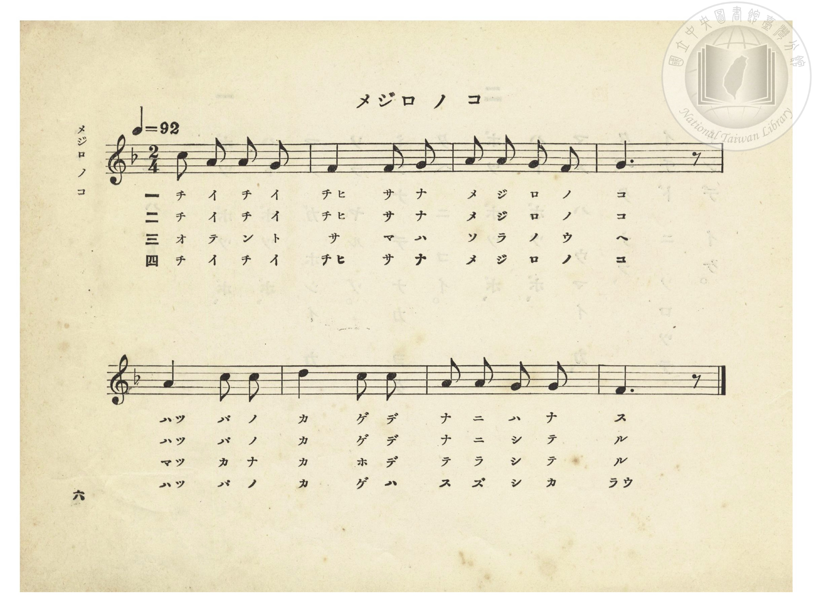
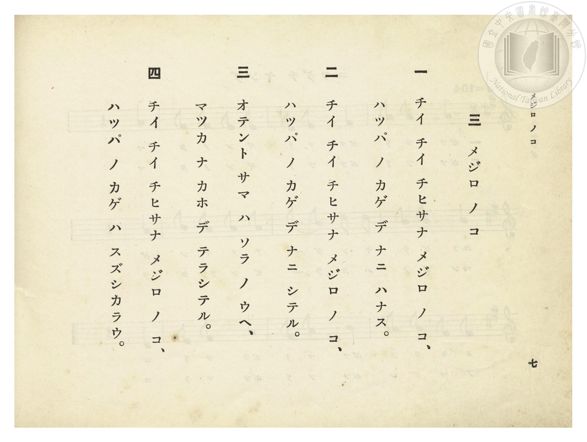

# メジロ ノ コ（綠繡眼之子）

> Re:Shōka 使用 AI 協助辨識與重建樂譜，可能會有錯誤。歡迎回報。

- **NEUTRINO 歌聲合成版**：<br><audio controls src="mejiro_no_ko_neutrino.mp3"></audio>
- **鋼琴伴奏版**：<br><audio controls src="mejiro_no_ko.mp3"></audio>


- 岡田與志松 作詞（懸賞募集入選原題〈木蔭の子目白〉）
- 臺灣總督府《公學校唱歌》第一學年用（昭和九年三月第一版、昭和十一年二月第四版，索書號 0729 73）

## 說明


- 出處：臺灣總督府編《公學校唱歌》第一學年用，第三課〈メジロ ノ コ〉（綠繡眼之子），原書第 6–7 頁（掃描檔 P010.jpg–P011.jpg）。
- 調性與拍號：ヘ長調（F 大調五聲音階），2/4 拍，速度 != 92。
- 背景與曲風：描寫臺灣庭園與樹叢間常見的小巧綠繡眼（メジロ）幼鳥，在烈日當空時躲在涼爽綠葉蔭下啾啾鳴叫的可愛模樣。全曲共 8 小節、四節歌詞，旋律輕巧溫馨。


## 歌詞

```text
一　チイ チイ チヒサナ メジロ ノ コ、
ハッパ ノ カゲ デ ナニ ハナス。

二　チイ チイ チヒサナ メジロ ノ コ、
ハッパ ノ カゲ デ ナニ シテル。

三　オテント サマ ハ ソラ ノ ウヘ、
マッカ ナ カホ デ テラシテル。

四　チイ チイ チヒサナ メジロ ノ コ、
ハッパ ノ カゲ ハ スズシカラウ。
```

## ABC

```abc
X:1
T:メジロ ノ コ（綠繡眼之子）
M:2/4
L:1/16
Q:1/4=92
K:F
V:V1 name="Piano" snm="Pia"
[V:V1]
c2 A2 A2 G2 | F4 G2 G2 | A2 A2 G2 F2 | G6 z2 |
w: 1.~チ イ チ イ | チヒ サ ナ | メ ジ ロ ノ | コ
w: 2.~チ イ チ イ | チヒ サ ナ | メ ジ ロ ノ | コ
w: 3.~オ テ ン ト | サ マ ハ | ソ ラ ノ ウ | ヘ
w: 4.~チ イ チ イ | チヒ サ ナ | メ ジ ロ ノ | コ
A4 c2 c2 | d4 c2 c2 | A2 A2 G2 G2 | F6 z2 |
w: 1.~ハッ パ ノ | カ ゲ デ | ナ ニ ハ ナ | ス
w: 2.~ハッ パ ノ | カ ゲ デ | ナ ニ シ テ | ル
w: 3.~マッ カ ナ | カ ホ デ | テ ラ シ テ | ル
w: 4.~ハッ パ ノ | カ ゲ ハ | ス ズ シ カ | ラウ
```

## TMD 檔案連結

- [主旋律 TMD 檔案](mejiro_no_ko.tmd) [[在 TMD Studio 編輯](https://tmdlang.github.io/Tmd-TS/#tmd=s7IKdvYPcrWy4qpTUCpJTLdSSM7PyUlNLsnMz7PKzk9PzM7Ojy_OyM9OVIKrKMvPKc1NtUovSkxJjTdEiBfnlxYlp1oVJ2fk5-fEl6RWlCTl52ejy8cXJKanWgUYGBogZAqK8stS8xLzgLoLijLzSlJTwNoRClLLMlNSQdLFyYl58WWpRZlpmakpSE5KLSoGuRhqRUlRYl5xclFmAcgbCFX5RSUZ-UBnF2RUWmVkFpfkF2UmJ-bEZyfmIfmuJCMV6LnEvMzcxBwlLi0thcfNCx837XjcvBbI6lN43LT5_Z6O59sWPN-58PmcPU92dj9dO-H9nk4FLS0uRVsFSyMue1sFNy4bI30TO5CZTzctfD5lw4uO9qf7pz-bu0_hyd45L1bOAxrxrH3Hi83znnbPfzm77Wnr0peNO572zX-5sOdxQ8ezOSteTFn7uHEd0Ojns9c9n7n3cUMn0A6wI1-073reuPj5jr3P5y5-umvO44aup61rnq7d8WzBwqdTNj5bCzSg-_maNU92NAAFn-7c8nzKCpBtM9Y-ndTzZOdcoMiTHZ3P5nRA1Dzv7Hjc0AiRfdrbCNIFVLCrB6Lg6ezZQAXv9_Q837Lo2ewdL2bOVzAwN7JUMDcGu4ZLX0vBllqAS0FB4XHDhGezNwG9_GLVqmcz-h43TASLNu9-2r7rxcyp7_fMQvP98-0riAuAHrBI54tVm4DhixGj4ODFEqlAfcBIAfocqFvB7FHDZHOFlwsaQcHZ1_ysv__ZqikKoISsl1WQDpQEMg1BTKDGxw1NUJe_WLX_WcNyYPw_6-4Fhh_QC4-bZ7ycuh0oDjTHTeHpkuVA5pNdU140bno5f_PLWX0Qe4HpRwGoBch62TD_6a5lCuDEhWRuc8-zmetB5s7e9HIR0IezgA56un41JICe7lr7dM4kkOyKnU_7F72cNvnpjh0vlnU_n9XydEP_0-3L4X4FOgIeHECbn-7c83LzUpC_56x43tzxbPrS51O3PV-569nMphe7NgEFn23b87xjL1D7i4mdwET6ZEf306n7gOjl5i1P-1eDzO9f_6xl9rMVC5-tWAx07tPWFUAXPm3dqGChALT6-foGYHoDpav1DcCoAmeFnmfTu5_u636xZyrQYc92rX65DBipTVzQBAGJAIhakGHT2oHeerJjLYixat6LteuBqQToiacbep-1d4KiAxoH0JhTKNBTMAd6DGwcME08bmh43Nz4uGkJMBDhVPOkx01bHzd3YeZ1oGMhAd7_uLn5cfNEqPjqx02bgMx2IO563NwNke963LQTGkFAB0EcB4wXSPiAfA0M-Q39L2ftBoYSPPyBof10_TYgAroYGsIrdiLCFlgSrFr1ZNfsJ7sbXu7a82LlxqcTF73fA0xGUA_tAqZ2mnioafvj5rbHzaup76GnjbPgHnqyqxvNQzuAeafhcdMqsO2bHzd3AJ0C9Mk8kIuBzL2Pm1dCnbwMmJHgvpkH8k3TapDzwb5png31DdCUlXg9s2TVy5l7QSVI65qXq2c865sNcuKSlcA0_2RHF7joa33ZMAuIgJ580d75ct-EZ2sXP29d_qKh4cXE6cDs-3TOBqC5MA8AkzZVYwTk6Z2Pm3aB_ADyF9AzyyiKE0hsAGVBDHCcgErKdbOe7usA5u2n-1c_nbAc6h-gHZSX61CgoKXPxeWbmpVZlO-X751vFZCZmJfvUGNQUw2yRsHGQssOzMBWpShAivMXC3sUNEygpYgOvOTVxKIBaBnIsBoFUwVjIDQCsgwVdIE0iAURMQSyjIBiugoGCjVg1T6GNaCoAgY4OMrANFgEGHlAZcD4AycvkNBCIG8HkIZEIlCkaTOqUUbUM8oYJLYKlJSBeDMQd4BVbQWZA80XIP5eIAueNcAmz0A1x4QqTsIfSbt6yIkkY6DZpkBYo2AGZ0EiCRZx6JEEyipg_0NyC8iJq8GegBRiICWgnAYumGHeatqJJYqIN6hpOzgKQCIgFWgRBC6AwBohZRDcIGhBBFICij9gDOE2CBxDeF0EieqdQLwLYhBQDqQJVCrAzarl4tK1U0DkNQUgT5kLAA)]
- [鋼琴伴奏 TMD 檔案](mejiro_no_ko_piano.tmd) [[在 TMD Studio 編輯](https://tmdlang.github.io/Tmd-TS/#tmd=s7IKdvYPcrWy4tLSUnjcvPBx047HzWuBrD6Fx02b3-_peL5twfOdC5_P2fNkZ_fTtRMeN-9-2b3n-YQtT_Zsebq0_3lnx_s9nQpaWlyKtgqWRlz2tgpuXDZG-iZ2XHUKSi_adz1vXPx8x97ncxc_3TXncUPX09Y1T9fueLZg4dMpG5-t7Xnc0P18zZonOxqAgk93bnk-ZQXQxmcz1j6d1PNk51ygyJMdnc_mdEDUAO163NAIkX3a2wjSBVSwqwei4Ons2WDH9DzfsujZ7B0vZs5XMDA3slQwNwY6UImLyzOvpCjfKiAzMS8_yMOhxqCmmksBCGwstOzAjBoFYwVdBVMgrFEwg7OMgdAICGsUDIFiugoGCjVctSiG-SAbZgI3zDBeIdowFsgwgTFAIqbxUBbUHN_UrMyifL98b3wu09dSsEUHCpAgebGwR0HDROHphv7n6xt0FAIMDA30sgrSNbFo0NKHuswU6imIlyCeg4gYAllGcG-CVPsY1gCTQiMwKSyB02CRx82TgMoeN20FcrrAQguBvB1AGpJ2gCJNm1GNMqKeUcYgsVVA2TYg3gzEHWBVW0HmNM8D4n4wfy-QtRKalJeBTZ6Bao4JVZyEP5J29ZATScSmRUQk9T9ubgb7fyLciavBntgE5LeDPdEFxN3g0IF6q2knligi3qCm7eAoAImAVKBFUPM8qEFA7TD7wAY1z4YbBIo_YAzhNggcQ3hdBInqnUC8C2IQUA6kaSUozpGyLHpWI5RvUbIrRMg0HpJxScnhunYK4MJCAchAOCHaB6gBTcQIQ8QYQ8QELKLMBQA)]

## 分析

```text
================================================================================
📊 TMD Song Profile: [ メジロ ノ コ（綠繡眼之子） ]
================================================================================
⏱  Duration:       0:10 (10.4s), 8 measures total
🎼 Key & Tempo:    首調基準 F, != 92.0 BPM, <2/4>
   - 分析範圍：      由實際發聲的音符與和弦推測調性；播放脈絡另行呈現
🎤 人聲音域:    F4 (MIDI 65) – D5 (MIDI 74) [跨度: 9 個半音 / 0.8 個八度, 難度: easy]
   - 最低音:  F4 in [MejiroNoKo #1 @ m.2, 0:01]
   - 最高音: D5 in [MejiroNoKo #1 @ m.6, 0:06]
   - 適合: soprano, mezzo-soprano, contralto, tenor, baritone, bass
🏛  結構:      MejiroNoKo (10.4s)
⚡ 編曲密度:        Peak 1 軌道同時演奏
🗝  調性診斷：       C 調性不明確（純淨自然大調，未偵測到可信轉調）
   - 風格氣質:    純淨自然大調（陽光明朗、易唱易記，無明顯調外色彩）
   - 轉調歷程:    全曲維持單一推測調性（未偵測到可信轉調）
   - 核心骨幹音:  G, A, F, C, D
   - 調性數值:    C 調性不明確 [相關度: 0.68, 穩定度: Ambiguous, 自然音純度: 100.0%]
   - 候選調性 (K-S): C 大調 (0.68), F 大調 (0.65), A 小調 (0.59)
   - 五度圈歷程:   +0
   - 各段落調性細節:
     • [MejiroNoKo #1]: C 調性不明確 (r: 0.68, 自然音純度: 100.0%)

  [ 五度圈游移軌跡 ]
              [C ]*
         F            G  
      Bb               D  
      Eb               A  
         Ab           E  
            Db       B  
               F# 
     (* = active key center)

  [ 十二半音累積音高分佈 ]
     C  : █████████████             16.7%
     C# :                            0.0%
     D  : █████                      6.7%
     D# :                            0.0%
     E  :                            0.0%
     F  : ████████████████          20.0%
     F# :                            0.0%
     G  : ████████████████████████  30.0%
     G# :                            0.0%
     A  : █████████████████████     26.7%
     A# :                            0.0%
     B  :                            0.0%
--------------------------------------------------------------------------------
Assignment 軌道音域：
  - Piano         : F4 – D5 (9 個半音 / 0.8 個八度, 23 個音符)
================================================================================
```


## 原書掃描頁






