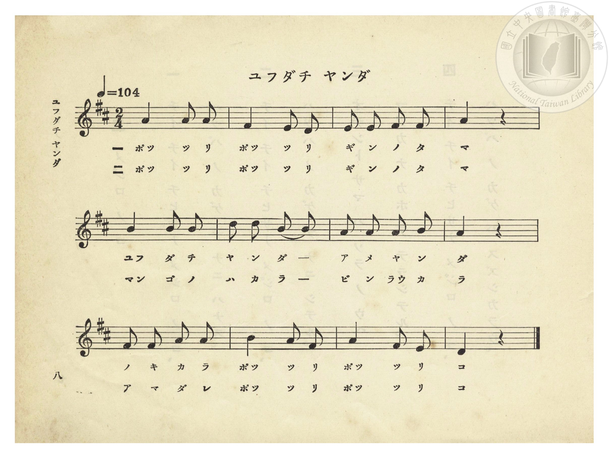
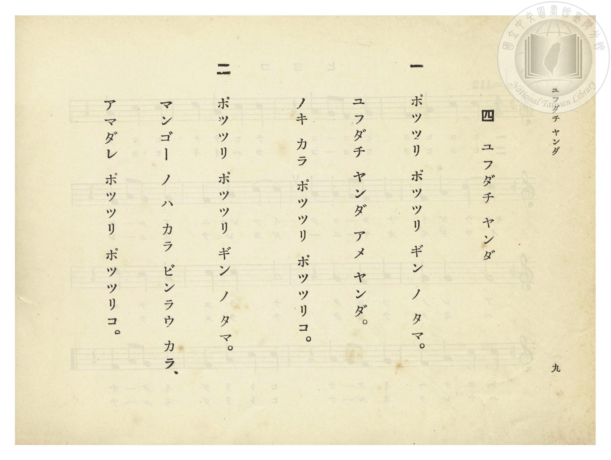

# ユフダチ ヤンダ（西北雨停了）

> Re:Shōka 使用 AI 協助辨識與重建樂譜，可能會有錯誤。歡迎回報。

<audio controls src="yudachi_yanda.mp3"></audio>

- 增本光春 作詞（臺南師範學校學寮・懸賞募集入選）
- 臺灣總督府《公學校唱歌》第一學年用（昭和九年三月第一版、昭和十一年二月第四版，索書號 0729 73）

## 說明

【曲目說明】
・出處：臺灣總督府編《公學校唱歌》第一學年用，第四課〈ユフダチ ヤンダ〉（西北雨停了），原書第 8–9 頁（掃描檔 P012.jpg–P013.jpg）。
・調性與拍號：ニ長調（D 大調五聲音階），2/4 拍，速度 != 104。
・背景與曲風：臺灣總督府專為臺灣公學校低學年編纂之**臺灣鄉土特色童謠**。描寫夏日午後陣雨（西北雨／夕立）剛停，屋簷與庭院裡的**芒果樹葉（マンゴー ノ ハ）**、**檳榔樹葉（ビンラウ）**上，雨滴如銀色珠玉般「ポッツリ、ポッツリ」滴落的南國雨後景致。

## 歌詞

```text
一　ポッツリ ポッツリ ギン ノ タマ。
ユフダチ ヤンダ アメ ヤンダ。
ノキ カラ ポッツリ ポッツリコ。

二　ポッツリ ポッツリ ギン ノ タマ。
マンゴー ノ ハ カラ ビンラウ カラ、
アマダレ ポッツリ ポッツリコ。
```

## ABC

```abc
X:1
T:ユフダチ ヤンダ（西北雨停了）
M:2/4
L:1/16
Q:1/4=104
K:D
V:V1 name="Piano" snm="Pia"
[V:V1]
F4 F2 F2 | E4 E2 D2 | E2 E2 E2 E2 | F4 z4 |
w: 1.~ポッ ツ リ | ポッ ツ リ | ギ ン ノ タ | マ
w: 2.~ポッ ツ リ | ポッ ツ リ | ギ ン ノ タ | マ
A4 A2 A2 | B2 B2 A4 | F2 F2 F2 A2 | F4 z4 |
w: 1.~ユフ ダ チ | ヤ ン ダ | ア メ ヤ ン | ダ
w: 2.~マン ゴ ノ | ハ カ ラ | ビ ン ラウ カ | ラ
F2 F2 A2 A2 | B4 A2 F2 | A4 F2 E2 | D4 z4 |
w: 1.~ノ キ カ ラ | ポッ ツ リ | ポッ ツ リ | コ
w: 2.~ア マ ダ レ | ポッ ツ リ | ポッ ツ リ | コ
```

## TMD 檔案連結

- [主旋律 TMD 檔案](yudachi_yanda.tmd) [[在 TMD Studio 編輯](https://tmdlang.github.io/Tmd-TS/#tmd=s7IKdvYPcrWy4qpTUCpJTLdSSM7PyUlNLsnMz7PKzk9PzM7Ojy_OyM9OVIKrKMvPKc1NtUovSkxJjTdEiBfnlxYlp1oVJ2fk5-fEl6RWlCTl52ejy8cXJKanWgUYGBohZAqK8stS8xLzgLoLijLzSlJTwNoRClLLMlNSQdLFyYl58WWpRZlpmakpSE5KLSoGuRhqRUlRYl5xclFmAcgbCFX5RSUZ-UBnF2RUWmVkFpfkF2UmJ-bEZyfmIfmuJCMV6Lm8xJLSolQlLi0thcfNyx43T33c3PC4uRHIWfK4eTOQ835Px4ul-5_2TH85e8XTxjlPdrW939OpoKXFpWirYGhgwmVvq-DCZWOkb2IHMvnponnP5qx52tr5bMZShSd757xYOQ9kQPuup73Tn-5Y_Xx9y9O1O54tWAgkn65f97h597P2HS82z3vaPf_l7LanrUtfNu4AGg92JFDT88bFz3fsfT538dNdcx43dD1tXQPVPWXjs7U9jxu6n69Z82RHA8iwnVueT1kBtOrZjLVPJ_U82TkXKPJkR-ezOR0QNc87Ox43NEJkn_Y2gnQBFezqgSh4Ons2UMH7PT3Ptyx6NnvHi5nzFQzMjSwVzI3BruHS11KwpRbgUlBQeNww4dnsTc9nr3uxatWzGX2PGyaCRZt3P23f9WLm1Pd7ZqH5_vn2FcQFQA_ENy9WbXrc0IE9Rh83dGKNVKDmp33zgd4HGqFg8ahhsqXCywWNoDDta37W3_9s1RQFUGrWyypIB0oCmcYgJlDj44YmqPNfrNr_rGH5i472Z929wEAE-uNxc_fLqduB4kBzXBSeLlkOZD7ZNeVF46aX8ze_nNUHsReYfBSAWoCslw3zn-5apgBJXEgGN_c8m7keZPDsTS8XAf2JHkBPN3Q8b9oFEYQH05O9fdCg2b7i-a6mJzu7tbQgSl62dD6dM_95584XnZuer176Ys0CLS2gbUBvPl2_-umS_mfTlz7t7Xi6r-flzMXAMEIOr_d7-p8umfp8dTfQ6U87ZwODDxRwG7ufb9gOdN_TXWtfzlz0YvHC57NagJZ1TXo2b86zFTtfTASF-ePmeaAoaNryuHkP0Fd9QNwPNAVkdaOW1rNVm58tm4KkeDI4vlY-bloGVvRkRxcogGaveLZ7y9NlTS-7GkCO71_wvK_zRceaxw09j5vnPm5uftzc8rh5FdBEVG4vUNeLCXuBzgJlxTndoJjfBw7U9i2gcIYmS0gKACYuYM592rri2bR2oKee7FgLYqya92LtemBaBTru6YbeZ-2doPQATQTQpKNQoKdgCXQt2DhgynzcAEx7CGcAPYzMaQKWAJshAdG0HxQ4sPjGlmyBahY9bl6InI6hqvseN60Fyq4GhhWaBcgh0LQZqgEUmWCvAFMRMFCer50CKhnADJA_mvuhITurBRi4T9dOAGpDTguw_AKKCQgbpGDfPEgSeLKjG-htoGmgSJqzARLoIMF9IGXwkNkFzLxkhQxmAkL4HJFeoGJAf4F1gQIOqBFo4RpaBdC-echpHZhUgVqAgvA0jZx4CQQQ0AWUl7JQoKClz8UVWZqSmJyRGZmYl5JoFZCZmJfvUGNQUw2ySMHGQssOzMBWxCtAitcXC3sUNEwUnm7of76-QQdeCGpi0QC0DmRYjYKxgi4QGwNZRkCWkYIhmAWBEFkDIK4Bq_YxrIHGBFAIGBlAvAqoCJtQ0zogC54wwIrmoZplRB2z8IfJrh5ywsQUaLIpENYomAEhiAcKCRAEiWELE1A5AHY0MPcDywKQ0BKooxvA2oFJG8gGFwpgcZAKkAx6gICyDcigpi1g_4KEwBkHSK-EGNQ8GWowLP-ABUGSxATIjk7yEgnI65AAAQUNKLmAgsUYnEgMsQQIKKrAZR3YbcRHNcjzaGECDrl50LBdQ5ZZtVxcunYKyNlLAchX5gIA)]
- [鋼琴伴奏 TMD 檔案](yudachi_yanda_piano.tmd) [[在 TMD Studio 編輯](https://tmdlang.github.io/Tmd-TS/#tmd=s7IKdvYPcrWy4tLSUnjcvOxx89THzQ2PmxuBnCWPmzcDOe_3dLxYuv9pz_SXs1c8bZzzZFfb4-bdL7v3PJ-w5cmeLU-X9j_v7Hi_p1NBS4tL0VbB0MCEy95WwYXLxkjfxI6rTkHpRfuu542Ln-_Y-3zu4qe75jxu6Hrauubp2h3PFix8OmXjs7U9jxu6n69Z82RHA1Dw6c4tz6esAFr5bMbap5N6nuycCxR5sqPz2ZwOiBqgZY8bGiGyT3sbQbqACnb1QBQ8nT0b7Jqe51sWPZu948XM-QoG5kaWCubGQBcqcXF55pUU5VsFZCbm5Qd5ONQY1FRzKQCBjYWWHZhRo2AMhKZAWKNgpqALpI2BLFMgy1jBCMgyBLIMgLiGqxbFMB9kw0zghhnGK0QbxgIZJjCGaTyQZRoPYgIlDSAGRZamJCZnZEYm5qUk4nGcvpaCLTpQgITKi4U9ChomCk839D9f36CjEGBgaKSXVZCuiUWDlj7cpyBfgfxnBGQZAf0GYkEgRBbiU5BqH8MaYIKY-7i5GSj0uLkFiFcBFWETaloHZG0G4j4gez9Y0TxUs4yoYxb-MNnVQ06YgGIaFvtmYB4kRYDSBPYwAeUYsKMbgLgR7MQlUEc3gLU_bloEZC-Ei4NUgGTQA2QeSBJoUNMWsH9BQv1A3mogvRJiUPNkqMErHzctA0uBBEGSxATIjk7yEglx2QERIKCoWgt3OPFRDfI8WpiAQ24eNGzXkGUW1txFKLciZVLM_IorZ8NFCKjDWgLo2imASxMFIAPZvdE-QD0YYkZgMWUuAA)]

## 分析

```text
================================================================================
📊 TMD Song Profile: [ ユフダチ ヤンダ（西北雨停了） ]
================================================================================
⏱  Duration:       0:13 (13.8s), 12 measures total
🎼 Key & Tempo:    首調基準 D, != 104.0 BPM, <2/4>
   - 分析範圍：      由實際發聲的音符與和弦推測調性；播放脈絡另行呈現
🎤 人聲音域:    D4 (MIDI 62) – B4 (MIDI 71) [跨度: 9 個半音 / 0.8 個八度, 難度: easy]
   - 最低音:  D4 in [YudachiYanda #1 @ m.2, 0:02]
   - 最高音: B4 in [YudachiYanda #1 @ m.6, 0:05]
   - 適合: soprano, mezzo-soprano, contralto, tenor, baritone, bass
🏛  結構:      YudachiYanda (13.8s)
⚡ 編曲密度:        Peak 1 軌道同時演奏
🗝  調性診斷：       F# 小調（純淨自然小調，未偵測到可信轉調）
   - 風格氣質:    純淨自然小調（陰鬱抒情、旋律集中，無明顯調外色彩）
   - 轉調歷程:    全曲維持單一推測調性（未偵測到可信轉調）
   - 核心骨幹音:  F#, A, E, B, D
   - 調性數值:    F# 小調 [相關度: 0.80, 穩定度: Moderate, 自然音純度: 100.0%]
   - 候選調性 (K-S): F# 小調 (0.80), A 大調 (0.68), D 大調 (0.56)
   - 五度圈歷程:   +6
   - 各段落調性細節:
     • [YudachiYanda #1]: F# 小調 (r: 0.80, 自然音純度: 100.0%)

  [ 五度圈游移軌跡 ]
               C  
         F            G  
      Bb               D  
      Eb               A  
         Ab           E  
            Db       B  
              [F#]*
     (* = active key center)

  [ 十二半音累積音高分佈 ]
     C  :                            0.0%
     C# :                            0.0%
     D  : █████                      7.1%
     D# :                            0.0%
     E  : █████████████             19.0%
     F  :                            0.0%
     F# : ████████████████████████  35.7%
     G  :                            0.0%
     G# :                            0.0%
     A  : ███████████████████       28.6%
     A# :                            0.0%
     B  : ██████                     9.5%
--------------------------------------------------------------------------------
Assignment 軌道音域：
  - Piano         : D4 – B4 (9 個半音 / 0.8 個八度, 33 個音符)
================================================================================
```


## 原書掃描頁






