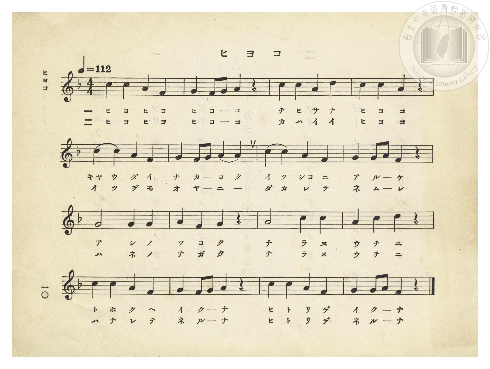
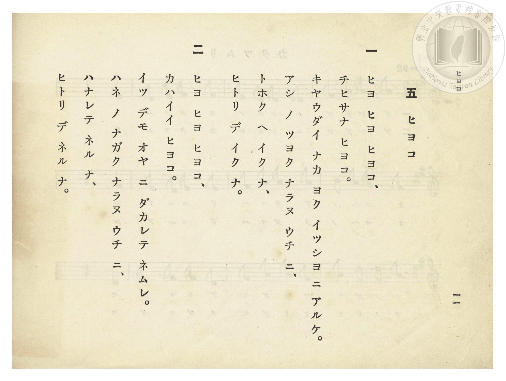

# ヒヨコ（小雞）

> Re:Shōka 使用 AI 協助辨識與重建樂譜，可能會有錯誤。歡迎回報。

- **鋼琴伴奏版**：<br><audio controls src="hiyoko.mp3"></audio>
- **NEUTRINO 歌聲合成版**：<br><audio controls src="hiyoko_neutrino.mp3"></audio>

- 詞：文部省
- 曲：文部省
- 臺灣總督府《公學校唱歌》第一學年用（昭和九年三月第一版、昭和十一年二月第四版，索書號 0729 73）

## 說明


- 出處：臺灣總督府編《公學校唱歌》第一學年用，第五課〈ヒヨコ〉（小雞），原書第 10–11 頁（掃描檔 P014.jpg–P015.jpg）。
- 調性與拍號：ヘ長調（F 大調），4/4 拍，速度 != 112。
- 背景與曲風：與《新定兒童唱歌》第一學年用第一學期第三首〈ヒヨコ〉同曲同詞。描寫小雞吱吱叫、兄弟相親相愛一起走路，並叮嚀小雞在腳還沒長強壯、翅膀還沒長長之前，不要獨自走遠或離開母雞睡覺。


## 歌詞

```text
一　ヒヨ ヒヨ ヒヨコ、
チヒサナ ヒヨコ。
キヤウダイ ナカ ヨク イッシヨ ニ アルケ。
アシ ノ ツヨク ナラヌ ウチ ニ、
トホク ヘ イク ナ、
ヒトリ デ イク ナ。

二　ヒヨ ヒヨ ヒヨコ、
カハイイ ヒヨコ。
イツ デモ オヤ ニ ダカレテ ネムレ。
ハネ ノ ナガク ナラヌ ウチ ニ、
ハナレテ ネル ナ、
ヒトリ デ ネル ナ。
```

## ABC

<div class="abc-score" data-abc-src="hiyoko.abc" aria-label="五線譜載入中"></div>

[下載 ABC 原始檔](hiyoko.abc)

## TMD 檔案連結

- [主旋律 TMD 檔案](hiyoko.tmd) [[在 TMD Studio 編輯](https://tmdlang.github.io/Tmd-TS/#tmd=s7IKdvYPcrWy4qpTUCpJTLdSSM7PyUlNLsnMz7PKzk9PzM7Ojy_OyM9OVIKrKMvPKc1NtUovSkxJjTdEiBfnlxYlp1oVJ2fk5-fEl6RWlCTl52ejy8cXJKanWgUYGJogZAqK8stS8xLzgLoLijLzSlJTwNoRClLLMlNSQdLFyYl58WWpRZlpmakpSE5KLSoGuRhqRUlRYl5xclFmAcgbCFX5RSUZ-UBnF2RUWmVkFpfkF2UmJ-bEZyfmIfmuJCMV6LnEvMzcxBxkrZnpmXlWufl5SaXA4FDi0tJSeNw86XHzisdNm9_v6Xi6of_l7Hnv93QqaGlxKdoqGBoacdnbKrhx2Zjom9iBjHmxEig969m09pfNK57PaQQb_Wz2JgyxF-27njcufr5j7_O5i5_umvO4oetp65qna3c8W7Dw6ZSNz9b2PG7ofr5mzZMdDUDBpzu3PJ-yAmj_sxlrn07qebJzLlDkyY7OZ3M6IGqed3Y8bmiEyD7tbQTpAirY1QNR8HT2bKCC93t6nm9Z9Gz2jhcz5ysYmBtZKpgbA32ixMWlr6VgSy3ApaCg8LhhAtDLz2eve7Fq1bMZfY8bJoJFm3c_bd_1YuZUYFig-f759hXEBUAPSGTXlBerNj1u6IBHzOOGTuS4ASp72jcf6FGgYgVDg0cNkw0NFV4uaASFX1_zs_7-Z6umKIBSpl5WQTpQFsg0BTGBWh83NEGd-mLV_mcNy190tD_r7gUGGNDNj5tnvJy6HSgONMdN4emS5WAmyDZg3CsAlQFZLxvmP921TAGSMpAMa-55NnM9yLDZm14uAvpjFpAN9PGzaRuerpv1tHXS89VLcXkazn02Zz6Y3fly2TQ03z-d0AM0GUgCUx_QVqAXn65fDQmPpxM2glD_amD6eNra8nTP_OfAFLBsFZB81jIbaPKLrdtfbN3wYvt6oPOf7Fj2tH_d01kNUL1zVrxo3fyyqeXZpklArz_ds_3p4vVAc57vb33R1gAXB6InO7ufdoIC4MmO3hfLGp_3rnjRvgpo7MvGBc86pr2cvejltO5n63uBZj6fu_DFsl2goIGmFEhUAb0OdPvT1hXAXAIMmyc71oIYq-a9WAu0cCI4dnuftXeCog0aV9A4VijQA4Y1MB7A5gH987ihARI00IyLyL9Al0PioxEk1LT1cXMXsiQksprWPm5e8rhp2ePmhsdNS4DyXY-bVgMpoJr1QNklj5ubHzdth5jbDRRY9Lh59eOmjXDti4CyQKk-IG6B6QKa0bzycXMPUBpobiNIJ9wtwHicDVE0A2w8VD1MGug6oIpVQFY7ijTYNmCwQIIImKCeTt0HQtA80ANkANHzWS0QEaAGSOQ_bZgIih9sSQCkZs6Kl7NnosT5vumQaEeLYaD6px3g6J2282nfboR4-6qn2zc-nbYOmASA4kAz4VGzC5i4CUVN0-rHzf1gf4KCHj1qgIHfAgqJx82LgLxVwIiCRAIoqoAa1zxubgNyeh83LwBxYLmvHygEjRFgXK4hGCNA9UBZhGGg2McRIUjSBCOkfz0wsJEj5OWsFc9mNr1s3gsMtif75j5t7AMGPySTPGvf_mLxQnhWAYoTzHJoeQxrhADFoRECdCvlRT0UKGjpc3F5ZFbmZ-dbBWQm5uU71BjUVIOsULCx0LIDM7DVMAqQku3Fwh4FDRMFUGpd36ADL5c1sWgAWgQyrEbBVEEXjI2B2BCIaxSMwCwjsIgBWARZjRmGCFgN2DQfwxpQtAL5oBQJIhFsNJmmzUAyHireiFDbtBXM7sKnA2KXEVl2AQsgkHg_WHwJnMRtF_4w39VD_TAHYXxqQDy0MAeVtIvBDl8G9kQDisdAgQnzOMR766GBAQ6A5mawGLAgXg7mdkMlF4F5YG1NGzHDHqq5BUy2g0mQDpDMKjAPIg8yDQRBDoE4C-KQNWCyDSrTC-YtgMsQE_Y7OskJe1AogiCIBuEaeAiDeJD0DhIBQVgcQERALFDqRw97kK9BEFRbgdzfB_UTJGQQAQ5L7aDoAKtvXgkme6ChBok6SF4AhRp6WgelWYg-SGjB7IFELzg8KbAHb1gDW730KFsIpvPmDrCrZ8P9CqrqkZIyVAzkc1goQHI1RB8kXYLSKk4daOENDV2sqRWSjomyC7sOrlouLl07BUh5rwBkKXMBAA)]
- [鋼琴伴奏 TMD 檔案](hiyoko_piano.tmd) [[在 TMD Studio 編輯](https://tmdlang.github.io/Tmd-TS/#tmd=s7IKdvYPcrWy4tLSUnjcPOlx84rHTZvf7-l4uqH_5ex5j5t3v-ze83zClid7tjxd2v-8s-P9nk4FLS0uRVsFQ0MjLntbBTcuGxN9EzuuOgWlFyvnvd8z69m09pfNK57PaVQCiT2bvQlD7EX7rueNi5_v2Pt87uKnu-Y8buh62rrm6dodzxYsfDpl47O1PY8bup-vWfNkRwNQ8OnOLc-nrAC66NmMtU8n9TzZORco8mRH57M5HRA1QEc9bmiEyD7tbQTpAirY1QNR8HT2bLCre55vWfRs9o4XM-crGJgbWSqYGwN9osTF5ZFZmZ-dbxWQmZiXH-ThUGNQU82lAAQ2Flp2YIa-loItOlCA2PxiYY-ChokCMKier2_QUQgwMDTRyypI18SiQUsfbFiNgqmCLhgbA7EhENcoGIFZRmARA7AIshozDBGwGrBpPoY1oDgD8oHRBiYRbDSZps1AMh4q3ohQ27QVzO7CpwNilxFZdjWtBov3g8WXwEncduEP81091A9zEManBsRDC_OmtY-bF4MdvgzsiQYUj4ECE-ZxiPfWQwMDHADNzWCx7Y-bl4O53VDJRWAeWFvTRsywh2puAZPtYBKkAySzCsyDyINMA0GQQyDOgjhkDZhsg8r0gnkL4DLEhP2OTnLCHhSKIAiiQbgGHsIgHiS9g0RAEBYHEBEQC5T60cMe5GsQBAYh2P19UD9BQgYR4LDUDooOsPrmlWCyBxpqkKiD5AVQqKGndVCaheiDhBbMHkj0gsOTAnvwhjWw0KJH2UIwnTd3gF09G-7Xx80zoL6C5GWIGMjnsFCA5GqIPki6BKVVnDrQwhsaulhTKyQdE2UXdh1ctajFvQ9ycW8CLe5rFAzjFaINY2EUMMTigSzTeLCIAULeBEiZgOQR6oGyRJgBESFgCyxGYaJwBlwnSATJOegGA51HnHOwmYHuGGDA6dopQMIu2geoBIlnBOYpcwEA)]

## 分析

```text
================================================================================
📊 TMD Song Profile: [ ヒヨコ（小雞） ]
================================================================================
⏱  Duration:       0:34 (34.3s), 16 measures total
🎼 Key & Tempo:    首調基準 F, != 112.0 BPM, <4/4>
   - 分析範圍：      由實際發聲的音符與和弦推測調性；播放脈絡另行呈現
🎤 人聲音域:    F4 (MIDI 65) – D5 (MIDI 74) [跨度: 9 個半音 / 0.8 個八度, 難度: easy]
   - 最低音:  F4 in [Hiyoko #1 @ m.1, 0:01]
   - 最高音: D5 in [Hiyoko #1 @ m.3, 0:05]
   - 適合: soprano, mezzo-soprano, contralto, tenor, baritone, bass
🏛  結構:      Hiyoko (34.3s)
⚡ 編曲密度:        Peak 1 軌道同時演奏
🗝  調性診斷：       C 大調（純淨自然大調，未偵測到可信轉調）
   - 風格氣質:    純淨自然大調（陽光明朗、易唱易記，無明顯調外色彩）
   - 轉調歷程:    全曲維持單一推測調性（未偵測到可信轉調）
   - 核心骨幹音:  C, A, G, F, D
   - 調性數值:    C 大調 [相關度: 0.80, 穩定度: Moderate, 自然音純度: 100.0%]
   - 候選調性 (K-S): C 大調 (0.80), F 大調 (0.74), A 小調 (0.72)
   - 五度圈歷程:   +0
   - 各段落調性細節:
     • [Hiyoko #1]: C 大調 (r: 0.80, 自然音純度: 100.0%)

  [ 五度圈游移軌跡 ]
              [C ]*
         F            G  
      Bb               D  
      Eb               A  
         Ab           E  
            Db       B  
               F# 
     (* = active key center)

  [ 十二半音累積音高分佈 ]
     C  : ████████████████████████  29.8%
     C# :                            0.0%
     D  : ███                        3.5%
     D# :                            0.0%
     E  :                            0.0%
     F  : ███████████████           18.4%
     F# :                            0.0%
     G  : ██████████████████        21.9%
     G# :                            0.0%
     A  : █████████████████████     26.3%
     A# :                            0.0%
     B  :                            0.0%
--------------------------------------------------------------------------------
Assignment 軌道音域：
  - Piano         : F4 – D5 (9 個半音 / 0.8 個八度, 60 個音符)
================================================================================
```


## 原書掃描頁






