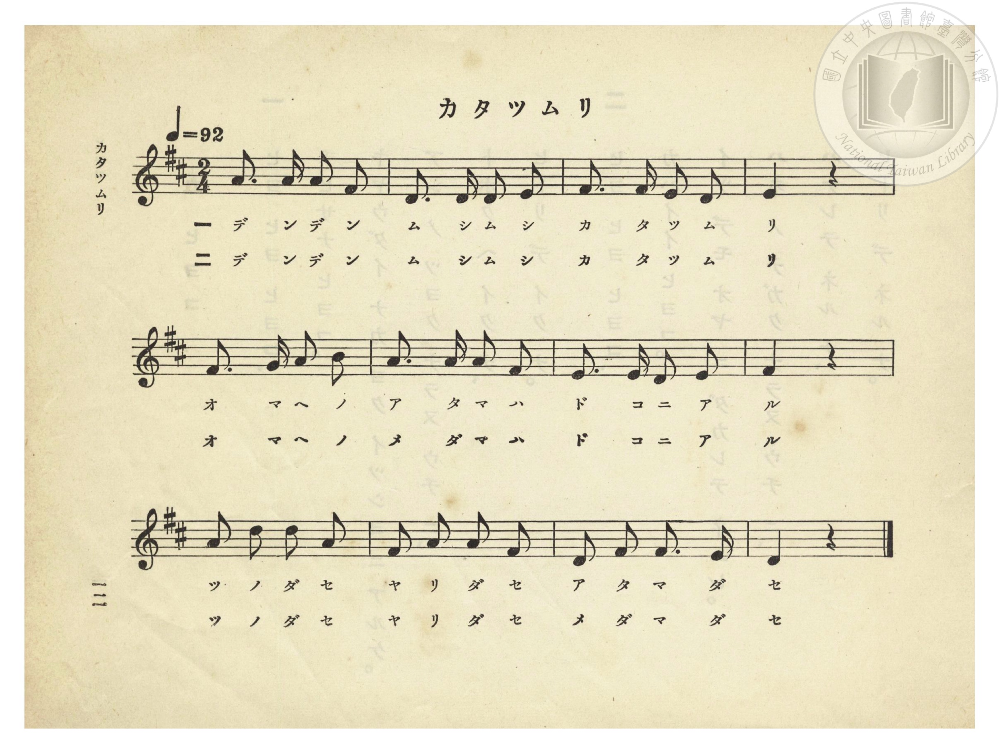
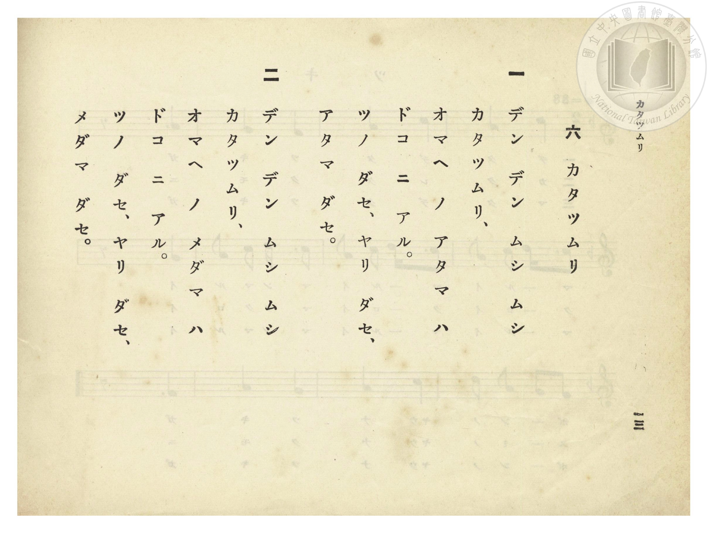

# カタツムリ（蝸牛）

> Re:Shōka 使用 AI 協助辨識與重建樂譜，可能會有錯誤。歡迎回報。

<audio controls src="katatsumuri.mp3"></audio>

- 詞：文部省《尋常小學唱歌》
- 曲：文部省《尋常小學唱歌》
- 臺灣總督府《公學校唱歌》第一學年用（昭和九年三月第一版、昭和十一年二月第四版，索書號 0729 73）

## 說明

【曲目說明】
・出處：臺灣總督府編《公學校唱歌》第一學年用，第六課〈カタツムリ〉（蝸牛），原書第 12–13 頁（掃描檔 P016.jpg–P017.jpg）。
・調性與拍號：ニ長調（D 大調），2/4 拍，速度 != 92。
・背景與曲風：原出自明治 44 年（1911）文部省《尋常小學唱歌（一）》〈かたつむり〉，亦收錄於《新定兒童唱歌》第一學年用第一學期第六首。以附點八分音符搭配十六分音符的輕快節奏，描寫孩童對著蝸牛呼喚「伸出觸角、伸出長槍、伸出頭與眼珠吧」的童趣場景。

## 歌詞

```text
一　デン デン ムシ ムシ
カタツムリ、
オマヘ ノ アタマ ハ
ドコ ニ アル。
ツノ ダセ、ヤリ ダセ、
アタマ ダセ。

二　デン デン ムシ ムシ
カタツムリ、
オマヘ ノ メダマ ハ
ドコ ニ アル。
ツノ ダセ、ヤリ ダセ、
メダマ ダセ。
```

## ABC

```abc
X:1
T:カタツムリ（蝸牛）
C:曲：文部省《尋常小學唱歌》
M:2/4
L:1/16
Q:1/4=92
K:D
V:V1 name="Piano" snm="Pia"
[V:V1]
A3 A A2 F2 | D3 D D2 E2 | F3 F E2 D2 | E4 z4 |
w: 1.~デ ン デ ン | ム シ ム シ | カ タ ツ ム | リ
w: 2.~デ ン デ ン | ム シ ム シ | カ タ ツ ム | リ
F3 G A2 B2 | A3 A A2 F2 | E3 E D2 E2 | F4 z4 |
w: 1.~オ マ ヘ ノ | ア タ マ ハ | ド コ ニ ア | ル
w: 2.~オ マ ヘ ノ | メ ダ マ ハ | ド コ ニ ア | ル
A2 d2 d2 A2 | F2 A2 A2 F2 | D2 F2 F3 E | D4 z4 |
w: 1.~ツ ノ ダ セ | ヤ リ ダ セ | ア タ マ ダ | セ
w: 2.~ツ ノ ダ セ | ヤ リ ダ セ | メ ダ マ ダ | セ
```

## TMD 檔案連結

- [主旋律 TMD 檔案](katatsumuri.tmd) [[在 TMD Studio 編輯](https://tmdlang.github.io/Tmd-TS/#tmd=s7IKdvYPcrWy4qpTUCpJTLdSSM7PyUlNLsnMz7PKzk9PzM7Ojy_OyM9OVIKrKMvPKc1NtUovSkxJjTdEiBfnlxYlp1oVJ2fk5-fEl6RWlCTl52ejy8cXJKanWgUYGJohZAqK8stS8xLzgLoLijLzSlJTwNoRClLLMlNSQdLFyYl58WWpRZlpmakpSE5KLSoGuRhqRUlRYl5xclFmAcgbCFX5RSUZ-UBnF2RUWmVkFpfkF2UmJ-bEZyfmIfmuJCMV6LnEvMzcxBwlLi0thcdNqx837X_c3PK4ecHj5lXv93S8mLvjeefs93s6FbS0uBRtFSyNuOxtFVy4bIz0TexABr1YOe_9nlnPprW_bF7xfE7j44aupxu6n-7Y8XRD_9O1O55O2fhsbc_jhm6wpc9mbyJa7Yv2Xc8bFz_fsff53MVPd80BqW1dA1T1bMFCuMLna9Y82dEA0rpzy_MpK4DOfTZj7dNJPU92zgWKPNnR-WxOB0TN886Oxw2NENmnvY0gXUAFu3ogCp7Ong1U8H5Pz_Mti57N3vFi5nwFA3MjSwVzY6DHlbi49LUUbKkFuBQUFB43TAAGxfPZ616sWvVsRt_jholg0ebdT9t3vZg5FRhGaL5_vn0FcQHQA_JN69oXqzY9buhAi83HDZ3IEQpU_LRvPtC7QC0KhkaPGiYbGiu8XNAICsW-5mf9_c9WTVEApV29rIJ0oCyQaQ5iArU-bmiCOvjFqv3PGpa_6Gh_1t0LDDagyx83d7-cuh0oDjTHReHpkuVgJsg2YIpRACoDsl42zH-6a5kCODkhmdXc82zmepBZsze9XAT0zCyg-0Ah0g4KpGebdiuYmCgAPQo02NDS0BBoKP6UBFQHDBywc7tBodHY_bhx_uPGJY-bGh43dYFDo-fJrmXPpmx72dPybNoeoCHPpm14um7W09ZJz1cvxRXIcO6zOfMhof1y2TSgL57sXvpyZsvL3fOetq5-2tH2cv7m52uWPZuw9mVrLzDFAZXBBZ_PanmxZ-rT_aufr294urQf6AxgaD9dv_rp2pUgezf0vpg4HRJNTyfueTpt1uOGnid7doBCYvmOF8snARMyhAsM52fLexHcBWuBgfd8zp7n_QueTlj-uKEXaBHQwBfbFj9dsAUYtKCghiY_SMwD_QfMvk9bVwADEqj1yY61IMaqeS_WAtVOBIYf0C3P2jtBqQAa9dAko1Cgp2AIyhxg84DB8bih4XFz--PmzcCIhFILHjdth1JgS9ETYyNEdNXj5nmPm2cAVfYBeYvAauYBef2QVNH5uAlkWDdYrnk1PLUAjQGqbwbG5G6gUY-blwDNRPAhRiMMgwiDtYKyANiHoFwGDuQX8zcBEVAXMPHAckfPk70LgKEHDNKnc1Y8nbzqxeKFTycuer9nPiwiJj3Z14YWEUARUFR2dQF1QcSBIuCIaIKH1C5ggqJKSDUvBPmKSiGFZBi5IQVNdqQHFkQjlvACuoDy0hYKFLT0ubi8E0sSS4pLc0uLMq0CMhPz8h1qDGqqQfYo2BiaadmBWdiKegVIln-xsEdBA1gCbegH5lsdeNGoiUUD0DqQYTUKpgq6QGgKpo2BuEbBECxiCKaNwCIgcZAsiAcSrQGzQNAASteATfMxrAGlGbAINP1AWSA9wMQCkYGkJSgLLNO0GiqzH5QcwHpA8iA9q7DbZEQPm_CH964ecsIbEpYm4PA2A9uMGQOQ0DXCiAGs4d0EcTckc8wAs_qgfl2E5Nd5YJl-qF87oTKQ_AhigdSCZCDhgzW8cdvUvBAq00CRTQTSdye56dswDkaAeJDQBLFQ0zyIBQlnI3guwJ7CIekG5HeQj0F-2g310xKwGCic0GTAvgbFBCT8YKEFkgGpwJXCybAJHBdQMYI21XJx6dopIJU7CkCuMhcA)]
- [鋼琴伴奏 TMD 檔案](katatsumuri_piano.tmd) [[在 TMD Studio 編輯](https://tmdlang.github.io/Tmd-TS/#tmd=s7IKdvYPcrWy4tLSUnjctPpx0_7HzS2Pmxc8bl71fk_Hi7k7nnfOfty8-2X3nucTtjzZs-Xp0v7nnR3v93QqaGlxKdoqWBpx2dsquHDZGOmb2HHVKSi9WDnv_Z5Zz6a1v2xe8XxO4-OGrqcbup_u2PF0Q__TtTueTtn4bG3P44ZuJZDaZ7M3Ea32Rfuu542Ln-_Y-3zu4qe75oDUtq4Bqnq2YCFc4fM1a57saABp3bnl-ZQVQA88m7H26aSeJzvnAkWe7Oh8NqcDogboh8cNjRDZp72NIF1ABbt6IAqezp4N9mTP8y2Lns3e8WLmfAUDcyNLBXNjoMeVuLi8E0sSS4pLc0uLMq0CMhPz8oM8HGoMaqq5FIDAxtBMyw7M0tdSsEUHChD7XyzsUdAwUQB69Pn6Bh2FAANDM72sgnRNLBq09MGG1SiYKugCoSmYNgbiGgVDsIghmDYCi4DEQbIgHki0BswCQQMoXQM2zcewRuFxcztY5HHzZigbxALpAcY_RKZpO5QNYoFlmlZDZfYDZVrAekDyID2rsNtkRA-b8If3rh5ywhsSlibg8DYD24wZA5DQNcKIAazh3QRx9-PmeUA8A8zqg_p1EZJf54Fl-qF-7YTKgEKuG8wCqQXJQMIHa3jjtql5IVSmgSKbCKTvTnLTt2EcjADxIKEJYqGmeRALEs5G8FyAPYVD0g3I7yAfg_y0G-qnJWAxUDihyYB9DYoJSPjBQgskA1KBK4WTYRM4LqBiBG2qxVLs-CAXOybQUgcYIPEK0YaxWBmm8fFAMyHuhgibYMhHm8ZDxVBVYhqJohDoQF07BSQ3RvsAFaILGYGFlLkA)]

## 分析

```text
================================================================================
📊 TMD Song Profile: [ カタツムリ（蝸牛） ]
================================================================================
⏱  Duration:       0:15 (15.7s), 12 measures total
🎼 Key & Tempo:    首調基準 D, != 92.0 BPM, <2/4>
   - 分析範圍：      由實際發聲的音符與和弦推測調性；播放脈絡另行呈現
🎤 人聲音域:    D4 (MIDI 62) – D5 (MIDI 74) [跨度: 12 個半音 / 1.0 個八度, 難度: easy]
   - 最低音:  D4 in [Katatsumuri #1 @ m.2, 0:01]
   - 最高音: D5 in [Katatsumuri #1 @ m.9, 0:10]
   - 適合: soprano, mezzo-soprano, contralto, tenor, baritone, bass
🏛  結構:      Katatsumuri (15.7s)
⚡ 編曲密度:        Peak 1 軌道同時演奏
🗝  調性診斷：       D 大調（純淨自然大調，未偵測到可信轉調）
   - 風格氣質:    純淨自然大調（陽光明朗、易唱易記，無明顯調外色彩）
   - 轉調歷程:    全曲維持單一推測調性（未偵測到可信轉調）
   - 核心骨幹音:  F#, A, D, E, B
   - 調性數值:    D 大調 [相關度: 0.81, 穩定度: Moderate, 自然音純度: 100.0%]
   - 候選調性 (K-S): D 大調 (0.81), F# 小調 (0.74), A 大調 (0.72)
   - 五度圈歷程:   +2
   - 各段落調性細節:
     • [Katatsumuri #1]: D 大調 (r: 0.81, 自然音純度: 100.0%)

  [ 五度圈游移軌跡 ]
               C  
         F            G  
      Bb              [D ]*
      Eb               A  
         Ab           E  
            Db       B  
               F# 
     (* = active key center)

  [ 十二半音累積音高分佈 ]
     C  :                            0.0%
     C# :                            0.0%
     D  : ████████████████████      23.8%
     D# :                            0.0%
     E  : ███████████████           17.9%
     F  :                            0.0%
     F# : ████████████████████████  28.6%
     G  : █                          1.2%
     G# :                            0.0%
     A  : ██████████████████████    26.2%
     A# :                            0.0%
     B  : ██                         2.4%
--------------------------------------------------------------------------------
Assignment 軌道音域：
  - Piano         : D4 – D5 (12 個半音 / 1.0 個八度, 39 個音符)
================================================================================
```


## 原書掃描頁






