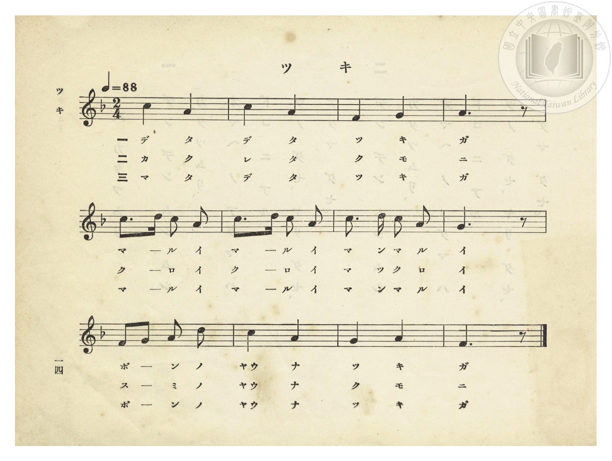
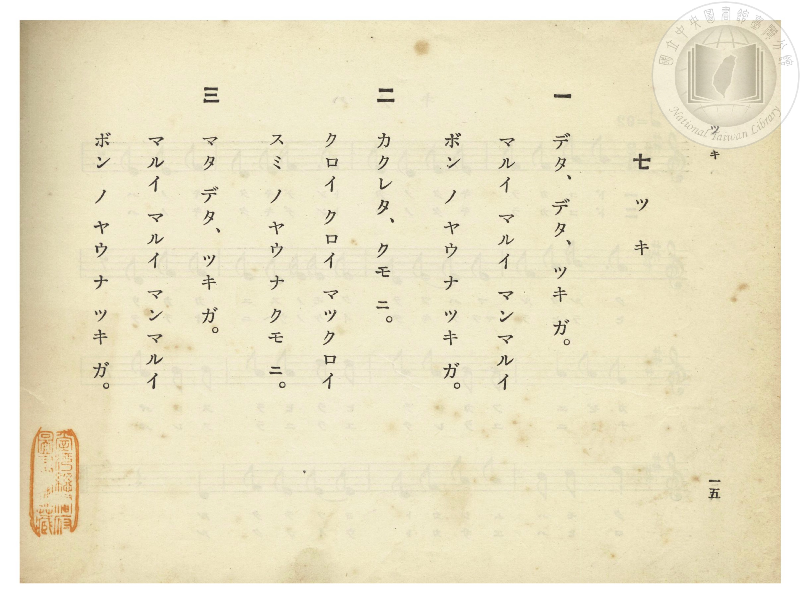

# ツキ（月亮）

> Re:Shōka 使用 AI 協助辨識與重建樂譜，可能會有錯誤。歡迎回報。

- **鋼琴伴奏版**：<br><audio controls src="tsuki.mp3"></audio>
- **NEUTRINO 歌聲合成版**：<br><audio controls src="tsuki_neutrino.mp3"></audio>

- 詞：文部省《尋常小學唱歌》
- 曲：文部省《尋常小學唱歌》
- 臺灣總督府《公學校唱歌》第一學年用（昭和九年三月第一版、昭和十一年二月第四版，索書號 0729 73）

## 說明


- 出處：臺灣總督府編《公學校唱歌》第一學年用，第七課〈ツキ〉（月亮），原書第 14–15 頁（掃描檔 P018.jpg–P019.jpg）。
- 調性與拍號：ヘ長調（F 大調），2/4 拍，速度 != 88。
- 背景與曲風：原出自明治 44 年（1911）文部省《尋常小學唱歌（一）》〈月〉，亦收錄於大正 4 年《公學校唱歌集》第二學年第四首及《新定兒童唱歌》第一學年用第二學期第八首。描寫圓圓如托盤般的明月升起、躲入烏黑雲朵又再度露臉的夜空景致。


## 歌詞

```text
一　デタ、デタ、ツキ ガ。
マルイ マルイ マンマルイ
ボン ノ ヤウ ナ ツキ ガ。

二　カクレタ、クモ ニ。
クロイ クロイ マックロイ
スミ ノ ヤウ ナ クモ ニ。

三　マタ デタ、ツキ ガ。
マルイ マルイ マンマルイ
ボン ノ ヤウ ナ ツキ ガ。
```

## ABC

<div class="abc-score" data-abc-src="tsuki.abc" aria-label="五線譜載入中"></div>

[下載 ABC 原始檔](tsuki.abc)

## TMD 檔案連結

- [主旋律 TMD 檔案](tsuki.tmd) [[在 TMD Studio 編輯](https://tmdlang.github.io/Tmd-TS/#tmd=s7IKdvYPcrWy4qpTUCpJTLdSSM7PyUlNLsnMz7PKzk9PzM7Ojy_OyM9OVIKrKMvPKc1NtUovSkxJjTdEiBfnlxYlp1oVJ2fk5-fEl6RWlCTl52ejy8cXJKanWgUYGFogZAqK8stS8xLzgLoLijLzSlJTwNoRClLLMlNSQdLFyYl58WWpRZlpmakpSE5KLSoGuRhqRUlRYl5xclFmAcgbCFX5RSUZ-UBnF2RUWmVkFpfkF2UmJ-bEZyfmIfmuJCMV6Lm8xJLSolRkrZnpmXlWufl5SaXA4FDi0tJSeNzc8rhp7fs9Hc_mdDzZte79nk4FLS0uRVsFCwsue1sFNy4bI30TO5ARL1bOe79n1rNp7S-bVzyf0_i4oevphu6nO3Y83dD_dO2Op1M2Plvb87ihG2zds9mbiFb7on3X88bFz3fsfT538dNdc0BqW9cAVT1bsBCu8PmaNU92NIC07tzyfMoKkHNnrH06qefJzrlAkSc7OoGuh6h53tnxuKERIvu0txGkC6hgVw9EwdPZs4EK3u_peb5l0bPZO17MnK9gYG5kqWBuDPS4EheXvpaCLbUAl4KCwuOGCcCgeD573YtVq57N6HvcMBEs2rz7afuuFzOnAsMIzffPt68gLgB6wCLNL1ZtetzQAYnExw2dyPEIVPO0bz7Ql0CVCoYmjxomG5oqvFzQCFLT1_ysv__ZqikKoCSsl1WQDpQFMi1BTKDWxw1NUHe-WLX_WcPyFx3tz7p7gaEFdPDj5hkvp24HigPNcVN4umQ5mAmyDZhQFIDKgKyXDfOf7lqmAE5FSGY19zybuR5k1uxNLxcB_TAL6D5QQLSDwubZpt0KJiYKQP8BDTa0NDQEGoo_AQHVAcME7NxuYCAAPQ4OgZ4nu5Y9m7LtZU_Ls2l7gO57tnaxAthczIB9ObsNGra7eqBhC04jL5dNe9rfBVT_bNqGp-tmPW2d9Hz1UlxxAdf-bM58kPbW1UDtQF8DQ_jp-tVP50wGoWVNzzpnPJ-95EXHmuezWkDendPxtLf9xdbtwNT6Ytemp61Lnzf3v9w98eXsTc_mbH3a3_G0rRcYhi_nbHrR3gnU8nTJnOcrd4HCrx3okSYuaOqCxDDQXcDc-bR1BTDAgOH7ZMdaEGPVvBdr1wOTHDCcnm7ofdbeCYptaBRDk4ZCgZ6CoSkwCMHmAX31uKHhcXP746b9QGchMUDJS-Fx0xp4ZM573Lz6cdMSdNZmOB-ibA5QCEj1AfGSx03LgFQXtMRBMg3oPohbQSmifdeTfW1PdgHjpRHOBjoXkqqRZJsgAQsMGZBKJPazHfuA7JeL9z7bDUyXPU-b-yEhD_TcsxWLQYGPYRTc_7uA0dvwuAno_vWPm9dAPQ9iLwK6GpjGIJ4HCawFexnBAnm7Gc6HKNv5uHk-hufRTUP2PDAdABME3M9A7suGTcAE8WLxQohDQelj90SIP5HZkKTzbE8bkIT4-emiFc82gko_iJ8hqQpoDrJvdwAzDjC25wH9CXTQAMQ1MJHTM4qB1lNeqkOBgpY-F1dIcWl2plVAZmJevkONQU01yAYFG0MzLTswC1tlogApPF4s7FHQABZKG_qfr2_QgZfCmlg0AC0CGVajYKqgC4bGUBqbiCGUZQQXgcmBoAFIBGyaj2ENKMqh4qAEAFOPS7QFLroWIdq0Bsn0eITpRiC51XAd65HMgelAMR2uApQ3EGq7sZtuDJKbRwO344-1XT3kx5oZmAbFBXEisPjDFmtwnzeDQhiUHSG-xC8OyZwgNkQeFAIgFbhiDxEjoDCDm4ZLHG5LM1QNRB6PLaixSAO_EMiDneTEJih_geIGFEtmYJsx8yAs7jBzJbbYnAP36WYw2Qf1KbgIhUl1wY0iJyPuhJsznygryMiNNPNFLReXrp0CuKBVADKUuQA)]
- [鋼琴伴奏 TMD 檔案](tsuki_piano.tmd) [[在 TMD Studio 編輯](https://tmdlang.github.io/Tmd-TS/#tmd=s7IKdvYPcrWy4tLSUnjc3PK4ae37PR3P5nQ82bXucfPul917nk_Y8mTPlqdL-593drzf06mgpcWlaKtgYcFlb6vgxmVjpG9ix1WnoPRi5bz3e2Y9m9b-snnF8zmNjxu6nm7ofrpjx9MN_U_X7ng6ZeOztT2PG7qVQGqfzd5EtNoX7bueNy5-vmPv87mLn-6aA1Lbugao6tmChXCFz9esebKjAaR155bnU1aAPDBj7dNJPU92zgWKPNnRCfQPRA3QD48bGiGyT3sbQbqACnb1QBQ8nT0b7Mme51sWPZu948XM-QoG5kaWCubGQI8rcXGFFJdmZ1oFZCbm5Qd5ONQY1FRzKQCBjaGZlh2Ypa-lYIsOFCA2v1jYo6BhogD04vP1DToKAQaGFnpZBemaWDRo6YMNq1EwVdAFQ2MojU3EEMoygovA5EDQACQCNs3HsAYYv-1Q8cdN--HqcYm2wEXXIkSb1iCZHo8w3QgktxquYz2SOTAdKKbDVTxuXoSkthu76cYguXk0cDv-WNvVQ36smYFpUFwQJwKLP2yxBvd5MyiEHzctgfoSv_jj5s1QNkQeFAIgFbhiDxEjoDCDm4ZLHG5LM1QNRB6PLaixSAO_EMiDneTEJih_geIGFEtmYJsx8yAs7jBzJbbYnAP36WYw2Qf16ZLHTcvgUl1wo8jJiDvh5swnygoyciPNfFGLUs76IJezFtBitkYh2jAWqBhC4uCZxiNzQdEAcT5RmmE8iCFYNJvgUY7VaqC3dO0UwD6L9gGJwzlGyBxjMEeZCwA)]

## 分析

```text
================================================================================
📊 TMD Song Profile: [ ツキ（月亮） ]
================================================================================
⏱  Duration:       0:16 (16.4s), 12 measures total
🎼 Key & Tempo:    首調基準 F, != 88.0 BPM, <2/4>
   - 分析範圍：      由實際發聲的音符與和弦推測調性；播放脈絡另行呈現
🎤 人聲音域:    F4 (MIDI 65) – D5 (MIDI 74) [跨度: 9 個半音 / 0.8 個八度, 難度: easy]
   - 最低音:  F4 in [Tsuki #1 @ m.3, 0:02]
   - 最高音: D5 in [Tsuki #1 @ m.5, 0:05]
   - 適合: soprano, mezzo-soprano, contralto, tenor, baritone, bass
🏛  結構:      Tsuki (16.4s)
⚡ 編曲密度:        Peak 1 軌道同時演奏
🗝  調性診斷：       A 小調（純淨自然小調，未偵測到可信轉調）
   - 風格氣質:    純淨自然小調（陰鬱抒情、旋律集中，無明顯調外色彩）
   - 轉調歷程:    全曲維持單一推測調性（未偵測到可信轉調）
   - 核心骨幹音:  A, C, G, F, D
   - 調性數值:    A 小調 [相關度: 0.81, 穩定度: Moderate, 自然音純度: 100.0%]
   - 候選調性 (K-S): A 小調 (0.81), C 大調 (0.72), F 大調 (0.67)
   - 五度圈歷程:   +3
   - 各段落調性細節:
     • [Tsuki #1]: A 小調 (r: 0.81, 自然音純度: 100.0%)

  [ 五度圈游移軌跡 ]
               C  
         F            G  
      Bb               D  
      Eb              [A ]*
         Ab           E  
            Db       B  
               F# 
     (* = active key center)

  [ 十二半音累積音高分佈 ]
     C  : ██████████████████████    30.0%
     C# :                            0.0%
     D  : ████                       5.6%
     D# :                            0.0%
     E  :                            0.0%
     F  : ██████████                13.3%
     F# :                            0.0%
     G  : █████████████             17.8%
     G# :                            0.0%
     A  : ████████████████████████  33.3%
     A# :                            0.0%
     B  :                            0.0%
--------------------------------------------------------------------------------
Assignment 軌道音域：
  - Piano         : F4 – D5 (9 個半音 / 0.8 個八度, 29 個音符)
================================================================================
```


## 原書掃描頁






