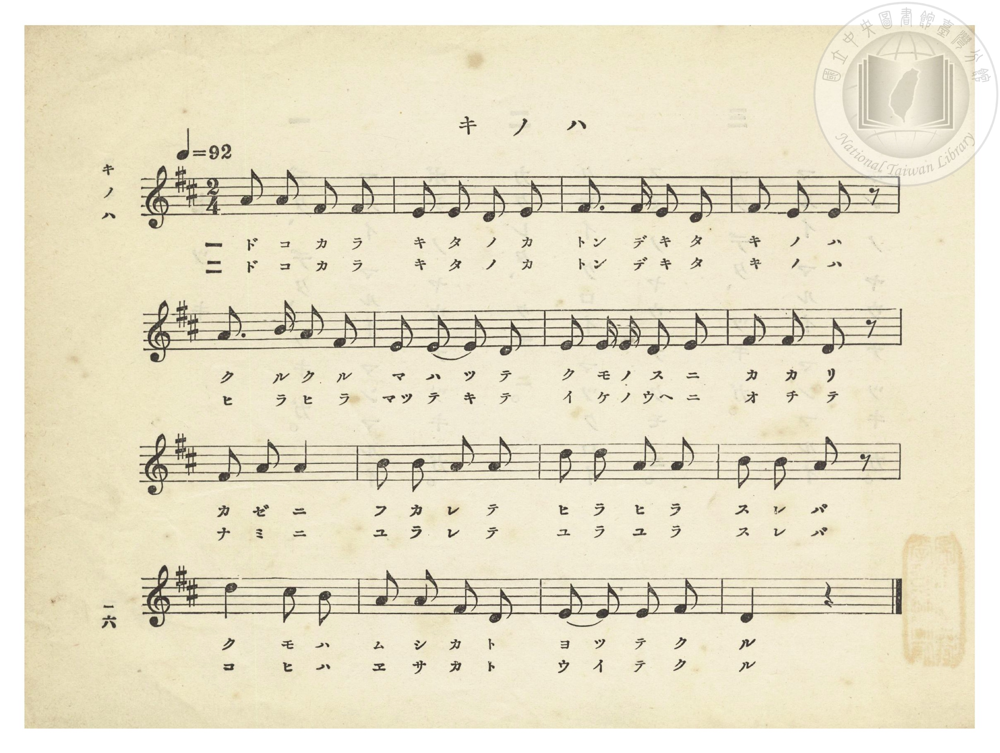
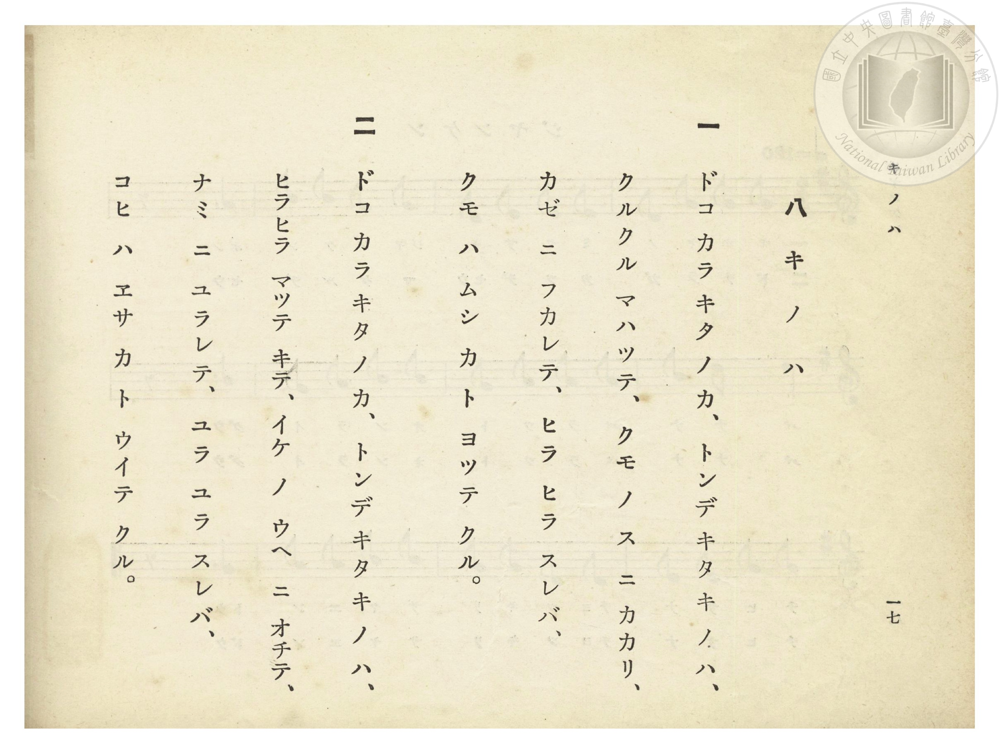

# キ ノ ハ（樹葉）

> Re:Shōka 使用 AI 協助辨識與重建樂譜，可能會有錯誤。歡迎回報。

- **NEUTRINO 歌聲合成版**：<br><audio controls src="ki_no_ha_neutrino.mp3"></audio>
- **鋼琴伴奏版**：<br><audio controls src="ki_no_ha.mp3"></audio>


- 詞：文部省
- 曲：文部省
- 臺灣總督府《公學校唱歌》第一學年用（昭和九年三月第一版、昭和十一年二月第四版，索書號 0729 73）

## 說明


- 出處：臺灣總督府編《公學校唱歌》第一學年用，第八課〈キ ノ ハ〉（樹葉），原書第 16–17 頁（掃描檔 P020.jpg–P021.jpg）。

- 調性與拍號：ニ長調（D 大調），2/4 拍，速度 != 92。

- 背景與曲風：與《新定兒童唱歌》第二學年用第二學期第十一首〈木のは〉同曲同詞。生動描寫隨風飄來的落葉：第一節寫樹葉打轉掛在蜘蛛網上隨風搖晃，蜘蛛以為是昆蟲而靠近；第二節寫樹葉飄落池塘隨波搖晃，鯉魚以為是餌食而游過來。


## 跨冊／重複收錄參照

> 同曲（《公學校唱歌》、《新定兒童唱歌》共同收錄教材）

- **[同曲]** 《新定兒童唱歌》尋常科第二學年用（2020.006.0847.0002）：[**〈木のは〉**](../../../shintei_jido_shoka/grade_2_2020.006.0847.0002/2_11_ki_no_ha/index.md)（`D` / `2/4` — [原始 TMD](../../../shintei_jido_shoka/grade_2_2020.006.0847.0002/2_11_ki_no_ha/ki_no_ha.tmd)）
- 總表：[跨冊重複與同名歌曲總索引](../../../duplicate_songs.md)

## 歌詞

```text
一　ドコ カラ キタ ノ カ、トンデ キタ キ ノ ハ、
クルクル マハッテ、クモ ノ ス ニ カカリ、
カゼ ニ フカレテ、ヒラ ヒラ スレバ、
クモ ハ ムシ カ ト ヨッテ クル。

二　ドコ カラ キタ ノ カ、トンデ キタ キ ノ ハ、
ヒラヒラ マッテ キテ、イケ ノ ウヘ ニ オチテ、
ナミ ニ ユラレテ、ユラ ユラ スレバ、
コヒ ハ エサ カ ト ウイテ クル。
```

## ABC

```abc
X:1
T:キ ノ ハ（樹葉）
C:曲：文部省
M:2/4
L:1/16
Q:1/4=92
K:D
V:V1 name="Piano" snm="Pia"
[V:V1]
A2 A2 F2 F2 | E2 E2 D2 E2 | F3 F E2 D2 | F2 E2 E2 z2 |
w: 1.~ド コ カ ラ | キ タ ノ カ | トン デ キ タ | キ ノ ハ
w: 2.~ド コ カ ラ | キ タ ノ カ | トン デ キ タ | キ ノ ハ
A3 B A2 F2 | E2 E2 E2 D2 | E2 E E D2 E2 | F2 F2 D2 z2 |
w: 1.~ク ル ク ル | マ ハ ツ テ | ク モ ノ ス ニ | カ カ リ
w: 2.~ヒ ラ ヒ ラ | マッ テ キ テ | イ ケ ノ ウヘ ニ | オ チ テ
F2 A2 A4 | B2 B2 A2 A2 | d2 d2 A2 A2 | B2 B2 A2 z2 |
w: 1.~カ ゼ ニ | フ カ レ テ | ヒ ラ ヒ ラ | ス レ バ
w: 2.~ナ ミ ニ | ユ ラ レ テ | ユ ラ ユ ラ | ス レ バ
d4 c2 B2 | A2 A2 F2 D2 | E2 E2 E2 F2 | D4 z4 |
w: 1.~ク モ ハ | ム シ カ ト | ヨ ッ テ ク | ル
w: 2.~コ ヒ ハ | エ サ カ ト | ウ イ テ ク | ル
```

## TMD 檔案連結

- [主旋律 TMD 檔案](ki_no_ha.tmd) [[在 TMD Studio 編輯](https://tmdlang.github.io/Tmd-TS/#tmd=s7IKdvYPcrWy4qpTUCpJTLdSSM7PyUlNLsnMz7PKzk9PzM7Ojy_OyM9OVIKrKMvPKc1NtUovSkxJjTdEiBfnlxYlp1oVJ2fk5-fEl6RWlCTl52ejy8cXJKanWgUYGBkgZAqK8stS8xLzgLoLijLzSlJTwNoRClLLMlNSQdLFyYl58WWpRZlpmakpSE5KLSoGuRhqRUlRYl5xclFmAcgbCFX5RSUZ-UBnF2RUWmVkFpfkF2UmJ-bEZyfmIfmuJCMV6LmCnMQ8oP1aWgqPm9YqPG7uA-L-93s6nq3Y-WJi5_s9nQpaWlyKtgqWRlz2tgouXDZG-iZ2IDNerJz3fs-sZ9PaXzaveD6nEWzus9mbMMRetO963rj4-Y69z-cufrprzuOGrqeta56u3fFswcKnUzY-W9vzuKH7-Zo1T3Y0AAWf7tzyfMoKkPUz1j6d1PNk51ygyJMdnc_mdEDUPO_seNzQCJF92tsI0gVUsKsHouDp7NlABe_39DzfsujZ7B0vZs5XMDA3slQwNwZ6RImLS19LwZZagEtBQeFxwwSgl5_PXvdi1apnM_oeN0wEizbvftq-68XMqcCwQPP98-0riAuAHpBvWle_WLXpcUMHUsw8bgDGCSJygAqf9s0HehWoXMHQ7FHDZENzhZcLGkFq-pqf9fc_WzVFAZQE9bIK0oGyQKYhiAnU-rihCerYF6v2P2tY_qKj_Vl3LzDIgK5-3Nz9cup2oDjQHBeFp0uWg5kg24CxrwBUBmS9bJj_dNcyBXDSQDKruefZzPUgs2ZverkI6JFZQDbQy8-mbXi6btbT1knPVy9F8fWuHriv4dxnc-aDvA-O3pfLpgFD4NmcFY8b1z1uXA_0_9MJPUDDgSQwBQItfj5l_tPuqUCvPl2_-uWsFUBLXy5uebKv7fmslhcT9oKDaRY07axvAKqBhN2zzskv9nY-65v9dM6KF3NmvAAmnG2bnuzogpjwbMK0ZzObgZ6ESD3ZvfR5065nM9Y_m9H2Yv6mFw09L-cueLF_4vs9syFuRjYZaDvQ3mcbFzxdOANo2rPNi-CmvVzf-XLtLLhpL5f0vFw8H2jasx07Xjb2Ad0MCkdouoJEKzCcgL582roCmKeAAflkx1oQY9W8F2uBIQG0v-Ppht5n7Z2gKIbGKzQ9KBToKRiaA-MMbB7Q848bGh43dz5u2gzM56sfN68EZffHTfsh6Qoo0tD4uLnjcfPmx83tcCnkZNcIdlfT-sfNqyEkUHgeSKa5-XEz0OGNYNFFUPN2AulusLkgy1bBtQP5eyBSzVPBUmugmpsngd0EpZp2gmUmIFsLMrofiBc8btoOMgnI7ADiFRAHwJwGSYjAgIEEEjDun-zofT5_6dN9855OXgVMfy8Xz4YkDlge6nm5asXzRT1A9HTOBlCymDgdmDKA4piJAxjfLxatBqYPUF6dsPPFnqlAhJZWXja1wCMYmFaANj7Zt__Zzq4nu9rgcQyPll3AXECNaAEHGzwMgdECDZK1sKhZ8rhpI9TMZY-bZ0BjZ9XjZqDxIBUQU7oeN8-Hxg5QFdBAeOyAuFBRLLEDdN0kSOw0rXjctBURO0DLgFZTFDvP968EIqD4i455kKz1tGMDJHc927Dl5dxFkHgB5jRgxAFFoPkNHCnIuQ45XoC57nnnSlC8bF0HjBegCYh4AbqP8roBChS09Lm4vDP98j0SrQIyE_PyHWoMaqpBVijYGJpp2YFZ2OokBUiB9WJhj4KGicLTDf3AAkYHXo5rYtEAtAlkWI2CqYIuGBtDcY2CEZAEYUMoXQMWB8nCRCEiMHUGIBGwaT6GNcB47ATyQQkURK4GkcA0ANIDSocgsf1gsT64PEgPKMmCLYGmW7hCuDaIBmCaQbHQiI4W4g_9XT3khr6ughk8BhChjwhrCM8ILT5AGCSCFvpN66G-AuYoMBvEgnh5Htw_j5tbwGQb1L8QdYiyGMTrhsqBAxQarKuwBP4kqH3gwhg58MHFCtwaWKDCrFwCFkMpY5BtBdkELGzgWoiJgR2d5MQAKBxheQAEa4CxAYoRhGiNgmEcKLBBBEIMWRV6HEDCbA_cRxBzgVUYUliuQQ4OpJBDC0VobEBUT8AS_l1gmfkYdi1DMhHVLmQZBBu3XXhDHdiCJifUwYEJgubQYEQtiJATPgRDMgdIHARBDgN7FCPhQxIyLKGDvLsAHOjbkYK-AyqzAsxDTqMgM0AyIHVY7AEFOLicgdgDiSioPU1g04CVGYY9TeBAhqR4gvbUcnHp2ilA6gAFIEuZCwA)]
- [鋼琴伴奏 TMD 檔案](ki_no_ha_piano.tmd) [[在 TMD Studio 編輯](https://tmdlang.github.io/Tmd-TS/#tmd=s7IKdvYPcrWy4tLSUnjctFbhcXMfEPe_39PxbMXOFxM7Hzfvftm95_mELU_2bHm6tP95Z8f7PZ0KWlpcirYKlkZc9rYKLlw2Rvomdlx1CkovVs57v2fWs2ntL5tXPJ_TqAQSezZ7E4bYi_ZdzxsXP9-x9_ncxU93zXnc0PW0dc3TtTueLVj4dMrGZ2t7Hjd0P1-z5smOBqDg051bnk9ZAXLQjLVPJ_U82TkXKPJkR-ezOR0QNUA3PW5ohMg-7W0E6QIq2NUDUfB09mywo3ueb1n0bPaOFzPnKxiYG1kqmBsDPaLExeWd6ZfvkWgVkJmYlx_k4VBjUFPNpQAENoZmWnZglr6Wgi06UIBY_WJhj4KGicLTDf3P1zfoKAQYGBnoZRWka2LRoKUPNqxGwVRBF4yNobhGwQhIgrAhlK4Bi4NkYaIQEZg6A5AI2DQfwxpgbHUC-Y-bNoPJ1SCyeSVYDyg-QWL7wWJ9cHmQno7HzSANIIl2FIVwbRANzf2oFhrR0UL8ob-rh9zQ11Uwg8cAIvQRYQ3hGaHFBwiDRNBCv2k91FeroWwQC-LleXD_PG5uAZNtUP9C1C2C5LamnWBeN1QOHKDQYF2FJfAnQe1bCWXDA7953uPmZrg1sECFWbkELLYRauWyx80zUGwF2fS4uRGuhZgY2NFJTgyAwhGWB0CwBhgboBhBiNYoGMaBAhtEIMSQVaHHASTM9sB9BDH3cfNUpLBcgxwcSCGHForQ2IConoAl_LvAMvMx7FqGZCKqXcgyCDZuu_CGOrA8IyfUwYEJgubQYEQtiJATPgRDMgdIHARBDgN7FCPhQxIyLKGDvLsAHOjbkYK-AyqzAsxDTqMgM0AyIHVY7AEFOLicgdgDiSioPU1g05q2YtrTBA5kSIonaE8tahXgg1wFmEBrAGA4xCtEG8aCAi0exgIJmcajsLAqhqhBYgKlDTDVmiCbC2eYIEwFKTBFUYBpJtAzunYKEP9E-wAVIfGMwDxlLgA)]

## 分析

```text
================================================================================
📊 TMD Song Profile: [ キ ノ ハ（樹葉） ]
================================================================================
⏱  Duration:       0:20 (20.9s), 16 measures total
🎼 Key & Tempo:    首調基準 D, != 92.0 BPM, <2/4>
   - 分析範圍：      由實際發聲的音符與和弦推測調性；播放脈絡另行呈現
🎤 人聲音域:    D4 (MIDI 62) – D5 (MIDI 74) [跨度: 12 個半音 / 1.0 個八度, 難度: easy]
   - 最低音:  D4 in [KiNoHa #1 @ m.2, 0:01]
   - 最高音: D5 in [KiNoHa #1 @ m.11, 0:13]
   - 適合: soprano, mezzo-soprano, contralto, tenor, baritone, bass
🏛  結構:      KiNoHa (20.9s)
⚡ 編曲密度:        Peak 1 軌道同時演奏
🗝  調性診斷：       A 大調（純淨自然大調，未偵測到可信轉調）
   - 風格氣質:    純淨自然大調（陽光明朗、易唱易記，無明顯調外色彩）
   - 轉調歷程:    全曲維持單一推測調性（未偵測到可信轉調）
   - 核心骨幹音:  E, A, D, F#, B
   - 調性數值:    A 大調 [相關度: 0.84, 穩定度: Moderate, 自然音純度: 100.0%]
   - 候選調性 (K-S): A 大調 (0.84), D 大調 (0.75), F# 小調 (0.60)
   - 五度圈歷程:   +3
   - 各段落調性細節:
     • [KiNoHa #1]: A 大調 (r: 0.84, 自然音純度: 100.0%)

  [ 五度圈游移軌跡 ]
               C  
         F            G  
      Bb               D  
      Eb              [A ]*
         Ab           E  
            Db       B  
               F# 
     (* = active key center)

  [ 十二半音累積音高分佈 ]
     C  :                            0.0%
     C# : ██                         1.7%
     D  : ███████████████████       20.3%
     D# :                            0.0%
     E  : ████████████████████████  25.4%
     F  :                            0.0%
     F# : ██████████████████        18.6%
     G  :                            0.0%
     G# :                            0.0%
     A  : ███████████████████████   24.6%
     A# :                            0.0%
     B  : █████████                  9.3%
--------------------------------------------------------------------------------
Assignment 軌道音域：
  - Piano         : D4 – D5 (12 個半音 / 1.0 個八度, 57 個音符)
================================================================================
```


## 原書掃描頁






