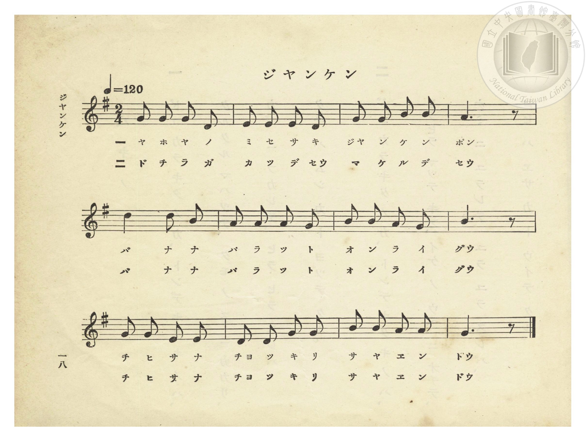
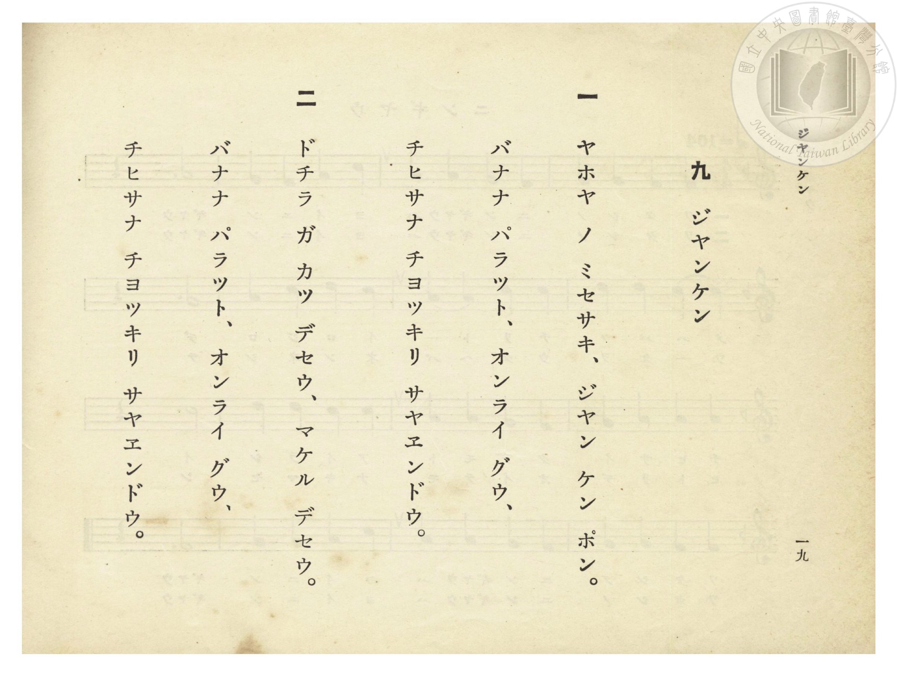

# ジヤンケン（猜拳）

> Re:Shōka 使用 AI 協助辨識與重建樂譜，可能會有錯誤。歡迎回報。

- **鋼琴伴奏版**：<br><audio controls src="janken.mp3"></audio>
- **NEUTRINO 歌聲合成版**：<br><audio controls src="janken_neutrino.mp3"></audio>

- 竹田英親 作詞（懸賞募集入選原題〈じやんけんぽん〉）
- 臺灣總督府《公學校唱歌》第一學年用（昭和九年三月第一版、昭和十一年二月第四版，索書號 0729 73）

## 說明


- 出處：臺灣總督府編《公學校唱歌》第一學年用，第九課〈ジヤンケン〉（猜拳），原書第 18–19 頁（掃描檔 P022.jpg–P023.jpg）。
- 調性與拍號：ト長調（G 大調五聲音階），2/4 拍，速度 != 120。
- 背景與曲風：極具臺灣本土風物特色之公學校兒童遊戲歌！詞中將蔬果店（八百屋／ヤホヤ）前孩童猜拳的「布、石頭、剪刀」三種手勢，巧妙比擬為臺灣代表性物產：
- **「バナナ パラット」**（成串展開的**香蕉**＝五指張開的「布」／パー）
- **「オンライ グウ」**（圓滾滾的**鳳梨〔臺語「旺來／王梨」音譯 オンライ〕**＝握拳的「石頭」／グー）
- **「チヒサナ チヨッキリ サヤエンドウ」**（小巧分岔的**荷蘭豆／豌豆莢**＝伸出兩指的「剪刀」／チョキ）
- 校勘註記：原書 P022.jpg 第一行第 4 小節（M4「ポン／セウ」）因音樂活字排版略偏下而印於第一間，依五聲音階半終止語法（1 1 3 3 | 2 - - 0）校訂為 2（A4）。


## 歌詞

```text
一　ヤホヤ ノ ミセサキ、ジヤン ケン ポン。
バナナ パラット、オンライ グウ、
チヒサナ チヨッキリ サヤエンドウ。

二　ドチラ ガ カツ デセウ、マケル デセウ。
バナナ パラット、オンライ グウ、
チヒサナ チヨッキリ サヤエンドウ。
```

## ABC

```abc
X:1
T:ジヤンケン（猜拳）
M:2/4
L:1/16
Q:1/4=120
K:G
V:V1 name="Piano" snm="Pia"
[V:V1]
G2 G2 G2 E2 | E2 E2 E2 D2 | G2 G2 B2 B2 | A6 z2 |
w: 1.~ヤ ホ ヤ ノ | ミ セ サ キ | ジヤ ン ケ ン | ポン
w: 2.~ド チ ラ ガ | カ ツ デ セウ | マ ケ ル デ | セウ
d4 d2 B2 | A2 A2 A2 G2 | B2 B2 A2 G2 | B6 z2 |
w: 1.~バ ナ ナ | パ ラ ッ ト | オ ン ラ イ | グウ
w: 2.~バ ナ ナ | パ ラ ッ ト | オ ン ラ イ | グウ
G2 G2 E2 E2 | D2 D2 G2 G2 | B2 B2 A2 A2 | G6 z2 |
w: 1.~チ ヒ サ ナ | チヨ ッ キ リ | サ ヤ エ ン | ドウ
w: 2.~チ ヒ サ ナ | チヨ ッ キ リ | サ ヤ エ ン | ドウ
```

## TMD 檔案連結

- [主旋律 TMD 檔案](janken.tmd) [[在 TMD Studio 編輯](https://tmdlang.github.io/Tmd-TS/#tmd=s7IKdvYPcrWy4qpTUCpJTLdSSM7PyUlNLsnMz7PKzk9PzM7Ojy_OyM9OVIKrKMvPKc1NtUovSkxJjTdEiBfnlxYlp1oVJ2fk5-fEl6RWlCTl52ejy8cXJKanWgUYGBkhZAqK8stS8xLzgLoLijLzSlJTwNoRClLLMlNSQdLFyYl58WWpRZlpmakpSE5KLSoGuRhqRUlRYl5xclFmAcgbCFX5RSUZ-UBnF2RUWmVkFpfkF2UmJ-bEZyfmIfmuJCMV6LmUxMycyviczLRUZO2Z6Zl5ViWJmeVAR-SnpWUmZybm4JJPzgf6o7gk3tDS2FiJS0tL4XHTjsfNSx43b37ctBFIvt_T8bxnzrNuIKNTQUuLS9FWwdDIgMveVsGdy8ZI38QOZO7z1TufT9nwonvji2WrFJ7snfNi5TygvmftO15snve0e_7L2W1PW5e-bNzxtG_-y4U9jxs6HjfOeNzU8rhp8uPGiWByL4hs6ARaAnboi_ZdzxsXP9-x9_ncxU93zXnc0PW0dc3TtTueLVj4dMrGZ2uBZnQ_X7PmyY4GoODTnVueT1kBsnDG2qeTep7snAsUebKj89mcDoia550djxsaIbJPextBuoAKdvVAFDydPRuo4P2enudbFj2bvePFzPkKBuZGlgrmxmDXcOlrKdhSC3ApKCg8bpjwbPam57PXvVi16tmMvscNE8Gizbuftu96MXPq-z2z0Hz_fPsK4gKgBySyc-6LVZtAQYwaj-DARUQlUDEwMoDeBWpRMLR41DDZ0FLh5YJGUCj2NT_r73-2aooCKPXrZRWkA2WBTGMQE6j1cUMT1MEvVu1_1rD8RUf7s-5eYLABXf64uePl1O1AcaA57gpPlywHMp_smvKicdPL-ZtfzuqD2AxMNgpALUDWy4b5T3ctU4AkKiSDm3uezVwPMnj2ppeLgD6b9Wzp1qet2yEB82zOmqdz5gPFn3eufN6580Xnpic7uxHB0zrp-WpgYut61rEJGE7v9zQCU-OTHWufbmh_MWXNs3lznu6aDnTd09bVz2fue7qx-_2efnA4zQaSQOc97ex9unYl0ARIUD2f1fK4oefpjmZgAnoO9MKCtUDG085VTzsaHjf0AhPZ8xXrnnV2P-1eBArR7cufLpv5bP2UZ5PXPG_aBXHtk92LXyxcAQwnkGunAJXNAnlSQUEXmJuARj9unvC4uQuIgP6e-Lh55ePmZmAgAs3W0gLFRceEJzs2Pd049eW0bqBTtLReLpv5YmonSG4uMFyf9bQ_3bMVIgdzJjBYgR4CGrUH6BtUq5pWgRIC0I6mJcBsvuFx0zKYPU_nTH62ex8QQSzZvPnZImCamwL0wYtV84Ban03f9WRfG9Dk533dYKleYHy-WLseaAzCzMcNU8EOe9a_EB5ysDADuwpoJRZXNTc-bp70uGkrJAyAnBWgMGha-7h5FdB4oPCSx01AIaAlncgu3tAPCu6OtqebpoAd_aJ3-4sZa19sBLnyxcYeIONF3yJIQO3ZAcxaT1tXAoMLGlCwCASHFdDK5UD7oA4DJj9QKuqe8WLF7hcrZgDjC5JR4LlBAZLvXiwEZTcFEwWgS56vbwA6ydcE7J254FIT6NvdEOeCEtXsBcDwerai6dmW3U_XTn_WNwlY4jyfuvRpY_-THd0vgA7q3fBs2h6IwS-nTQampSf7QBEMzzhPe7ueb216tnYRMD6ebQYWEh2GCoYKxkBYo2AEDEpdBQOgPUCHv1jRBEx6CkZAFY4m0NwKLXUg_gDmCWCGeNq64tm0dmAOA-YMEGPVPGBsAosicMj2PmvvBHkXmuOhJYVCgZ6CoSUolEDmAR36uKEBnnOAwdYHxPPBvt4Kir2GRngJBIxGUBEElAeFDTybY0_4QG1YkmkjRAuJSQVsEdBLEO-BonLOCngh8HJaw9P-xSDvQVMDUgbf0QwsNyB5DZLBns1YDxbsgecNSJYApnlIcgcqgGgHGQhMm8BEMasFYjJQCp44gWkS6Cx4IO4CluPAQOwEe2Yl0A9rgHj14-YWoPfaYSkIKDUPHIKrkUUHMBAnrwIl06auZ3OaX2zpfzoRWKjNRxEEZjiwIG1DEOgsymtkKFDQ0ufi8krMy07NswrITMzLd6gxqKkGF1Q2Flp2YAa2hgCiMFDQgBUFOvCiQhOLBqBFIMNqgNkXBM3igUwgAUGmIB5GzlaoAWvxMawBRhgoq82G0n1ANcBMB4y23aCoA-K1IBFwvgNKgDMemAYpA-U9VPOMQMKdoEQAxJDUB9INSmbgBAgyF5gEwLrnQc0Cp0GwMrAUzDz8AbSrh5wAMgWabQoNBxA0BLJA4QJjYYbNBKAIJFl3gR09EeKv5mYg7gA7GpjEwQURyLdLwCKgrIElWCg2ikCS6SQ3yUASCjB0wKkFJAILFSOwCsxQAcXuJEj6gHoGlOkhfgEmGFC-B7keJA0qK0AykBQDyv9YgoY65tVycenaKUCynAKQpcwFAA)]
- [鋼琴伴奏 TMD 檔案](janken_piano.tmd) [[在 TMD Studio 編輯](https://tmdlang.github.io/Tmd-TS/#tmd=s7IKdvYPcrWy4tLSUnjctONx85LHzZsfN20Eku_3dDzvmfOse_Pj5t0vu_c8n7DlyZ4tT5f2P-_seL-nU0FLi0vRVsHQyIDL3lbBncvGSN_EjqtOQelF-67njYuf79j7fO7ip7vmPG7oetq65unaHc8WLHw6ZeOztT2PG7qfr1nzZEcDUPDpzi3Pp6wA2vRsxtqnk3qe7JwLFHmyo_PZnA6IGqBljxsaIbJPextBuoAKdvVAFDydPRvsmp7nWxY9m73jxcz5CgbmRpYK5sZAFypxcXnmlRTlWwVkJublB3k41BjUVHMpAIGNhZYdmFGjYAiEZvEgVKNgGg9CIJEaBWMgNAJCkApdIDRQqOGqRTHQB9lAE4SB8QrRhrFg02AskJBpPJQFNcgrMS87NQ-P0_S1FGzRgQIkTF4s7FHQMFF4uqH_-foGHYUAAyMjvayCdE0sGrT0kfwJ9mkN1LtABPQsRALk2RqgZ2EeBWnxMaxRAKYGIJ4NpfuAah43zwcmk91AvBWI14JEwIkGKLEZyNwIpkHK5oIYKOYZgYQ7gbgRiFcCFa8B614N5LUAcTvI3MdNy8C650HNAkm2g5WBpWDm4Q-gXT3kBJAp0GxTaDiAICIRQFiYYTMBKPK4uQuMQfyJEH81NwNxB9jRqyDBAvbtErDIBmRvIIKFYqMIJJlOcpMMsVkDESqg2J0ESR9QzzQ-bl4B8QswwTxuXgV2PUgamGqaQDKQFNOJPWioYx5ajiOUd81AedcsPheWe-EZGuY29HwOz96oGZ2kIkHXTgFcvCgAGRDHRvsAFSPxjMA8ZS4A)]

## 分析

```text
================================================================================
📊 TMD Song Profile: [ ジヤンケン（猜拳） ]
================================================================================
⏱  Duration:       0:12 (12.0s), 12 measures total
🎼 Key & Tempo:    首調基準 G, != 120.0 BPM, <2/4>
   - 分析範圍：      由實際發聲的音符與和弦推測調性；播放脈絡另行呈現
🎤 人聲音域:    D4 (MIDI 62) – D5 (MIDI 74) [跨度: 12 個半音 / 1.0 個八度, 難度: easy]
   - 最低音:  D4 in [Janken #1 @ m.2, 0:01]
   - 最高音: D5 in [Janken #1 @ m.5, 0:04]
   - 適合: soprano, mezzo-soprano, contralto, tenor, baritone, bass
🏛  結構:      Janken (12.0s)
⚡ 編曲密度:        Peak 1 軌道同時演奏
🗝  調性診斷：       G 大調（純淨自然大調，未偵測到可信轉調）
   - 風格氣質:    純淨自然大調（陽光明朗、易唱易記，無明顯調外色彩）
   - 轉調歷程:    全曲維持單一推測調性（未偵測到可信轉調）
   - 核心骨幹音:  G, B, A, D, E
   - 調性數值:    G 大調 [相關度: 0.82, 穩定度: High, 自然音純度: 100.0%]
   - 候選調性 (K-S): G 大調 (0.82), E 小調 (0.68), D 大調 (0.58)
   - 五度圈歷程:   +1
   - 各段落調性細節:
     • [Janken #1]: G 大調 (r: 0.82, 自然音純度: 100.0%)

  [ 五度圈游移軌跡 ]
               C  
         F           [G ]*
      Bb               D  
      Eb               A  
         Ab           E  
            Db       B  
               F# 
     (* = active key center)

  [ 十二半音累積音高分佈 ]
     C  :                            0.0%
     C# :                            0.0%
     D  : ██████████                13.3%
     D# :                            0.0%
     E  : ██████████                13.3%
     F  :                            0.0%
     F# :                            0.0%
     G  : ████████████████████████  31.1%
     G# :                            0.0%
     A  : ███████████████           20.0%
     A# :                            0.0%
     B  : █████████████████         22.2%
--------------------------------------------------------------------------------
Assignment 軌道音域：
  - Piano         : D4 – D5 (12 個半音 / 1.0 個八度, 38 個音符)
================================================================================
```


## 原書掃描頁






