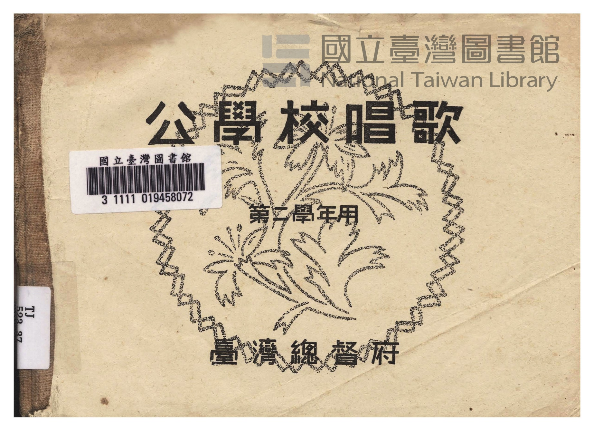
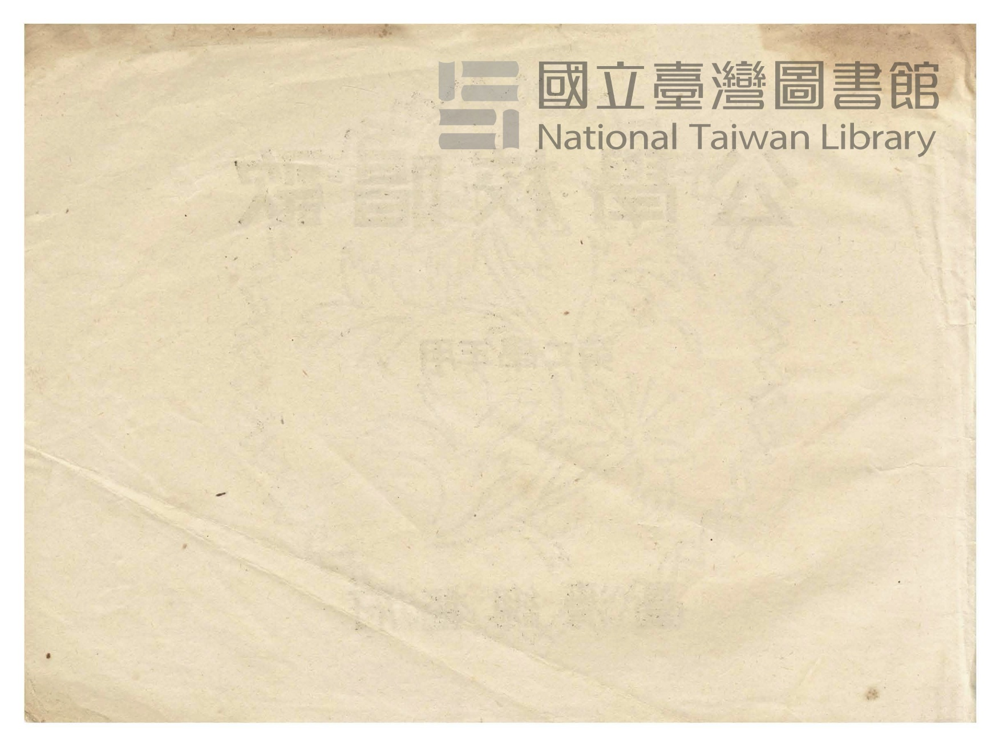
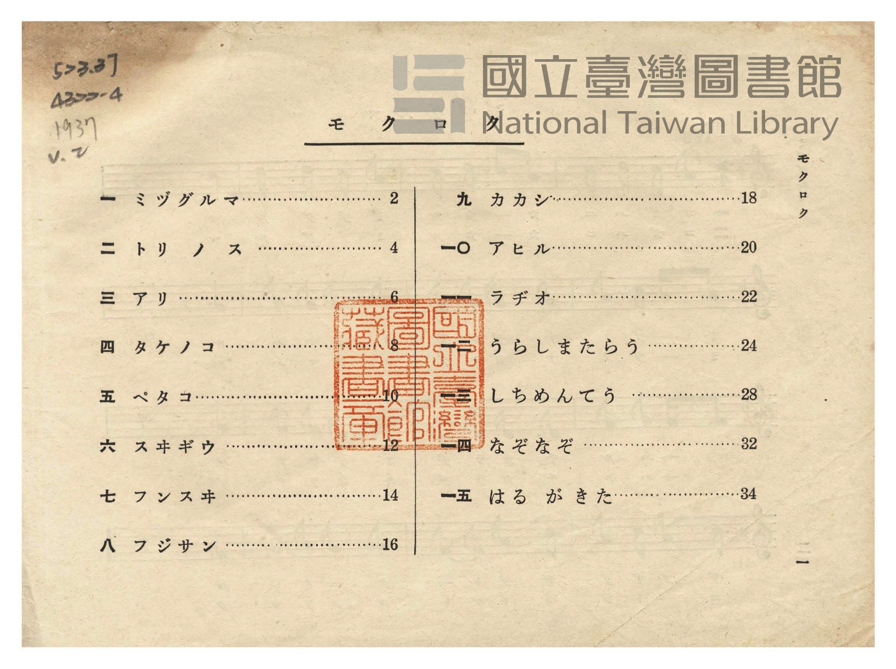
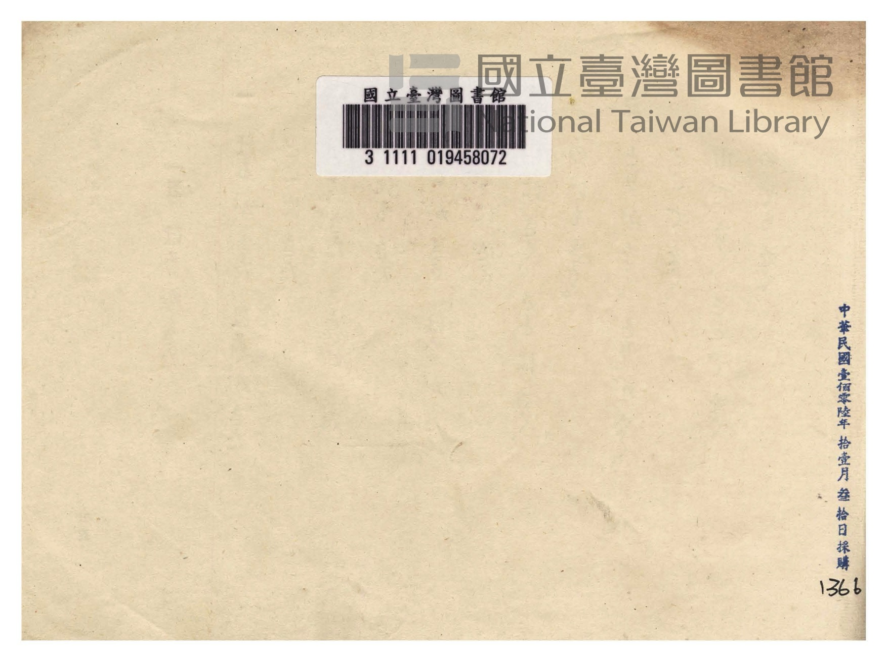
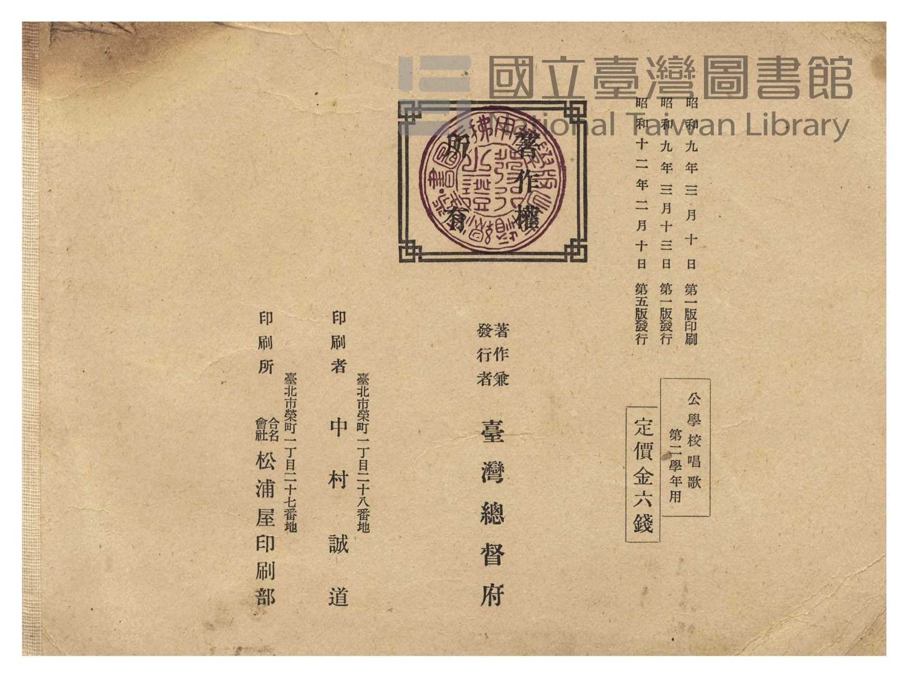
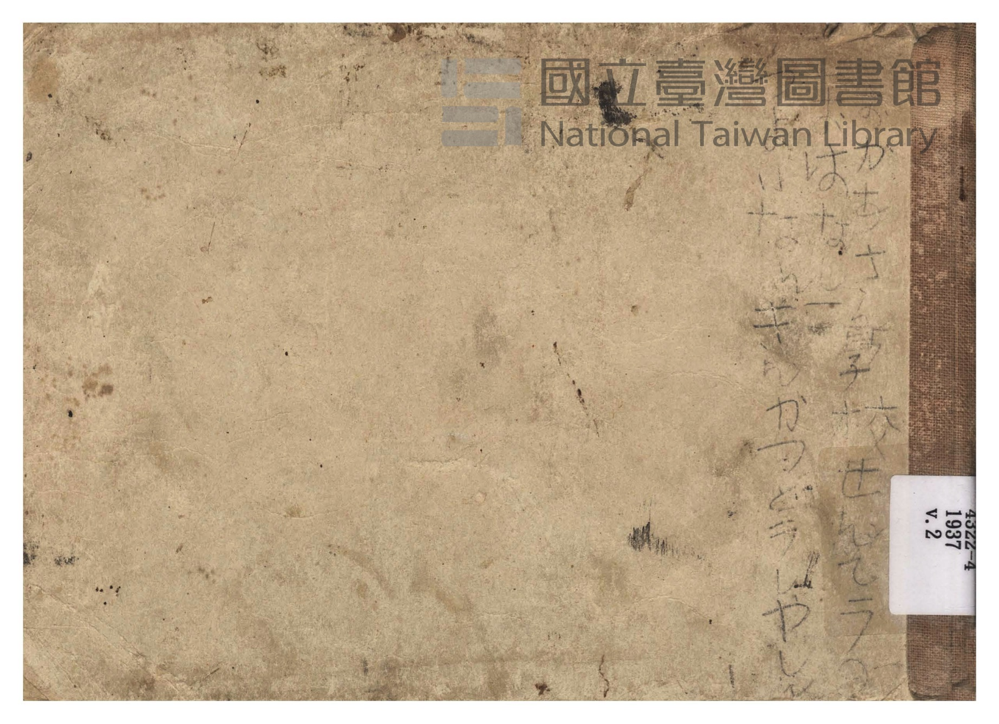

# 書訊與卷首／卷末掃描頁 — 《公學校唱歌》 尋常科 第二學年用（國臺圖 523.37 4322-4）

本頁收錄本冊之封面、扉頁、目次（もくろく）、樂典大要、版權頁與封底等原書掃描圖檔（共 6 頁）。

### P001.jpg

本冊封面（右頁），題「公學校唱歌　第二學年用　臺灣總督府」，右上蓋有「昭和十二年四月十三日　編修課ヨリ寄贈」藏書印，左上貼有舊藏圖書分類籤「523.37 4322-4」。

### P002.jpg

封面裏（見返頁），貼有國臺圖舊藏書標。

### P003.jpg

目次頁（「もくろく」，原書第 1 頁）：列出「一　ミヅグルマ」至「一五　はる が きた」共 15 首曲名與頁碼。

### P038.jpg

卷末留白襯頁，貼有國立臺灣圖書館條碼籤「3 1111 019458072」與分類號「523.37 4322-4」。

### P039.jpg

版權頁：標明「昭和九年三月十日第一版印刷、昭和九年三月十三日第一版發行、昭和十二年二月十日第五版發行」、「公學校唱歌 第二學年用（定價金六錢）」、「著作兼發行者 臺灣總督府」、「印刷者 臺北市榮町一丁目二十八番地 中村誠道」、「印刷所 臺北市榮町一丁目二十七番地 合名會社松浦屋印刷部」。

### P040.jpg

封底外頁。

