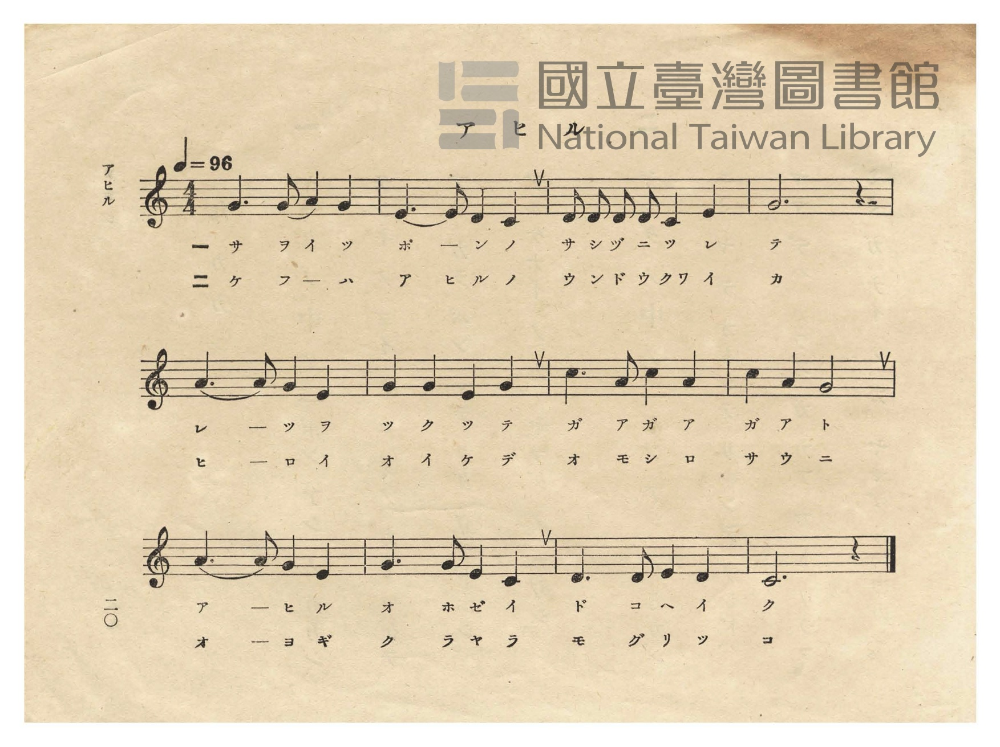
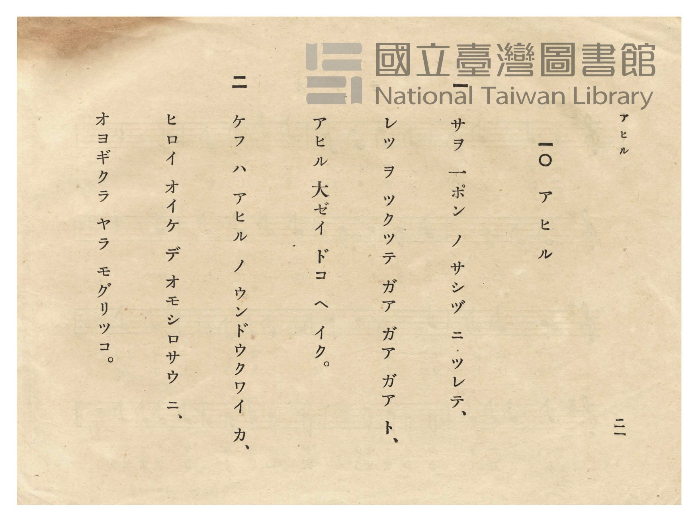

# アヒル（家鴨）

> Re:Shōka 使用 AI 協助辨識與重建樂譜，可能會有錯誤。歡迎回報。

- **鋼琴伴奏版**：<br><audio controls src="ahiru.mp3"></audio>
- **NEUTRINO 歌聲合成版**：<br><audio controls src="ahiru_neutrino.mp3"></audio>

- 日治時期公學校唱歌（第二學年・第十課）
- 國立臺灣圖書館典藏

## 說明


- 出處：臺灣總督府編《公學校唱歌》第二學年用，第十課〈アヒル〉（家鴨），原書第 20–21 頁（P022–P023）。
- 調性與拍號：ハ調（C 大調），4/4 拍，速度 != 96。
- 背景與曲風：描寫臺灣農村常見的趕鴨景象——趕鴨人僅憑一根長竹竿（サヲ 一ポン）指揮，成群結隊的鴨子
便「ガア ガア ガア」排隊前行，到了寬廣池塘裡彷彿開運動會般比賽游泳（オヨギクラ）與潛水（モグリツコ）。
（註：與《新定公學校唱歌集》第一學年用第七課〈アヒル〉`1_07_ahiru` 為同名異曲。）
- 版本說明：本檔案為原書單聲部五線譜之忠實數位化版本。

### 編曲說明（鋼琴伴奏版）：

1. 前奏 (Intro, 4 小節)：以第三行搖擺逗趣的五聲音階終止句引出鴨群搖搖擺擺列隊行進的畫面。
2. 主歌伴奏 (Ahiru, 12 小節 × 2 段)：右手演奏原曲歌唱旋律；左手以穩健輕快的四拍子和聲伴奏。


## 歌詞

```text
一
サヲ 一ポン ノ サシヅ ニ ツレテ、
レツ ヲ ツクツテ ガア ガア ガア ト、
アヒル 大ゼイ ドコ ヘ イク。

二
ケフ ハ アヒル ノ ウンドウクワイ カ、
ヒロイ オイケ デ オモシロサウ ニ、
オヨギクラ ヤラ モグリツコ。
```

## ABC

<div class="abc-score" data-abc-src="ahiru.abc" aria-label="五線譜載入中"></div>

[下載 ABC 原始檔](ahiru.abc)

## TMD 檔案連結

- [主旋律 TMD 檔案](ahiru.tmd) [[在 TMD Studio 編輯](https://tmdlang.github.io/Tmd-TS/#tmd=s7IKdvYPcrWy4qpTUCpJTLdSSM7PyUlNLsnMz7PKzk9PzM7Ojy_OyM9OVIKrKMvPKc1NtUovSkxJjTdCiBfnlxYlp1oVJ2fk5-fEl6RWlCTl52cj5AuK8stS8xLzgGoKijLzSlJTwIoQClLLMlNSQdKpKZkl-UWZiTlIlqYWFYPcBLEkvqQoMa84uSizAORQhCqgpvTMPKuSxMzyxLz4_LS0zGSwKVpaCo-bFj1unvS4efX7PR1P1217uWXF-z2dClpaXIq2CpZmXPa2Cs5cNib6JnYgw55NX_ps0-5nM5uezZn_tHXN07U7ni1Y-HTKxmdre4Dan69Z82RXD1Dw6c4tj5t3A7lPextfrNoENBDslKdzup-v7n7Rvut54-Knc6Y9m73j5ZIVT1t3vJjer8TFpa-lYEstwKWgoPC4YcKz2Zuez173YtWqZzP6HjdMBIs2737avuvFzKnv98yCuOT5jr3P5y5-umvO8-0rHjd0oXnrcUM3sreeTwEGTw_cZ48bOuDh97ihEzkIgcqe9s0H-hGoWMHI4FHDZCNDhZcLGoFqAgyMjIB8IGUMVPi4oQnqsBer9j9rWP6io_1Zd--LmfOBLnzc3A8UBGpxVni6ZDmYCTIYGB0KQDVA1suG-U93LVMAxxWSQc09z2auBxk0e9PLRUDXzHrW3_90_WqIh1_s2_Rs7sSnO3a8WNb9fFbLi21TgS4Gqd-48FHDFCCCiDzZtetpc-uztolPdjQ8W7Dz5dTtz1fvfL4a5JrHTVsfN29SAEo8bp77uHkz0FXPetqf9a8DuuhZx4Tn-5Y83zrh5awuoOlAg56unQByl4LCk337Hzf0PG5aAwwzYLpDoh439D7rmwTU8bSz98VCYFrqedqx4cmutqfr1zzdvfjZxgVPF854sXjh073bn-7d_3Ja98vG7qfdU5_NaX7RsebZ-ikvNu99tmPHs81AhwDdtupx84rHTeseN61_3LwS6DRQOOyd_WzDFpBs86LHTRseNwPVtDxuAjkcGmoKCkDZFyt2g5JFRzswHTybtuHpulloqeHl7DZogtjRAE8QYG4zZmpIMIw3MI9PzMgsKk1QeN606-mEnqcTep9P3QCMFaCtQLuh0fW8s-PZnDWQZAqKqzlrnq2a8mxhB0gPOAk9nbbuReOml83AOJnyfPusF2vnPNnZ_XT_gqfrlz2buuPJ3t6nPdMghoB8A038EK1AR79YOe9p64pn09qBHnuyYy2IsWrei7XrgTkClGA39D5r71QAJUa9rIJ0kKtABgA9CDYHLaaBzu0DCzZtf9zcCuR1A3HL4-Y1j5uBIdMI8RCQ0wKkNoGlQLEAVNCGGuFwqrkDpg0WcqCU_rhpz-OmJUDZTmAkAakZQOklIKMgkQWKKrAXgKH1ckHbi4nTIWkUkkCBqQ6SGp_u2PZywQxQmuybBEyWwOT1ZE_v0xl9T6d2AS1FYzyds-Fp_2qgUUD1oNhdshyYjCGp98Wyxqf7Gp5OXgVKgn27n05c9H4PMHdCA2pXD8T5Gx83TwU6tR_JJ5DAWgYMN7BPloEDYz3YZ03AFAINLqDStRCxVWBfbgSKtYN5oMQKDGegLDDAl4FCGx5YKIkcKLMEQqGkbiyh9WR319MlK5_NWA_x2dOGiaA8CstNT6cD09_8p3NWQPIdKCBhWe_5nO4XW7c_2df2dOleYAZ8ur8ZGGDIWe_ppB5ILkMkbcrLcShQ0NLn4nIEZSSrgMzEvHyHGoOaanCutbHQsgMzahRMFXSB0BhIm4HZNUA2RMQISBqCRYygEMQDycJ0QaABSARsmo9hDSiVg0XBCRmcGJuBeC5YFygnQOT2gCMZyAKrBunaDhSB5wxQbgCra4PKrsBunxFIbiPUTHgyAiUOqH2rMexbBncJMHGB-cDEAGSvB8sugdoH0YdsHzS4zMBCkKBCBAWMBwlAwzioIjADpAMqBmLCQg4pxMB-BbkSkv0hLIg7wK4C8yBhAcz_UJlFED1APoSNKgMsIMBiq1BtA4UXOGxAKtZC_QtRBdIJ4YHCE5SVkGSaYbaBYmktmAWLN1B4gmINFnoQ2_CGFigQQDxY4gKJGIFFQGxgWEGNwZa4oA4BegISuQgnzoY6ERjVEI8AoxfiRFiiAxeHYDWgYIU5HleyggQdsLwAstch6wKWGBAZUOIGsSHBA9KzASqzChZpYLsRpiHbVMvFpWunAM6eCkCGMhcA)]
- [鋼琴伴奏 TMD 檔案](ahiru_piano.tmd) [[在 TMD Studio 編輯](https://tmdlang.github.io/Tmd-TS/#tmd=s7IKdvYPcrWy4tLSUnjctOhx86THzavf7-l4um7byy0rHjfvftm95_mELU_2bHm6tP95Z8f7PZ0KWlpcirYKlmZc9rYKzlw2Jvomdlx1CkrPpi99tmn3s5lNz-bMf9q65unaHc8WLHw6ZeOztT1AA5-vWfNkVw9Q8OnOLUBjgdynvY0vVm0CGqgE0v10Tvfz1d0v2nc9b1z8dM60Z7N3vFyy4mnrjhfT-5W4uPS1FGypBbgUFBQeN0x4NnvT89nrXqxa9WxG3-OGiWDR5t1P23e9mDn1_Z5ZEJc837H3-dzFT3fNeb59xeOGLjRvPW7oRvbW8ykr3u_pgfvscUMHPEQfN3TCAxXoY6Cyp33zgX4EKlYwMnjUMNnIUOHlgkagmgADIyMgH0gZAxU-bmiCOuzFqv3PGpa_6Gh_1t37YuZ8oAsfN_cDBYFanBWeLlkOZoIMBkaHAlANkPWyYf7TXcsUwHGFMAjoE6DXIf4GasaMX6DRIKUKCoZ6Ck87e4HiChqeeSVF-ToKJgpPN_Q_X9-gCVTzZPdSkOd3dL5Y2PNswrRnk3e9bJj-Ytvi57Nanuya8qJx08v5m1_O6nu-tenZ2kVP-5c-3TMVGLhA_z_ftwSkHqwFiJ52TH85qwtoyMuGTUC9z6eufjl3EdS5CgpGegpPduwGhjXEhQoajhmZRaU6CoZGUKcoHJ6uYKTwbN1WkJue9m9-1tn9bM8UoFJwAG8C6gTF1fTup_u63--Z_XT7MqACkNNXrnzauPQF0E37VwNtfTp7NjDMnq6d8HRSD9DpEMugjqA8xUGBgpY-Fxc4JK0CMhPz8oM8HGoMaqrBHrWx0LIDM2oUzBR0gdBMwRRIGgNxDZilCyRBPEOwiBFYxAgsAmLXgMVh0AAkwlWLYpkPdstM4oFqo01iQSaDmYYgJtA4BAdF3BTMMQVxkJgo6iEk3A3gCMPrYYj3jIE0xNM1YG-BREBeg3kYAkE85EBB9jDINB_DGmA5thUs-rh5E5C9BEg3A_FcsK7HzZuhcnuAuA_EAqsG6doOFGkF4m4gbgHiNWB1bVDZFdjtMwLJbYSaORWI-0HlKJCeBLVvNYZ9y-AuedzcCeY_bloPZK8Hyy6B2gfRh2wf3vQB40EC0DAOqgjMAOmAioGYsJBDCjGwX0GuBPl7E5QFcQfYVWAeJCweN4HUgmQWQfQA-RA2qszj5g6w2CpU20DhBQ4bkIq1UP9CVIF0Qnig8Hzc3I4s0wyzDRRLa8EsWLyBwhMUa7DQg9hG5dyESFxQhwA9AYlchBNnQ50IjGqIR4DRC3EiLNHNgHsRFKwwx-NKVpCge9y8Asheh6yreSVUBpS4QWxI8ID0bIDKrIJFGthuhGloJQRS7sRRQuAqCZA4kJIAs4TAW3IgPEt6KYSkHokJU49hDt3KOl07BXCRC7YQyAGHbrSPYSyagBFcQJkLAA)]

## 分析

```text
================================================================================
📊 TMD Song Profile: [ アヒル（家鴨） ]
================================================================================
⏱  Duration:       0:30 (30.0s), 12 measures total
🎼 Key & Tempo:    首調基準 C, != 96.0 BPM, <4/4>
   - 分析範圍：      由實際發聲的音符與和弦推測調性；播放脈絡另行呈現
🎤 人聲音域:    C4 (MIDI 60) – C5 (MIDI 72) [跨度: 12 個半音 / 1.0 個八度, 難度: easy]
   - 最低音:  C4 in [Ahiru #1 @ m.2, 0:04]
   - 最高音: C5 in [Ahiru #1 @ m.7, 0:15]
   - 適合: soprano, mezzo-soprano, contralto, tenor, baritone, bass
🏛  結構:      Ahiru (30.0s)
⚡ 編曲密度:        Peak 1 軌道同時演奏
🗝  調性診斷：       C 調性不明確（純淨自然大調，未偵測到可信轉調）
   - 風格氣質:    純淨自然大調（陽光明朗、易唱易記，無明顯調外色彩）
   - 轉調歷程:    全曲維持單一推測調性（未偵測到可信轉調）
   - 核心骨幹音:  G, C, E, A, D
   - 調性數值:    C 調性不明確 [相關度: 0.82, 穩定度: Ambiguous, 自然音純度: 100.0%]
   - 候選調性 (K-S): C 大調 (0.82), G 大調 (0.80), E 小調 (0.67)
   - 五度圈歷程:   +0
   - 各段落調性細節:
     • [Ahiru #1]: C 調性不明確 (r: 0.82, 自然音純度: 100.0%)

  [ 五度圈游移軌跡 ]
              [C ]*
         F            G  
      Bb               D  
      Eb               A  
         Ab           E  
            Db       B  
               F# 
     (* = active key center)

  [ 十二半音累積音高分佈 ]
     C  : ███████████████           20.7%
     C# :                            0.0%
     D  : ██████████                13.0%
     D# :                            0.0%
     E  : ██████████████            18.5%
     F  :                            0.0%
     F# :                            0.0%
     G  : ████████████████████████  32.6%
     G# :                            0.0%
     A  : ███████████               15.2%
     A# :                            0.0%
     B  :                            0.0%
--------------------------------------------------------------------------------
Assignment 軌道音域：
  - Piano         : C4 – C5 (12 個半音 / 1.0 個八度, 44 個音符)
================================================================================
```


## 原書掃描頁






