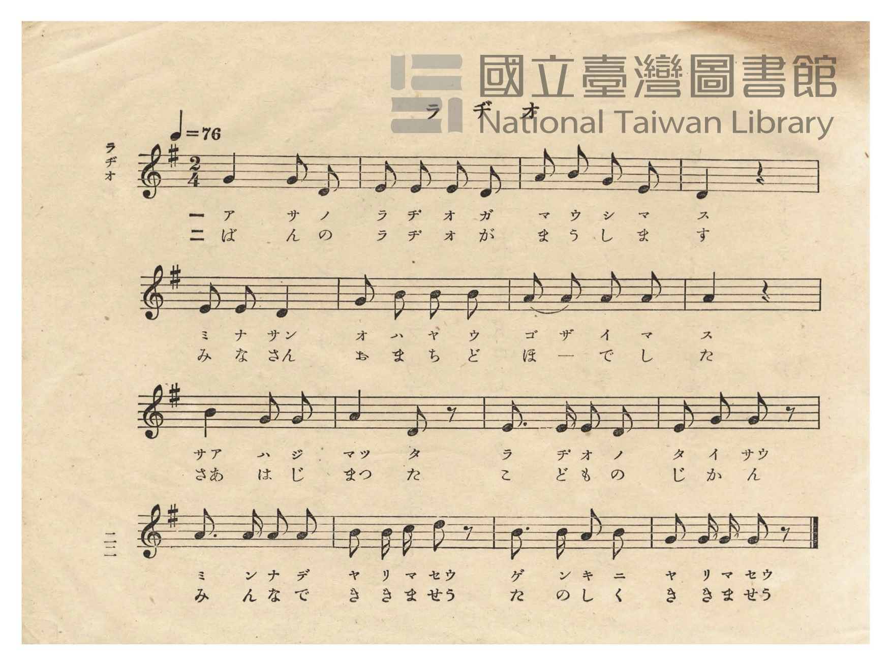
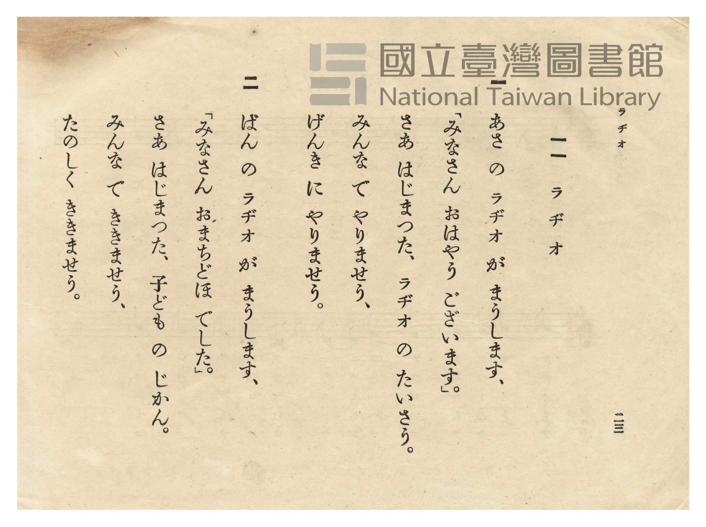

# ラヂオ（ラジオ）

> Re:Shōka 使用 AI 協助辨識與重建樂譜，可能會有錯誤。歡迎回報。

- **鋼琴伴奏版**：<br><audio controls src="rajio.mp3"></audio>
- **NEUTRINO 歌聲合成版**：<br><audio controls src="rajio_neutrino.mp3"></audio>

- 日治時期公學校唱歌（第二學年・第十一課）
- 國立臺灣圖書館典藏

## 說明


- 出處：臺灣總督府編《公學校唱歌》第二學年用，第十一課〈ラヂオ〉（ラジオ- 收音機廣播），原書第 22–23 頁（P024–P025）。
- 調性與拍號：ト調（G 大調），2/4 拍，速度 != 76。
- 背景與曲風：反映 1930 年代臺灣廣播事業（JFAK 臺北放送局等）與校園、家庭日常生活結合的現代化教材。
第一節描寫早晨收音機傳來播音員問候「みなさん おはやう ございます」與廣播體操（ラヂオのたいさう）；
第二節描寫晚間收音機播出兒童時間（子どものじかん），大家一起開心地收聽。
- 版本說明：本檔案為原書單聲部五線譜之忠實數位化版本。

### 編曲說明（鋼琴伴奏版）：

1. 前奏 (Intro, 4 小節)：取第四行「みんなで やりませう、げんきに やりませう」充滿朝氣的附點節奏動機作為前奏。
2. 主歌伴奏 (Rajio, 16 小節 × 2 段)：右手演奏原曲歌唱旋律；左手以富有廣播體操律動感的二拍子和聲伴奏。


## 歌詞

```text
一
あさ の ラヂオ が まうします、
「みなさん おはやう ございます。」
さあ はじまつた、ラヂオ の たいさう。
みんな で やりませう、
げんき に やりませう。

二
ばん の ラヂオ が まうします、
「みなさん おまちどほ でした。」
さあ はじまつた、子ども の じかん。
みんな で ききませう、
たのしく ききませう。
```

## ABC

```abc
X:1
T:ラヂオ（ラジオ）
M:2/4
L:1/16
Q:1/4=76
K:G
V:V1 name="Piano" snm="Pia"
[V:V1]
G4 G2 D2 | E2 E2 E2 D2 | A2 B2 G2 E2 | D4 z4 |
w: 1.~あ さ の | ラ ヂ オ が | ま う し ま | す
w: 2.~ば ん の | ラ ヂ オ が | ま う し ま | す
E2 E2 D4 | G2 B2 B2 B2 | A2 A2 A2 A2 | A4 z4 |
w: 1.~み な さ | お は や う | ご ざ い ま | す
w: 2.~み な さ | お ま ち ど | ほ ー で し | た
B4 G2 G2 | A4 D2 z2 | E3 E E2 D2 | E2 G2 G2 z2 |
w: 1.~さ は じ | ま た | ラ ヂ オ の | た い さ
w: 2.~さ は じ | ま た | こ ど も の | じ か ん
A3 A A2 A2 | B2 B c d2 z2 | B3 B A2 B2 | G2 G G G2 z2 |
w: 1.~み ん な で | や り ま せ | げ ん き に | や り ま せ
w: 2.~み ん な で | き き ま せ | た の し く | き き ま せ
```

## TMD 檔案連結

- [主旋律 TMD 檔案](rajio.tmd) [[在 TMD Studio 編輯](https://tmdlang.github.io/Tmd-TS/#tmd=s7IKdvYPcrWy4qpTUCpJTLdSSM7PyUlNLsnMz7PKzk9PzM7Ojy_OyM9OVIKrKMvPKc1NtUovSkxJjTdCiBfnlxYlp1oVJ2fk5-fEl6RWlCTl52cj5AuK8stS8xLzgGoKijLzSlJTwIoQClLLMlNSQdKpKZkl-UWZiTlIlqYWFYPcBLEkvqQoMa84uSizAORQhCqgpvTMPKuSxMzyxLz4_LS0zGSwKVpaCo-bVz5ubnrctOr9ng4Qu2kHmN2poKXFpWirYG7GZW-r4M5lY6RvYgcy79n0pc827X42s-nZnPlPW9c8Xbvj2YKFT6dsfLa2B2jC8zVrnuzqAQo-3bnlcfNuIPdpb-OTHQ0vVm0Cmgl20NM53c9Xd79o3_W8cfHTOdOezd7xcsmKp607XkzvV-Li0tdSsKUW4FJQUHjcMOHZ7E3PZ697sWrVsxl9jxsmgkWbdz9t3_Vi5tT3e2ZBXPJ8x97ncxc_3TXn-fYVjxu60Hz2uKEb2WfPp6x4v6cH2XOPG8CBBw7Ixw2dyGEJtOvZlG0v529-tnL-092Ln01aCwwJoPanffOBfgcaomBk9KhhspGxwssFjUCNAQZGJkA-kDIFKnzc0AR18ItV-581LH_R0f6su_fFzPlAlz9u7gAKArW4KzxdshzMBBkMjCkFoBog62XD_Ke7limAoxHJoOaeZzPXgwyavenlIqBPZj3t7302Y4GCoaWxgQLQe092L4ZGD9i5T3Z1P1sKdHSHl5ujtwJQ5mnP9GdT9r1saHy6seH5WqCVnSDDgGE1Z9JjoOC6bU93rQUmk6c7djyfMv_Zlt3Pt054OqHj-ayW5_37gGY_7Zn2bOrMZ3MnQJ2koAAK2x0Nz9c3POvvf7p-9bPpK5_NXIEItKbNT_a1AR0C5D6dvPDp1P6nDTMfN_Q8btz_uHHV48apj5smKzxu7HrcuP5xU8vjxjYgZ8rjxmmPG4GcfY8bgWp7gQ6EeObl6inPJgPDBim6Gtc9bpwPVjwVqBkchrMR7trVg3DXzFkvp02GuwtoGjARPW2d9Hz1UmB-AEoBjX26dsLjRmDMN4GNnfG4sRvoOmiEL1kODBtQetm6_eW07qf7m5_O2QA07UXjXkTkPO_seDZnDSSxAmMGyH62asqzhR3Pm3ZBEszTaeteNG562bziya4pz7fPerF2zpOdQLMWPF2_7NnUHU_29gKDF2IIyFBoFoBoBSbkFyvnPW1d8WxaOzBAnuxYC2Ksmvdi7XpgvgA5fkPvs_ZOBVDS08sqSAc6G2wA0MlgcxqBnpoKpNYhCg0grweIgaHc9rhxOiy4GyHWkhJDTcBIglgCjIQmILUeHHpAySWg2GloRLYS6ACkGIMFHtCypslA-4Cs5Qoge5qAFgINmA1WA3FT4ySwml4gazWmGrA5wHCAhAko-MEpEZhy4ZH-smHmsxWLgfHzshEYrbOAnnw6oQUY6kCVT9cBY7kR6A9gan06YTkoxpGSHCjGl3c_2QVMYCgpAaS4cRZE_fNN-54vnfdy8d5nu_cD0wZEHOgseETs6oH4YgMkQCmICKD8QlBCbdwNCi6wFmAoE4wFePKGxgI0gWOPgsZeMEKPAmDMAbMG0MJ-TCWYMTBz1pMdXcTEwJOdrcDCCBzAqJGAlEHxRAIwF0LUA9VAcyc4g0LEoZEAdBzl1RIUKGjpc3EFJWZl5lsFZCbm5TvUGNRUg8sdG0MzLTswq0bBUEEXDEG0aTyQqFEwA1EIAipqBCSNoQrB4jUQGRA0gNI1YEN9DGtAeRkqBsrSIHIdWAswPYF4zSBZUKoCyfRAZBr3gXltYHI6mASJgGRmYrfHCCS3AWYPMOVR3x5oKKGFBlgOHBKgEIFhSBghY4gIrhDaD7Yb4jZQGEH8AJLpAoutB4u0wF0LkpkC5k0DkxAZYsKIkE2QEFkIJkHhBpLZDQ6_PWCx5fCwAsnMxxVKoECApSUQRngfHGog9dCgBAcmcuoCs2H6wAqRAgrqZEiBAWbNgDoF5HAQfwnUWRArIJEPiX5Y5EOTBVgVLOggCRMctEiBRbJtjaCEBwk6UMGFbBtIJ7AEgwY4zGfQ4IIEjhFSaoGkJBMFU7jhkCA1huc-SKozBEPMgALFM8QqWGyDYg4oA0lFTV1gTwDLQiTHT0LS0wvWsxq_HrR0hdU-qEmgahDdPkjqgZTukNzXj18PVy0Xl66dArgkUwAylLkA)]
- [鋼琴伴奏 TMD 檔案](rajio_piano.tmd) [[在 TMD Studio 編輯](https://tmdlang.github.io/Tmd-TS/#tmd=s7IKdvYPcrWy4tLSUnjcvPJxc9PjplXv93SA2E07gOzHzbtfdu95PmHLkz1bni7tf97Z8X5Pp4KWFpeirYK5GZe9rYI7l42RvokdV52C0rPpS59t2v1sZtOzOfOftq55unbHswULn07Z-GxtD9DM52vWPNnVAxR8unML0Fgg92lv45MdDS9WbQKaqQQy4Omc7ueru1-073reuPjpnGnPZu94uWTF09YdL6b3K3Fx6Wsp2FILcCkoKDxumPBs9qbns9e9WLXq2Yy-xw0TwaLNu5-273oxc-r7PbMgLnm-Y-_zuYuf7przfPuKxw1daD573NCN7LPnU1a839OD7LnHDeDgBAft44ZOtNB9NmXby_mbn62c_3T34meT1gJDAqj9ad98oN-BhigYGT1qmGxkrPByQSNQY4CBkQmQD6RMgQofNzRBHfxi1f5nDctfdLQ_6-59MXM-0OWPmzuAgkAt7gpPlywHM0EGA2NKAagGyHrZMP_prmUK4GhEGAT0ITBIIOEB1IwZ9UCjQUoVFAz1FJ529gLFFTQ880qK8nUUTBSebuh_vr5BE6jmaf80UBDMnv1iITCAeh437n_cNPlx46rHjcsVHje1PG7qety473Hj7MeNbY8bGh83TgJL9z5uXI0p3fu0tfXZ7v3P5sx9tmHx81ktL2e2vNw9D2gR0PKn3VOBQfdk75znTbsgzoH6RUHBSE_hyY7dwAiCOF9BIygxKxPoTEMzqDsVDk9XMFJ4tm4rxMGbn3V2P9szBWQoKPQ3AXWCInh699N93e_3zH66fRlQwZPdS5-u73k2pxMSWy9XT3k2uReoAOSOlvlAxwHTATB8n66d8HRSz4vGTRC7oW6iPNVCgYKWPhcXONStAjIT8_KDPBxqDGqqwf62MTTTsgOzaoC-0wVCIzANwjUKxkDSGBhTpkDaAC4CEgPJg9g1CoZA0hAMoWq4alFs88Fhm2k8UHG0aSyQRGICzQNxwARYGGItmB9tiF0xWATMgtsPjjz8vgW5FwRBNNiEGgUzEIUgoKIwr4IUgsWhbgdBkIUgWAM21MewRuFxYxNU7HHjVDC5DqwFmIlBvGaQLDArg2V6IDKN-8C8NjA5HUyCREAyM7HbYwSS2wCzp2kyDeyBhhJaaIDlwCEBSRqwRABLMoikA0lM2ENoP9huiNtAYQTxA0imCyy2HizSAnctSGYKmDcNTEJkiAkjQjZBQmQhmASFG0hmNzj89oDFlsPDCiQzH1coQXIFJImAMML7SGkYHIrgwEROXWA2TB8k_SICCupkYJKCBkrjDKhTQA4H8ZdAnQWxAhL5kOiHRT40WYBVwYIOkjDBQYsUWCTb1ghKeJCge9wETnBw20A6Hzd2QwMc5jMqFzSoKQpiFSy2QTEHlIGkoqYusCeAVQSS4ych6ekF61mNXw9ausJqH9SkXiz2QVIPKIhgua8fvx60ggxXQYpUNiIxaxRMwBwTDHGkAhQibpaLIYGal3CbhctuXIU7HiuINQoSnLgcBBFHmIKIOBrXOLp2CuBKD2wXkAOOuGgfw1g0ASO4gDIXAA)]

## 分析

```text
================================================================================
📊 TMD Song Profile: [ ラヂオ（ラジオ） ]
================================================================================
⏱  Duration:       0:25 (25.3s), 16 measures total
🎼 Key & Tempo:    首調基準 G, != 76.0 BPM, <2/4>
   - 分析範圍：      由實際發聲的音符與和弦推測調性；播放脈絡另行呈現
🎤 人聲音域:    D4 (MIDI 62) – D5 (MIDI 74) [跨度: 12 個半音 / 1.0 個八度, 難度: easy]
   - 最低音:  D4 in [Rajio #1 @ m.1, 0:01]
   - 最高音: D5 in [Rajio #1 @ m.14, 0:21]
   - 適合: soprano, mezzo-soprano, contralto, tenor, baritone, bass
🏛  結構:      Rajio (25.3s)
⚡ 編曲密度:        Peak 1 軌道同時演奏
🗝  調性診斷：       G 大調（純淨自然大調，未偵測到可信轉調）
   - 風格氣質:    純淨自然大調（陽光明朗、易唱易記，無明顯調外色彩）
   - 轉調歷程:    全曲維持單一推測調性（未偵測到可信轉調）
   - 核心骨幹音:  A, G, B, E, D
   - 調性數值:    G 大調 [相關度: 0.73, 穩定度: Moderate, 自然音純度: 100.0%]
   - 候選調性 (K-S): G 大調 (0.73), D 大調 (0.69), E 小調 (0.67)
   - 五度圈歷程:   +1
   - 各段落調性細節:
     • [Rajio #1]: G 大調 (r: 0.73, 自然音純度: 100.0%)

  [ 五度圈游移軌跡 ]
               C  
         F           [G ]*
      Bb               D  
      Eb               A  
         Ab           E  
            Db       B  
               F# 
     (* = active key center)

  [ 十二半音累積音高分佈 ]
     C  : █                          0.9%
     C# :                            0.0%
     D  : ███████████████           16.1%
     D# :                            0.0%
     E  : █████████████████         17.9%
     F  :                            0.0%
     F# :                            0.0%
     G  : █████████████████████     21.4%
     G# :                            0.0%
     A  : ████████████████████████  25.0%
     A# :                            0.0%
     B  : ██████████████████        18.7%
--------------------------------------------------------------------------------
Assignment 軌道音域：
  - Piano         : D4 – D5 (12 個半音 / 1.0 個八度, 52 個音符)
================================================================================
```


## 原書掃描頁






