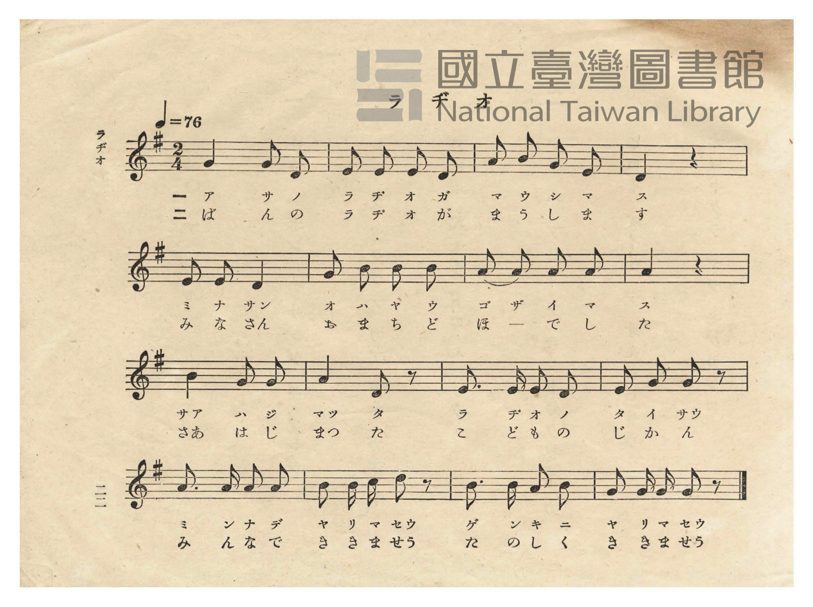
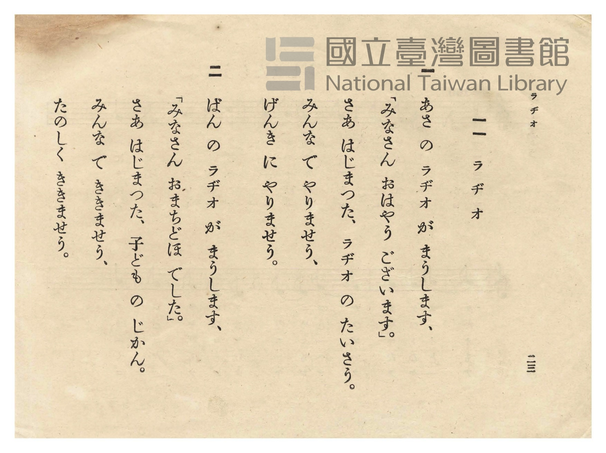

# ラヂオ（ラジオ）

> Re:Shōka 使用 AI 協助辨識與重建樂譜，可能會有錯誤。歡迎[回報](https://github.com/TMDLang/reshoka/issues)。

- **鋼琴伴奏版**：<br><audio controls src="rajio.mp3"></audio>
- **NEUTRINO 歌聲合成版**：<br><audio controls src="rajio_neutrino.mp3"></audio>

- 日治時期公學校唱歌（第二學年・第十一課）
- 國立臺灣圖書館典藏

## 說明


- 出處：臺灣總督府編《公學校唱歌》第二學年用，第十一課〈ラヂオ〉（ラジオ- 收音機廣播），原書第 22–23 頁（P024–P025）。
- 調性與拍號：ト調（G 大調），2/4 拍，速度 != 76。
- 背景與曲風：反映 1930 年代臺灣廣播事業（JFAK 臺北放送局等）與校園、家庭日常生活結合的現代化教材。
第一節描寫早晨收音機傳來播音員問候「みなさん おはやう ございます」與廣播體操（ラヂオのたいさう）；
第二節描寫晚間收音機播出兒童時間（子どものじかん），大家一起開心地收聽。
- 版本說明：本檔案為原書單聲部五線譜之忠實數位化版本。

### 編曲說明（鋼琴伴奏版）：

1. 前奏 (Intro, 4 小節)：取第四行「みんなで やりませう、げんきに やりませう」充滿朝氣的附點節奏動機作為前奏。
2. 主歌伴奏 (Rajio, 16 小節 × 2 段)：右手演奏原曲歌唱旋律；左手以富有廣播體操律動感的二拍子和聲伴奏。


## 歌詞

```text
一
あさ の ラヂオ が まうします、
「みなさん おはやう ございます。」
さあ はじまつた、ラヂオ の たいさう。
みんな で やりませう、
げんき に やりませう。

二
ばん の ラヂオ が まうします、
「みなさん おまちどほ でした。」
さあ はじまつた、子ども の じかん。
みんな で ききませう、
たのしく ききませう。
```

## ABC

<div class="abc-score" data-abc-src="rajio.abc" aria-label="五線譜載入中"></div>

[下載 ABC 原始檔](rajio.abc)

## TMD 檔案連結

- [主旋律 TMD 檔案](rajio.tmd) [[在 TMD Studio 編輯](https://tmdlang.github.io/Tmd-TS/#tmd=s7IKdvYPcrWy4qpTUCpJTLdSSM7PyUlNLsnMz7PKzk9PzM7Ojy_OyM9OVIKrKMvPKc1NtUovSkxJjTdCiBfnlxYlp1oVJ2fk5-fEl6RWlCTl52cj5AuK8stS8xLzgGoKijLzSlJTwIoQClLLMlNSQdKpKZkl-UWZiTlIlqYWFYPcBLEkvqQoMa84uSizAORQhCqgpvTMPKuSxMzyxLz4_LS0zGQUU6C6CxLTU60CDIxMdIGEKbL2kox8oL8KMiqtMjKLQW5ITsyJz07MQ_J-SUYq0PclqckZefk5-emVSlxaWgqPm1c-bm563LTq_Z4OELtpB5jdqaClxaVoq2BuxmVvq-DOZWOkb2IHMunZ9KXPNu1-NrPp2Zz5T1vXPF2749mChU-nbHy2tgdowvM1a57s6gEKPt255XHzbiD3aW_jkx0NL1ZtApoJdsrTOd3PV3e_aN_1vHHx0znTns3e8XLJiqetO15M71fi4tLXUrClFuBSUFB43DDh2exNz2eve7Fq1bMZfY8bJoJFm3c_bd_1YubU93tmQVzyfMfe53MXP9015_n2FY8butB89rihG9lnz6eseL-nB9lzjxvAgQcOyMcNnchhCbTr2ZRtL-dvfrZy_tPdi59NWgsMCaD2p33zgX4HGqJgZPSoYbKRscLLBY1AjaDYBfJB8QtU-LihCergF6v2P2tY_qKj_Vl374uZ84Euf9zcARQEanFXeLpkOZgJMhgYUwpANUDWy4b5T3ctUwBHI5JBzT3PZq4HGTR708tFQJ_Metrf-2zGAgVDS2MDBaD3nuxeDI0esHOf7Op-thTo6A4vN0dvBaDM057pz6bse9nQ-HRjw_O1QCs7QYYBw2rOpMdAwXXbnu5aC0wmT3fseD5l_rMtu59vnfB0QsfzWS3P-_cBzX7aM-3Z1JnP5k6AOklBARS2Oxqer2941t__dP3qZ9NXPpu5AhFoTZuf7GsDOgTIfTp54dOp_U8bZj5u6HncuP9x46rHjVMfN01WeNzY9bhx_eOmlseNbUDOlMeN0x43Ajn7HjcC1fYCHQjxzMvVU55NBoYNUnQ1rnvcOB-seCpQMzgMZyPctasH4a6Zs15Omwx3F9A0YCJ62jrp-eqlwPwAlAIa-3TthMeNwJhvAhs743FjN9B10AhfshwYNqD0snX7y2ndT_c3P52zAWjai8a9iMh53tnxbM4aSGIFxgyQ_WzVlGcLO5437YIkmKfT1r1o3PSyecWTXVOeb5_1Yu2cJzuBZi14un7Zs6k7nuztBQYvxBCQodAsANEKTMgvVs572rri2bR2YIA82bEWxFg178Xa9cB8AXL8ht5n7Z0KoKSnl1WQDnQ22ACgk8HmNAI9NRVIrUMUGkBeDxADQ7ntceN0WHA3QqwlJYaagJEEsQQYCU1Aaj049ICSS0Cx09CIbCXQAUgxBgs8oGVNk4H2AVnLFUD2NAEtBBowG6wG4qbGSWA1vUDWakw1YHOA4QAJE1Dwg1MiMOXCI_1lw8xnKxYD4-dlIzBaZwE9-XRCCzDUgSqfrgPGciPQH8DU-nTCclCMIyU5UIwv736yC5jAUFICSHHjLIj655v2PV867-Xivc927wemDYg40FnwiNjVA_HFBkiAUhARQPmFoITauBsUXGAtwFAmGAvw5A2NBWgCxx4Fjb1ghB4FwJgDZg2ghf2YSjBjYOasJzu6iImBJztbgYUROIBRIwEpg-KJBGAuhKgHqoHmTnAGhYhDIwHoOMqrJShQ0NLn4gpKzMrMtwrITMzLd6gxqKkGlzs2hmZadmBWjYKhgi4YgmjTeCBRo2AGohAEVNQISBpDFYLFayAyIGgApWvAhvoY1oDyMlQMlKVB5DqwFmB6AvGaQbKgVAWS6YHINO4D89rA5HQwCRIByczEbo8RSG4DzB5gyqO-PdBQQgsNsBw4JEAhAsOQMELGEBFcIbQfbDfEbaAwgvgBJNMFFlsPFmmBuxYkMwXMmwYmITLEhBEhmyAhshBMgsINJLMbHH57wGLL4WEFkpmPK5RAgQBLSyCM8D441EDqoUEJDkzk1AVmw_SBFSIFFNTJkAIDzJoBdQrI4SD-EqizIFZAIh8S_bDIhyYLsCpY0EESJjhokQKLZNsaQQkPEnSgggvZNpBOYAkGDXCYz6DBBQkcI6TUAklJJgqmcMMhQWoMz32QVGcIhpgBBYpniFWw2AbFHFAGkoqausCeAJaFSI6fhKSnF6xnNX49aOkKq31Qk0DVILp9kNQDKd0hua8fvx6uWi4uXTsFcEmmAGQocwEA)]
- [鋼琴伴奏 TMD 檔案](rajio_piano.tmd) [[在 TMD Studio 編輯](https://tmdlang.github.io/Tmd-TS/#tmd=s7IKdvYPcrWy4qpTUCpJTLdSSM7PyUlNLsnMz7PKzk9PzM7Ojy_OyM9OVIKrKMvPKc1NtTJCiBTnlxYlp-JSD5GNL0hMT7UKMDAy0QUSpgjpgqL8stS8xDygASWJmeWJefHpQIGivPyi-PTUvNSixByE2tSyzJRUkMqCoszcxKLK-JT8ZKBb8kqQXJdaVAxyfEFmYl5-fGJRUWJeeiqqkvyikoz89KLEgoxKq4zM4pL8oszkxJz47MQ8JFeXZAB1WZWkJmfk5efkp1cqcWlpKTxuXvm4uelx06r3ezpA7KYdQPbj5t0vu_c8n7DlyZ4tT5f2P-_seL-nU0FLi0vRVsHcjMveVsGdy8ZI38QOZPaz6Uufbdr9bGbTsznzn7auebp2x7MFC59O2fhsbQ_QzOdr1jzZ1QMUfLpzC9BYIPdpb-OTHQ0vVm0Cmgl23NM53c9Xd79o3_W8cfHTOdOezd7xcsmKp607XkzvV-Li0tdSsKUW4FJQUHjcMOHZ7E3PZ697sWrVsxl9jxsmgkWbdz9t3_Vi5tT3e2ZBXPJ8x97ncxc_3TXn-fYVjxu60Hz2uKEb2WfPp6x4v6cH2XOPG8DBCQ7axw2daKH7bMq2l_M3P1s5_-nuxc8mrQWGBFD70775QL8DDVEwMnrUMNnIWOHlgkagRlAKA_JBaQyo8HFDE9TBL1btf9aw_EVH-7Pu3hcz5wNd_ri5AygI1OKu8HTJcjATZDAwphSAaoCslw3zn-5apgCORoRBQB8CgwQSHkDNmFEPNBqkVEHBUE_haWcvUFxBwzOvpChfR8FE4emG_ufrGzSBap72TwMFwezZLxYCA6jnceP-x02THzeuety4XOFxU8vjpq7HjfseN85-3Nj2uKHxceMksHTv48bVmNK9T1tbn-3e_2zO3GcbFj-f1fJyZsvL3fOAFgEtf9o9FRh0T_bOed60C-IcqF8UFIz0FJ7s2A2MIIjzFTSCErMygc40NIO6U-HwdAUjhWfrtkIcvPlZZ_ezPVNAhoJCfxNQJyiCp3c_3df9fs_sp9uXARU82b306fqeZ3M6IbH1cvWUZ5N7gQpA7miZD3QcMB0Aw_fp2glPJ_W8aNwEsRvqJspTLRQoaOlzcYFD3SoAVBIEeTjUGNRUg_1tY2imZQdm1QB9pwuERmAahGsUjIGkMTCmTIG0AVwEJAaSB7FrFAyBpCEYQtVw1aLY5oNsmwXcMtN4hWjTWBgFNCYehIBcAwgn2hBVEsgGkkBJkPHguMHvGZBzQBBEA_WCXGoGohAEVBTmE5BCsDjYbRDNIP-AYA3YUB_DGoXHjU1QsceNU8HkOrAWYB4F8Zp2gMlVYJkeiEzjPjCvDUxOB5MgEZDMTOz2GIHkNsDsaZpMA3ugoYQWGmA5cEhAYh4Wx7AUgUgZkLSCPYT2g-2GuA0URhA_gGS6wGLrwSItcNeCZKaAedPAJESGmDAiZBMkRBaCSVC4gWR2g3jNe8Biy-FhBZKZjyuUIIkekkRAGOF9cKhBcgY4FMGBiZy6wGyYPkj2QAQU1MnAJAUNlMYZUKeAHA7iL4E6C2IFJPIh0Q-LfGiyAKuCBR0kYYKDFimwSLatEZTwIEH3uAmU7BG2gXQ-buyGBjjMZ1QuR1BTFMQqWGyDYg4oA0lFTV1gTwBrACTHT0LS0wvWsxq_HrR0hdU-qEm9WOyDpB5QEMFyXz9-PWgFGY5yEloUQqkaBRMgwwSJDy0jQXyzXCQBhJcw9aCbiV4WYzECtxZQeY1uAYgPUQ0qsKlQ4OvaKYCrFLBZQA443KJ9DGPRBIzgAspcAA)]

## 分析

```text
================================================================================
📊 TMD Song Profile: [ ラヂオ（ラジオ） ]
================================================================================
⏱  Duration:       0:25 (25.3s), 16 measures total
🎼 Key & Tempo:    首調基準 G, != 76.0 BPM, <2/4>
   - 分析範圍：      由實際發聲的音符與和弦推測調性；播放脈絡另行呈現
🎤 人聲音域:    D4 (MIDI 62) – D5 (MIDI 74) [跨度: 12 個半音 / 1.0 個八度, 難度: easy]
   - 最低音:  D4 in [Rajio #1 @ m.1, 0:01]
   - 最高音: D5 in [Rajio #1 @ m.14, 0:21]
   - 適合: soprano, mezzo-soprano, contralto, tenor, baritone, bass
🏛  結構:      Rajio (25.3s)
⚡ 編曲密度:        Peak 1 軌道同時演奏
🗝  調性診斷：       G 大調（純淨自然大調，未偵測到可信轉調）
   - 風格氣質:    純淨自然大調（陽光明朗、易唱易記，無明顯調外色彩）
   - 轉調歷程:    全曲維持單一推測調性（未偵測到可信轉調）
   - 核心骨幹音:  A, G, B, E, D
   - 調性數值:    G 大調 [相關度: 0.73, 穩定度: Moderate, 自然音純度: 100.0%]
   - 候選調性 (K-S): G 大調 (0.73), D 大調 (0.69), E 小調 (0.67)
   - 五度圈歷程:   +1
   - 各段落調性細節:
     • [Rajio #1]: G 大調 (r: 0.73, 自然音純度: 100.0%)

  [ 五度圈游移軌跡 ]
               C  
         F           [G ]*
      Bb               D  
      Eb               A  
         Ab           E  
            Db       B  
               F# 
     (* = active key center)

  [ 十二半音累積音高分佈 ]
     C  : █                          0.9%
     C# :                            0.0%
     D  : ███████████████           16.1%
     D# :                            0.0%
     E  : █████████████████         17.9%
     F  :                            0.0%
     F# :                            0.0%
     G  : █████████████████████     21.4%
     G# :                            0.0%
     A  : ████████████████████████  25.0%
     A# :                            0.0%
     B  : ██████████████████        18.7%
--------------------------------------------------------------------------------
Assignment 軌道音域：
  - Piano         : D4 – D5 (12 個半音 / 1.0 個八度, 52 個音符)
================================================================================
```


## 原書掃描頁






