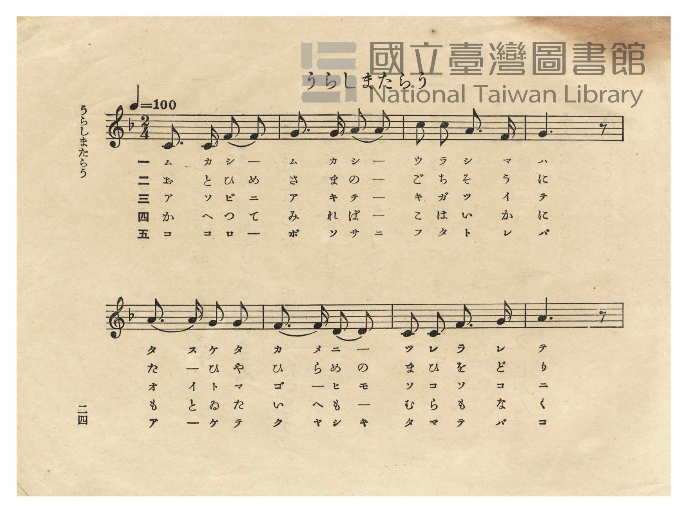
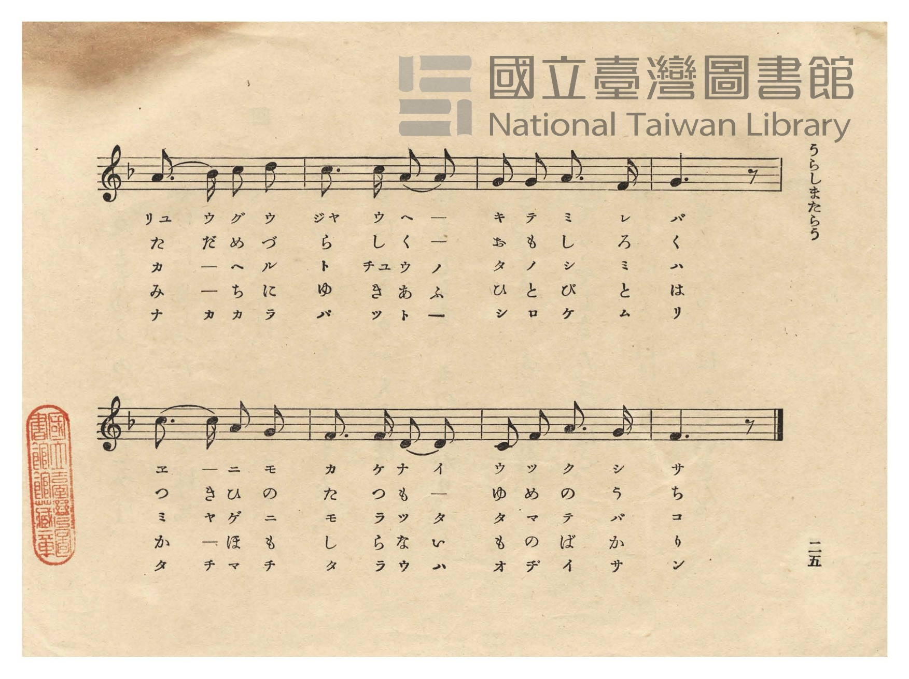
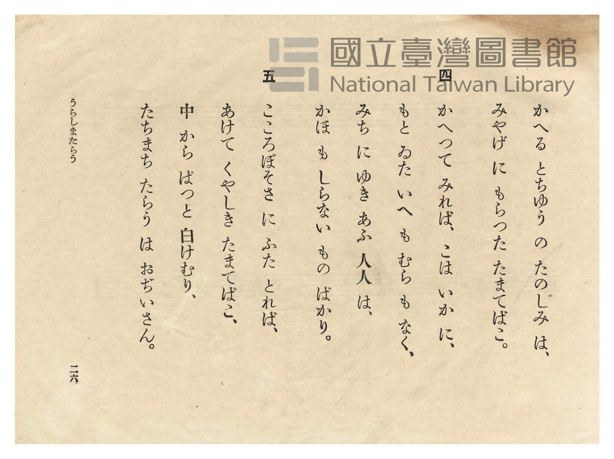
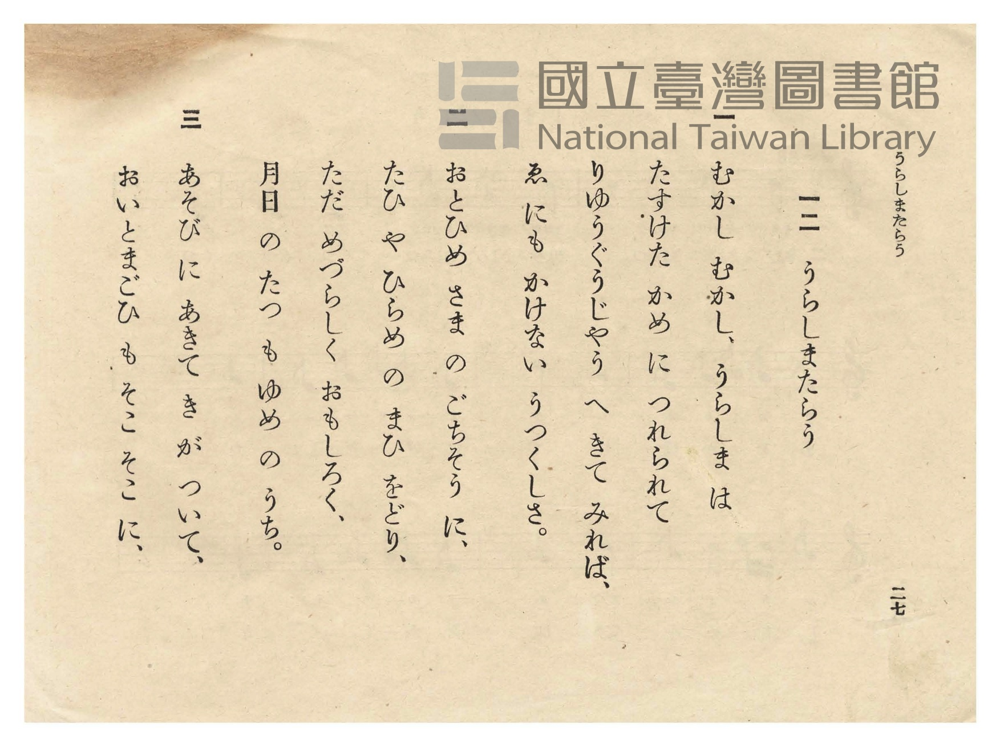

# うらしまたらう（浦島太郎）

> Re:Shōka 使用 AI 協助辨識與重建樂譜，可能會有錯誤。歡迎回報。

- **鋼琴伴奏版**：<br><audio controls src="urashimataro.mp3"></audio>
- **NEUTRINO 歌聲合成版**：<br><audio controls src="urashimataro_neutrino.mp3"></audio>

- 作詞：石原和三郎（幼年唱歌）
- 作曲：田村虎藏（幼年唱歌）
- 日治時期公學校唱歌（第二學年・第十二課）
- 國立臺灣圖書館典藏

## 說明


- 出處：臺灣總督府編《公學校唱歌》第二學年用，第十二課〈うらしまたらう〉（浦島太郎），原書第 24–27 頁（P026–P029）。
- 調性與拍號：ヘ調（F 大調），2/4 拍，速度 != 100。
- 背景與曲風：原出自 1900 年《幼年唱歌》及 1911 年文部省《尋常小學唱歌（一）》第十二課〈浦島太郎〉
（亦收錄於《新定公學校唱歌集》第二學年用第七課 `2_07_urashimataro`）。全曲共五節，敘述浦島太郎搭救海龜、
前往龍宮城觀賞鯛魚與比目魚曼妙舞姿、攜玉手箱返鄉卻見人事全非、打開玉手箱化作白髮老翁的故事。
- 版本說明：本檔案為原書單聲部五線譜之忠實數位化版本。

### 編曲說明（鋼琴伴奏版）：

1. 前奏 (Intro, 4 小節)：以第四行「ゑにも かけない うつくしさ」優美流暢的五聲音階終止句作為前奏。
2. 主歌伴奏 (Urashimataro, 16 小節 × 5 段)：右手演奏原曲歌唱旋律；左手以輕快二拍子和聲伴奏。


## 歌詞

```text
一
むかし むかし、うらしま は
たすけた かめ に つれられて
りゆうぐうじやう へ きて みれば、
ゑ にも かけない うつくしさ。

二
おとひめ さま の ごちそう に、
たひ や ひらめ の まひ をどり、
ただ めづらしく おもしろく、
月日 の たつ も ゆめ の うち。

三
あそび に あきて き が ついて、
おいとまごひ も そこ そこ に、
かへる とちゆう の たのしみ は、
みやげ に もらつた たまてばこ。

四
かへつて みれば、こは いかに、
もと ゐた いへ も むら も なく、
みち に ゆき あふ 人人 は、
かほ も しらない もの ばかり。

五
こころぼそさ に ふた とれば、
あけて くやしき たまてばこ、
中 から ぱつと 白けむり、
たちまち たらう は おぢいさん。
```

## ABC

<div class="abc-score" data-abc-src="urashimataro.abc" aria-label="五線譜載入中"></div>

[下載 ABC 原始檔](urashimataro.abc)

## TMD 檔案連結

- [主旋律 TMD 檔案](urashimataro.tmd) [[在 TMD Studio 編輯](https://tmdlang.github.io/Tmd-TS/#tmd=s7IKdvYPcrWy4qpTUCpJTLdSSM7PyUlNLsnMz7PKzk9PzM7Ojy_OyM9OVIKrKMvPKc1NtUovSkxJjTdCiBfnlxYlp1oVJ2fk5-fEl6RWlCTl52cj5AuK8stS8xLzgGoKijLzSlJTwIoQClLLMlNSQdKpKZkl-UWZiTlIlqYWFYPcBLEkvqQoMa84uSizAORQhCqgpvTMPKvc_LykUqCrMSVSM7MykZympaXwuLHtcVPn48bpjxv3PW6cD2a3vd_T8Wzrsqebtz1dsuplc9_7PZ0KWlpcirYKhgYGXPa2Cm5cNkb6JnYg459NX_ps0-5nM5uezZn_tHXN07U7ni1Y-HTKxmdre4CmPF-z5smuHqDg051bHjfvBnKf9jYCRV6s2gQ0FOy-J3vnvFg57_2eWc_nb37aN__ppJ4nOzrBlnY83bkHqA9mGFz5s9lAzbOeT9nwbO7EFzP7Xkzvx6H26Zzu56u7X7Tvet64-Omcac9m73i5ZMXT1h1AHUpcXPpaCrbUAlwKCgqPGyYAXfZ89roXq1Y9m9H3uGEiWLR599P2XS9mTgU6GeKS5zv2Pp-7-OmuOc-3r3jc0IUWaI8bupED7fmUFe_39CCH2-OGDqxx9rihEzPagHqBYQr0ONAEBSOTRw2TjcwVXi5oBKoMMDAyA_KBlCVQ4eOGJqhrX6za_6xh-YuO9mfdvS9mzgc6-3HzDKAgUIubwtMly8FMkMHAFKAAVANkvWyY_3TXMgVI-kAyqbnn2cz1IJNmb3q5COiPWaD4BQZG-yoFQ0sDAwVQogAGAFLMAX3_tL8LKGtoCJJ9Nq39ZfOK53MaQco2dD_dsePphn5QwMDS15MdDWDHg8IMOYSQgwEYMCAHKSiA1O9a9mzKtpc9Lc-m7QGa-WzahqfrZqHFwMvZwLBEjwQQd0cz0HCFBKN4A_P40qLE4ozM3MSSxKL8BEj4PW1dAfTo09aNT3ZNeb4e6K6eZ1NnvNi_AdktzyasfTZ14rOt21_um_O4oRHirqedvU_3Nbzc1_t03bqn8_teLG94sXney_WzX66dBQq89VOAaQrIfjZ7z9NlM190zHu6fD9Q77Mpc573dT7r7H6-buOL_VNetnQ-7d39Yln3k127nuzqBjrm5dx5IGWdk19O64arfNozDZiDns_c-3L1uhcNjc_3Nz6f1fJsaitQCyLinnd2PJuzBpKMgbEGZD9bNeXZwo7nTbsgqenptHUvGjcBowbk1e2zXqyd82Rn99P9C56uX_Zs6o4ne3uB1kAMARkKzRwQrcAABmZ3UFhNawf67smOtSDGqnkv1q4H5hhQRt7Q-6y9UwGYLi2gyVMvqyAdGMRgc4ARDjauqeFxYzcwByBYQL8i5wtgwbYerBKYPxpnPm6cCGQAOd2PmxqB1GogXvK4qQekHEg2LoMY2vW4qQ1kSOMEMDnjcVMLkAFUuwOIe4HKgNR-sIYN0Nh73DQRZNzjpiaw4SBrVj1ubAEXq0AbGvvBrpkKDVug9yBeBeWFffPAEQ8iQWkFKZW8WLT6ye5pwITyYut2UPSAk8vTHduQUwkwIJ7P6QaVDXPmP5ux_mXD4udTVz_ZOR9E7ugF5rIn-9qAep_v63u5azooG25cCHQEPBh39UACp-tx44rHjZsgoTIVEm7rgHjK48aFjxvnQny_GuZZUFhuAvoZ5D-gHmDYgbSB1APLIZDEpMeNK0HBiKR-AVAYGDNLYTHTD7a1qQnEaQKGaT9U8bM5HcC6BGocUN8SoD5goAIjBG4JMEhBnsAIyTkrnuyc-XT5GmBGfrJjN8jXs2c_a259tmbf032tT3aAQgk5UwGrGHimAgUvOF-B0mUHsBrqedq_6sWyXU_3TQcVDkvbn_YDk3Hni22LQXG0dhPIlVsbXzbMfbp3-9O9-1827wXa_nTJoqeLmoFZAJiakQN5B7jgedwI9CswJDdD0x2QB01KvUDcA06JjcB0tgweasBIAfKB8QIMVWBEgAIWlLyAZkxGUIhIASa7HY-buoEsoJaFkCSMCMd14FDfD8oPcB3ANAy0YBLEQcCoAEUN0BGgDALUAbR1GSiFN07GEtjP-1YCw-b57IUvOjqe7ut5Onvey8a-50vnAZMbKPB62kBowkRIVLzYt_bFQmA5DQy5HS8bpjzZ0fVsTgOoobCvFRjwIPUbNgITL6hEatr1ZM8WUBm1bB2whAZGGigaYaUWUqA-nT0bydcgV6NmSpCrG9cDhYAeBCqBhxIowa0AUsCcDfImUBaYp8EJrAHofWgIA7MuLDmCzGxcCA0hYIiC4gpoxFZg1gGWr7tQghNoz26oCcA0DQxLSBEAshIUCcCQBBY7wEyBmXJnz3vaAayCtgFLb3iGftkw8_nKbc9Xg7L1swZg9t0DVAYsn9_vmQ8qQuesebK3Hxg4QF2g2gHYBOrrAiZDYKYHF_6gWHixfT0wqF_s73s5d9GLrRsgJQHQ0U9BBWwPqOwFhjlQ_areF2tnAKWAyp6unYJSPEyB-AwYlpPBuXQPON1NhSbhrZBAXIFaFILCB1j-geKjH5zAgOkOFGxoSQqsGJhTIKUxMOgbN4LjcYUCsFoCmQCKEZQiBFgSAQ0ARQa0rQMKfUg-WQSOyqmPm7ClVVDWXLsEWFk9b1n4tGslqK7pawDVhrMnvZiMKDuf7F4CDJxnTVOeNa5ATnWgkFy8EBQ4M6c_nbPhadskULG6o-HlzMVAlz5vnQlSsLfz-Zw9L6dNhpTcwPT8Yl3Xs44JwIgAVa8du4AIGrBAx1He0IQCBS19Lq5QpDaIVUBmYl6-Q41BTTW4UWFjaKZlB2bVKJjGK-gCIZAyBFIgXKNgBBYyUjAGkiAMVAVSAuWBVMHUQKABSA3YPB_DGmAbYQFY9HETKHdsB7Ga94BNwSPTtAzMWwmWBcmAePPAevqx22QElGvsgqgEZV5gSQjS2wgxD5gaITKQOgvJpsYpYPGFYHIuVFUbWGY1dpuMQe5bBHX5XqBJk8HmdUNdDpMBptnmNhQ_rQWLrwGLtUBVLQH7CaQOi00mIFeAzAW5CdSsWAJmgcIGJLMfagaoWtiA4iewi4DJHkRCbQKag8dPpiD3bYaaB6x8msFuhcfTHIRvm7Yi-7YZFK6Pm0AuedzcAVHVvAYsMwHDJmgSgyQaY3CSAeEacDIDJSMzUOIDE9CECCYgskZwnVgTGdgJIKfsBOKNcEeBZCBeftwMLBPAzkZ4CxQ0IOfCkhrC8TgiBJzI5kNV7oEnMpA5IBkQD8QHVRGghAdJaiCZfWAeRPUkiKrGlWDXQZIs9kS2CmoesHkDDlxQFoD4aQvUDcBquRmU4BCJbC9YBygqIWwID-QnSELCmsiA1RE84zSBIg7iS5DLYckHUgMi29QA9SuIhOlfBdaDI4uCExkse2yEZY8mUDIFuQ-UuCHZHZpV4DZBkhfI77CYASUvRJLFmchMwKWUGdgYEAtUaiFKMVgCJK4Ug0ZGM7DKgpROTaA8ByurQHxgEIE9AREB6ZkB5kE8A3P4fLAMKNHBPIIziUHaw2DWUqhdoOAG8YGdGXAwI_I8KCFBowgoC3FRL77oACcxWOYAJmaIa5tBIiAXwnIzsEEN9DOyr_rAPEikgNiQSAPJQNwNEgfZiV6SQbMoOONAyluoXU3QsIE0nMAsUCkDy1KgZAkioeUTkAeSASUbHImsGVoPgOsVkB2Q7A2SmQh1A7DJBc1SsEQGqX_AcQUuQEC8BWA9kJjHksiQkxSBkgwkAUlnoIIMogx7OoPZDYoRSHEFyjJIcQXOOpDYBqU2RG0JLs7A2QkeI-DSGotN4FQGzXDgUIeEM6y4gqU_SL8KOZQgWRZRuIFoSG0JilEcqQyaLkC543ET2CZ4_QEtDoDxA3M_rNgmJdNj1paQNjYsLyDnnFXQQg3hJ4g6cKsAXI-CaHBtiatwBhdksNQMyh8QV0LbGnAZoJ-gMQPKDbAC_XEz2D5w3IHoreBwwPRTLReXrp0CcrtNAchX5gIA)]
- [鋼琴伴奏 TMD 檔案](urashimataro_piano.tmd) [[在 TMD Studio 編輯](https://tmdlang.github.io/Tmd-TS/#tmd=s7IKdvYPcrWy4tLSUnjc2Pa4qfNx4_THjfseN84Hs9ve7-l4tnXZ083bni5Z9bK573Hz7pfde55P2PJkz5anS_ufd3a839OpoKXFpWirYGhgwGVvq-DGZWOkb2LHVaeg9Gz60mebdj-b2fRszvynrWuert3xbMHCp1M2PlvbAzT3-Zo1T3b1AAWf7twCNBfIfdrbCBR5sWoT0FAlkAFP9s55sXLe-z2zns_f_LRv_tNJPU92dAKdAdT9dOceoD6YYXDlz2YDNc96PmXDs7kTX8zsezG9H4fap3O6n6_uftG-63nj4qdzpj2bvePlkhVPW3cAdShxcelrKdhSC3ApKCg8bpgAdNnz2eterFr1bEbf44aJYNHm3U_bd72YORXoZIhLnu_Y-3zu4qe75jzfvuJxQxdaoD1u6EYOtOdTVrzf04Mcbo8bOrDG4uOGTrSIBAYDUC8wTIEeB5qgYGTyqGGykbnCywWNQJUBBkZmQD6QsgQqfNzQBHXti1X7nzUsf9HR_qy798XM-UBnP26eARQEanFTeLpkOZgJMhiYAhSAaoCslw3zn-5apgBJHwiTgP4DBggkNIC6MRMV0GyQUgUFQz2Fp529QHEFDc-8kqJ8HQUThacb-p-vb9AEqnmyeykoAGbPfrEQGDw9j5smPm5c_bipCZiaux83AjmrHje2gJN245LHjf3gcJn6uKH3acuq5_v6nm1tfDZr0fNZLU92TXnRuOnl_M0vZ_U939r0bO2ip_1LgcnpedMuiOVQlysoGOkpPNmxGxgZEMcqaIQWJRZnZOYmliSC3GZoBnWcwuHpCqYKz9ZtBbnyaf_mZ53dz_ZMAeoAh_kmoAGgOJ3e_XRf9_s9s59uXwZUAPTMiz1Tn-5fDYxNYOg9XTsBmOKB7oJYBXUC5QkSChS09Lm4wEFqFZCZmJcf5OFQY1BTDfamjaGZlh2YVQP0hS4QmioYA0kjIK5RMASLGCqYxQMpMAFUBaJAEiBlIIUwZRBoAFLEVYtioQ-yhRZw-wzjFaINY8GUaSyCbwKkTEB8oE0gPohClgdhA4gdyFFCwG8gVwM9Fw92LAjXgP0I8gDIIyAMCQEQhnjNEK4G2Wsg83wMa4BpewFY9HHTaiDeDmI17wGbgkemaRmYtxIsC5IB8eaB9fRjt8kIKNfYBVHZuAKIN4H1NkLMa5wKldkHxOuQbWqcAhZfCCbnQlW1gWVWY7fJGOS-RVCX7wWaNBlsXjfU5TCZtUCxNhQ_rQWLrwGLtUBVLQH7CaQOi00mIFeAzAW5aQcQLwGzQGEDktkPNaMHyN6A4iewixrXg0moTUBz8PjJFOS-zVDzNgNNArsVHk9zEL5t2ors22ZQuD5uArnkcXMHRFXzGrDMBAyboEkMkmiMwUmGQPaB5yFI_oHoxJrIwE4AOWUnEG-EOwokA_Hy4-aFUGcjvAUKGpBzYUkN4XgcEQJOZPOhKvfAExnIHJAMiAfid0ITHiSpgWT2gXkQ1ZMgqhpXgl0HSbLYE9kqqHlLoIELygIQP22BumESEIMSHCKR7QXrAEUlhA3hgfwESUhYExmweoBnnCZQxEF8CXI5LPkAkx9YFcKmBqhfQSRM_yqwHhxZFJzIYNljIyx7NIGSKch9oMQNye7QrAK3CZK8QH6HxQwoeSGSLM5EZgIupczAxiCX2pBSDJYAiSvFoJHRvAxWOjWB8hysrALxgUEE9gREBKRnBpgH8QzM4fPBMqBEB_MIziTWuACekJZC7QIFN4g_HRrMiDwPSkjQKALKQlzUiy86wEkMljmAiRni2maQCMiFsNzcCPYzsq_6wDxIpIDYkEgDyUDcDRIH2YlekkGzKDjjQMpbqF1N0LBp7AViiA9ApQwsS4GSJYiElk9AHkgGlGxwJLJmaD0ArldAdkCyN0hmItQNwCYQNEvBEhmk_gHHFbgAAfEWgPVAYh5LIqNiQwCRzmB2g2IEUlyBsgxSXIGzDiS2QakNUVuCizNwdoLHCLi0xmITOJVBMxw41CHhDCuuYOkPWPCgZXpIlkUUbiAaUluCYhRHKoOmC1DueNwEtglef0CLA2D8wNwPK7ZJyfSYteVulLyAnHNWQQs1hJ8g6sCtAnA9CqLBtSWuwhlckMFSMyh_QFwJbWvAZYB-gsYMKDfACvTHzWD7wHEHoreCwwHTT1ibbYRbiEAK0iIENgXhfBzyQArUQEQxA70VCW9l4miFAikMM0AUuh6s7sLjDgpau7p2CuBGNdhAIAc5GKN9DGOxixvhEDfGIW6CQ9wULq7MBQA)]

## 分析

```text
================================================================================
📊 TMD Song Profile: [ うらしまたらう（浦島太郎） ]
================================================================================
⏱  Duration:       0:19 (19.2s), 16 measures total
🎼 Key & Tempo:    首調基準 F, != 100.0 BPM, <2/4>
   - 分析範圍：      由實際發聲的音符與和弦推測調性；播放脈絡另行呈現
🎤 人聲音域:    C4 (MIDI 60) – D5 (MIDI 74) [跨度: 14 個半音 / 1.2 個八度, 難度: moderate]
   - 最低音:  C4 in [Urashimataro #1 @ m.1, 0:00]
   - 最高音: D5 in [Urashimataro #1 @ m.9, 0:10]
   - 適合: soprano, mezzo-soprano, contralto, tenor, baritone, bass
🏛  結構:      Urashimataro (19.2s)
⚡ 編曲密度:        Peak 1 軌道同時演奏
🗝  調性診斷：       F 大調（純淨自然大調，未偵測到可信轉調）
   - 風格氣質:    純淨自然大調（陽光明朗、易唱易記，無明顯調外色彩）
   - 轉調歷程:    全曲維持單一推測調性（未偵測到可信轉調）
   - 核心骨幹音:  A, G, F, C, D
   - 調性數值:    F 大調 [相關度: 0.75, 穩定度: Moderate, 自然音純度: 100.0%]
   - 候選調性 (K-S): F 大調 (0.75), C 大調 (0.71), A 小調 (0.67)
   - 五度圈歷程:   -1
   - 各段落調性細節:
     • [Urashimataro #1]: F 大調 (r: 0.75, 自然音純度: 100.0%)

  [ 五度圈游移軌跡 ]
               C  
        [F ]*          G  
      Bb               D  
      Eb               A  
         Ab           E  
            Db       B  
               F# 
     (* = active key center)

  [ 十二半音累積音高分佈 ]
     C  : ██████████████████        20.0%
     C# :                            0.0%
     D  : ████████                   8.3%
     D# :                            0.0%
     E  :                            0.0%
     F  : ███████████████████       20.8%
     F# :                            0.0%
     G  : █████████████████████     23.3%
     G# :                            0.0%
     A  : ████████████████████████  26.7%
     A# : █                          0.8%
     B  :                            0.0%
--------------------------------------------------------------------------------
Assignment 軌道音域：
  - Piano         : C4 – D5 (14 個半音 / 1.2 個八度, 52 個音符)
================================================================================
```


## 原書掃描頁










