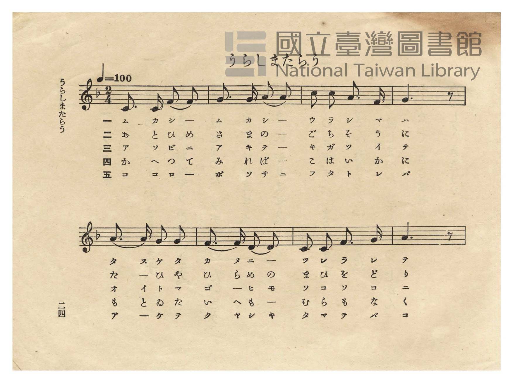
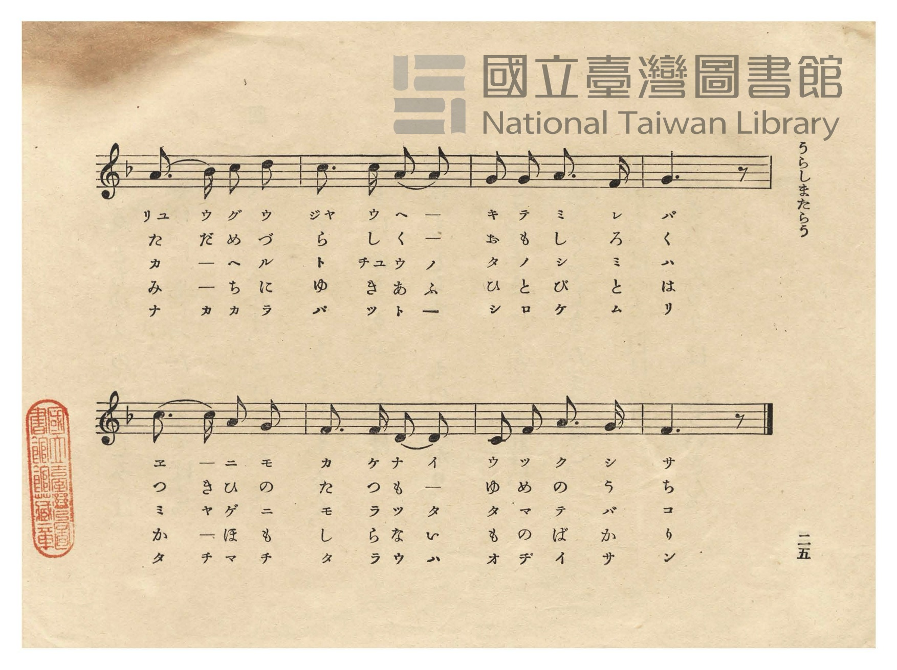
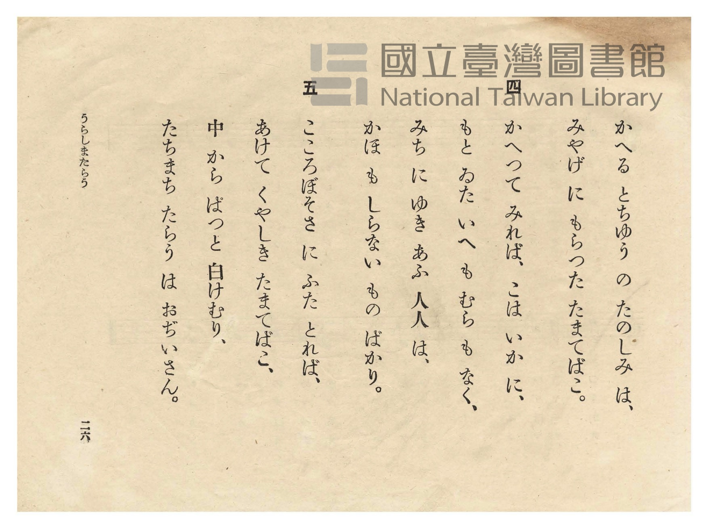
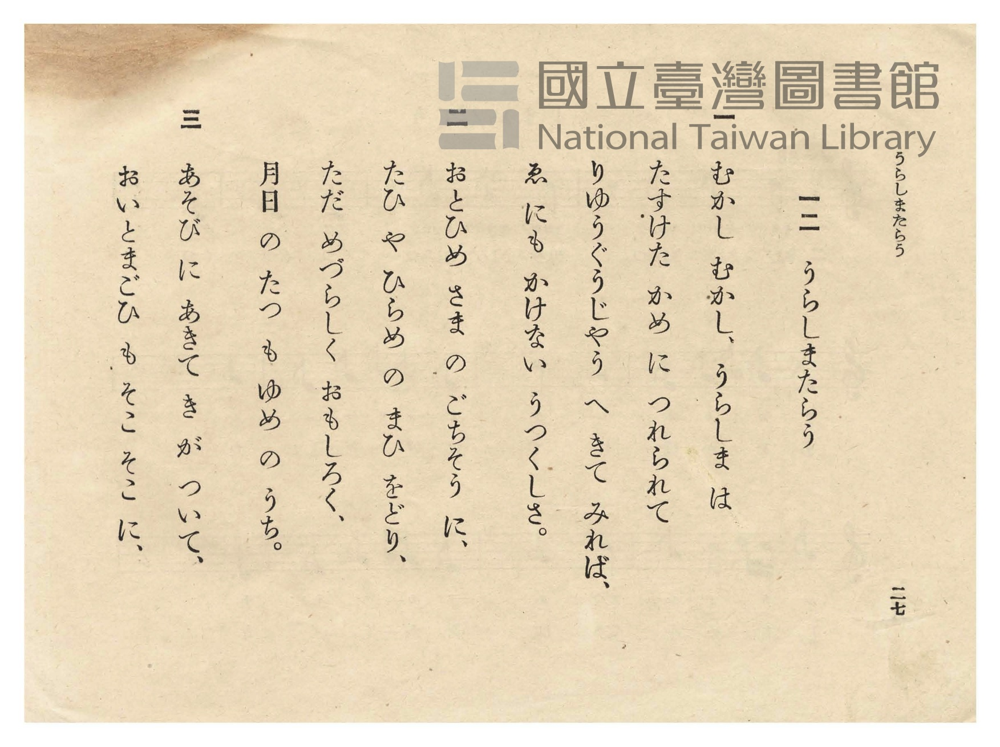

# うらしまたらう（浦島太郎）

> Re:Shōka 使用 AI 協助辨識與重建樂譜，可能會有錯誤。歡迎回報。

- **鋼琴伴奏版**：<br><audio controls src="urashimataro.mp3"></audio>
- **NEUTRINO 歌聲合成版**：<br><audio controls src="urashimataro_neutrino.mp3"></audio>

- 作詞：石原和三郎（幼年唱歌）
- 作曲：田村虎藏（幼年唱歌）
- 日治時期公學校唱歌（第二學年・第十二課）
- 國立臺灣圖書館典藏

## 說明


- 出處：臺灣總督府編《公學校唱歌》第二學年用，第十二課〈うらしまたらう〉（浦島太郎），原書第 24–27 頁（P026–P029）。
- 調性與拍號：ヘ調（F 大調），2/4 拍，速度 != 100。
- 背景與曲風：原出自 1900 年《幼年唱歌》及 1911 年文部省《尋常小學唱歌（一）》第十二課〈浦島太郎〉
（亦收錄於《新定公學校唱歌集》第二學年用第七課 `2_07_urashimataro`）。全曲共五節，敘述浦島太郎搭救海龜、
前往龍宮城觀賞鯛魚與比目魚曼妙舞姿、攜玉手箱返鄉卻見人事全非、打開玉手箱化作白髮老翁的故事。
- 版本說明：本檔案為原書單聲部五線譜之忠實數位化版本。

### 編曲說明（鋼琴伴奏版）：

1. 前奏 (Intro, 4 小節)：以第四行「ゑにも かけない うつくしさ」優美流暢的五聲音階終止句作為前奏。
2. 主歌伴奏 (Urashimataro, 16 小節 × 5 段)：右手演奏原曲歌唱旋律；左手以輕快二拍子和聲伴奏。


## 歌詞

```text
一
むかし むかし、うらしま は
たすけた かめ に つれられて
りゆうぐうじやう へ きて みれば、
ゑ にも かけない うつくしさ。

二
おとひめ さま の ごちそう に、
たひ や ひらめ の まひ をどり、
ただ めづらしく おもしろく、
月日 の たつ も ゆめ の うち。

三
あそび に あきて き が ついて、
おいとまごひ も そこ そこ に、
かへる とちゆう の たのしみ は、
みやげ に もらつた たまてばこ。

四
かへつて みれば、こは いかに、
もと ゐた いへ も むら も なく、
みち に ゆき あふ 人人 は、
かほ も しらない もの ばかり。

五
こころぼそさ に ふた とれば、
あけて くやしき たまてばこ、
中 から ぱつと 白けむり、
たちまち たらう は おぢいさん。
```

## ABC

<div class="abc-score" data-abc-src="urashimataro.abc" aria-label="五線譜載入中"></div>

[下載 ABC 原始檔](urashimataro.abc)

## TMD 檔案連結

- [主旋律 TMD 檔案](urashimataro.tmd) [[在 TMD Studio 編輯](https://tmdlang.github.io/Tmd-TS/#tmd=s7IKdvYPcrWy4qpTUCpJTLdSSM7PyUlNLsnMz7PKzk9PzM7Ojy_OyM9OVIKrKMvPKc1NtUovSkxJjTdCiBfnlxYlp1oVJ2fk5-fEl6RWlCTl52cj5AuK8stS8xLzgGoKijLzSlJTwIoQClLLMlNSQdKpKZkl-UWZiTlIlqYWFYPcBLEkvqQoMa84uSizAORQhCqgpvTMPKvc_LykUqCrMSVSM7MysTgNampBYnqqVYCBkZkukLBE1l2SkQ_0b0FGpVVGZjHIbcmJOfHZiXlIwVKSkQoMlZzU9NS8FCUuLS2Fx41tj5s6HzdOf9y473HjfDC77f2ejmdblz3dvO3pklUvm_ve7-lU0NLiUrRVMDQw4LK3VXDjsjHSN7EDmfps-tJnm3Y_m9n0bM78p61rnq7d8WzBwqdTNj5b2wM05fmaNU929QAFn-7c8rh5N5D7tLcRKPJi1SagoWBnPdk758XKee_3zHo-f_PTvvlPJ_U82dEJtrTj6c49QH0ww-DKn80Gap71fMqGZ3MnvpjZ92J6Pw61T-d0P1_d_aJ91_PGxU_nTHs2e8fLJSuetu4A6lDi4tLXUrClFuBSUFB43DAB6LLns9e9WLXq2Yy-xw0TwaLNu5-273oxcyrQyRCXPN-x9_ncxU93zXm-fcXjhi60QHvc0I0caM-nrHi_pwc53B43dGCNs8cNnZjRBtQLDFOgx4EmKBiZPGqYbGSu8HJBI1AlKAUB-aA0BFT4uKEJ6toXq_Y_a1j-oqP9WXfvi5nzgc5-3DwDKAjU4qbwdMlyMBNkMDAFKADVAFkvG-Y_3bVMAZI-kExq7nk2cz3IpNmbXi4C-mMWKH6BgdG-SsHQ0sBAAZQogAGAFHNA3z_t7wLKGhqCZJ9Na3_ZvOL5nEaQsg3dT3fseLqhHxQwsPT1ZEcD2PGgMEMOIeRgAAYMyEEKCiD1u5Y9m7LtZU_Ls2l7gGY-m7bh6bpZaDHwcjYwLNEjAcTd0Qw0XCHBKN7APL60KLE4IzM3sSSxKD8BEn5PW1cAPfq0deOTXVOerwe6q-fZ1Bkv9m9AdsuzCWufTZ34bOv2l_vmPG5ohLjraWfv030NL_f1Pl237un8vhfLG15snvdy_eyXa2eBAm_9FGCaArKfzd7zdNnMFx3zni7fD9T7bMqc532dzzq7n6_b-GL_lJctnU97d79Y1v1k164nu7qBjnk5dx5IWefkl9O64Sqf9kwD5qDnM_e-XL3uRUPj8_2Nz2e1PJvaCtSCiLjnnR3P5qyBJGNgrAHZz1ZNebaw43nTLkhqejpt3YvGTcCoAXl1-6wXa-c82dn9dP-Cp-uXPZu648neXqA1EENAhkIzB0QrMICB2R0UVtPagb57smMtiLFq3ou164E5BpSRN_Q-a-9UAKZLC2jy1MsqSAcGMdgcYISDjWtqeNzYDcwBCBbQr8j5AliwrQerBOaPxpmPGycCGUBO9-OmRiC1GoiXPG7qASkHko3LIIZ2PW5qAxnSOAFMznjc1AJkANXuAOJeoDIgtR-sYQM09h43TQQZ97ipCWw4yJpVjxtbwMUq0IbGfrBrpkLDFug9iFdBeWHfPHDEg0hQWkFKJS8WrX6yexowobzYuh0UPeDk8nTHNuRUAgyI53O6QWXDnPnPZqx_2bD4-dTVT3bOB5E7eoG57Mm-NqDe5_v6Xu6aDsqGGxcCHQEPxl09kMDpety44nHjJkioTIWE2zognvK4ceHjxrkQ36-GeRYUlpuAfgb5D6gHGHYgbSD1wHIIJDHpceNKUDAiqV8AFAbGzFJYzPSDbW1qAnGagGHaD1X8bE4HsC6BGgfUtwSoDxiowAiBWwIMUpAnMEJyzoonO2c-Xb4GmJGf7NgN8vXs2c-aW5-t2fd0X-uTHaBQQs5UwCoGnqlAwQvOV6B02QGshnqe9q96sWzX033TQYXD0van_cBk3Pli22JQHK3dBHLl1saXDXOf7t3-dO_-l817gbY_XbLo6aJmYBYApmbkQN4BLngeNwL9CgzJzdB0B-RBk1IvEPeAU2IjMJ0tg4caMFKAfGC8AEMVGBGggAUlL6AZkxEUIlKAyW7H46ZuIAuoZSEkCSPCcR041PeD8gNcBzANAy2YBHEQMCpAUQN0BCiDAHUAbV0GSuGNk7EE9vO-lcCweT574YuOjqf7ep7Onveyse_50nnA5AYKvJ42EJowERIVL_atfbEQWE4DQ27Hy4YpT3Z0PZvTAGoo7GsFBjxI_YaNwMQLKpGadj3ZswVURi1bByyhgZEGikZYqYUUqE9nz0byNcjVqJkS5OrG9UAhoAeBSuChBEpwK4AUMGeDvAmUBeZpcAJrAHofGsLArAtLjiAzGxdCQwgYoqC4AhqxFZh1gOXrLpTgBNqzG2oCME0DwxJSBICsBEUCMCSBxQ4wU2Cm3NnznnYAq6BtwNIbnqFfNsx8vnLb89WgbP2sAZh99wCVAcvn93vmg4rQOWue7O0HBg5QF6h2ADaB-rqAyRCY6cGFPygWXmxfDwzqF_v7Xs5d9GLrBkhJAHT0U1AB2wMqe4FhDlS_qvfF2hlAKaCyp2unoBQPUyA-A4blZHAu3QNOd1OhSXgrJBBXoBaFoPABln-g-OgHJzBgugMFG1qSAisG5hRIaQwM-saN4HhcoQCslkAmgGIEpQgBlkRAA0CRAW3rgEIfkk8WgaNy6uMmbGkVlDXXLgFWVs9bFj7tWgmqa_oaQLXh7EkvJiPKzie7lwAD51nTlGeNK5BTHSgkFy8EBc7M6U_nbHjaNglUrO5oeDlzMdClz1tnghTs7Xw-Z8_LaZMhJTcwPb9Y1_WsYwIwIkDVa8cuIIIGLNBxlDc0oUBBS5-LKxSpDWIVkJmYl-9QY1BTDW5U2BiaadmBWTUKpvEKukAIpAyBFAjXKBiBhYwUjIEkCANVgZRAeSBVMDUQaABSAzbPx7AG2EZYABZ93ATKHdtBrOY9YFPwyDQtA_NWgmVBMiDePLCefuw2GQHlGrsgKkGZF1gSgvQ2QswDpkaIDKTOQrKpcQpYfCGYnAtV1QaWWY3dJmOQ-xZBXb4XaNJksHndUJfDZIBptrkNxU9rweJrwGItUFVLwH4CqcNikwnIFSBzQW4CNSuWgFmgsAHJ7IeaAaoWNqD4CewiYLIHkVCbgObg8ZMpyH2boeYBK59msFvh8TQH4dumrci-bQaF6-MmkEseN3dAVDWvActMwLAJmsQgicYYnGRAuAaczEDJyAyU-MAENCGCCYisEVwn1kQGdgLIKTuBeCPcUSAZiJcfNwPLBLCzEd4CBQ3IubCkhnA8jggBJ7L5UJV74IkMZA5IBsQD8UFVBCjhQZIaSGYfmAdRPQmiqnEl2HWQJIs9ka2Cmgds3oADF5QFIH7aAnUDsFpuBiU4RCLbC9YBikoIG8ID-QmSkLAmMmB1BM84TaCIg_gS5HJY8oHUgMg2NUD9CiJh-leB9eDIouBEBsseG2HZowmUTEHuAyVuSHaHZhW4TZDkBfI7LGZAyQuRZHEmMhNwKWUGNgbEApVaiFIMlgCJK8WgkdEMrLIgpVMTKM_ByioQHxhEYE9AREB6ZoB5EM_AHD4fLANKdDCP4ExikPYwmLUUahcouEF8YGcGHMyIPA9KSNAoAspCXNSLLzrASQyWOYCJGeLaZpAIyIWw3AxsUAP9jOyrPjAPEikgNiTSQDIQd4PEQXail2TQLArOOJDyFmpXEzRsIA0nMAtUysCyFChZgkho-QTkgWRAyQZHImuG1gPgegVkByR7g2QmQt0AbHJBsxQskUHqH3BcgQsQEG8BWA8k5rEkMuQkRaAkA0lA0hmoIIMow57OYHaDYgRSXIGyDFJcgbMOJLZBqQ1RW4KLM3B2gscIuLTGYhM4lUEzHDjUIeEMK65g6Q_Sr0IOJUiWRRRuIBpSW4JiFEcqg6YLUO543AS2CV5_QIsDYPzA3A8rtknJ9Ji1JaSNDcsLyDlnFbRQQ_gJog7cKgDXoyAaXFviKpzBBRksNYPyB8SV0LYGXAboJ2jMgHIDrEB_3Ay2Dxx3IHorOBww_VTLxaVrp4DcblMA8pW5AA)]
- [鋼琴伴奏 TMD 檔案](urashimataro_piano.tmd) [[在 TMD Studio 編輯](https://tmdlang.github.io/Tmd-TS/#tmd=s7IKdvYPcrWy4qpTUCpJTLdSSM7PyUlNLsnMz7PKzk9PzM7Ojy_OyM9OVIKrKMvPKc1NtTJCiBTnlxYlp-JSD5GNL0hMT7UKMDAy0wUSlgjpgqL8stS8xDygASWJmeWJefHpQIGivPyi-PTUvNSixByE2tSyzJRUkMqCoszcxKLK-JT8ZKBb8kqQXJdaVAxyfEFmYl5-fGJRUWJeeiqqkvyikoz89KLEgoxKq4zM4pL8oszkxJz47MQ8JFeXZAB1WeWkAt2QosSlpaXwuLHtcVPn48bpjxv3PW6cD2a3vd_T8Wzrsqebtz1dsuplc9_j5t0vu_c8n7DlyZ4tT5f2P-_seL-nU0FLi0vRVsHQwIDL3lbBjcvGSN_EDmTPs-lLn23a_Wxm07M585-2rnm6dsezBQufTtn4bG0P0Nzna9Y82dUDFHy6cwvQXCD3aW8jUOTFqk1AQ8EOfbJ3zouV897vmfV8_uanffOfTup5sqMT6Ayg7qc79wD1wQyDK382G6h51vMpG57NnfhiZt-L6f041D6d0_18dfeL9l3PGxc_nTPt2ewdL5eseNq6A6hDiYtLX0vBllqAS0FB4XHDBKDLns9e92LVqmcz-h43TASLNu9-2r7rxcypQCdDXPJ8x97ncxc_3TXn-fYVjxu60ALtcUM3cqA9n7Li_Z4e5HB73NCBNRYfN3SiRSQwGIB6gWEK9DjQBAUjk0cNk43MFV4uaASqBKViIB-UjoEKHzc0QV37YtX-Zw3LX3S0P-vufTFzPtDZj5tnAAWBWtwUni5ZDmaCDAamAAWgGiDrZcP8p7uWKUDSB8IkoP-AAQIJDaBuzEQFNBukVEHBUE_haWcvUFxBwzOvpChfR8FE4emG_ufrGzSBap7sXgoKgNmzXywEBk_P46aJjxtXP25qAqbm7seNQM6qx40t4KTduORxYz84XKY-buh92rLq-b6-Z1sbn81a9HxWy5NdU140bno5f_PLWX3PtzY9W7voaf9SYHJ63rQLYjnU5QoKRnoKT3bsBkYGxLEKGqFFicUZwMxakghym6EZ1HEKh6crmCo8W7cV5Mqn_ZufdXY_2zMFqAMc5puABoDidHr3033d7_fMfrp9GVAB0DMv9kx9un81MDaBofd07QRgige6C2IV1AmUJ0goUNDS5-ICB6lVAKgsCfJwqDGoqQZ708bQTMsOzKoB-kIXCE0VjIGkERDXKBiCRQwVzOKBFJgAqgJRIAmQMpBCmDIINAAp4qpFsdAH2UILuH2G8QrRhrFgyjQWwTcBUiYgPtAmEB9EIcuDsAHEDuQoIeA3kKuBnosHOxaEa8B-BHkA5BEQhoQACEO8ZghXg-w1kHk-hjXAtL0ALPq4aTUQbwexmveATcEj07QMzFsJlgXJgHjzwHr6sdtkBJRr7IKobFwBxJvAehsh5jVOhcrsA-J1yDY1TgGLLwSTc6Gq2sAyq7HbZAxy3yKoy_cCTZoMNq8b6nKYzFqgWBuKn9aCxdeAxVqgqpaA_QRSh8UmE5ArQOaC3LQDiJeAWaCwAcnsh5rRA2RvQPET2EWN68Ek1CagOXj8ZApy32aoeZuBJoHdCo-nOQjfNm1F9m0zKFwfN4Fc8ri5A6KqeQ1YZgKGTdAkBkk0xuAkQyD7wPMQJP9AdGJNZGAngJyyE4g3wh0FkoF4-XHzQqizEd4CBQ3IubCkhnA8jggBJ7L5UJV74IkMZA5IBsQD8TuhCQ-S1EAy-8A8iOpJEFWNK8GugyRZ7IlsFdS8JdDABWUBiJ-2QN0wCYhBCQ6RyPaCdYCiEsKG8EB-giQkrIkMWD3AM04TKOIgvgS5HJZ8gMkPrAphUwPUryASpn8VWA-OLApOZLDssRGWPZpAyRTkPlDihmR3aFaB2wRJXiC_w2IGlLwQSRZnIjMBl1JmYGOQS21IKQZLgMSVYtDIaF4GK52aQHkOVlaB-MAgAnsCIgLSMwPMg3gG5vD5YBlQooN5BGcSa1wAT0hLoXaBghvEnw4NZkSeByUkaBQBZSEu6sUXHeAkBsscwMQMcW0zSATkQlhubgT7GdlXfWAeJFJAbEikgWQg7gaJg-xEL8mgWRSccSDlLdSuJmjYNPYCMcQHoFIGlqVAyRJEQssnIA8kA0o2OBJZM7QeANcrIDsg2RskMxHqBmATCJqlYIkMUv-A4wpcgIB4C8B6IDGPJZFRsSGASGcwu0ExAimuQFkGKa7AWQcS26DUhqgtwcUZODvBYwRcWmOxCZzKoBkOHOqQcIYVV7D0Byx40DI9JMsiCjcQDaktQTGKI5VB0wUodzxuAtsErz-gxQEwfmDuhxXbpGR6zNpyN0peQM45q6CFGsJPEHXgVgG4HgXR4NoSV-EMLshgqRmUPyCuhLY14DJAP0FjBpQbYAX642awfeC4A9FbweGA6SeszTbCLUQgBWkRApuCcD4OeSAFaiCimIHeioS3MnG0QoEUhhkgCl0PVnfhcQcFrV1dOwVwoxpsIJCDHIzRPoax2MWNcIgb4xA3wSFuChdX5gIA)]

## 分析

```text
================================================================================
📊 TMD Song Profile: [ うらしまたらう（浦島太郎） ]
================================================================================
⏱  Duration:       0:19 (19.2s), 16 measures total
🎼 Key & Tempo:    首調基準 F, != 100.0 BPM, <2/4>
   - 分析範圍：      由實際發聲的音符與和弦推測調性；播放脈絡另行呈現
🎤 人聲音域:    C4 (MIDI 60) – D5 (MIDI 74) [跨度: 14 個半音 / 1.2 個八度, 難度: moderate]
   - 最低音:  C4 in [Urashimataro #1 @ m.1, 0:00]
   - 最高音: D5 in [Urashimataro #1 @ m.9, 0:10]
   - 適合: soprano, mezzo-soprano, contralto, tenor, baritone, bass
🏛  結構:      Urashimataro (19.2s)
⚡ 編曲密度:        Peak 1 軌道同時演奏
🗝  調性診斷：       F 大調（純淨自然大調，未偵測到可信轉調）
   - 風格氣質:    純淨自然大調（陽光明朗、易唱易記，無明顯調外色彩）
   - 轉調歷程:    全曲維持單一推測調性（未偵測到可信轉調）
   - 核心骨幹音:  A, G, F, C, D
   - 調性數值:    F 大調 [相關度: 0.75, 穩定度: Moderate, 自然音純度: 100.0%]
   - 候選調性 (K-S): F 大調 (0.75), C 大調 (0.71), A 小調 (0.67)
   - 五度圈歷程:   -1
   - 各段落調性細節:
     • [Urashimataro #1]: F 大調 (r: 0.75, 自然音純度: 100.0%)

  [ 五度圈游移軌跡 ]
               C  
        [F ]*          G  
      Bb               D  
      Eb               A  
         Ab           E  
            Db       B  
               F# 
     (* = active key center)

  [ 十二半音累積音高分佈 ]
     C  : ██████████████████        20.0%
     C# :                            0.0%
     D  : ████████                   8.3%
     D# :                            0.0%
     E  :                            0.0%
     F  : ███████████████████       20.8%
     F# :                            0.0%
     G  : █████████████████████     23.3%
     G# :                            0.0%
     A  : ████████████████████████  26.7%
     A# : █                          0.8%
     B  :                            0.0%
--------------------------------------------------------------------------------
Assignment 軌道音域：
  - Piano         : C4 – D5 (14 個半音 / 1.2 個八度, 52 個音符)
================================================================================
```


## 原書掃描頁










