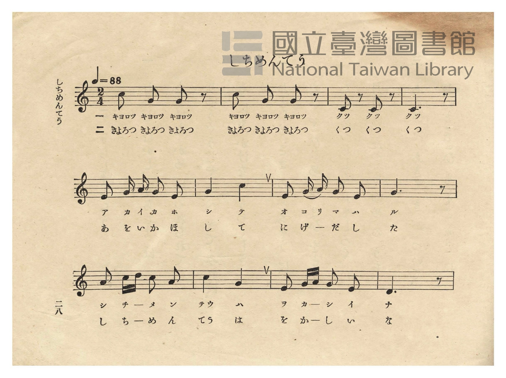
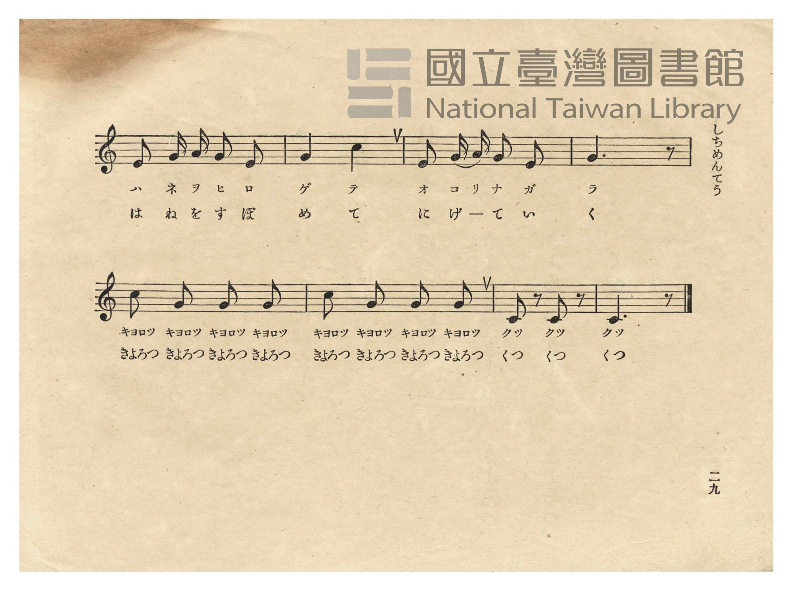
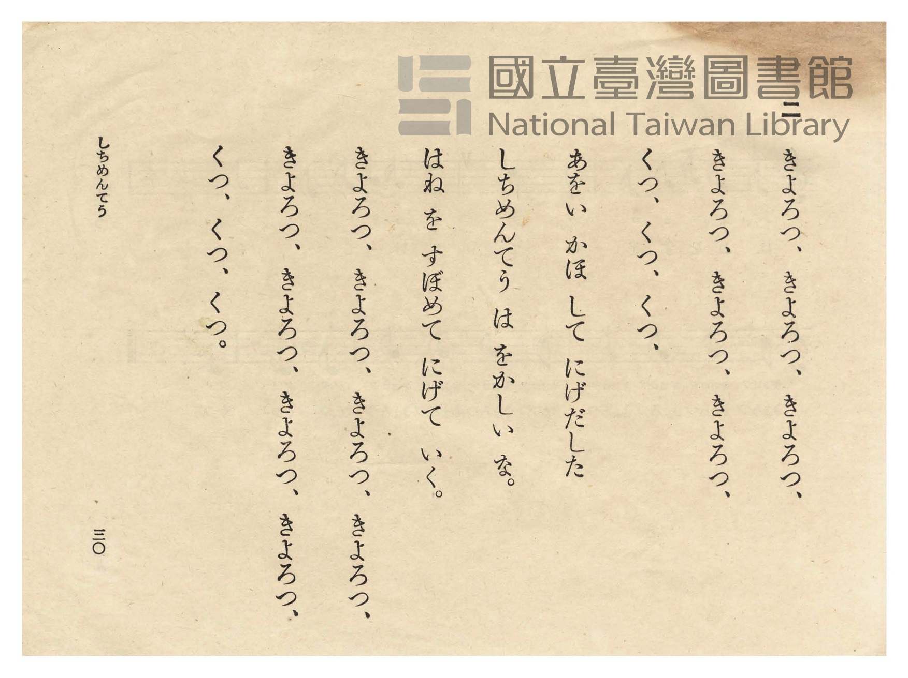
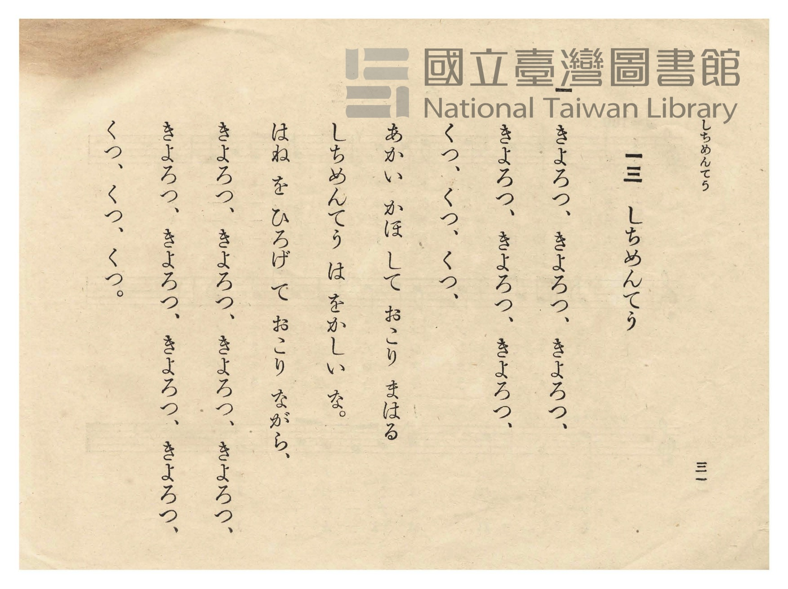

# しちめんてう（七面鳥）

> Re:Shōka 使用 AI 協助辨識與重建樂譜，可能會有錯誤。歡迎回報。

<audio controls src="shichimencho.mp3"></audio>

- 日治時期公學校唱歌（第二學年・第十三課）
- 國立臺灣圖書館典藏

## 說明

【曲目說明】
・出處：臺灣總督府編《公學校唱歌》第二學年用，第十三課〈しちめんてう〉（七面鳥・火雞），原書第 28–31 頁（P030–P033）。
・調性與拍號：ハ調（C 大調），2/4 拍，速度 != 88。
・背景與曲風：臺灣農家庭院常見飼養火雞（七面鳥），因其肉垂與臉部皮膚會隨情緒由紅變藍而得名。
歌詞第一節描寫火雞脹紅著臉（あかい かほ して）、張開翅膀到處生氣威嚇；第二節描寫火雞臉色發青
（あをい かほ して）、收起翅膀落荒而逃的滑稽模樣。首尾均以「きよろつ、きよろつ…くつ、くつ、くつ」
搭配八分休止符斷奏（`1 - 0 - 1 - 0 -`），惟妙惟肖地模仿火雞咕嚕咕嚕的叫聲。
・版本說明：本檔案為原書單聲部五線譜之忠實數位化版本。

・編曲說明（鋼琴伴奏版）：
1. 前奏 (Intro, 4 小節)：以火雞「きよろつ、きよろつ…くつ、くつ、くつ」的跳音叫聲動機開場。
2. 主歌伴奏 (Shichimencho, 20 小節 × 2 段)：右手演奏原曲歌唱旋律；左手以詼諧輕快的斷奏與二拍子和聲伴奏。

## 歌詞

```text
一
きよろつ、きよろつ、きよろつ、
きよろつ、きよろつ、きよろつ、
くつ、くつ、くつ、
あかい かほ して おこり まはる
しちめんてう は をかしい な。
はね を ひろげて おこり ながら、
きよろつ、きよろつ、きよろつ、きよろつ、
きよろつ、きよろつ、きよろつ、きよろつ、
くつ、くつ、くつ。

二
きよろつ、きよろつ、きよろつ、
きよろつ、きよろつ、きよろつ、
くつ、くつ、くつ、
あをい かほ して にげだした
しちめんてう は をかしい な。
はね を すぼめて にげて いく。
きよろつ、きよろつ、きよろつ、きよろつ、
きよろつ、きよろつ、きよろつ、きよろつ、
くつ、くつ、くつ。
```

## ABC

```abc
X:1
T:しちめんてう（七面鳥）
M:2/4
L:1/16
Q:1/4=88
K:C
V:V1 name="Piano" snm="Pia"
[V:V1]
c2 G2 G2 z2 | c2 G2 G2 z2 | C2 z2 C2 z2 | C6 z2 |
w: 1.~キ ヨ ロ | キ ヨ ロ | ク ク | ク
w: 2.~き よ ろ | き よ ろ | く く | く
E2 G A G2 E2 | G4 c4 | E2 G A G2 E2 | G6 z2 |
w: 1.~ア カ イ カ ホ | シ テ | オ コ リ マ ハ | ル
w: 2.~あ を い か ほ | し て | に げ ー だ し | た
A2 c d c2 A2 | c4 G4 | E2 G A G2 E2 | D6 z2 |
w: 1.~シ チ ー メ ン | テ ウ | ヲ カ ー シ イ | ナ
w: 2.~し ち ー め ん | て う | を か ー し い | な
E2 G A G2 E2 | G4 c4 | E2 G A G2 E2 | G6 z2 |
w: 1.~ハ ネ ヲ ヒ ロ | ゲ テ | オ コ リ ナ ガ | ラ
w: 2.~は ね を す ぼ | め て | に げ ー て い | く
c2 G2 G2 G2 | c2 G2 G2 G2 | C2 z2 C2 z2 | C6 z2 |
w: 1.~キ ヨ ロ ツ | キ ヨ ロ ツ | ク ク | ク
w: 2.~き よ ろ つ | き よ ろ つ | く く | く
```

## TMD 檔案連結

- [主旋律 TMD 檔案](shichimencho.tmd) [[在 TMD Studio 編輯](https://tmdlang.github.io/Tmd-TS/#tmd=s7IKdvYPcrWy4qpTUCpJTLdSSM7PyUlNLsnMz7PKzk9PzM7Ojy_OyM9OVIKrKMvPKc1NtUovSkxJjTdCiBfnlxYlp1oVJ2fk5-fEl6RWlCTl52cj5AuK8stS8xLzgGoKijLzSlJTwIoQClLLMlNSQdKpKZkl-UWZiTlIlqYWFYPcBLEkvqQoMa84uSizAORQJS4tLYXHjdMfNy583NT4uGny48Zljxvb3u_peLKj-eXcRS83L32_p1NBS4tL0VbBwoLL3lbBmcvGSN_EDmT8s-lLn23a_Wxm07M585-2rnm6dsezBQufTtn4bG0P0ITna9Y82dUDFHy6c8vj5t1A7tPexic7Ol-s2gQ0E-y-p3O6n6_uftG-63nj4qdzpj2bvePlkhVPW3e8mN6vxMWlr6VgSy3ApaCg8LhhwrPZm57PXvdi1apnM_oeN0wEizbvftq-68XMqe_3zIK45PmOvc_nLn66a87z7SseN3Sh-exxQzeyz55PWfF-Tw-y5x43dGCG6OOGTuRABYVH4-qXs-cBQwKo_WnffKDfgYYoGFk8aphsbKjwckEjUH2AgbEBkA-kjIEKHzc0QR38YtX-Zw3LX3S0P-vufTFzPtDlj5v7gYJALc4KT5csBzNBBgNjSgGoBsh62TD_6a5lCuBoRDKouefZzPUgg2ZverkI6BNoELzYt-npum1Pd619OXPR0x07Xizrfrl4z8slXTBHoyQPkAdmL3jauu1FU-fTeU1A0160d75sXvF81roXbbOezWl-OWvFs-bW59snPZ-y8fmW1hfrul5M733R0PN03_SnE3qhrlFQAAbui5XzQIG7o-H5-oZn_f1P16-G2PiiZSdI48TpQJOBtj9ubHrc2P24sQWYdoHUbkgSXgYOo8ane7a-nNb9fH_ri7aGpx0bgDH7fMr8ZxsWP13R-HRW-_s9syHRh25De-eLzk3PZ-55OXcSxDlQe5om4bDn2ZRtL7Zuh9jzYsLeF72TgF562dD8fFbLs90Tn6_Y-2zFwmcrFgO993LZtKcb9j2d2_5k99LHDT2PG3sfN3U8bup93LgEaA4y91EDMLH0w8TRGL3QYJqw9mVr79PW1U872p7smfhs7aLna5Y9m7b96dJ-oJMTDBV0FQyAGEonQCLoWfP8p8tmAskXTdOeztkAdNqT3fshPn86aerTWVMhJNDtT_tXv2gEJmJYEnne2fFszhpIlgGmDyD72aopzxZ2PG_aBUm2T6etA2oAxveTXVOeb5_1Yu2cJzu7n-5f8HT9smdTdzzZ2_u0ZxrEEJCh0IwI0QqJ8aetK55Nawcmmyc71oIYq-a9WLsemDuBvnm6ofdZe6cCMAMYQfOBXlZBOtBLYHOA6QRsHO7wxOSSqQFXnEClsSZHINX1uHHy46YuIGvf48b1j5u6IcrRSweg0HoFcEoDagdKggxaBYsCoL7GtSBZIHMT2FlAdaiGr3rc2PO4CZQoSfYepcFDUmiBPQSMVkgUA1MTJNWBMi0qA1Sk4JWCcCEkUAS5fEDO8y_2dj6d0wFM1ZCk_nzOfEjWfDqxAega5JICmJZeNnVBdAENhHBxuQGPY4DGwpPnrp5BkzyxlGJAajU4LS0A8-dTmDRnPm7cA9KIZDCI1QJyCkz5yEuXSLXKs-4pL1r3AyuIF9sn4kqRyHUKROWTXcDWGE5LCSdEoMcobz1BgYKWPhdXcEZmckZmLrC1mZFvFZCZmJfvUGNQUw2um2wMzbTswKwaBcM4YAVkCsWgCgm7EGptBRWBQbAI2DwfwxpgOlsL5D9uXgEmQWyIDtzi66FsBAsmisUGI6BcYy9YdQeYBLGhenCK98NsgLNgoqg2QAPFGOx5M3AAgNg1YBYIgsMGBCGKNICqNFU1dHU1sajFFjSLwE5bDcRLwDQoKGZDPbwdqudxcxvcksdNq0DWPG7aDBRepQkk5oFVgJwOlG0GmYArkJrAdoEyPbhIAXt_N9Tr02F2AXM_3K5GkGkawDIBaPAeoF2NC8AqQGpBsvNxBZcZSBswZIzioGEBDiWQKDQxgSAsVPAEnBGegAMFjsbj5kao05oXgoNhMzQYYAH2uAnJO82bIEEHDG2wHrAZoICHyHbhCTqQl4EBsRCmsxGsczI0IGB2gMpdRERNgujphgUeyAxQ0EP0gKKRvmkNnEYeN_eCA-JxM8h5kGwHciwoaAinNVAQPW5aAw2wlXgCDJRZkSoZMG8P1FRQ4BFOayA5RHDhzJoohRMIYxeCaiOvvHrcDHUGHhnKyyxglQb1LG4ZYsutWi4uXTsF5DJfAchX5gIA)]
- [鋼琴伴奏 TMD 檔案](shichimencho_piano.tmd) [[在 TMD Studio 編輯](https://tmdlang.github.io/Tmd-TS/#tmd=s7IKdvYPcrWy4tLSUnjcOP1x48LHTY2PmyY_blz2uLHt_Z6OJzuaX85d9HLz0sfNu19273k-YcuTPVueLu1_3tnxfk-ngpYWl6KtgoUFl72tgjOXjZG-iR1XnYLSs-lLn23a_Wxm07M585-2rnm6dsezBQufTtn4bG0P0Mzna9Y82dUDFHy6cwvQWCD3aW_jkx2dL1ZtApqpBDLg6Zzu56u7X7Tvet64-Omcac9m73i5ZMXT1h0vpvcrcXHpaynYUgtwKSgoPG6Y8Gz2puez171YterZjL7HDRPBos27n7bvejFz6vs9syAueb5j7_O5i5_umvN8-4rHDV1oPnvc0I3ss-dTVrzf04PsuccNHZhh_LihEy2Ynzeufjl7HjAkgNqf9s0H-h1oiIKRxaOGycaGCi8XNALVBxgYGwD5QMoYqPBxQxPUwS9W7X_WsPxFR_uz7t4XM-cDXf64uR8oCNTirPB0yXIwE2QwMKYUgGqArJcN85_uWqYAjkaEQUAfAoMEEh5AzZhRDzQapFRBwVBP4WlnL1BcQcMzr6QoX0fBROHphv7n6xs0gWqe7F4K8c_jhp7Hjb2PmzoeN_U-blzyuKERmfuoARgW_TBxNEbv81ktL7Zvfjl_89P-1S8aNz3tnvps5fyX07qfLtgCdbGCgpGewpMdu4HRAHGkgkZwRmZyRmZual5yBtBNRgZQRykcnq5gpPBs3VaQ6572b37W2f1szxSgDnBQbwIaAIrN6d1P93W_3zP76fZlQAVAT7xYuefF6uUv9kx9un810DnPpm0HagGGMzC6gcH4dO2Ep5N6gE6DWA51FOWJEwoUtPS5uMCBaxWQmZiXH-ThUGNQUw32uI2hmZYdmFWjYBinoKtgCsUGQIxdCMqC0RARGASLcNWi2OeDy754oOJow1g4CTUOjzCIaQpjQMUwrEaOOnr5GGSej2GNwuOmtUD-4-YVYBLEhujALb4eykawYKJYbDACyjX2glV3gEkQG6oHp3g_zAY4CyaKagM0UIzBnjcDBwCIXQNmgSA4bEAQokgDqEpTVUNXVxOLWmxBswjstNVAvARMg4JiNtTD26F6Hje3wS153LQKZM3jps1A4VWaQGIeWAXI6UDZZpAJuAKpCWzXJCCrBYi7wd7fDfX6dJhdjcsQdjWCTNN43AjU0rwHaFfjArAKkFqQ7HxcwWUG0gYMGaM4aFiAQwkkCk1MIAgLFTwBZ4Qn4ECBo_G4uRHqtOaF4GDYDA0GWIA9bkLyTvMmSNABQxusB2wGKOAhsl14gg7kZWBALITpbATrnAwNCJgdwMoHYRswoMF6umGBBzIDFPQQPaBopG9aA6eRx8294IB43AxyHiTbgRwLChrCaQ0URI-b1kADbCWeAANl1seNa6HpbSaYtwdqKijwCKc1kBwiuHBmTZTCCYSxC0G1kVdePW6GOgOPDOVlFrBmhnoWtwyx5RbWIp-ulQ6G0UhM0sXBdkWbgjgIa6F2mIDlTEBySEzq2kEPf5BlB1G1v66dArjtAbYIyEFOGtE-hrHYxY3g4spcAA)]

## 分析

```text
================================================================================
📊 TMD Song Profile: [ しちめんてう（七面鳥） ]
================================================================================
⏱  Duration:       0:27 (27.3s), 20 measures total
🎼 Key & Tempo:    首調基準 C, != 88.0 BPM, <2/4>
   - 分析範圍：      由實際發聲的音符與和弦推測調性；播放脈絡另行呈現
🎤 人聲音域:    C4 (MIDI 60) – D5 (MIDI 74) [跨度: 14 個半音 / 1.2 個八度, 難度: moderate]
   - 最低音:  C4 in [Shichimencho #1 @ m.3, 0:02]
   - 最高音: D5 in [Shichimencho #1 @ m.9, 0:11]
   - 適合: soprano, mezzo-soprano, contralto, tenor, baritone, bass
🏛  結構:      Shichimencho (27.3s)
⚡ 編曲密度:        Peak 1 軌道同時演奏
🗝  調性診斷：       C 大調（純淨自然大調，未偵測到可信轉調）
   - 風格氣質:    純淨自然大調（陽光明朗、易唱易記，無明顯調外色彩）
   - 轉調歷程:    全曲維持單一推測調性（未偵測到可信轉調）
   - 核心骨幹音:  G, C, E, A, D
   - 調性數值:    C 大調 [相關度: 0.85, 穩定度: Moderate, 自然音純度: 100.0%]
   - 候選調性 (K-S): C 大調 (0.85), G 大調 (0.74), E 小調 (0.61)
   - 五度圈歷程:   +0
   - 各段落調性細節:
     • [Shichimencho #1]: C 大調 (r: 0.85, 自然音純度: 100.0%)

  [ 五度圈游移軌跡 ]
              [C ]*
         F            G  
      Bb               D  
      Eb               A  
         Ab           E  
            Db       B  
               F# 
     (* = active key center)

  [ 十二半音累積音高分佈 ]
     C  : █████████████████         31.2%
     C# :                            0.0%
     D  : ███                        5.1%
     D# :                            0.0%
     E  : ████████                  14.5%
     F  :                            0.0%
     F# :                            0.0%
     G  : ████████████████████████  42.8%
     G# :                            0.0%
     A  : ████                       6.5%
     A# :                            0.0%
     B  :                            0.0%
--------------------------------------------------------------------------------
Assignment 軌道音域：
  - Piano         : C4 – D5 (14 個半音 / 1.2 個八度, 59 個音符)
================================================================================
```


## 原書掃描頁










