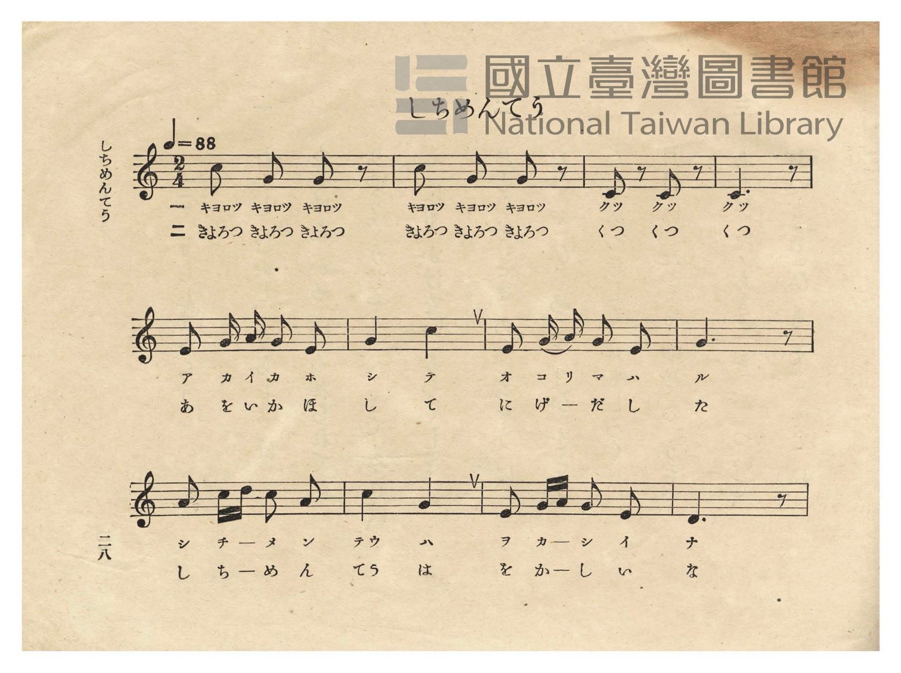
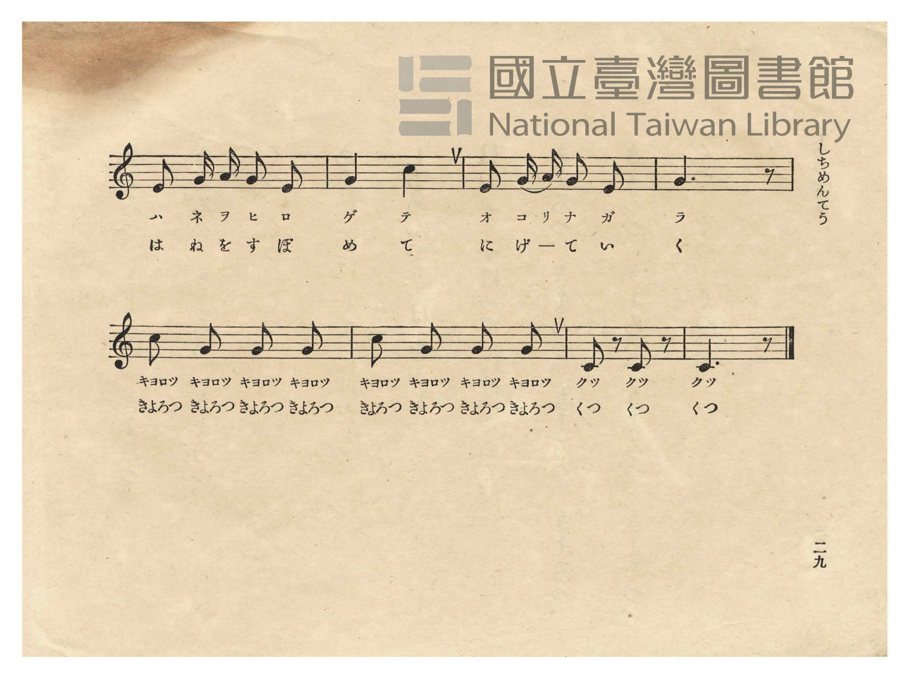
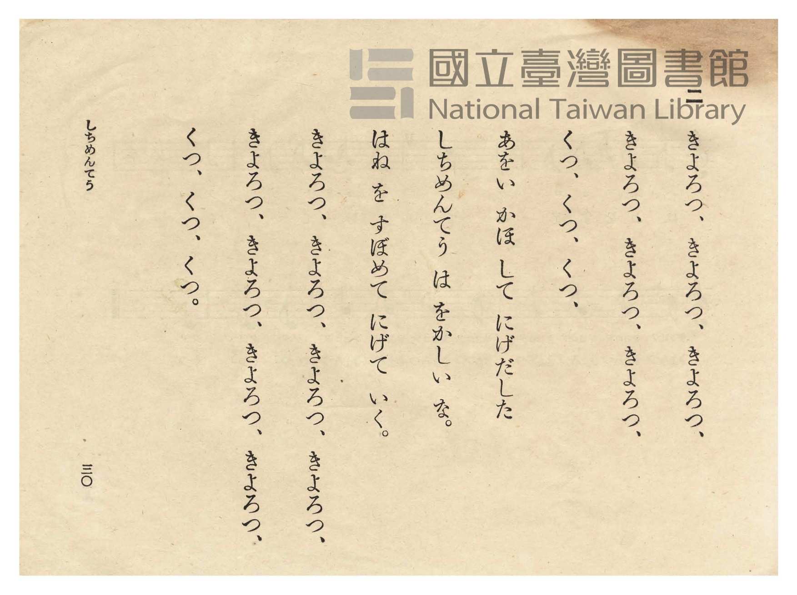
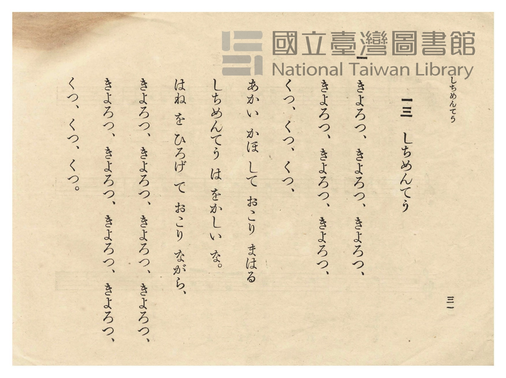

# しちめんてう（七面鳥）

> Re:Shōka 使用 AI 協助辨識與重建樂譜，可能會有錯誤。歡迎[回報](https://github.com/TMDLang/reshoka/issues)。

- **鋼琴伴奏版**：<br><audio controls src="shichimencho.mp3"></audio>
- **NEUTRINO 歌聲合成版**：<br><audio controls src="shichimencho_neutrino.mp3"></audio>

- 日治時期公學校唱歌（第二學年・第十三課）
- 國立臺灣圖書館典藏

## 說明


- 出處：臺灣總督府編《公學校唱歌》第二學年用，第十三課〈しちめんてう〉（七面鳥- 火雞），原書第 28–31 頁（P030–P033）。
- 調性與拍號：ハ調（C 大調），2/4 拍，速度 != 88。
- 背景與曲風：臺灣農家庭院常見飼養火雞（七面鳥），因其肉垂與臉部皮膚會隨情緒由紅變藍而得名。
歌詞第一節描寫火雞脹紅著臉（あかい かほ して）、張開翅膀到處生氣威嚇；第二節描寫火雞臉色發青
（あをい かほ して）、收起翅膀落荒而逃的滑稽模樣。首尾均以「きよろつ、きよろつ…くつ、くつ、くつ」
搭配八分休止符斷奏（`1 - 0 - 1 - 0 -`），惟妙惟肖地模仿火雞咕嚕咕嚕的叫聲。
- 版本說明：本檔案為原書單聲部五線譜之忠實數位化版本。

### 編曲說明（鋼琴伴奏版）：

1. 前奏 (Intro, 4 小節)：以火雞「きよろつ、きよろつ…くつ、くつ、くつ」的跳音叫聲動機開場。
2. 主歌伴奏 (Shichimencho, 20 小節 × 2 段)：右手演奏原曲歌唱旋律；左手以詼諧輕快的斷奏與二拍子和聲伴奏。


## 歌詞

```text
一
きよろつ、きよろつ、きよろつ、
きよろつ、きよろつ、きよろつ、
くつ、くつ、くつ、
あかい かほ して おこり まはる
しちめんてう は をかしい な。
はね を ひろげて おこり ながら、
きよろつ、きよろつ、きよろつ、きよろつ、
きよろつ、きよろつ、きよろつ、きよろつ、
くつ、くつ、くつ。

二
きよろつ、きよろつ、きよろつ、
きよろつ、きよろつ、きよろつ、
くつ、くつ、くつ、
あをい かほ して にげだした
しちめんてう は をかしい な。
はね を すぼめて にげて いく。
きよろつ、きよろつ、きよろつ、きよろつ、
きよろつ、きよろつ、きよろつ、きよろつ、
くつ、くつ、くつ。
```

## ABC

<div class="abc-score" data-abc-src="shichimencho.abc" aria-label="五線譜載入中"></div>

[下載 ABC 原始檔](shichimencho.abc)

## TMD 檔案連結

- [主旋律 TMD 檔案](shichimencho.tmd) [[在 TMD Studio 編輯](https://tmdlang.github.io/Tmd-TS/#tmd=s7IKdvYPcrWy4qpTUCpJTLdSSM7PyUlNLsnMz7PKzk9PzM7Ojy_OyM9OVIKrKMvPKc1NtUovSkxJjTdCiBfnlxYlp1oVJ2fk5-fEl6RWlCTl52cj5AuK8stS8xLzgGoKijLzSlJTwIoQClLLMlNSQdKpKZkl-UWZiTlIlqYWFYPcBLEkvqQoMa84uSizAORQhCqgpvTMPKuSxEygm0HuLk-Mz03MzMtJzEtBd2h8QWJ6qlWAgbGBLpAwRjakJCMf6LuCjEqrjMxikEuSE3PisxPzkAKhJCMVGAaJeZm5iTnFSlxaWgqPG6c_blz4uKnxcdPkx43LHje2vd_T8WRH88u5i15uXvp-T6eClhaXoq2ChQWXva2CM5eNkb6JHci8Z9OXPtu0-9nMpmdz5j9tXfN07Y5nCxY-nbLx2doeoAnP16x5sqsHKPh055bHzbuB3Ke9jU92dL5YtQloJthBT-d0P1_d_aJ91_PGxU_nTHs2e8fLJSuetu54Mb1fiYtLX0vBllqAS0FB4XHDhGezNz2fve7FqlXPZvQ9bpgIFm3e_bR914uZU9_vmQVxyfMde5_PXfx015zn21c8buhC89njhm5knz2fsuL9nh5kzz1u6MAM0ccNnciBCgqPxtUvZ88DhgRQ-9O--UC_Aw1RMLJ41DDZ2FDh5YJGoHpQHAP5oFgGKnzc0AR18ItV-581LH_R0f6su_fFzPlAlz9u7gcKArU4KzxdshzMBBkMjCkFoBog62XD_Ke7limAoxHJoOaeZzPXgwyavenlIqBPoEHwYt-mp-u2Pd219uXMRU937HixrPvl4j0vl3TBHI2SPEAemL3gaeu2F02dT-c1AU170d75snnF81nrXrTNejan-eWsFc-aW59vn_R8ysbnW1pfrOt6Mb33RUPP033Tn07ohbpGQQEYuC9WzgMF7o6G5-sbnvX3P12_GmLji5adII0TpwNNBtr-uLHpcWP348YWYNoFUrshSXgZOIwan-7Z-nJa9_P9rS_aGp52bADG7PMp859tWPx0RePTWe3v98yGRB-6De2dLzo3PZ-55-XcSRDnQO1pmoTDnmdTtr3Yuh1iz4sJe1_0TgJ66WVD8_NZLc92T3y-Yu-zFQufrVgM9N7LZdOebtj3dG77k91LHzf0PG7sfdzU8bip93HjEqA5yNxHDcDE0g8TR2P0QoNpwtqXrb1PW1c_7Wh7smfis7WLnq9Z9mza9qdL-4FOTjBU0FUwAGIonQCJoGfN858umwkkXzRNezpnA9BpT3bvh_j86aSpT2dNhZBAtz_tX_2iEZiIYUnkeWfHszlrIFkGmD6A7Gerpjxb2PG8aRck2T6dtg6oARjfT3ZNeb591ou1c57s7H66f8HT9cueTd3xZG_v055pEENAhkIzIkQrJMaftq54Nq0dmGye7FgLYqya92LtemDuBPrm6YbeZ-2dCsAMYATNB3pZBelAL4HNAaYTsHG4wxOTS6YGXHEClcaaHIFU1-PGyY-buoCsfY8b1z9u6oYoRy8dgELrFcApDagdKAkyaBUsCoD6GteCZIHMTWBnAdWhGr7qcWPP4yZQoiTZe5QGD0mhBfYQMFohUQxMTZBUB8q0qAxQkYJXCsKFkEAR5PIBOc-_2Nv5dE4HMFVDkvrzOfMhWfPpxAaga5BLCmBaetnUBdEFNBDCxeUGPI4BGgtPnrt6Bk3yxFKKAanV4LS0AMyfT2HSnPm4cQ9II5LBIFYLyCkw5SMvXSLVKs-6p7xo3Q-sIF5sn4grRSLXKRCVT3YBW2M4LSWcEIEeo7z1BAUKWvpcXMEZmckZmbnA5m5GvlVAZmJevkONQU01uG6yMTTTsgOzahQM44AVkCkUgyok7EKotRVUBAbBImDzfAxrgOlsLZD_uHkFmASxITpwi6-HshEsmCgWG4yAco29YNUdYBLEhurBKd4PswHOgomi2gANFGOw583AAQBi14BZIAgOGxCEKNIAqtJU1dDV1cSiFlvQLAI7bTUQLwHToKCYDfXwdqiex81tcEseN60CWfO4aTNQeJUmkJgHVgFyOlC2GWQCrkBqAtsFyvTgIgXs_d1Qr0-H2QXM_XC7GkGmaQDLBKDBe4B2NS4AqwCpBcnOxxVcZiBtwJAxioOGBTiUQKLQxASCsFDBE3BGeAIOFDgaj5sboU5rXggOhs3QYIAF2OMmJO80b4IEHTC0wXrAZoACHiLbhSfoQF4GBsRCmM5GsM7J0ICA2QEqdxERNQmipxsWeCAzQEEP0QOKRvqmNXAaedzcCw6Ix80g50GyHcixoKAhnNZAQfS4aQ00wFbiCTBQZkWqZMC8PVBTQYFHOK2B5BDBhTNrohROIIxdCKqNvPLqcTPUGXhkKC-zgFUa1LO4ZYgtt2q5uHTtFJDLfAUgX5kLAA)]
- [鋼琴伴奏 TMD 檔案](shichimencho_piano.tmd) [[在 TMD Studio 編輯](https://tmdlang.github.io/Tmd-TS/#tmd=s7IKdvYPcrWy4qpTUCpJTLdSSM7PyUlNLsnMz7PKzk9PzM7Ojy_OyM9OVIKrKMvPKc1NtTJCiBTnlxYlp-JSD5GNL0hMT7UKMDA20AUSxgjpgqL8stS8xDygASWJmeWJefHpQIGivPyi-PTUvNSixByE2tSyzJRUkMqCoszcxKLK-JT8ZKBb8kqQXJdaVAxyfEFmYl5-fGJRUWJeeiqqkvyikoz89KLEgoxKq4zM4pL8oszkxJz47MQ8JFeXZAB1WSXmAe3JKVbi0tJSeNw4_XHjwsdNjY-bJj9uXPa4se39no4nO5pfzl30cvPSx827X3bveT5hy5M9W54u7X_e2fF-T6eClhaXoq2ChQWXva2CM5eNkb6JHciGZ9OXPtu0-9nMpmdz5j9tXfN07Y5nCxY-nbLx2doeoJnP16x5sqsHKPh05xagsUDu097GJzs6X6zaBDQT7MSnc7qfr-5-0b7reePip3OmPZu94-WSFU9bd7yY3q_ExaWvpWBLLcCloKDwuGHCs9mbns9e92LVqmcz-h43TASLNu9-2r7rxcyp7_fMgrjk-Y69z-cufrprzvPtKx43dKH57HFDN7LPnk9Z8X5PD7LnHjd0YIbx44ZOtGB-3rj65ex5wJAAan_aNx_od6AhCkYWjxomGxsqvFzQCFQPSmdAPiilARU-bmiCOvjFqv3PGpa_6Gh_1t37YuZ8oMsfN_cDBYFanBWeLlkOZoIMBsaUAlANkPWyYf7TXcsUwNGIMAjoQ2CQQMIDqBkz6oFGg5QqKBjqKTzt7AWKK2h45pUU5esomCg83dD_fH2DJlDNk91LIf553NDzuLH3cVPH46bex41LHjc0InMfNQDDoh8mjsbofT6r5cX2zS_nb37av_pF46an3VOfrZz_clr30wVboC5WUDDSU3iyYzcwGiCOVNAIzshMzsgE5ozkDKCbjAygjlI4PF3BSOHZuq0g1z3t3_yss_vZnilAHeCg3gQ0ABSb07uf7ut-v2f20-3LgAqAnnixcs-L1ctf7Jn6dP9qoHOeTdsO1AIMZ2B0A4Px6doJTyf1AJ0GsRzqKMoTJxQoaOlzcYED1yoAlO2DPBxqDGqqwR63sdCyAzNqFAzjFEyB0ACNCSRBGMTSBUIgi6sWxTgfHMbFK0QbxoIxWDcG10DBFESA2UgmIwc8FvcamiE7WBfoSgg2AGLsQlAWjIZ5BALBImDzfAxrFB43rQXyHzevAJMgNkQHbvH1UDaCBRPFYoMRUK6xF6y6A0yC2FA9OMX7YTbAWTBRVBuggWIM9rwZOABA7BowCwTBYQOCEEUaQFWaqhq6uppY1GILmkVgp60G4iVgGhQUs6Ee3g7V87i5DW7J46ZVIGseN20GCq_SBBLzwCpATgfKNoNMwBVITWC7JgFZLUDcDfb-bqjXp8PsalyGsKsRZJrG40agluY9QLsaF4BVgNSCZOfjCi4zkDZgyBjFQcMCHEogUWhiAkFYqOAJOCM8AQcKHI3HzY1QpzUvBAfDZmgwwALscROSd5o3QYIOGNpgPWAzQAEPke3CE3QgLwMDYiFMZyNY52RoQMDsAFYdCNuAAQ3W0w0LPJAZoKCH6AFFI33TGjiNPG7uBQfE42aQ8yDZDuRYUNAQTmugIHrctAYaYCvxBBgosz5uXAtNbzPBvD1QU0GBRzitgeQQwYUza6IUTiCMXQiqjbzy6nEz1Bl4ZCgvs4D1KtSzuGWILbewFvnUrFNQtEIpwnygOdGmsVDjoGaYAMVMYmEUeWZQwx1EmIGjctW1UwDX3GCDgBzkkI_2MYzFLm4EF1fmAgA)]

## 分析

```text
================================================================================
📊 TMD Song Profile: [ しちめんてう（七面鳥） ]
================================================================================
⏱  Duration:       0:27 (27.3s), 20 measures total
🎼 Key & Tempo:    首調基準 C, != 88.0 BPM, <2/4>
   - 分析範圍：      由實際發聲的音符與和弦推測調性；播放脈絡另行呈現
🎤 人聲音域:    C4 (MIDI 60) – D5 (MIDI 74) [跨度: 14 個半音 / 1.2 個八度, 難度: moderate]
   - 最低音:  C4 in [Shichimencho #1 @ m.3, 0:02]
   - 最高音: D5 in [Shichimencho #1 @ m.9, 0:11]
   - 適合: soprano, mezzo-soprano, contralto, tenor, baritone, bass
🏛  結構:      Shichimencho (27.3s)
⚡ 編曲密度:        Peak 1 軌道同時演奏
🗝  調性診斷：       C 大調（純淨自然大調，未偵測到可信轉調）
   - 風格氣質:    純淨自然大調（陽光明朗、易唱易記，無明顯調外色彩）
   - 轉調歷程:    全曲維持單一推測調性（未偵測到可信轉調）
   - 核心骨幹音:  G, C, E, A, D
   - 調性數值:    C 大調 [相關度: 0.85, 穩定度: Moderate, 自然音純度: 100.0%]
   - 候選調性 (K-S): C 大調 (0.85), G 大調 (0.74), E 小調 (0.61)
   - 五度圈歷程:   +0
   - 各段落調性細節:
     • [Shichimencho #1]: C 大調 (r: 0.85, 自然音純度: 100.0%)

  [ 五度圈游移軌跡 ]
              [C ]*
         F            G  
      Bb               D  
      Eb               A  
         Ab           E  
            Db       B  
               F# 
     (* = active key center)

  [ 十二半音累積音高分佈 ]
     C  : █████████████████         31.2%
     C# :                            0.0%
     D  : ███                        5.1%
     D# :                            0.0%
     E  : ████████                  14.5%
     F  :                            0.0%
     F# :                            0.0%
     G  : ████████████████████████  42.8%
     G# :                            0.0%
     A  : ████                       6.5%
     A# :                            0.0%
     B  :                            0.0%
--------------------------------------------------------------------------------
Assignment 軌道音域：
  - Piano         : C4 – D5 (14 個半音 / 1.2 個八度, 59 個音符)
================================================================================
```


## 原書掃描頁










