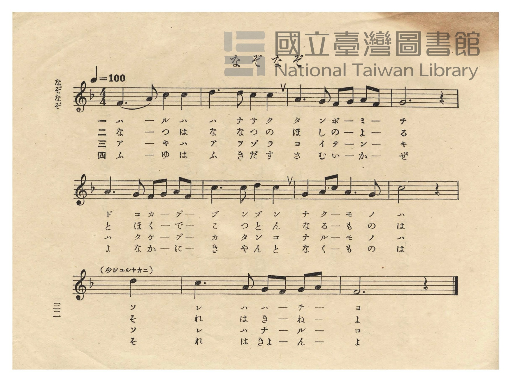
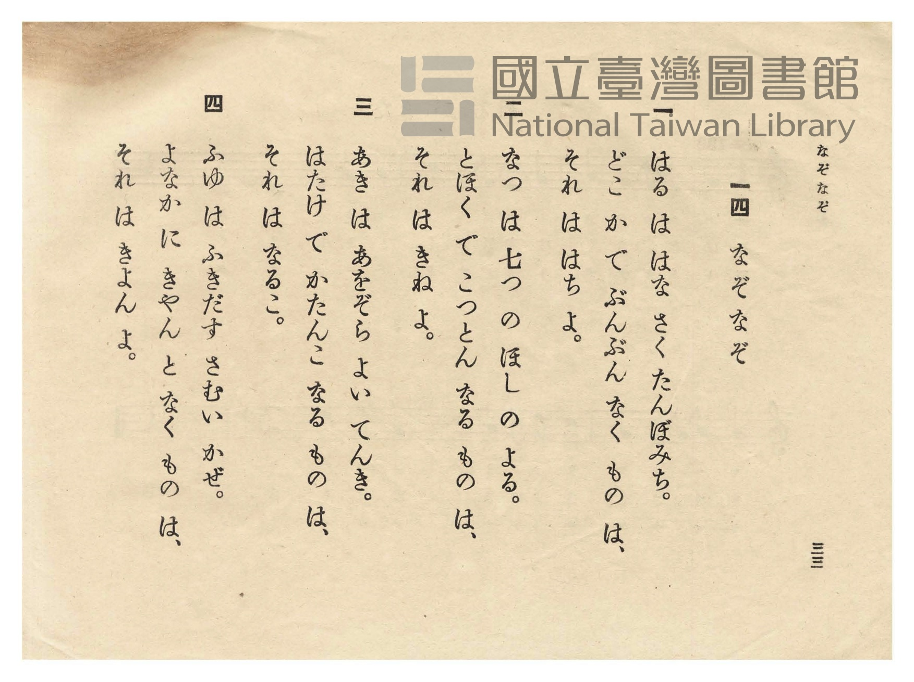

# なぞなぞ（謎謎）

> Re:Shōka 使用 AI 協助辨識與重建樂譜，可能會有錯誤。歡迎[回報](https://github.com/TMDLang/reshoka/issues)。

- **鋼琴伴奏版**：<br><audio controls src="nazonazo.mp3"></audio>
- **NEUTRINO 歌聲合成版**：<br><audio controls src="nazonazo_neutrino.mp3"></audio>

- 日治時期公學校唱歌（第二學年・第十四課）
- 國立臺灣圖書館典藏

## 說明


- 出處：臺灣總督府編《公學校唱歌》第二學年用，第十四課〈なぞなぞ〉（謎謎- 猜謎），原書第 32–33 頁（P034–P035）。
- 調性與拍號：ヘ調（F 大調），4/4 拍，速度 != 100（末句標示「少シ ユルヤカニ」稍漸慢）。
- 背景與曲風：以春、夏、秋、冬四季聲音為題的猜謎童謠：
第一節（春）：花開田埂間「ぶんぶん」嗡嗡響的是蜜蜂（はち）；
第二節（夏）：七星閃耀的夏夜裡遠處「こつとん」咚咚響的是舂米木杵（きね）；
第三節（秋）：晴空旱田裡「かたんこ」咔噹響的是驅鳥鳴子（なるこ）；
第四節（冬）：寒風吹起的冬夜裡「きやん」地吠叫的是臺灣特有的山羌（きよん＝臺語「羌仔」kiong-á），
將臺灣山林特有動物自然融入四季猜謎之中。
- 版本說明：本檔案為原書單聲部五線譜之忠實數位化版本。第 9 小節原譜於「（少シ ユルヤカニ）」下方印有二分音符 `6`
（「ソ／そ」），此處補齊前半小節二分休止符以維持 4/4 拍完整小節時值。

### 編曲說明（鋼琴伴奏版）：

1. 前奏 (Intro, 4 小節)：以第一行輕快活潑的五聲音階主題引出四季猜謎的趣味氛圍。
2. 主歌伴奏 (Nazonazo, 11 小節 × 4 段)：右手演奏原曲歌唱旋律；左手以活潑四拍子和聲伴奏。


## 歌詞

```text
一
はる は はな さく たんぼみち。
どこ か で ぶんぶん なく もの は、
それ は はち よ。

二
なつ は 七つ の ほし の よる。
とほく で こつとん なる もの は、
それ は きね よ。

三
あき は あをぞら よい てんき。
はたけ で かたんこ なる もの は、
それ は なるこ。

四
ふゆ は ふきだす さむい かぜ。
よなか に きやん と なく もの は、
それ は きよん よ。
```

## ABC

<div class="abc-score" data-abc-src="nazonazo.abc" aria-label="五線譜載入中"></div>

[下載 ABC 原始檔](nazonazo.abc)

## TMD 檔案連結

- [主旋律 TMD 檔案](nazonazo.tmd) [[在 TMD Studio 編輯](https://tmdlang.github.io/Tmd-TS/#tmd=s7IKdvYPcrWy4qpTUCpJTLdSSM7PyUlNLsnMz7PKzk9PzM7Ojy_OyM9OVIKrKMvPKc1NtUovSkxJjTdCiBfnlxYlp1oVJ2fk5-fEl6RWlCTl52cj5AuK8stS8xLzgGoKijLzSlJTwIoQClLLMlNSQdKpKZkl-UWZiTlIlqYWFYPcBLEkvqQoMa84uSizAORQhCqgpvTMPKuSxMzyxLz4_LS0zGQUU6C6CxLTU60CDIxNdIGEKbL2kox8oL8KMiqtMjKLQW5ITsyJz07MQ_J-SUYqyPeJualKXFpaCo8bVz1unAch3-_peLGmD4je7-lU0NLiUrRVMDQw4LK3VXDjsjHRN7EDGfJs-tJnm3Y_m9n0bM78p61rnq7d8WzBwqdTNj5b2wPU_3zNmie7eoCCT3duedy8G8h92tv4dPbsF6s2AQ0Fu-LpnO7nq7tftO963rj46Zxpz2bveLlkxdPWHS-m9ytxcelrKdhSC3ApKCg8bpjwbPam57PXvVi16tmMvscNE8Gizbuftu96MXPq-z2zIC55vmPv87mLn-6a83z7iscNXWg-e9zQjeyz51NWvN_Tg-y5xw0dyCH5uKETHpigYOiZAwlVoK6nffOBXgbqVTA2etQw2dhY4eWCRqBiUHwC-aAYBSp83NAEdeeLVfufNSx_0dH-rLv3xcz5QAc_bp4BFARqcVN4umQ5mAkyGBhBCkA1QNbLhvlPdy1TgEQfUN2zOauf9i99tmLm8yW7Hjf0PN0w8XHTdqDZyx43r37cvORxE5DsftzQ-3xF77M9O561LkJ1QHPPs5nrQQ6YvenlIqDHZz3ZvfTZjKWPGxqfLukHks-XAzU3Pm1bAwyKp2sXv2jc9HL-5udNu14u7Hk-qwXi9-erl75YswCoF2SoggIoMHc0PF_fAHLdjKVgD8x60bXx5bTu51M2PJ3f9HLaZKBLHzdue9w0GUo29D6dvhCIXs7fDzT22Yz1L-bMeTGnCWjC48b1jxsXgg2ZjTB_Vw_EfKAjIeY_2dH8bMb8l9OaXzQ0AE0Aij9dMufF4oUvGxcAUwLYOqBdSx43roBaN2kWECGs62h6vnHzszkrns3dCra093HjWnRLd3RCLAWGCcTSZzO3PF-569n0jUB_Ae0C29L9uHE-2F8QW6Y8nbkTbsvLla0vNy99uXnL07UTwLasetwEVD8ZzSJgUEN917YGYtHT9ZOAsfN0ws4XW7eDfAeMDrDvwDb2Pm5qgXpqzoanExY87V8N9RQk8XfufDanE6Rr48bn-0D5GKylA6jl_Z65QDUvVgGTdA9Q6snuKUBDsoGlVrruYUiQ90Ac9XRDOzRPb9z4bN50iJFPu6c-71z5on3V85ZtL-b1Pm1dCkkjkETxZGf3kx1rESnteScwqa6BZFRQ0M1Z82zVlGcLO4BpCZJrnk5bB0pdzSue7JryfPusF2vnAI14un_B0_XLnk3d8WRv79OeaRBDgIaCspgl0Fn9wIACagcqfjZtD9AXoEDDmgPAqb73yY7uZ9N2Pu3dAHQ-KMN3tIFS85plCglmCRCfgoIHGKhNe9_v6X_cOBeoBxIOz9YuAaajF4vnvNzb9bSz92lvF8RyiClP9kx8tnYR0CBg7nm-be2znkYFaI59uq7n2dQtELXAcvVpA9CVTVzQwgvicWAR9GLlvKetK55NawfmRGCogRir5r1Yux5YooF91PusvVMBVHroZRWkAx0ENgCYycDmADNIUzeIAjMbVwGpqY8b-4EUJCHuedy4H5iFYFHRuBKY4oAUSMtyIEbkQkh9AdTY1PS4cR3YtIZGiJ65j5t6EFYsBCoBBhPYPFBRCHYrKFJnLH26ZCUw5T2fuQ-Y4Z_Png3K88BiYsoGYJ4HBsKL7UAjm57s6H0-f-nTffOeTl4FTMTQnA_MFeCECyrjmhbDi4CnExuAWuB-3gVOkWCHLgE7CJjxIUyQg3c_bpwOYYLSN7Dkgnp5BVgKFCQgHyMKArBBoMDD62NQWYDDx-ByBuTjpz3Tn02bjlEKzXk2cxZQG9CvkILoadPmJ_vaIIUPuCwFlQxwH0PKHzQf7-iEOAjowl6og5oeN00CVURNnWBnNbYAxZaBo7EX7mVgNM1_3DgR6mVEqUScl6EFExYfAws_iI8hhd-LCWtetoOqgqdL94LENywGeXfOClBJPwdUKEKKQAj5ZO8cNB9DSkSgCKRQRPU6sDiBOGzr46Y2qMO2gqNjwePGmeBk3tQA8T3QsXNgXgeFCDB5gNL3anDsgYtHUCogLoFDC0dcMQ4qe1dCiuInu9qAJfPTNlCZDCyfIT4HFQ3wwrml73HL8sctS6CFc__qFxOnI_sfUiYjvA20jPKmERQoaOlzcfklVuXnAbFVQGZiXr5DjUFNNbigs7HQsgMzahQMFXSB0FjBFEiCcI2CGVjEDEnEGCxiBFRrBGQbAkWMwCIQaABSAzbNx7AGWPL2g0WBxS-UDSFBMl0QmaatQLwezNoPldkM1TMHiOcD8R4gbgTTQNmmJdhtMwLKAQs8sE5oeQBigUTQZdaBWbuhMtOhMuCSAmIbKE9AbGtsw26bMcgli6A-AJYIEL-BRUA-2ASV2QdkrwT7ZQVEBur6x83ARAz0J8Q2kH68fjMBuWQr1ExI8ge5GCQCkumF-mABEM8Es6ZCbWuAyoDzBcS2RlCoQvzWgWEbNBlgRjEo6kEJAJQcIMkAFOmghAJTC1ODPRl0Qh0P9HITKCmAorQd5pDmadBAAQUIiA1JArBEAkoeEB3QAG_uA8tBkhb2hAAKbkgkgzM52OPAwg_q8clQWVBiAKkEZXFEMoFFP7BogKpbB5YDBTqOpABL5sAk_LhpI7r_gD6Gy4J9BgoHJP-BMwfR_gMlBmBChbgMVMPDIhZiClKCaAJGO9hnEF_C_QcLEYL-gyYHEAcEIWUByCBIVBvDkwis5MAW-TDdwIYUXP_j5jVQr4KcAnUOIo-Dcwv2qIWb1jgXYRqwvIaIgctsaHAgchVmOodFHGG3dUHdBg9ccNRhjxai3QYqZ4ARg91ttVxcunYKsMJaAchW5gIA)]
- [鋼琴伴奏 TMD 檔案](nazonazo_piano.tmd) [[在 TMD Studio 編輯](https://tmdlang.github.io/Tmd-TS/#tmd=s7IKdvYPcrWy4qpTUCpJTLdSSM7PyUlNLsnMz7PKzk9PzM7Ojy_OyM9OVIKrKMvPKc1NtTJCiBTnlxYlp-JSD5GNL0hMT7UKMDA20QUSpgjpgqL8stS8xDygASWJmeWJefHpQIGivPyi-PTUvNSixByE2tSyzJRUkMqCoszcxKLK-JT8ZKBb8kqQXJdaVAxyfEFmYl5-fGJRUWJeeiqqkvyikoz89KLEgoxKq4zM4pL8oszkxJz47MQ8JFeXZAB1WaUn5qYqcWlpKTxuXPW4cR6EfL-n48WaPiB63Lz7Zfee5xO2PNmz5enS_uedHe_3dCpoaXEp2ioYGhhw2dsquHHZmOib2IGMfTZ96bNNu5_NbHo2Z_7T1jVP1-54tmDh0ykbn63tAZr4fM2aJ7t6gIJPd24BmgvkPu1tfDp79otVm4CGgt31dE7389XdL9p3PW9c_HTOtGezd7xcsuJp644X0_uVuLj0tRRsqQW4FBQUHjdMeDZ70_PZ616sWvVsRt_jholg0ebdT9t3vZg59f2eWRCXPN-x9_ncxU93zXm-fcXjhi40nz1u6Eb22fMpK97v6UH23OOGDuSwfdzQiRy8z3vmABnAAADqeto3H-hloF4FY6NHDZONjRVeLmgEKgalKSAflKqACh83NEHd-WLV_mcNy190tD_r7n0xcz7QwY-bZwAFgVrcFJ4uWQ5mggwGRpACUA2Q9bJh_tNdyxQg0YcwCegzYFBAwgGoGzPOgWaDlCooGOopPO3sBYoraHjmlRTl6yiYKDzd0P98fYMmUM2T3UtBgbGj4cXCnhd7pj7dv_rZlt3P9k58Pqvlya4pLxo3vZy_-eWsvic7dr9c2PMUqKB9FzCQnq5dDAkGoLIX2xY_nbj52YbZT-f0Qt2noGCkpwDUAgxsiJMUNPwSq_LzgFhHwdAQar3C4elApzxbtxXkjqf9m591dj_bMwWoGhyqm4CaQfE1vfvpvu73e2Y_3b4MqADoXIj7gI4Ahs_TtROeTuoBuhJiDdR6yhMbFCho6XNxgQPNKgCUd4M8HGoMaqrBXrSx0LIDM2oUDBV0gdBYwRRIgnCNghlYxAxJBESC1BgBVRsBaZguCDQAqeGqRbHMB9kyE4Rl8QrRhrEwqkbBBMgwQeJDGaZAyhSJD8IGEDtgUUGxn4zBIjAfGQJFjDD8BDLNx7AGmGT7waKPm1dD2RASJNMFkWnaCsTrwaz9UJnNUD1zgHg-EO8B4kYwDZRtWoLdNiOgXOMqiM7GJUAMNhMsgi6zDszaDZWZDpVZBzS7A2JbUzfMtsY27LYZg1yyCOqDtTC_gUVAPtgEldkHZK8E-2UFRAbq-sfNbWB_QmwD6cfrNxOQS7ZCzQTqhPoNJAKS6YX6YAEQzwSzpkJta4DKtAAxxE-PG0GhCvFbB4Zt0GSAGcWQhGwKTg6QZACKdFBCgamFqcGeDDqhjgd6uQmUFEBR2g5zSPM0aKCAAgTEhiQBWCIBJQ-IDmiAN_eB5SBJC3tCAAU3JJIfN_ZDPb4c7vHJUFlQYgCpfNwEEoElE1j0P25qgqpbB5YDBTqOpABL5sAk_LhpI7r_gD6Gy4J9BgoHJP-BMwfR_gMlBmBChbhsFVLEQkxBShBNwGgH-wziS7j_YCFC0H_Q5ADigCCkLCC2XINFPkz346a9cP2Pm9dAvQpyCtQ5iDwOzi3YoxZuWuNchGlNPVAxYEIBeh4SHIhchZnOYRFH2G1dULfBAxccddijhWi3gcoZYMRgdxtGWU1ZlQDnQ-sGIAWqEbCbAWWAjILrgcojVytACmEGyNVQu4mph3TtFMDVHVg3kAPza7SPYSymmBEWMWMsYiZwMWUuAA)]

## 分析

```text
================================================================================
📊 TMD Song Profile: [ なぞなぞ（謎謎） ]
================================================================================
⏱  Duration:       0:26 (26.4s), 11 measures total
🎼 Key & Tempo:    首調基準 F, != 100.0 BPM, <4/4>
   - 分析範圍：      由實際發聲的音符與和弦推測調性；播放脈絡另行呈現
🎤 人聲音域:    F4 (MIDI 65) – D5 (MIDI 74) [跨度: 9 個半音 / 0.8 個八度, 難度: easy]
   - 最低音:  F4 in [Nazonazo #1 @ m.1, 0:00]
   - 最高音: D5 in [Nazonazo #1 @ m.2, 0:02]
   - 適合: soprano, mezzo-soprano, contralto, tenor, baritone, bass
🏛  結構:      Nazonazo (26.4s)
⚡ 編曲密度:        Peak 1 軌道同時演奏
🗝  調性診斷：       C 大調（純淨自然大調，未偵測到可信轉調）
   - 風格氣質:    純淨自然大調（陽光明朗、易唱易記，無明顯調外色彩）
   - 轉調歷程:    全曲維持單一推測調性（未偵測到可信轉調）
   - 核心骨幹音:  C, G, A, F, D
   - 調性數值:    C 大調 [相關度: 0.85, 穩定度: Moderate, 自然音純度: 100.0%]
   - 候選調性 (K-S): C 大調 (0.85), F 大調 (0.77), A 小調 (0.66)
   - 五度圈歷程:   +0
   - 各段落調性細節:
     • [Nazonazo #1]: C 大調 (r: 0.85, 自然音純度: 100.0%)

  [ 五度圈游移軌跡 ]
              [C ]*
         F            G  
      Bb               D  
      Eb               A  
         Ab           E  
            Db       B  
               F# 
     (* = active key center)

  [ 十二半音累積音高分佈 ]
     C  : ████████████████████████  30.8%
     C# :                            0.0%
     D  : ██████████                12.8%
     D# :                            0.0%
     E  :                            0.0%
     F  : ██████████████            17.9%
     F# :                            0.0%
     G  : ███████████████           19.2%
     G# :                            0.0%
     A  : ███████████████           19.2%
     A# :                            0.0%
     B  :                            0.0%
--------------------------------------------------------------------------------
Assignment 軌道音域：
  - Piano         : F4 – D5 (9 個半音 / 0.8 個八度, 39 個音符)
================================================================================
```


## 原書掃描頁






