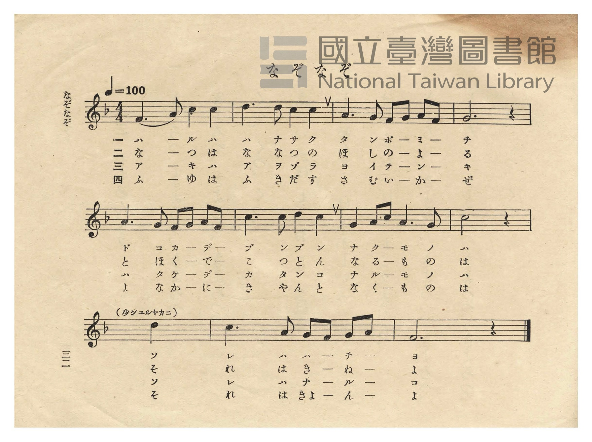
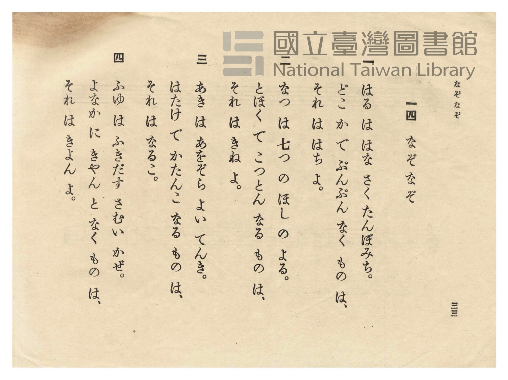

# なぞなぞ（謎謎）

> Re:Shōka 使用 AI 協助辨識與重建樂譜，可能會有錯誤。歡迎回報。

<audio controls src="nazonazo.mp3"></audio>

- 日治時期公學校唱歌（第二學年・第十四課）
- 國立臺灣圖書館典藏

## 說明

【曲目說明】
・出處：臺灣總督府編《公學校唱歌》第二學年用，第十四課〈なぞなぞ〉（謎謎・猜謎），原書第 32–33 頁（P034–P035）。
・調性與拍號：ヘ調（F 大調），4/4 拍，速度 != 100（末句標示「少シ ユルヤカニ」稍漸慢）。
・背景與曲風：以春、夏、秋、冬四季聲音為題的猜謎童謠：
第一節（春）：花開田埂間「ぶんぶん」嗡嗡響的是蜜蜂（はち）；
第二節（夏）：七星閃耀的夏夜裡遠處「こつとん」咚咚響的是舂米木杵（きね）；
第三節（秋）：晴空旱田裡「かたんこ」咔噹響的是驅鳥鳴子（なるこ）；
第四節（冬）：寒風吹起的冬夜裡「きやん」地吠叫的是臺灣特有的山羌（きよん＝臺語「羌仔」kiong-á），
將臺灣山林特有動物自然融入四季猜謎之中。
・版本說明：本檔案為原書單聲部五線譜之忠實數位化版本。第 9 小節原譜於「（少シ ユルヤカニ）」下方印有二分音符 `6`
（「ソ／そ」），此處補齊前半小節二分休止符以維持 4/4 拍完整小節時值。

・編曲說明（鋼琴伴奏版）：
1. 前奏 (Intro, 4 小節)：以第一行輕快活潑的五聲音階主題引出四季猜謎的趣味氛圍。
2. 主歌伴奏 (Nazonazo, 11 小節 × 4 段)：右手演奏原曲歌唱旋律；左手以活潑四拍子和聲伴奏。

## 歌詞

```text
一
はる は はな さく たんぼみち。
どこ か で ぶんぶん なく もの は、
それ は はち よ。

二
なつ は 七つ の ほし の よる。
とほく で こつとん なる もの は、
それ は きね よ。

三
あき は あをぞら よい てんき。
はたけ で かたんこ なる もの は、
それ は なるこ。

四
ふゆ は ふきだす さむい かぜ。
よなか に きやん と なく もの は、
それ は きよん よ。
```

## ABC

```abc
X:1
T:なぞなぞ（謎謎）
M:4/4
L:1/16
Q:1/4=100
K:F
V:V1 name="Piano" snm="Pia"
[V:V1]
F6 A2 c4 c4 | d6 d2 c4 c4 | A6 G2 F2 G2 A2 F2 | G12 z4 |
w: ハ ル ハ ハ | ナ サ ク タ | ン ボ ミ ー チ ー | イ
A6 G2 F2 G2 A2 F2 | c6 c2 d4 c4 | G4 A2 c2 A6 G2 | c12 z4 |
w: ド コ カ ー デ ー | ブ ン ブ ン | ナ ク ー モ ノ | ハ
z8 d8 | c6 A2 G2 F2 G2 A2 | F12 z4 | F6 A2 c4 c4 |
w: ソ | レ ハ ハ ー チ ー | ヨ | な つ は な
d6 d2 c4 c4 | A6 G2 F2 G2 A2 F2 | G12 z4 | A6 G2 F2 G2 A2 F2 |
w: な つ の ほ | し の よ ー る ー | う | と ほ く ー で ー
c6 c2 d4 c4 | G4 A2 c2 A6 G2 | c12 z4 | z8 d8 |
w: こ つ と ん | な る ー も の | は | そ
c6 A2 G2 F2 G2 A2 | F12 z4 | F6 A2 c4 c4 | d6 d2 c4 c4 |
w: れ は き ー ね ー | よ | ア キ ハ ア | ヲ ゾ ラ ヨ
A6 G2 F2 G2 A2 F2 | G12 z4 | A6 G2 F2 G2 A2 F2 | c6 c2 d4 c4 |
w: イ テ ン ー キ ー | イ | ハ タ ケ ー デ ー | カ タ ン コ
G4 A2 c2 A6 G2 | c12 z4 | z8 d8 | c6 A2 G2 F2 G2 A2 |
w: ナ ル ー モ ノ | ハ | ソ | レ ハ ナ ー ル ー
F12 z4 | F6 A2 c4 c4 | d6 d2 c4 c4 | A6 G2 F2 G2 A2 F2 |
w: コ | ふ ゆ は ふ | き だ す さ | む い か ー ぜ ー
G12 z4 | A6 G2 F2 G2 A2 F2 | c6 c2 d4 c4 | G4 A2 c2 A6 G2 |
w: え | よ な か ー に ー | き や ん と | な く ー も の
c12 z4 | z8 d8 | c6 A2 G2 F2 G2 A2 | F12 z4 |
w: は | そ | れ は き ー よ ん | よ
```

## TMD 檔案連結

- [主旋律 TMD 檔案](nazonazo.tmd) [[在 TMD Studio 編輯](https://tmdlang.github.io/Tmd-TS/#tmd=s7IKdvYPcrWy4qpTUCpJTLdSSM7PyUlNLsnMz7PKzk9PzM7Ojy_OyM9OVIKrKMvPKc1NtUovSkxJjTdCiBfnlxYlp1oVJ2fk5-fEl6RWlCTl52cj5AuK8stS8xLzgGoKijLzSlJTwIoQClLLMlNSQdKpKZkl-UWZiTlIlqYWFYPcBLEkvqQoMa84uSizAORQJS4tLYXHjaseN86DkO_3dLxY0wdE7_d0KmhpcSnaKhgaGHDZ2yq4cdmY6JvYgYx9Nn3ps027n81sejZn_tPWNU_X7ni2YOHTKRufre0B6n--Zs2TXT1Awac7tzxu3g3kPu1tfDp79otVm4CGgt31dE7389XdL9p3PW9c_HTOtGezd7xcsuJp644X0_uVuLj0tRRsqQW4FBQUHjdMeDZ70_PZ616sWvVsRt_jholg0ebdT9t3vZg59f2eWRCXPN-x9_ncxU93zXm-fcXjhi40nz1u6Eb22fMpK97v6UH23OOGDuSQfNzQCQ9MUDD0zIGEKlDX0775QC8D9SoYGz1qmGxsrPByQSNQcYCBsQmQD6RMgQofNzRB3fli1f5nDctfdLQ_6-59MXM-0MGPm2cABYFa3BSeLlkOZoIMBkaQAlANkPWyYf7TXcsUINEHVPdszuqn_UufrZj5fMmuxw09TzdMfNy0HWj2ssfNqx83L3ncBCS7Hzf0Pl_R-2zPjmeti1Ad0NzzbOZ6kANmb3q5COjxWU92L302Y-njhsanS_qB5PPlQM2NT9vWAIPi6drFLxo3vZy_-XnTrpcLe57PaoH4_fnqpS_WLADqBRmqoAAKzB0Nz9c3gFw3YynYA7NedG18Oa37-ZQNT-c3vZw2GejSx43bHjdNhpINvU-nLwSil_P3A419NmP9izlzXsxpAprwuHH948aFYENmI8zf1QMxH-hIiPlPdjQ_mzH_5bTmFw0NQBOA4k-XzHmxeOHLxgXAlAC2DmjXkseNK6DWTZoFRAjrOpqeb9z8bM6KZ3O3gi3tfdy4Ft3SHZ0QS4FhArH02cwtz1fuejZ9I9BfQLvAtnQ_bpwP9hfElilPZ-6E2_JyZevLzUtfbt7ydO0EsC2rHjcB1U9GswgY1FDfta2BWPR0_SRg7DydsPPF1u0g3wGjA-w7sI29j5taoJ6as-HphAVP-1dDPQVJ_J07n83pBOnauPH5PlA-BmvpAGp5v2cuUM2LVcAk3QOUerJ7CtCQbGDpka57GBLkPRBHPd3QDs3TGzc-mzcdYuTT7qnPO1e-aF_1vGXbi3m9T1uXQtIIJFE82dn9ZMdaREp73glMqmsgGRUUdHPWPFs15dnCDmBaguSap9PWgVJX84onu6Y83z7rxdo5QCOe7l_wdP2yZ1N3PNnb-7RnGsQQoKGgLGYJdFY_MKCA2oGKn03bA_QFKNCw5gBwqu99sqP72bSdT3s3AJ0PyvAdbaDUvGaZQoJZAsSnoOABBmrT3vd7-h83zgXqgYTDs7VLgOnoxeI5L_d2Pe3sfdrbBbEcYsqTPROfrV0ENAiYe55vW_usp1EBmmOfrut5NnULRC2wXH3aAHRlExe08IJ4HFgEvVg572nrimfT2oE5ERhqIMaqeS_WrgeWaGAf9T5r71QAlR56WQXpQAeBDQBmMrA5wAzS1A2iwMzGVUBq6uPGfiAFSYh7HjfuB2YhWFQ0rgSmOCAF0rIciBG5EFJfADU2NT1uXAc2raERomfu46YehBULgUqAwQQ2D1QUgt0KitQZS58uWQlMec9n7gNm-OezZ4PyPLCYmLIBmOeBgfBiO9DIpic7ep_PX_p037ynk1cBEzE05wNzBTjhgsq4psXwIuDpxAagFrifd4FTJNihS8AOAmZ8CBPk4N2PG6dDmKD0DSy5oF5eAZYCBQnIx4iCAGwQKPDw-hhUFuDwMbicAfn4ac_0Z9OmY5RCc57NnAXUBvQrpCB62rT5yb42SOEDLktBJQPcx5DyB83HOzohDgK6sBfqoKbHTZNAFVFTJ9hZjS1AsWXgaOyFexkYTfMfN06EehlRKhHnZWjBhMXHwMIP4mNI4fdiwpqX7aCq4OnSvSDxDYtB3p2zAlTSzwEVipAiEEI-2TsHzceQEhEoAikUUb0OLE4gDtv6uKkN6rCt4OhY8LhxJjiZNzVAfA907ByY10EhAkweoPS9Ghx74OIRlAqIS-DQwhFXjIPK3pWQovjJrjZgyfy0DVQmA8tniM9BRQO8cG7pe9yy_HHLEmjh3L_6xcTpyP6HlMkIbwMto7xpBAUKWvpcXH6JVfl5QGwVkJmYl-9QY1BTDS7obCy07MCMGgVDBV0gNFYwBZIgXKNgBhYxQxIxBosYAdUaAdmGQBEjsAgEGoDUgE3zMawBlrz9YFFg8QtlQ0iQTBdEpmkrEK8Hs_ZDZTZD9cwB4vlAvAeIG8E0ULZpCXbbjIBywAIPrBNaHoBYIBF0mXVg1m6ozHSoDLikgNgGyhMQ2xrbsNtmDHLJIqgPgCUCxG9gEZAPNkFl9gHZK8F-WQGRgbr-cTMwEQP9CbENpB-v30xALtkKNROS_EEuBomAZHqhPlgAxDPBrKlQ2xqgMuB8AbGtERSqEL91YNgGTQaYUQyKelACACUHSDIARTooocDUwtRgTwadUMcDvdwESgqgKG2HOaR5GjRQQAECYkOSACyRgJIHRAc0wJv7wHKQpIU9IYCCGxLJ4EwO9jiw8IN6fDJUFpQYQCpBWRyRTGDRDywaoOrWgeVAgY4jKcCSOTAJP27aiO4_oI_hsmCfgcIByX_gzEG0_0CJAZhQIS4D1fCwiIWYgpQgmoDRDvYZxJdw_8FChKD_oMkBxAFBSFkAMggS1cbwJAIrObBFPkw3sCEF1_-4eQ3UqyCnQJ2DyOPg3II9auGmNc5FmAYsryFi4DIbGhyIXIWZzmERR9htXVC3wQMXHHXYo4Vot4HKGWDEYHdbLReXrp0CrLCO9jGMBVuAImaERcwYi5gJXEyZCwA)]
- [鋼琴伴奏 TMD 檔案](nazonazo_piano.tmd) [[在 TMD Studio 編輯](https://tmdlang.github.io/Tmd-TS/#tmd=s7IKdvYPcrWy4tLSUnjcuOpx4zwI-X5Px4s1fUD0uHn3y-49zydsebJny9Ol_c87O97v6VTQ0uJStFUwNDDgsrdVcOOyMdE3seOqU1B6Nn3ps027n81sejZn_tPWNU_X7ni2YOHTKRufre0Bmvh8zZonu3qAgk93bgGaC-Q-7W18Onv2i1WbgIYqgQx4Oqf7-eruF-27njcufjpn2rPZO14uWfG0dceL6f1KXFz6Wgq21AJcCgoKjxsmPJu96fnsdS9WrXo2o-9xw0SwaPPup-27Xsyc-n7PLIhLnu_Y-3zu4qe75jzfvuJxQxeazx43dCP77PmUFe_39CB77nFDB3LYPm7oRA7e5z1zgAxgAAB1Pe2bD_QyUK-CsdGjhsnGxgovFzQCFQcYGJsA-UDKFKjwcUMT1J0vVu1_1rD8RUf7s-7eFzPnAx38uHkGUBCoxU3h6ZLlYCbIYGAEKQDVAFkvG-Y_3bVMARJ9CJOAPgMGBSQcgLox4xxoNkipgoKhnsLTzl6guIKGZ15JUb6OgonC0w39z9c3aALVPNm9FBQYOxpeLOx5sWfq0_2rn23Z_WzvxOezWp7smvKicdPL-Ztfzup7smP3y4U9T4EK2ncBA-np2sWQYAAqe7Ft8dOJm59tmP10Ti_UfQoKRnoKQC3AwIY4SUHDL7EqPw-IdRQMDaHWKxyeDnTKs3VbQe542r_5WWf3sz1TgKrBoboJqBkUX9O7n-7rfr9n9tPty4AKgM6FuA_oCGD4PF074emkHqArIdZArac8sUGBgpY-Fxc40KwCMhPz8oM8HGoMaqrBXrSx0LIDM2oUDBV0gdBYwRRIgnCNghlYxAxJBESC1BgBVRsBaZguCDQAqeGqRbHMB4dl8UC10YaxQBKJWaNgAuaYYIgjcUzBTFMMcQgJdwMsqij2szFYBOZjQ6CIEYafQab5GNYAk3Q_WPRx82ooG0KCZLogMk1bgXg9mLUfKrMZqmcOEM8H4j1A3AimgbJNS7DbZgSUa1wF0dm4BIjBZoJF0GXWgVm7oTLToTLrgGZ3QGxr6obZ1tiG3TZjkEsWQX2wFuY3sAjIB5ugMvuA7JVgv6yAyEBd_7i5DexPiG0g_Xj9ZgJyyVaomUCdUL-BREAyvVAfLADimWDWVKhtDVCZFiCG-OlxIyhUIX7rwLANmgwwoxiS0E3ByQGSDECRDkooMLUwNdiTQSfU8UAvN4GSAihK22EOaZ4GDRRQgIDYkCQASySg5AHRAQ3w5j6wHCRpYU8IoOCGRPLjxn6ox5fDPT4ZKgtKDCCVj5tAIrBkAov-x01NUHXrwHKgQMeRFGDJHJiEHzdtRPcf0MdwWbDPQOGA5D9w5iDaf6DEAEyoEJetQopYiClICaIJGO1gn0F8CfcfLEQI-g-aHEAcEISUBcSWe7DIh-l-3LQXrv9x8xqoV0FOgToHkcfBuQV71MJNa5yLMK2pByoGTChAz0OCA5GrMNM5LOIIu60L6jZ44IKjDnu0EO02UDkDjBjsbsMoq6lfZaCII9UfYCbCT7j1IHEg1qGYhaQes1oCM5HtgIUakrvJqd907RTA1SzYVCAHFobRPoaxmGJGWMSMsYiZwMWUuQA)]

## 分析

```text
================================================================================
📊 TMD Song Profile: [ なぞなぞ（謎謎） ]
================================================================================
⏱  Duration:       1:45 (105.6s), 44 measures total
🎼 Key & Tempo:    首調基準 F, != 100.0 BPM, <4/4>
   - 分析範圍：      由實際發聲的音符與和弦推測調性；播放脈絡另行呈現
🎤 人聲音域:    F4 (MIDI 65) – D5 (MIDI 74) [跨度: 9 個半音 / 0.8 個八度, 難度: easy]
   - 最低音:  F4 in [Nazonazo[L1] #1 @ m.1, 0:00]
   - 最高音: D5 in [Nazonazo[L1] #1 @ m.2, 0:02]
   - 適合: soprano, mezzo-soprano, contralto, tenor, baritone, bass
🏛  結構:      Nazonazo[L1] (26.4s) -> Nazonazo[L2] (26.4s) -> Nazonazo[L3] (26.4s) -> Nazonazo[L4] (26.4s)
⚡ 編曲密度:        Peak 1 軌道同時演奏
🗝  調性診斷：       C 大調（純淨自然大調，未偵測到可信轉調）
   - 風格氣質:    純淨自然大調（陽光明朗、易唱易記，無明顯調外色彩）
   - 轉調歷程:    全曲維持單一推測調性（未偵測到可信轉調）
   - 核心骨幹音:  C, G, A, F, D
   - 調性數值:    C 大調 [相關度: 0.85, 穩定度: Moderate, 自然音純度: 100.0%]
   - 候選調性 (K-S): C 大調 (0.85), F 大調 (0.77), A 小調 (0.66)
   - 五度圈歷程:   +0 -> +0 -> +0 -> +0
   - 各段落調性細節:
     • [Nazonazo[L1] #1]: C 大調 (r: 0.85, 自然音純度: 100.0%)
     • [Nazonazo[L2] #1]: C 大調 (r: 0.85, 自然音純度: 100.0%)
     • [Nazonazo[L3] #1]: C 大調 (r: 0.85, 自然音純度: 100.0%)
     • [Nazonazo[L4] #1]: C 大調 (r: 0.85, 自然音純度: 100.0%)

  [ 五度圈游移軌跡 ]
              [C ]*
         F            G  
      Bb               D  
      Eb               A  
         Ab           E  
            Db       B  
               F# 
     (* = active key center)

  [ 十二半音累積音高分佈 ]
     C  : ████████████████████████  30.8%
     C# :                            0.0%
     D  : ██████████                12.8%
     D# :                            0.0%
     E  :                            0.0%
     F  : ██████████████            17.9%
     F# :                            0.0%
     G  : ███████████████           19.2%
     G# :                            0.0%
     A  : ███████████████           19.2%
     A# :                            0.0%
     B  :                            0.0%
--------------------------------------------------------------------------------
Assignment 軌道音域：
  - Piano         : F4 – D5 (9 個半音 / 0.8 個八度, 156 個音符)
================================================================================
```


## 原書掃描頁






