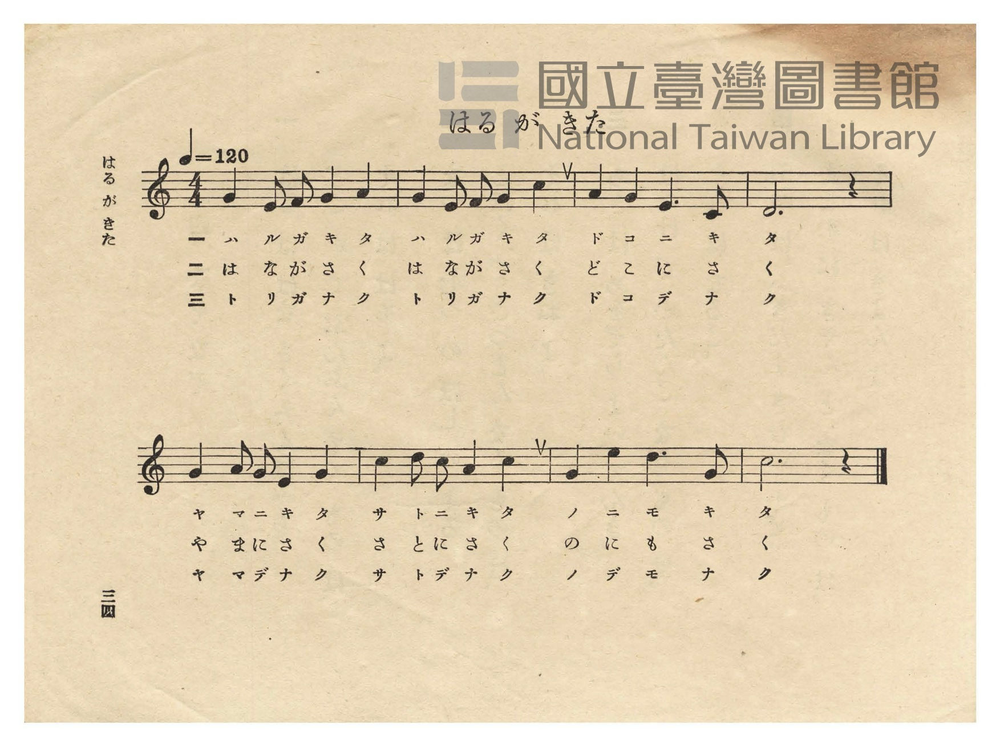
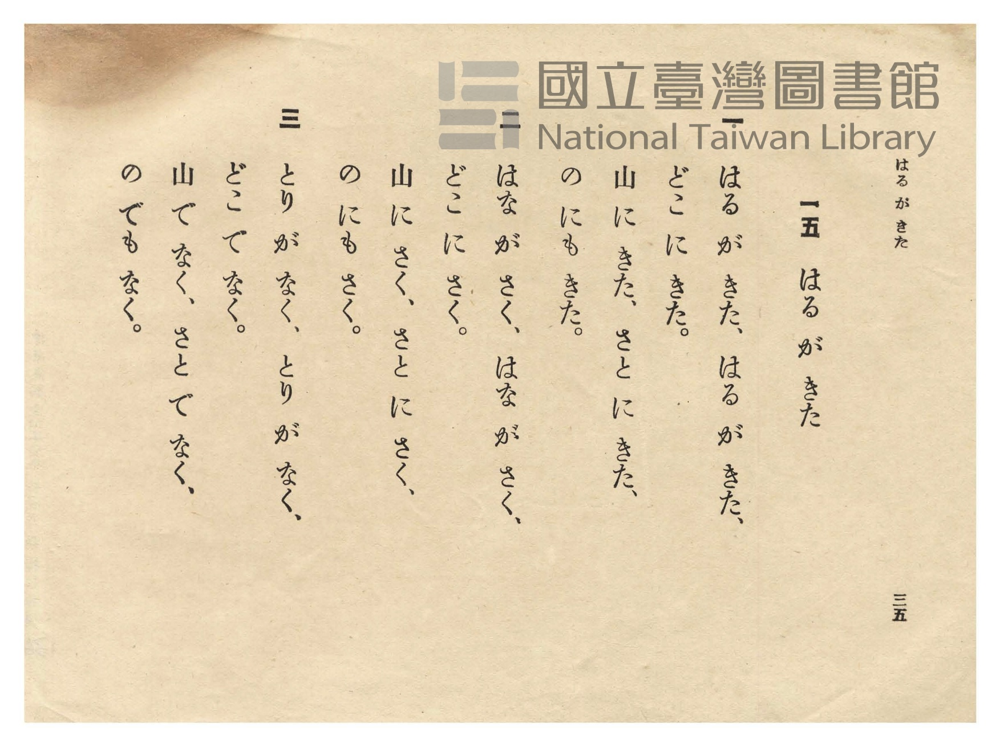

# はる が きた（春が來た）

> Re:Shōka 使用 AI 協助辨識與重建樂譜，可能會有錯誤。歡迎回報。

- **鋼琴伴奏版**：<br><audio controls src="haru_ga_kita.mp3"></audio>
- **NEUTRINO 歌聲合成版**：<br><audio controls src="haru_ga_kita_neutrino.mp3"></audio>

- 作詞：高野辰之（文部省尋常小學唱歌）
- 作曲：岡野貞一（文部省尋常小學唱歌）
- 日治時期公學校唱歌（第二學年・第十五課）
- 國立臺灣圖書館典藏

## 說明


- 出處：臺灣總督府編《公學校唱歌》第二學年用，第十五課〈はる が きた〉（春が來た），原書第 34–35 頁（P036–P037）。
- 調性與拍號：ハ調（C 大調），4/4 拍，速度 != 120。
- 背景與曲風：高野辰之作詞、岡野貞一作曲之日本近代最具代表性春之唱歌（原載於 1910 年《尋常小學讀本唱歌》
及 1911 年《尋常小學唱歌（二）》第四課，亦收錄於《新定公學校唱歌集》第二學年用第十三課 `2_13_haru_ga_kita`）。
描寫春天降臨山林、村里與原野，百花齊放、鳥兒啼鳴的明朗喜悅。
- 版本說明：本檔案為原書單聲部五線譜之忠實數位化版本。

### 編曲說明（鋼琴伴奏版）：

1. 前奏 (Intro, 4 小節)：以後半句「山にきた、さとにきた、のにもきた」明朗昂揚的旋律作為前奏。
2. 主歌伴奏 (HaruGaKita, 8 小節 × 3 段)：右手演奏原曲歌唱旋律；左手以輕快四拍子和聲伴奏。


## 歌詞

```text
一
はる が きた、はる が きた、
どこ に きた。
山 に きた、さと に きた、
の にも きた。

二
はな が さく、はな が さく、
どこ に さく。
山 に さく、さと に さく、
の にも さく。

三
とり が なく、とり が なく、
どこ で なく。
山 で なく、さと で なく、
の でも なく。
```

## ABC

<div class="abc-score" data-abc-src="haru_ga_kita.abc" aria-label="五線譜載入中"></div>

[下載 ABC 原始檔](haru_ga_kita.abc)

## TMD 檔案連結

- [主旋律 TMD 檔案](haru_ga_kita.tmd) [[在 TMD Studio 編輯](https://tmdlang.github.io/Tmd-TS/#tmd=s7IKdvYPcrWy4qpTUCpJTLdSSM7PyUlNLsnMz7PKzk9PzM7Ojy_OyM9OVIKrKMvPKc1NtUovSkxJjTdCiBfnlxYlp1oVJ2fk5-fEl6RWlCTl52cj5AuK8stS8xLzgGoKijLzSlJTwIoQClLLMlNSQdKpKZkl-UWZiTlIlqYWFYPcBLEkvqQoMa84uSizAORQhCqgpvTMPKvc_LykUqCrMSVSM7MysTgNampBYnqqVYCBsZkukDBH1l2SkQ_0b0FGpVVGZjHIbcmJOfHZiXlIwVKSkQoMlbzEktKiVCUuLS2Fx43rHzd1A6keIO593Dj__Z6OZzOWAvlP9rWBuZ0KWlpcirYKhkYGXPa2Cs5cNib6JnYgE59NX_ps0-5nM5uezZn_tHXN07U7ni1Y-HTKxmdre4CmPF-z5smuHqDg051bHjfvBnKf9jY-2TXlxapNQEPBTnqyd86LlfPe75n1cvWMl-19L_ZteLKzG-SAae0vm1c8n9P4dEP30x07nm7oBxkDNRiu9dlsoEGznm5aCNK6ad6THQ3EaX06p_v56u4X7bueNy5-Omfas9k7Xi5Z8bR1x4vp_UpcXPpaCrbUAlwKCgqPGyYAHfp89roXq1Y9m9H3uGEiWLR599P2XS9mTgX6AOKS5zv2Pp-7-OmuOc-3r3jc0IUWno8bupHD8_mUFe_39CAH6eOGDoyofNzQiRmbQH1P--YDPQ3UrWBs8qhhsrGpwssFjUCVoEQF5IOSFVDh44YmqEtfrNr_rGH5i472Z929L2YCDZn1uLkfKAjU4qzwdMlyMBNkMDBhKADVAFkvG-Y_3bVMAZJskExq7nk2cz3IpNmbXi4C-gEl5iHJ4XFDI3KcQiIaKAtKbXPWvNg_8cnuxc_mNDxt3Q5kvFi4Aug0oBeBCuApD-i_F3s6n03bo2BoaWigAEp_wABFSg8v1jUAjYKHLMhxCgpP-7tA6g2xqIebDIwAcMiAIuPp7NngpNzzZNeyZ1O2vexpAdoI1Phs2oan62ahxd_L2W2YUQiNvx2dQHMUEoziDY3jMxKLSuPTE-OzM0sSExCRoKDwrL__6frVQI8-XbLy5czeF-0rnm7c-GzedGBoPZs78WV7DzBQgf4GBhsoYczc96Jr48u9Xc-m7AMqeLl56dPWSU-n7nm5ecvzWS3AVPhszvSn0-Y8a2pFRM3zzg5Q8IITKTBegOxnq6Y8W9jxvGkXJL08nbbuReMmYOYCJrjn22e9WDsHFOb7Fzxdv-zZ1B1P9vY-7ZkGMQRkKDTpQ7QCAwAYsU9bVwBzJ9CdT3asBTFWzXuxdj0wP4BibEPvs_ZOBVDK08sqSAd6HGwAMPrB5mAm7EZsYhC1Kx83TgZSq-HiYB8CQwtFEGjA1MeNK1DFIAasAwk-bmpCNQDoSoiLQYEDjgZglnqyqw0Y3GhcIONpx4ank1e9WLwQKPJ04qL3e-ZDBTdufLKjC1kZMPJe9HVBVIIEd8JUguMSohjoAniI7OqBhUjjKqjvgf7oh4YIuhhGiEDE0UIEbgBSiKAYgBQiSAYghwgwuQGT2Mtp3RBvoHGBjKdzVqCFCFQQKUQgIpghAlWJI0R2dEIcueJxUxfU96tgHsIUQwmR5XBxpBBBCCJCBEkMESLLISGCZAByiEAzXf9qqN9QufDgAIq8mDgdEiLw4IAIQpTBgwMuCAwR5OCAiENDBOgIyqstKFDQ0ufi8gAWSO6J3sDiyCogMzEv36HGoKYaXCTZWGjZgRk1CqYKugrGCiZg2gyIUUUM48BCIAmIsC5IEChiBGZBoAFIDdg4H8MaYHnUD-Q_bgamxKY1QLwWxGvaDzYHv1wnmLcZrKIbbDJIBVAGrAKLbUZAucb1IHWIzAPmgWwhJLcSzJsMJldDbAOqAMmAVGCxzRjkxg6w64Amgtzf3AV2I8gWQnLIfmuH2AZUAfIbSAWqbUgxYwYkQYEOYtdAYsMoDkSDYgQaOeCIgcqADDGFqcQVP0vAts8DhzJaHDRtBct1YJNr7oPHzOPmRcTGT1MLOGT3wcomlDiA8ODlForcOnjMgPIqsfGD8Fs7ehwg-Q1DDuo3UMzA_YYzfmq5uHTtFBC5SwHIU-YCAA)]
- [鋼琴伴奏 TMD 檔案](haru_ga_kita_piano.tmd) [[在 TMD Studio 編輯](https://tmdlang.github.io/Tmd-TS/#tmd=s7IKdvYPcrWy4qpTUCpJTLdSSM7PyUlNLsnMz7PKzk9PzM7Ojy_OyM9OVIKrKMvPKc1NtTJCiBTnlxYlp-JSD5GNL0hMT7UKMDA20wUS5gjpgqL8stS8xDygASWJmeWJefHpQIGivPyi-PTUvNSixByE2tSyzJRUkMqCoszcxKLK-JT8ZKBb8kqQXJdaVAxyfEFmYl5-fGJRUWJeeiqqkvyikoz89KLEgoxKq4zM4pL8oszkxJz47MQ8JFeXZAB1WeUllpQWpSpxaWkpPG5c_7ipG0j1AHHv48b57_d0PJuxFMh_sq8NyH3cvPtl957nE7Y82bPl6dL-550d7_d0KmhpcSnaKhgaGXDZ2yo4c9mY6JvYgex4Nn3ps027n81sejZn_tPWNU_X7ni2YOHTKRufre0Bmvt8zZonu3qAgk93bgGaC-Q-7W18smvKi1WbgIaCHflk75wXK-e93zPr5eoZL9v7Xuzb8GRnN8hJ09pfNq94Pqfx6Ybupzt2PN3QDzIGajBc67PZQINmPd20EKR107wnOxqI0_p0Tvfz1d0v2nc9b1z8dM60Z7N3vFyy4mnrjhfT-5W4uPS1FGypBbgUFBQeN0wAOvT57HUvVq16NqPvccNEsGjz7qftu17MnAr0AcQlz3fsfT538dNdc55vX_G4oQstPB83dCOH5_MpK97v6UEO0scNHRiR-7ihEy1-gUEA1Pe0bz7Q00DdCsYmjxomG5sqvFzQCFQJSthAPihpAxU-bmiCuvTFqv3PGpa_6Gh_1t37YibQkFmPm_uBgkAtzgpPlywHM0EGAxOGAlANkPWyYf7TXcsUIMkGYRLQb8DAgIQEUDdmWgOaDVKqoGCop_C0sxcorqDhmVdSlK-jYKIAjMzn6xs0gWqe7F76dF_P096up_1LHzf0PN248XHjapinGx83Tn3cuAJVZB2I29QEE-kFOuDZnOnPZjQ965_1fFbLs-ndT_d1AxPV86ZdEHuhjlZQMNJTeLJjNzAOIO5U0PBILCp1T_TOLEnUUbCAOkrh8HQFY4Vn67aCXPe0f_Ozzu5ne6YAlYPDehNQNygewZa83zP76fZlQAVAT7zYM_Xp_tVPZ88GhtrTtROeTup50bgJYg_UfsoTIRQoaOlzcYGD0ioAVKwEeTjUGNRUg_1oY6FlB2bUKJgq6CqYAUljIA1i1ygYxgEpozgQbQZkgbkQdcZQGV2wWqhKGDQAKeOqRbHTB9lOE7idhvEK0YaxMKpGwQTIMImFUUC7IBIgyhTEhyoEYQOIHYgoIeg5Y2BCgngS7g2oCNRnIAmIMMgbhkARIwxvgYzzMawBJul-IP9x82qFx01rgHgtiNe0H2wOfrlOMG8zWEU32GSQCqAMWAUW24yAco3rQeoaV0Hz-FQwD2QLIbmVYN5kMLkaYhtQBUgGpAKLbcYgN3aAXQc0EeT-5i6wG0G2EJJD9ls7xDagCpDfQCpQbaNNskPEzxKw7fPAoYwWB01bwXId2OSa--Ax87h5EbHx09QCDtl94FBGjwMIbwVWuXXwmAGWUUTHD8Jv7ehxgOQ3DDmo30AxA_cbzvjBkrkI52JwrsWWq5H50OwMpECZmFolga6dArjAARsI5CAcH-1jGItN1AirqDFcVJkLAA)]

## 分析

```text
================================================================================
📊 TMD Song Profile: [ はる が きた（春が來た） ]
================================================================================
⏱  Duration:       0:16 (16.0s), 8 measures total
🎼 Key & Tempo:    首調基準 C, != 120.0 BPM, <4/4>
   - 分析範圍：      由實際發聲的音符與和弦推測調性；播放脈絡另行呈現
🎤 人聲音域:    C4 (MIDI 60) – E5 (MIDI 76) [跨度: 16 個半音 / 1.3 個八度, 難度: moderate]
   - 最低音:  C4 in [HaruGaKita #1 @ m.3, 0:05]
   - 最高音: E5 in [HaruGaKita #1 @ m.7, 0:12]
   - 適合: soprano, mezzo-soprano, contralto, tenor, baritone, bass
🏛  結構:      HaruGaKita (16.0s)
⚡ 編曲密度:        Peak 1 軌道同時演奏
🗝  調性診斷：       C 大調（純淨自然大調，未偵測到可信轉調）
   - 風格氣質:    純淨自然大調（陽光明朗、易唱易記，無明顯調外色彩）
   - 轉調歷程:    全曲維持單一推測調性（未偵測到可信轉調）
   - 核心骨幹音:  G, C, D, E, A
   - 調性數值:    C 大調 [相關度: 0.87, 穩定度: Moderate, 自然音純度: 100.0%]
   - 候選調性 (K-S): C 大調 (0.87), G 大調 (0.82), E 小調 (0.59)
   - 五度圈歷程:   +0
   - 各段落調性細節:
     • [HaruGaKita #1]: C 大調 (r: 0.87, 自然音純度: 100.0%)

  [ 五度圈游移軌跡 ]
              [C ]*
         F            G  
      Bb               D  
      Eb               A  
         Ab           E  
            Db       B  
               F# 
     (* = active key center)

  [ 十二半音累積音高分佈 ]
     C  : ███████████████████       23.3%
     C# :                            0.0%
     D  : █████████████             16.7%
     D# :                            0.0%
     E  : ████████████              15.0%
     F  : ███                        3.3%
     F# :                            0.0%
     G  : ████████████████████████  30.0%
     G# :                            0.0%
     A  : █████████                 11.7%
     A# :                            0.0%
     B  :                            0.0%
--------------------------------------------------------------------------------
Assignment 軌道音域：
  - Piano         : C4 – E5 (16 個半音 / 1.3 個八度, 30 個音符)
================================================================================
```


## 原書掃描頁






