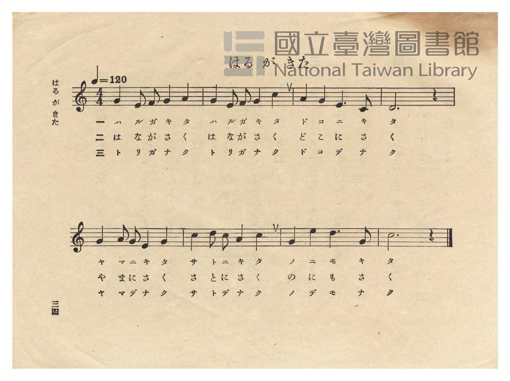
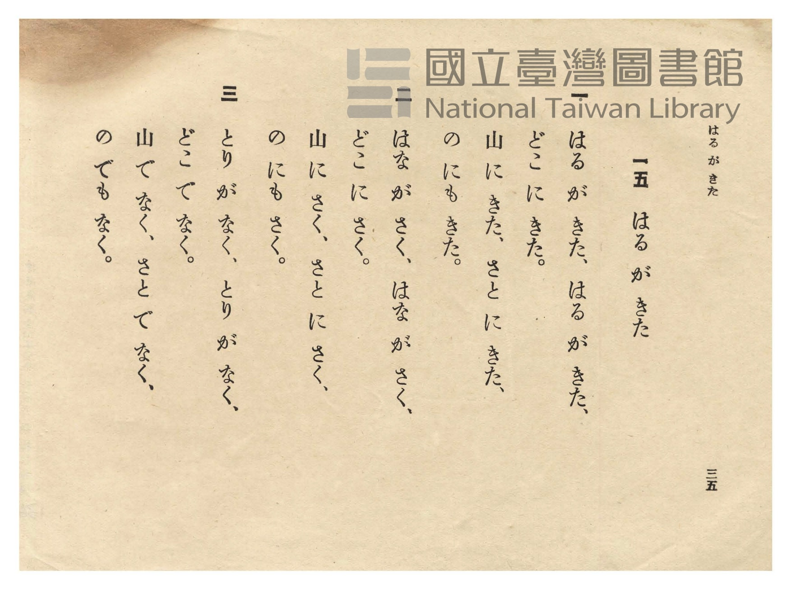

# はる が きた（春が來た）

> Re:Shōka 使用 AI 協助辨識與重建樂譜，可能會有錯誤。歡迎回報。

- **鋼琴伴奏版**：<br><audio controls src="haru_ga_kita.mp3"></audio>
- **NEUTRINO 歌聲合成版**：<br><audio controls src="haru_ga_kita_neutrino.mp3"></audio>

- 作詞：高野辰之（文部省尋常小學唱歌）
- 作曲：岡野貞一（文部省尋常小學唱歌）
- 日治時期公學校唱歌（第二學年・第十五課）
- 國立臺灣圖書館典藏

## 說明


- 出處：臺灣總督府編《公學校唱歌》第二學年用，第十五課〈はる が きた〉（春が來た），原書第 34–35 頁（P036–P037）。
- 調性與拍號：ハ調（C 大調），4/4 拍，速度 != 120。
- 背景與曲風：高野辰之作詞、岡野貞一作曲之日本近代最具代表性春之唱歌（原載於 1910 年《尋常小學讀本唱歌》
及 1911 年《尋常小學唱歌（二）》第四課，亦收錄於《新定公學校唱歌集》第二學年用第十三課 `2_13_haru_ga_kita`）。
描寫春天降臨山林、村里與原野，百花齊放、鳥兒啼鳴的明朗喜悅。
- 版本說明：本檔案為原書單聲部五線譜之忠實數位化版本。

### 編曲說明（鋼琴伴奏版）：

1. 前奏 (Intro, 4 小節)：以後半句「山にきた、さとにきた、のにもきた」明朗昂揚的旋律作為前奏。
2. 主歌伴奏 (HaruGaKita, 8 小節 × 3 段)：右手演奏原曲歌唱旋律；左手以輕快四拍子和聲伴奏。


## 歌詞

```text
一
はる が きた、はる が きた、
どこ に きた。
山 に きた、さと に きた、
の にも きた。

二
はな が さく、はな が さく、
どこ に さく。
山 に さく、さと に さく、
の にも さく。

三
とり が なく、とり が なく、
どこ で なく。
山 で なく、さと で なく、
の でも なく。
```

## ABC

<div class="abc-score" data-abc-src="haru_ga_kita.abc" aria-label="五線譜載入中"></div>

[下載 ABC 原始檔](haru_ga_kita.abc)

## TMD 檔案連結

- [主旋律 TMD 檔案](haru_ga_kita.tmd) [[在 TMD Studio 編輯](https://tmdlang.github.io/Tmd-TS/#tmd=s7IKdvYPcrWy4qpTUCpJTLdSSM7PyUlNLsnMz7PKzk9PzM7Ojy_OyM9OVIKrKMvPKc1NtUovSkxJjTdCiBfnlxYlp1oVJ2fk5-fEl6RWlCTl52cj5AuK8stS8xLzgGoKijLzSlJTwIoQClLLMlNSQdKpKZkl-UWZiTlIlqYWFYPcBLEkvqQoMa84uSizAORQhCqgpvTMPKvc_LykUqCrMSVSM7MykZympaXwuHH946ZuINUDxL2PG-e_39PxbMZSIP_JvjYwt1NBS4tL0VbB0MiAy95WwZnLxkTfxA5k9LPpS59t2v1sZtOzOfOftq55unbHswULn07Z-GxtD9CU52vWPNnVAxR8unPL4-bdQO7T3sYnu6a8WLUJaCjYbU_2znmxct77PbNerp7xsr3vxb4NT3Z2gxwwrf1l84rncxqfbuh-umPH0w39IGOgBsO1PpsNNGjW000LQVo3zXuyo4E4rU_ndD9f3f2ifdfzxsVP50x7NnvHyyUrnrbueDG9X4mLS19LwZZagEtBQeFxwwSgQ5_PXvdi1apnM_oeN0wEizbvftq-68XMqUAfQFzyfMfe53MXP9015_n2FY8butDC83FDN3J4Pp-y4v2eHuQgfdzQgRGVjxs6MWMTqO9p33ygp4G6FYxNHjVMNjZVeLmgEagywMDYDMgHUuZAhY8bmqAufbFq_7OG5S862p91976YCTRk1uPmfqAgUIuzwtMly8FMkMHAhKEAVANkvWyY_3TXMgVIskEyqbnn2cz1IJNmb3q5COgHlJiHJIfHDY3IcQqJaKAsKLXNWfNi_8Qnuxc_m9PwtHU7kPFi4Qqg04BeBCqApzyg_17s6Xw2bY-CoaWhgQIo_QEDFCk9vFjXADQKHrIgxykoPO3vAqk3xKIebjIwAsAhA4qMp7Nng5Nyz5Ndy55N2faypwVoI1Djs2kbnq6bhRZ_L2e3YUYhNP52dALNUUgwijc0js9ILCqNT0-Mz84sSUxARIKCwrP-_qfrVwM9-nTJypcze1-0r3i6ceOzedOBofVs7sSX7T3AQAX6GxhsoIQxc9-Lro0v93Y9m7IPqODl5qVPWyc9nbrn5eYtz2e1AFPhsznTn06b86ypFRE1zzs7QMELTqTAeAGyn62a8mxhx_OmXZD08nTauheNm4CZC5jgnm-f9WLtHFCY71_wdP2yZ1N3PNnb-7RnGsQQkKHQpA_RCgwAYMQ-bV0BzJ1Adz7ZsRbEWDXvxdr1wPwAirENvc_aOxVAKU8vqyAd6HGwAcDoB5uDmbAbsYlB1K583DgZSK2Gi4N9CAwtFEGgAVMfN65AFYMYsA4k-LipCdUAoCshLgYFDjgagFnqya42YHCjcYGMpx0bnk5e9WLxQqDI04mL3u-ZDxXcuPHJji5kZcDIe9HXBVEJEtwJUwmOS4hioAvgIbKrBxYijaugvgf6ox8aIuhiGCECEUcLEbgBSCGCYgBSiCAZgBwiwOQGTGIvp3VDvIHGBTKezlmBFiJQQaQQgYhghghUJY4Q2dEJceSKx01dUN-vgnkIUwwlRJbDxZFCBCGICBEkMUSILIeECJIByCECzXT9q6F-Q-XCgwMo8mLidEiIwIMDIghRBg8OuCAwRJCDAyIODRGgIyivtqBAQUufi8sDWCC5J3oDiyOrgMzEvHyHGoOaanCRZGOhZQdm1CiYKugqGCuYgGkzIEYVMYwDC4EkIMK6IEGgiBGYBYEGIDVg43wMa4DlUT-Q_7gZmBKb1gDxWhCvaT_YHPxynWDeZrCKbrDJIBVAGbAKLLYZAeUa14PUITIPmAeyhZDcSjBvMphcDbENqAIkA1KBxTZjkBs7wK4Dmghyf3MX2I0gWwjJIfutHWIbUAXIbyAVqLYhxYwZkAQFOohdA4kNozgQDYoRaOSAIwYqAzLEFKYSV_wsAds-DxzKaHHQtBUs14FNrrkPHjOPmxcRGz9NLeCQ3Qcrm1DiAMKDl1socuvgMQPKq8TGD8Jv7ehxgOQ3DDmo30AxA_cbzvip5eLStVNA5C4FIE-ZCwA)]
- [鋼琴伴奏 TMD 檔案](haru_ga_kita_piano.tmd) [[在 TMD Studio 編輯](https://tmdlang.github.io/Tmd-TS/#tmd=s7IKdvYPcrWy4tLSUnjcuP5xUzeQ6gHi3seN89_v6Xg2YymQ_2RfG5D7uHn3y-49zydsebJny9Ol_c87O97v6VTQ0uJStFUwNDLgsrdVcOayMdE3seOqU1B6Nn3ps027n81sejZn_tPWNU_X7ni2YOHTKRufre0Bmvt8zZonu3qAgk93bgGaC-Q-7W18smvKi1WbgIYqgQx4snfOi5Xz3u-Z9XL1jJftfS_2bXiysxvkpGntL5tXPJ_T-HRD99MdO55u6AcZAzUYrvXZbKBBs55uWgjSumnekx0NxGl9Oqf7-eruF-27njcufjpn2rPZO14uWfG0dceL6f1KXFz6Wgq21AJcCgoKjxsmAB36fPa6F6tWPZvR97hhIli0effT9l0vZk4F-gDikuc79j6fu_jprjnPt6943NCFFp6PG7qRw_P5lBXv9_QgB-njhg6MyH3c0IkWv8AgAOp72jcf6GmgbgVjk0cNk41NFV4uaASqDDAwNgPygZQ5UOHjhiaoS1-s2v-sYfmLjvZn3b0vZgINmfW4uR8oCNTirPB0yXIwE2QwMGEoANUAWS8b5j_dtUwBkmwQJgH9BgwMSEgAdWOmNaDZIKUKCoZ6Ck87e4HiChqeeSVF-ToKJgrAyHy-vkETqObJ7qVP9_U87e162r_0cUPP040bHzeuhnm68XHj1MeNK1BF1oG4TU0wkV6gA57Nmf5sRtOz_lnPZ7U8m979dF83MFE9b9oFsRfqaAUFIz2FJzt2A-MA4k4FDY_EolL3RO_MkkQdBQuooxQOT1cwVni2bivIdU_7Nz_r7H62ZwpQOTisNwF1g-IRbMn7PbOfbl8GVAD0xIs9U5_uX_109mxgqD1dO-HppJ4XjZsg9kDtpzwRQoGClj4XFzgorQIyE_PygzwcagxqqsF-tLHQsgMzahRMFXQVzICkMZAGsWsUDOOAlFEciDYDssBciDpjqIwuWC1UJQwagJRx1aLY6YPdTsN4oNpow1iQ6QhmjYIJmGMC4iAxgXYjFEGYphBxJM0QEu4GRJQR9LwxMKFBAgHuTagI1OcgCYgwyJuGQBEjDG-DjPMxrAEm-X4g_3HzaoXHTWuAeC2I17QfbA5-uU4wbzNYRTfYZJAKoAxYBRbbjIByjetB6hpXQcuAqWAeyBZCcivBvMlgcjXENqAKkAxIBRbbjEFu7AC7DmgiyP3NXWA3gmwhJIfst3aIbUAVIL-BVKDaRptkiYifJWDb54FDGS0OmraC5TqwyTX3wWPmcfMiYuOnqQUcsvvAoYweBxDeCqxy6-AxAyzDiI4fhN_a0eMAyW8YclC_gWIG7jec8YMlcxGby6G5GX_uxxRHyvJgJsLX9ChJdO0UwAUa2EIgB-H5aB_DWGyiRlhFjeGiylwA)]

## 分析

```text
================================================================================
📊 TMD Song Profile: [ はる が きた（春が來た） ]
================================================================================
⏱  Duration:       0:16 (16.0s), 8 measures total
🎼 Key & Tempo:    首調基準 C, != 120.0 BPM, <4/4>
   - 分析範圍：      由實際發聲的音符與和弦推測調性；播放脈絡另行呈現
🎤 人聲音域:    C4 (MIDI 60) – E5 (MIDI 76) [跨度: 16 個半音 / 1.3 個八度, 難度: moderate]
   - 最低音:  C4 in [HaruGaKita #1 @ m.3, 0:05]
   - 最高音: E5 in [HaruGaKita #1 @ m.7, 0:12]
   - 適合: soprano, mezzo-soprano, contralto, tenor, baritone, bass
🏛  結構:      HaruGaKita (16.0s)
⚡ 編曲密度:        Peak 1 軌道同時演奏
🗝  調性診斷：       C 大調（純淨自然大調，未偵測到可信轉調）
   - 風格氣質:    純淨自然大調（陽光明朗、易唱易記，無明顯調外色彩）
   - 轉調歷程:    全曲維持單一推測調性（未偵測到可信轉調）
   - 核心骨幹音:  G, C, D, E, A
   - 調性數值:    C 大調 [相關度: 0.87, 穩定度: Moderate, 自然音純度: 100.0%]
   - 候選調性 (K-S): C 大調 (0.87), G 大調 (0.82), E 小調 (0.59)
   - 五度圈歷程:   +0
   - 各段落調性細節:
     • [HaruGaKita #1]: C 大調 (r: 0.87, 自然音純度: 100.0%)

  [ 五度圈游移軌跡 ]
              [C ]*
         F            G  
      Bb               D  
      Eb               A  
         Ab           E  
            Db       B  
               F# 
     (* = active key center)

  [ 十二半音累積音高分佈 ]
     C  : ███████████████████       23.3%
     C# :                            0.0%
     D  : █████████████             16.7%
     D# :                            0.0%
     E  : ████████████              15.0%
     F  : ███                        3.3%
     F# :                            0.0%
     G  : ████████████████████████  30.0%
     G# :                            0.0%
     A  : █████████                 11.7%
     A# :                            0.0%
     B  :                            0.0%
--------------------------------------------------------------------------------
Assignment 軌道音域：
  - Piano         : C4 – E5 (16 個半音 / 1.3 個八度, 30 個音符)
================================================================================
```


## 原書掃描頁






