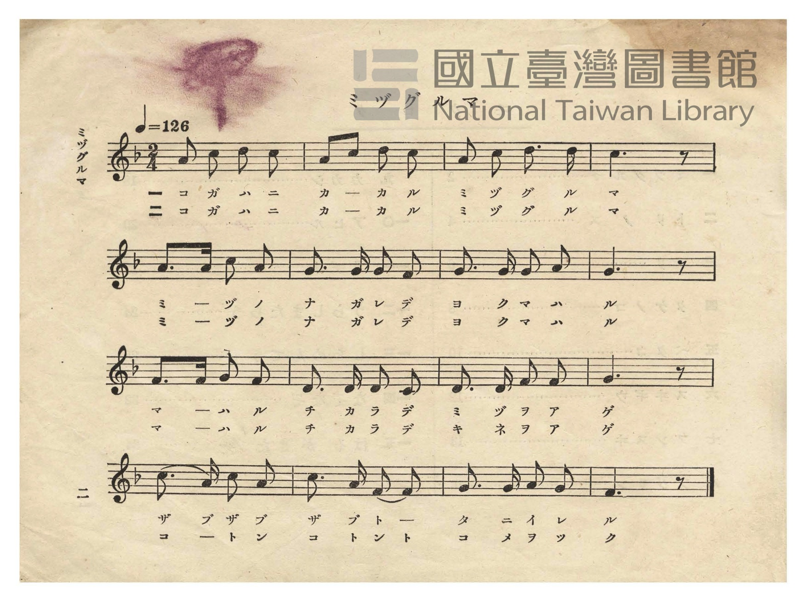
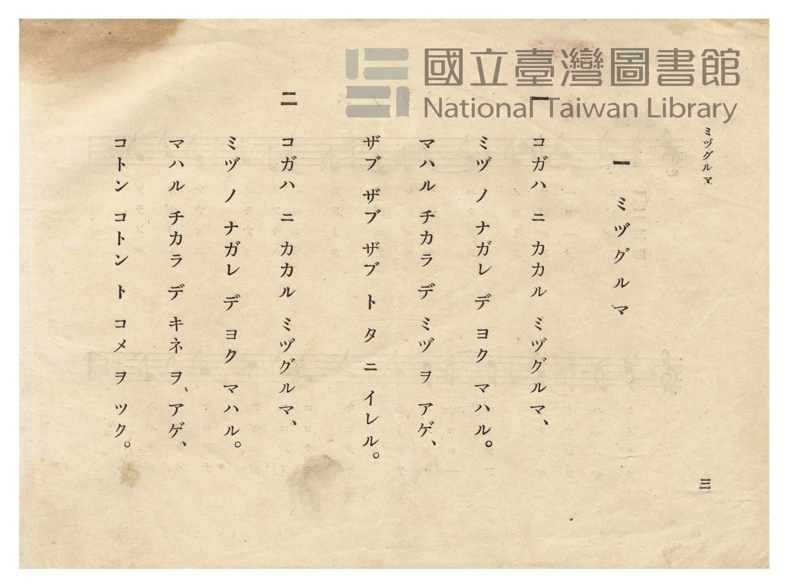

# ミヅグルマ（水車）

> Re:Shōka 使用 AI 協助辨識與重建樂譜，可能會有錯誤。歡迎回報。

- **NEUTRINO 歌聲合成版**：<br><audio controls src="mizuguruma_neutrino.mp3"></audio>
- **鋼琴伴奏版**：<br><audio controls src="mizuguruma.mp3"></audio>


- 日治時期公學校唱歌（第二學年・第一課）
- 國立臺灣圖書館典藏

## 說明


- 出處：臺灣總督府編《公學校唱歌》第二學年用，第一課〈ミヅグルマ〉（水車），原書第 2–3 頁（P004–P005）。
- 調性與拍號：ヘ調（F 大調），2/4 拍，速度 != 126。
- 背景與曲風：描寫架設於小河上的水車（ミヅグルマ），隨著水流輕快轉動：第一節描寫水車汲水
「ザブ ザブ ザブ」引入水田灌溉；第二節描寫水車帶動杵臼「コトン コトン」舂米的農村景象。
旋律以五聲音階級進與附點節奏構成，充滿水輪持續旋轉的律動感。
- 版本說明：本檔案為原書單聲部五線譜之忠實數位化版本。

### 編曲說明（鋼琴伴奏版）：

1. 前奏 (Intro, 4 小節)：以末尾水聲與舂米聲動機引出輕快轉動的水車意象。
2. 主歌伴奏 (Mizuguruma, 16 小節 × 2 段)：右手演奏原曲歌唱旋律；左手以輕快二拍子和聲伴奏。


## 跨冊／重複收錄參照

> 同曲＋同詞異曲（《公學校唱歌》與《新定兒童唱歌》第二學年〈水グルマ〉為同曲；《唱歌帖》P231 同採「お米つかうよ…」歌詞而旋律不同）

- **[同曲]** 《新定兒童唱歌》尋常科第二學年用（2020.006.0847.0002）：[**〈水グルマ〉**](../../../shintei_jido_shoka/grade_2_2020.006.0847.0002/1_03_mizuguruma/index.md)（`F` / `2/4` — [原始 TMD](../../../shintei_jido_shoka/grade_2_2020.006.0847.0002/1_03_mizuguruma/mizuguruma.tmd)）
- **[同詞異曲]** 楊金土手抄《唱歌帖》第 7 冊・VII（2020.006.0843）：[**〈水グルマ（水車）〉**](../../../shokacho/vol_07/p231_mizuguruma/index.md)（`D` / `2/4` — [原始 TMD](../../../shokacho/vol_07/p231_mizuguruma/mizuguruma.tmd)）
- 總表：[跨冊重複與同名歌曲總索引](../../../duplicate_songs.md)

## 歌詞

```text
一
コガハ ニ カカル ミヅグルマ、
ミヅ ノ ナガレ デ ヨク マハル。
マハル チカラ デ ミヅ ヲ アゲ、
ザブ ザブ ザブ ト タ ニ イレル。

二
コガハ ニ カカル ミヅグルマ、
ミヅ ノ ナガレ デ ヨク マハル。
マハル チカラ デ キネ ヲ アゲ、
コトン コトン ト コメ ヲ ツク。
```

## ABC

```abc
X:1
T:ミヅグルマ（水車）
M:2/4
L:1/16
Q:1/4=126
K:F
V:V1 name="Piano" snm="Pia"
[V:V1]
A2 c2 d2 c2 | A2 c2 d2 c2 | A2 c2 d3 d | c6 z2 |
w: 1.~コ ガ ハ ニ | カ カ ル ミ | ヅ グ ル マ | ア
w: 2.~コ ガ ハ ニ | カ カ ル ミ | ヅ グ ル マ | ア
A3 A c2 A2 | G3 G G2 F2 | G3 G G2 A2 | G6 z2 |
w: 1.~ミ ヅ ノ ナ | ガ レ デ ヨ | ク マ ハ ル | ウ
w: 2.~ミ ヅ ノ ナ | ガ レ デ ヨ | ク マ ハ ル | ウ
A3 A B2 A2 | D3 D D2 C2 | D3 D F2 F2 | G6 z2 |
w: 1.~マ ハ ル チ | カ ラ デ ミ | ヅ ヲ ア ゲ | エ
w: 2.~マ ハ ル チ | カ ラ デ キ | ネ ヲ ア ゲ | エ
c3 A c2 A2 | c3 A F2 F2 | G3 G A2 G2 | F6 z2 |
w: 1.~ザ ブ ザ ブ | ザ ブ ト タ | ニ イ レ ル | ウ
w: 2.~コ ト ン コ | ト ン ト コ | メ ヲ ツ ク | ウ
```

## TMD 檔案連結

- [主旋律 TMD 檔案](mizuguruma.tmd) [[在 TMD Studio 編輯](https://tmdlang.github.io/Tmd-TS/#tmd=s7IKdvYPcrWy4qpTUCpJTLdSSM7PyUlNLsnMz7PKzk9PzM7Ojy_OyM9OVIKrKMvPKc1NtUovSkxJjTdCiBfnlxYlp1oVJ2fk5-fEl6RWlCTl52cj5AuK8stS8xLzgGoKijLzSlJTwIoQClLLMlNSQdKpKZkl-UWZiTlIlqYWFYPcBLEkvqQoMa84uSizAORQJS4tLYXHzfMfN7c-btrwuHn14-Z57_d0PNuw5cXurvd7OhW0tLgUbRUMjcy47G0V3LhsjPRN7EAmP5u-9Nmm3c9mNj2bM_9p65qna3c8W7Dw6ZSNz9b2APU_X7Pmya4eoODTnVseN-8GcXc0vFi1CWgi2F1P53Q_X939on3X88bFT-dMezZ7x8slK5627ngxvV-Ji0tfS8GWWoBLQUHhccOEZ7M3PZ-97sWqVc9m9D1umAgWbd79tH3Xi5lT3--ZBXHJ8x17n89d_HTXnOfbVzxu6ELz1uOGbmRvPZ-y4v2eHrjPHjd0oAXj44ZO5JAEKn7aNx_oU6AWBaNHDZONFV4uaASqCDAwMAFygZQpUNnjhiao416s2v-sYfmLjvZn3b0vZs4HuvJx8wygIFCLm8LTJcvBTJCxwChRAKoBsl42zH-6a5kCJMKQTGrueTZzPcik2ZteLgI6e9az_v6n61c_m7ftxYq1z6btebqh_9mmzU92dD2f1QJzMLp3IHa9nLXixcTpQDXPtja-2DP16f7VL_Z2Pu0GhSEkKJ6vb4AaDjbn2cZNQAbIHaBo6HnctO1x8zQFFOpxQ-9ToEmtS4EKn0_Z8Lyx59kuoFWzIYGNZt7THduAtj2bu_VF-x6weZsfNwNduhloFpQFNO5FR9PzjZuBfnmxb9OzuRNBft-4EBocCgrPpnc_3df9ZPfSJ7umvGjc9HL-5pez-p5vmfWyYRMwiF7ObHm5ex7Q1qdL-58t737WMQEUca2tz3bvB7lgz6pnPY3Pd_UADQF6HGgF0CiQg1rmI4L7eWfHszlrIGkNFNZz1jxbNeXZwo7nTbsgKeDptHUgi5tXAF3wfPusF2vnPNnZ_XT_gqfrlz2buuPJ3t6nPdMghoAMhaZgiFZgOnyxct7T1hXPprUDXftkBzD62l-smvdi7XpgsgbG2tMNvc_aOxVAqUkvqyAdGGtgA4AxAzYHGEpNax439wPd2Q3krQah5tXoJcDjhkaIX0CiQKoPiLvAGtcAWe1AvOJx03ogNQ9oFEgLzO9QPpDVCDZ5JVQ51JxNQCsXPW4CZhaI-VhSA1BVB5C5H-rAJUArERYA_QfxKyhY5217OmcFtpTb83JBGzyRgsT7VgCj6MmO3qeNcyCpFWjcy7kLgGogXFA0ds1-2d7_rKsLpGvjphdbt4OifcbKp1OXQck5G55tBhZR0FT6YjEoQcFDd1fPAIZu09rHzb3YQhcjb0ADF8hbCFHf3AK0iU6B-6KjExisz-asAOZeUOBOmgVCczYAcytQ8fOZe4F5FhqmQNdQXvJDgYKWPheXb2ZVaXppUWluolVAZmJevkONQU01uDiwMTTTsgOzahSMFXQVTIHYDEoTEgGRNWAeDBqA1IBN8zGsAYU0kA-MWRAJTBUgshtsCjD6wDJgEhijIHI-RAaYJEAyG-AyIHoeWM8i7DYZ0cMmpCDSBZIgT4PYNQpGYBEjMG2IIYKsBmsQgR0DshiSE0CsLqjDQZ4B8SG5AsRaAZVZD3cszLMg54NkluEOIprbhBZEJnDvm8WDhYAUmGUKIpBFQcGGHHTYA2oe1Cmg0gUSj41Qp8DiDlIeoMcwiA8uGkCspk1QPSAP4gooEmxqWgu1qZcEm6ABBck4yGkJJoIeIEZgeRC7BiyOK7ttgzoCXJlAWRBHIMkAi0CQ8_ZDHQ7KJiD-EnD8E5mWwNkNpBZYnAKLVZB-EAkyD2Q6SAZS2CLLLEQEUXMLWAaUurDbVMvFpWungCi2FIA8ZS4A)]
- [鋼琴伴奏 TMD 檔案](mizuguruma_piano.tmd) [[在 TMD Studio 編輯](https://tmdlang.github.io/Tmd-TS/#tmd=s7IKdvYPcrWy4tLSUnjcPP9xc-vjpg2Pm1c_bp73fk_Hsw1bXuzuety8-2X3nucTtjzZs-Xp0v7nnR3v93QqaGlxKdoqGBqZcdnbKrhx2Rjpm9hx1SkoPZu-9Nmm3c9mNj2bM_9p65qna3c8W7Dw6ZSNz9b2AE18vmbNk109QMGnO7cAzQVxdzS8WLUJaKISSPfTOd3PV3e_aN_1vHHx0znTns3e8XLJiqetO15M71fi4tLXUrClFuBSUFB43DDh2exNz2eve7Fq1bMZfY8bJoJFm3c_bd_1YubU93tmQVzyfMfe53MXP9015_n2FY8butC89bihG9lbz6eseL-nB-6zxw0daAH7uKETHrZAfwMVP-2bD_QpUIuC0aOGycYKLxc0AlUEGBiYALlAyhSo7HFDE9RxL1btf9aw_EVH-7Pu3hcz5wNd-bh5BlAQqMVN4emS5WAmyFhglCgA1QBZLxvmP921TAESYQiTgN4B-h_ieaBuzFgGmg1SqqBgqKfwtLMXKK6g4ZlXUpSvo2Ci8HRD__P1DZpANU92L302Z_XTDftAnmrcBHTai46m5xs3A9lPu6c-Wzn_6Z6poCAFkvtXv9jbCRR8PqsFEgLPWvpfbFwIdZOCgpGewpMdu4GhCnGGgoZvZlVpemlRaW6ijoKhGdRShcPTFYwUnq3bCrL9af_mZ53dz_ZMAaoHh-QmoHZQ1Ezvfrqv-_2e2U-3LwMqADoS4gBgTAFD5enaCU8n9QBdCLEI6gDK0xUUKGjpc3GBg8oqIDMxLz_Iw6HGoKYa7EkbQzMtOzCrRsFYQVfBFIjNoDRCxDAOKlwD5uoCJYzAJEjEECwCgQYgEa5aFOt8cFhnGA9UHG0YCzIfwUQRNwEzTSDipmCOKYiDxERRDyHhjkDEF7kexy4CImEhgexvkGk-hjUKj5s2A_mPm9aAyOZ-MNkNNuVx02qwDJhshpDzITLNrWCZDXAZED0PrGcRdpuM6GETUhCBIhzkaUi0gxKALpAE0aAkgCqCrAZrEIEdA7K4FYj7wKwuqMNBngHx1wBxO5i1AiqzHu5YmGdBzgfJLMMdRDS3CS2ITODeNwOlTGBiiYewwKkWWRQUbMhBhz2g5kGd0g-Px0aoU2BxtxLufOQYBvE3QeP0cdMmqB6QB3EFFAk2Na2F2tRLgk3QgIIVIYi0BBNBDxAjsDyIja2YQWS3bVBHTIOyQSyII5BkmjvAztsPdTgom4D4S8DxT2RaAmc3kNoOIIZkPRAJMg9kOkhmM9wmmMxCRBA1t4BlQKkLu01YSi0Kyk-yylWEl3GbhaQHlzhKGU2OHUiOJEqcHDuQOGbxYLZZLrm1ja6dArjWA1sJ5CDiMdrHMBabqBFcVJkLAA)]

## 分析

```text
================================================================================
📊 TMD Song Profile: [ ミヅグルマ（水車） ]
================================================================================
⏱  Duration:       0:15 (15.2s), 16 measures total
🎼 Key & Tempo:    首調基準 F, != 126.0 BPM, <2/4>
   - 分析範圍：      由實際發聲的音符與和弦推測調性；播放脈絡另行呈現
🎤 人聲音域:    C4 (MIDI 60) – D5 (MIDI 74) [跨度: 14 個半音 / 1.2 個八度, 難度: moderate]
   - 最低音:  C4 in [Mizuguruma #1 @ m.10, 0:09]
   - 最高音: D5 in [Mizuguruma #1 @ m.1, 0:00]
   - 適合: soprano, mezzo-soprano, contralto, tenor, baritone, bass
🏛  結構:      Mizuguruma (15.2s)
⚡ 編曲密度:        Peak 1 軌道同時演奏
🗝  調性診斷：       C 大調（純淨自然大調，未偵測到可信轉調）
   - 風格氣質:    純淨自然大調（陽光明朗、易唱易記，無明顯調外色彩）
   - 轉調歷程:    全曲維持單一推測調性（未偵測到可信轉調）
   - 核心骨幹音:  G, C, A, D, F
   - 調性數值:    C 大調 [相關度: 0.78, 穩定度: Moderate, 自然音純度: 98.3%]
   - 候選調性 (K-S): C 大調 (0.78), F 大調 (0.66), A 小調 (0.62)
   - 五度圈歷程:   +0
   - 各段落調性細節:
     • [Mizuguruma #1]: C 大調 (r: 0.78, 自然音純度: 98.3%, 調外音: A#)

  [ 五度圈游移軌跡 ]
              [C ]*
         F            G  
      Bb               D  
      Eb               A  
         Ab           E  
            Db       B  
               F# 
     (* = active key center)

  [ 十二半音累積音高分佈 ]
     C  : ██████████████████████    23.3%
     C# :                            0.0%
     D  : ██████████████            15.0%
     D# :                            0.0%
     E  :                            0.0%
     F  : █████████████             13.3%
     F# :                            0.0%
     G  : ████████████████████████  25.0%
     G# :                            0.0%
     A  : █████████████████████     21.7%
     A# : ██                         1.7%
     B  :                            0.0%
--------------------------------------------------------------------------------
Assignment 軌道音域：
  - Piano         : C4 – D5 (14 個半音 / 1.2 個八度, 52 個音符)
================================================================================
```


## 原書掃描頁






