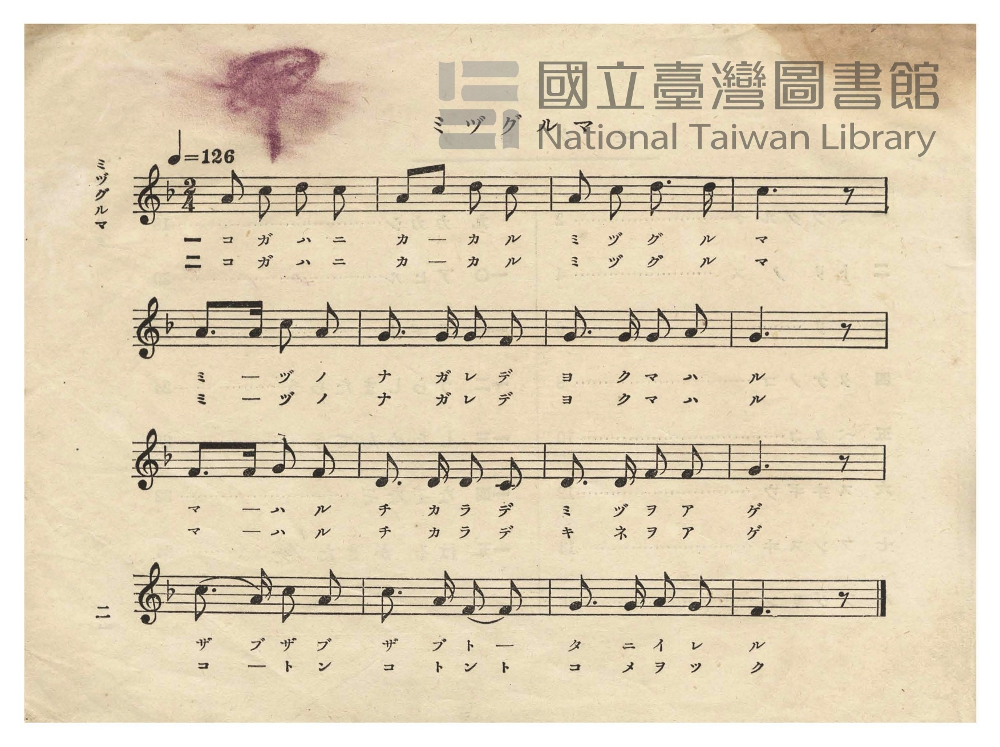
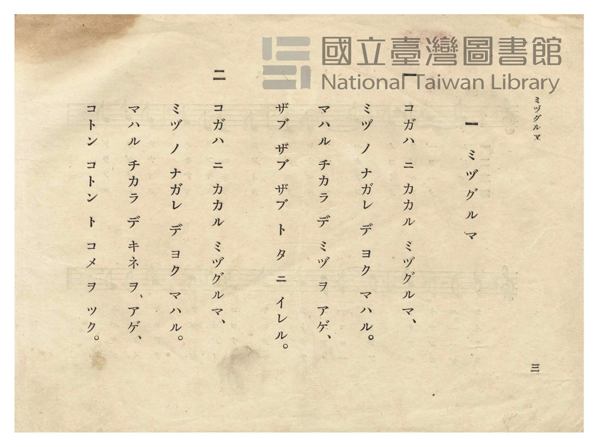

# ミヅグルマ（水車）

> Re:Shōka 使用 AI 協助辨識與重建樂譜，可能會有錯誤。歡迎回報。

- **鋼琴伴奏版**：<br><audio controls src="mizuguruma.mp3"></audio>
- **NEUTRINO 歌聲合成版**：<br><audio controls src="mizuguruma_neutrino.mp3"></audio>

- 日治時期公學校唱歌（第二學年・第一課）
- 國立臺灣圖書館典藏

## 說明


- 出處：臺灣總督府編《公學校唱歌》第二學年用，第一課〈ミヅグルマ〉（水車），原書第 2–3 頁（P004–P005）。
- 調性與拍號：ヘ調（F 大調），2/4 拍，速度 != 126。
- 背景與曲風：描寫架設於小河上的水車（ミヅグルマ），隨著水流輕快轉動：第一節描寫水車汲水
「ザブ ザブ ザブ」引入水田灌溉；第二節描寫水車帶動杵臼「コトン コトン」舂米的農村景象。
旋律以五聲音階級進與附點節奏構成，充滿水輪持續旋轉的律動感。
- 版本說明：本檔案為原書單聲部五線譜之忠實數位化版本。

### 編曲說明（鋼琴伴奏版）：

1. 前奏 (Intro, 4 小節)：以末尾水聲與舂米聲動機引出輕快轉動的水車意象。
2. 主歌伴奏 (Mizuguruma, 16 小節 × 2 段)：右手演奏原曲歌唱旋律；左手以輕快二拍子和聲伴奏。


## 歌詞

```text
一
コガハ ニ カカル ミヅグルマ、
ミヅ ノ ナガレ デ ヨク マハル。
マハル チカラ デ ミヅ ヲ アゲ、
ザブ ザブ ザブ ト タ ニ イレル。

二
コガハ ニ カカル ミヅグルマ、
ミヅ ノ ナガレ デ ヨク マハル。
マハル チカラ デ キネ ヲ アゲ、
コトン コトン ト コメ ヲ ツク。
```

## ABC

<div class="abc-score" data-abc-src="mizuguruma.abc" aria-label="五線譜載入中"></div>

[下載 ABC 原始檔](mizuguruma.abc)

## TMD 檔案連結

- [主旋律 TMD 檔案](mizuguruma.tmd) [[在 TMD Studio 編輯](https://tmdlang.github.io/Tmd-TS/#tmd=s7IKdvYPcrWy4qpTUCpJTLdSSM7PyUlNLsnMz7PKzk9PzM7Ojy_OyM9OVIKrKMvPKc1NtUovSkxJjTdCiBfnlxYlp1oVJ2fk5-fEl6RWlCTl52cj5AuK8stS8xLzgGoKijLzSlJTwIoQClLLMlNSQdKpKZkl-UWZiTlIlqYWFYPcBLEkvqQoMa84uSizAORQhCqgpvTMPKuSxMzyxLz4_LS0zGQUU6C6CxLTU60CDAxMdIGEKbL2kox8oL8KMiqtMjKLQW5ITsyJz07MQ_J-SUYq0Pd5iSWlRalKXFpaCo-b5z9ubn3ctOFx8-rHzfPe7-l4tmHLi91d7_d0KmhpcSnaKhgamXHZ2yq4cdkY6ZvYgUx6Nn3ps027n81sejZn_tPWNU_X7ni2YOHTKRufre0B6n--Zs2TXT1Awac7tzxu3g3i7mh4sWoT0ESwO57O6X6-uvtF-67njYufzpn2bPaOl0tWPG3d8WJ6vxIXl76Wgi21AJeCgsLjhgnPZm96Pnvdi1Wrns3oe9wwESzavPtp-64XM6e-3zML4pLnO_Y-n7v46a45z7eveNzQheatxw3dyN56PmXF-z09cJ89buhAC8bHDZ3IIQlU_LRvPtCnQC0KRo8aJhsrvFzQCFQBikYgFxSRQGWPG5qgjnuxav-zhuUvOtqfdfe-mDkf6MrHzTOAgkAtbgpPlywHM0HGAqNEAagGyHrZMP_prmUKkAhDMqm559nM9SCTZm96uQjo7FnP-vufrl_9bN62FyvWPpu25-mG_mebNj_Z0fV8VgvMwejegdj1ctaKFxOnA9U829r4Ys_Up_tXv9jb-bQbFIaQoHi-vgFqONicZxs3ARkgd4Cioedx07bHzdMUUKjHDb1PgSa1LgUqfD5lw_PGnme7gFbNhgQ2mnlPd2wD2vZs7tYX7XvA5m1-3Ax06WagWVAW0LgXHU3PN24G-uXFvk3P5k4E-X3jQmhwKCg8m979dF_3k91Ln-ya8qJx08v5m1_O6nu-ZdbLhk3AIHo5s-Xl7nlAW58u7X-2vPtZxwRQxLW2Ptu9H-SCPaue9TQ-39UDNATocaAVQKNADmqZjwju550dz-asgaQ1UFjPWfNs1ZRnCzueN-2CpICn09aBLG5eAXTB8-2zXqyd82Rn99P9C56uX_Zs6o4ne3uf9kyDGAIyFJqCIVqB6fDFynlPW1c8m9YOdO2THcDoa3-xat6LteuByRoYa0839D5r71QApSa9rIJ0YKyBDQDGDNgcYCg1rXnc3A90ZzeQtxqEmlejlwCPGxohfgGJAqk-IO4Ca1wDZLUD8YrHTeuB1DygUSAtML9D-UBWI9jklVDlUHM2Aa1c9LgJmFkg5mNJDUBVHUDmfqgDlwCtRFgA9B_Er6Bgnbft6ZwV2FJuz8sFbfBEChLvWwGMoic7ep82zoGkVqBxL-cuAKqBcEHR2DX7ZXv_s64ukK6Nm15s3Q6K9hkrn05dBiXnbHi2GVhEQVPpi8WgBAUP3V09Axi6TWsfN_diC12MvAENXCBvIUR9cwvQJjoF7ouOTmCwPpuzAph7QYE7aRYIzdkAzK1Axc9n7gXmWWiYAl1DeckPBQpa-lxcvplVpemlRaW5iVYBmYl5-Q41BjXV4OLAxtBMyw7MqlEwVtBVMAViMyhNSARE1oB5MGgAUgM2zcewBhTSQD4wZkEkMFWAyG6wKcDoA8uASWCMgsj5EBlgkgDJbIDLgOh5YD2LsNtkRA-bkIJIF0iCPA1i1ygYgUWMwLQhhgiyGqxBBHYMyGJITgCxuqAOB3kGxIfkChBrBVRmPdyxMM-CnA-SWYY7iGhuE1oQmcC9bxYPFgJSYJYpiEAWBQUbctBhD6h5UKeAShdIPDZCnQKLO0h5gB7DID64aACxmjZB9YA8iCugSLCpaS3Upl4SbIIGFCTjIKclmAh6gBiB5UHsGrA4ruy2DeoIcGUCZUEcgSQDLAJBztsPdTgom4D4S8DxT2RaAmc3kFpgcQosVkH6QSTIPJDpIBlIYYsssxARRM0tYBlQ6sJuUy0Xl66dAqLYUgDylLkA)]
- [鋼琴伴奏 TMD 檔案](mizuguruma_piano.tmd) [[在 TMD Studio 編輯](https://tmdlang.github.io/Tmd-TS/#tmd=s7IKdvYPcrWy4qpTUCpJTLdSSM7PyUlNLsnMz7PKzk9PzM7Ojy_OyM9OVIKrKMvPKc1NtTJCiBTnlxYlp-JSD5GNL0hMT7UKMDAw0QUSpgjpgqL8stS8xDygASWJmeWJefHpQIGivPyi-PTUvNSixByE2tSyzJRUkMqCoszcxKLK-JT8ZKBb8kqQXJdaVAxyfEFmYl5-fGJRUWJeeiqqkvyikoz89KLEgoxKq4zM4pL8oszkxJz47MQ8JFeXZAB1WeUllpQWpSpxaWkpPG6e_7i59XHThsfNqx83z3u_p-PZhi0vdnc9bt79snvP8wlbnuzZ8nRp__POjvd7OhW0tLgUbRUMjcy47G0V3LhsjPRN7EBmP5u-9Nmm3c9mNj2bM_9p65qna3c8W7Dw6ZSNz9b2AE18vmbNk109QMGnO7cAzQVxdzS8WLUJaCLYZU_ndD9f3f2ifdfzxsVP50x7NnvHyyUrnrbueDG9X4mLS19LwZZagEtBQeFxw4Rnszc9n73uxapVz2b0PW6YCBZt3v20fdeLmVPf75kFccnzHXufz138dNec59tXPG7oQvPW44ZuZG89n7Li_Z4euM8eN3SgBezjhk542AL9DVT8tG8-0KdALQpGjxomGyu8XNAIVAFKSkAuKDEBlT1uaII67sWq_c8alr_oaH_W3fti5nygKx83zwAKArW4KTxdshzMBBkLjBIFoBog62XD_Ke7lilAIgxhEtA7QP9DPA_UjRnLQLNBShUUDPUUnnb2AsUVNDzzSorydRRMFJ5u6H--vkETqObJ7qXP5qx-umEfyFONm4BOe9HR9HzjZiD7affUZyvnP90zFRSkQHL_6hd7O4GCz2e1QELgWUv_i40LoW5SUDDSU3iyYzcwVCHOUNDwzawqTS8tKs1N1FEwNINaqnB4uoKRwrN1W0G2P-3f_Kyz-9meKUD14JDcBNQOiprp3U_3db_fM_vp9mVABUBHQhwAjClgqDxdO-HppB6gCyEWQR1AebqCAgUtfS4ucFBZBYAyapCHQ41BTTXYkzaGZlp2YFaNgrGCroIpEJtBaYSIYRxUuAbM1QVKGIFJkIghWAQCDUAiXLUo1vkgW2cBt80wXiHaMBZGwfkmQMoExDcFMkxjYRRcHoQNIHYgooNcf2EXAZEwjyJ7C2Saj2GNwuOmzUD-46Y1ILK5H0x2g0153LQaLAMmmyHkfKjMLrDMBrgMiJ4HllmE3SYjetiEFESg-AR5GhKroPjVBZIgGhTDqCLIarAGEdgxIGfsArL7wE7ogjoP5BkQfw0Qt4NZK6Ay6-GOhXkW5HyQzDLcQURzm9CCyATufbN4sBCQArOAKRVVFBRsyEGHPaDmQZ3SD4_HRqhTYHG3Eu585BgG8TdB4_Rx0yaoDMiDuAKKBJua1kJkmntJsAkaULASApGWYCLoAWIElgexsZUiiOy2DeqIaVA2iAVxBJJMcwfYefuhDgdlExB_CTj-iUxL4OwGUtsBxJCsByJB5oFMB8lshtsEk1mICKLmFrAMKHVhtwlLqUVa8UhEcQkqHbGbAVWDzocXscSYAbUQJ58YM6AMs3ggbZZLXGGva6cArlPARgI5iGCM9jGMxSZqBBdV5gIA)]

## 分析

```text
================================================================================
📊 TMD Song Profile: [ ミヅグルマ（水車） ]
================================================================================
⏱  Duration:       0:15 (15.2s), 16 measures total
🎼 Key & Tempo:    首調基準 F, != 126.0 BPM, <2/4>
   - 分析範圍：      由實際發聲的音符與和弦推測調性；播放脈絡另行呈現
🎤 人聲音域:    C4 (MIDI 60) – D5 (MIDI 74) [跨度: 14 個半音 / 1.2 個八度, 難度: moderate]
   - 最低音:  C4 in [Mizuguruma #1 @ m.10, 0:09]
   - 最高音: D5 in [Mizuguruma #1 @ m.1, 0:00]
   - 適合: soprano, mezzo-soprano, contralto, tenor, baritone, bass
🏛  結構:      Mizuguruma (15.2s)
⚡ 編曲密度:        Peak 1 軌道同時演奏
🗝  調性診斷：       C 大調（純淨自然大調，未偵測到可信轉調）
   - 風格氣質:    純淨自然大調（陽光明朗、易唱易記，無明顯調外色彩）
   - 轉調歷程:    全曲維持單一推測調性（未偵測到可信轉調）
   - 核心骨幹音:  G, C, A, D, F
   - 調性數值:    C 大調 [相關度: 0.78, 穩定度: Moderate, 自然音純度: 98.3%]
   - 候選調性 (K-S): C 大調 (0.78), F 大調 (0.66), A 小調 (0.62)
   - 五度圈歷程:   +0
   - 各段落調性細節:
     • [Mizuguruma #1]: C 大調 (r: 0.78, 自然音純度: 98.3%, 調外音: A#)

  [ 五度圈游移軌跡 ]
              [C ]*
         F            G  
      Bb               D  
      Eb               A  
         Ab           E  
            Db       B  
               F# 
     (* = active key center)

  [ 十二半音累積音高分佈 ]
     C  : ██████████████████████    23.3%
     C# :                            0.0%
     D  : ██████████████            15.0%
     D# :                            0.0%
     E  :                            0.0%
     F  : █████████████             13.3%
     F# :                            0.0%
     G  : ████████████████████████  25.0%
     G# :                            0.0%
     A  : █████████████████████     21.7%
     A# : ██                         1.7%
     B  :                            0.0%
--------------------------------------------------------------------------------
Assignment 軌道音域：
  - Piano         : C4 – D5 (14 個半音 / 1.2 個八度, 52 個音符)
================================================================================
```


## 原書掃描頁






