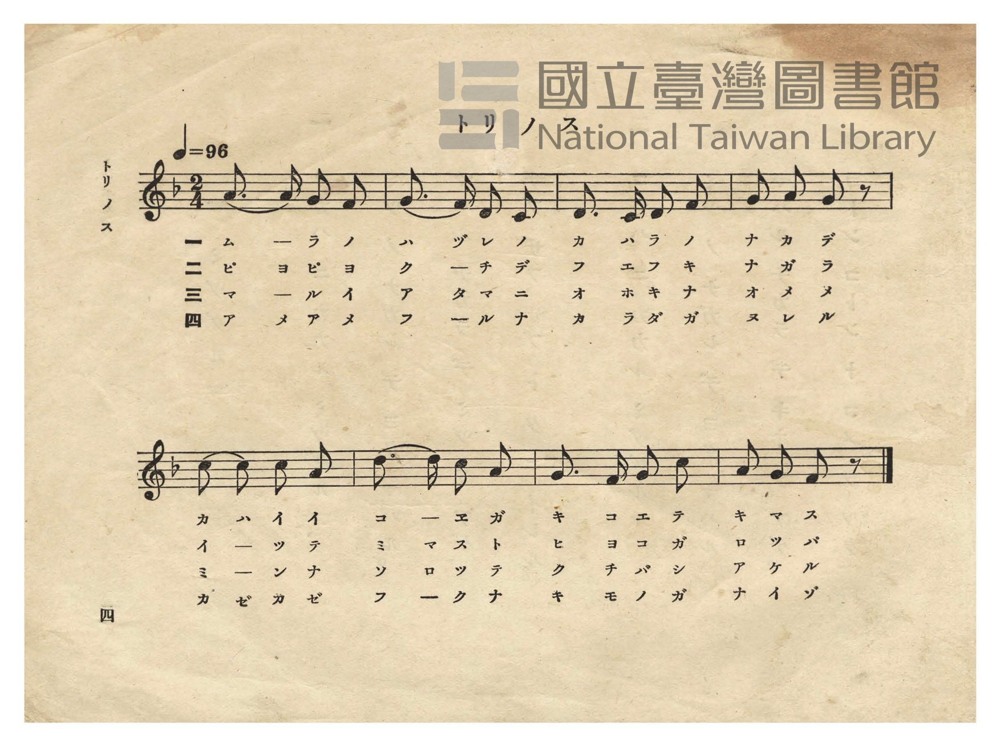
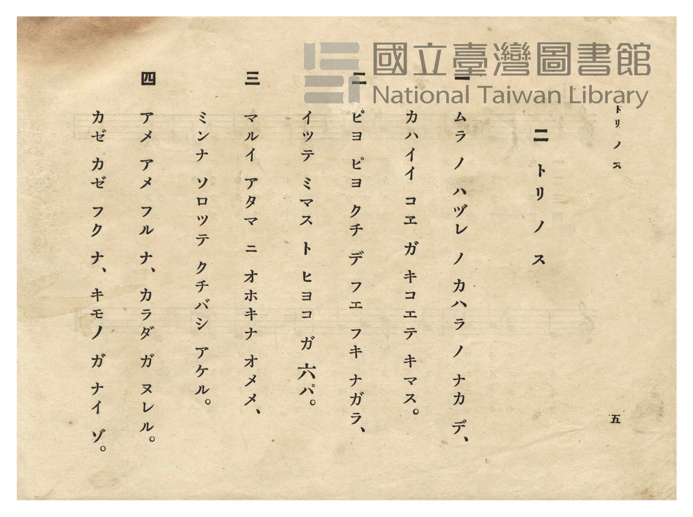

# トリ ノ ス（鳥の巣）

> Re:Shōka 使用 AI 協助辨識與重建樂譜，可能會有錯誤。歡迎回報。

- **NEUTRINO 歌聲合成版**：<br><audio controls src="tori_no_su_neutrino.mp3"></audio>
- **鋼琴伴奏版**：<br><audio controls src="tori_no_su.mp3"></audio>


- 日治時期公學校唱歌（第二學年・第二課）
- 國立臺灣圖書館典藏

## 說明


- 出處：臺灣總督府編《公學校唱歌》第二學年用，第二課〈トリ ノ ス〉（鳥の巣），原書第 4–5 頁（P006–P007）。
- 調性與拍號：ヘ調（F 大調），2/4 拍，速度 != 96。
- 背景與曲風：描寫村莊外圍河原草叢中的鳥巢，六隻雛鳥「ピヨ ピヨ」啾啾鳴叫、張大嘴巴等待餵食，
以及孩童叮囑風雨莫淋濕雛鳥的溫馨童心。
- 版本說明：本檔案為原書單聲部五線譜之忠實數位化版本。

### 編曲說明（鋼琴伴奏版）：

1. 前奏 (Intro, 4 小節)：以輕柔五聲音階下行與終止動機引出河床雛鳥鳴叫的溫馨氛圍。
2. 主歌伴奏 (ToriNoSu, 8 小節 × 4 段)：右手演奏原曲歌唱旋律；左手以柔和二拍子和弦伴奏。


## 歌詞

```text
一
ムラ ノ ハヅレ ノ カハラ ノ ナカ デ、
カハイイ コエ ガ キコエテ キマス。

二
ピヨ ピヨ クチ デ フエ フキ ナガラ、
イツテ ミマス ト ヒヨコ ガ 六パ。

三
マルイ アタマ ニ オホキナ オメメ、
ミンナ ソロツテ クチバシ アケル。

四
アメ アメ フル ナ、カラダ ガ ヌレル。
カゼ カゼ フク ナ、キモノ ガ ナイ ゾ。
```

## ABC

```abc
X:1
T:トリ ノ ス（鳥の巣）
M:2/4
L:1/16
Q:1/4=96
K:F
V:V1 name="Piano" snm="Pia"
[V:V1]
A3 A G2 F2 | G3 F D2 C2 | D3 C D2 F2 | G2 A2 G2 z2 |
w: 1.~ム ー ラ ノ | ハ ヅ レ ノ | カ ハ ラ ノ | ナ カ デ
w: 2.~ピ ヨ ピ ヨ | ク ー チ デ | フ エ フ キ | ナ ガ ラ
w: 3.~マ ー ル イ | ア タ マ ニ | オ ホ キ ナ | オ メ メ
w: 4.~ア メ ア メ | フ ー ル ナ | カ ラ ダ ガ | ヌ レ ル
c2 c2 c2 A2 | d3 d c2 A2 | G3 F G2 c2 | A2 G2 F2 z2 |
w: 1.~カ ハ イ イ | コ エ ガ キ | コ エ テ キ | マ ス ウ
w: 2.~イ ツ テ ミ | マ ス ト ヒ | ヨ コ ガ ロ | ツ パ ア
w: 3.~ミ ン ナ ソ | ロ ツ テ ク | チ バ シ ア | ケ ル ウ
w: 4.~カ ゼ カ ゼ | フ ク ナ キ | モ ノ ガ ナ | イ ゾ オ
```

## TMD 檔案連結

- [主旋律 TMD 檔案](tori_no_su.tmd) [[在 TMD Studio 編輯](https://tmdlang.github.io/Tmd-TS/#tmd=s7IKdvYPcrWy4qpTUCpJTLdSSM7PyUlNLsnMz7PKzk9PzM7Ojy_OyM9OVIKrKMvPKc1NtUovSkxJjTdCiBfnlxYlp1oVJ2fk5-fEl6RWlCTl52cj5AuK8stS8xLzgGoKijLzSlJTwIoQClLLMlNSQdKpKZkl-UWZiTlIlqYWFYPcBLEkvqQoMa84uSizAORQhCqgpvTMPKuSxMzyxLz4_LS0zGSwKVpaCo-bOx43rwJSfQqPm3a-39PxcvPSx43rnm5f_H5Pp4KWFpeirYKlGZe9rYIbl42RvokdyNBn05c-27T72cymZ3PmP21d83TtjmcLFj6dsvHZ2h6gCc_XrHmyqwco-HTnlsfNuyHcF6s2AQ0EO-npnO7nq7tftO963rj46Zxpz2bveLlkxdPWHS-m9ytxcelrKdhSC3ApKCg8bpjwbPam57PXvVi16tmMvscNE8Gizbuftu96MXPq-z2zIC55vmPv87mLn-6a83z7iscNXWjeetzQjeyt51NWvN_TA_fZ4wZgICKH4-OGTrSgBCp_2jcf6FegJgWTRw2TTRVeLmgEKgowMDADcoGUOVDZ44YmqPNerNr_rGH5i472Z929L2bOB7rzcfMMoCBQi5vC0yXLwUyQscBIUQCqAbJeNsx_umuZAjjGkAxq7nk2cz3IoNmbXi4CunvWs_7-p-tXP5s78UVf19Ml057O6X22aTPQdS96O5_2L3qyY-3zWS1Atz_dvgjk6ta1L2ftfjl7Nsg3DT2Pm6c8bl4BNBdEPW7ofTp1HxC93Lzlaf_qxw2NT_dsBbrt6YwtT7dveb628-m-1pdLtr5cDHR-D8g5CgpPdi992t_1dO3K56uBjHVPZ08Euunl7BUv-lY_2979bP9UiE1AFzzbtfrlshUgZfubEb553tnxbM4aSFyCvDJnzbNVU54t7HjetAsSvk-nrXvRuOll84onu6Y83z7rxdo5T3Z2P92_4On6Zc-m7niyt_dpzzSIISBDoSkEohUYzy9WznvauuLZtHZgeAEDAsRYNe_F2vXAZAMM-Kcbep-1dyqA4kovqyAdGP5gA57saIC4bsHj5pWQJNDc_7i59XHzGmiCWA0WgMl1AQWAVDswvMD6INJNS4AIyNn8uAkYvk1ArU1rIbzHzW1gTvM8cNICBwXQNRCXAQPh6ZwVwMh8unYCMDJfLgDFHig-d3VB4vPF4oWgaGza_GRf25NdbU_71z9rmQ1UA4wwYEABjYN7Yxc4jlBiGGjv-sfNjSDXAvFUsNNA1FqIN9YAPQX3xZLHzS1gpzbPhzgVVLgA8SRQSmnaDPYTMDU9bp6IzQ8ztgAdCgzJl01dTyfsfDFxOiRlgR26-OnkFRCpF1s3vGzse9q3-_mcbkiWAvrq2ZxOSCp9uqEfllARvtrRCfHVvMfNqyEhvOhx034gHyjWDeStetw8Gxy6XRDOQhCC-gnkk80Qmb2Pm4FqIB4Eh8nj5gmPm7ZDjNsIMhtbxEwGIqAXXrQue7Go-2Vr75MdwBy3HIiAgs_n7Hk-dzbIF0CRddueTd3ycm_X0zkbgHno5bRuoF9A2WjaTCS_PJ09GxLUi4BuhFPA-GgGpacuoKvBaWnl4-YGSApqBuZXYBzB3AaSbdoDp0ARuR6uEeg7oHmg1ArSCIxcUFDtw-IrYG59OrULQj7tWPpkR_fTiQ1Ab7wAZtjVU57NaYZkZKAP3--ZDczdIMVgEqgYGLUQxc87FzxtmPiyCZhUJwHj7_nK_S8WLn42p_fpxEVQDwNtpbwGgAIFLX0urhBgNeiXH1xqFZCZmJfvUGNQUw0uk2wMzbTswKwaBWMFXSA0VjACkoZAXANmgdhm8UDKFETUQNhgHpiFUAjSDqINQCJgI30Ma0AFA1j942ZQoK8Es_rAeoD5HirTCsRrkGWARQREph9DTxeIB5YHZUsU24xA8lOgOsGZGMqCmLkeyR2NcP0gPVMhMpD8DWatRbEN4jaQO5BsMwbJz0MyE-wmYMKB2LYIauZ-qCpQfoPIrILqmQ21B2ILTAaUqmEkkm0mSGZCkj9cFZIPEO6AmwkLSVD52wD3DUhPD1gc4jeQKoht0LRgCuTAMChigfEONsgMSQSWOkA0SBSSgmCpBy0ZQKMMFOWQQEIE1WZE8EOCGhb8yDLAogc5YsBBCixlQeQyVNtAyQBiQ3MLmATrbJ6PpBOiF1RCg2QmQWVACQUkAymtQTIw2yDmTATLggIePRmAzAYWlvCAB5aYUJ0gEyAugfkAlAxBMqAkCJKZABTbDjcZ5PaN8CjB8Bs4GUBk9oBJBBs5IYMLNpTwgiUdSBGHnEAgcbEPTIISIMS2Wi4uXTsFWKmhAGQrcwEA)]
- [鋼琴伴奏 TMD 檔案](tori_no_su_piano.tmd) [[在 TMD Studio 編輯](https://tmdlang.github.io/Tmd-TS/#tmd=s7IKdvYPcrWy4tLSUnjc3PG4eRWQ6lN43LTz_Z6Ol5uXPm5c93T74sfNu19273k-YcuTPVueLu1_3tnxfk-ngpYWl6KtgqUZl72tghuXjZG-iR1XnYLSs-lLn23a_Wxm07M585-2rnm6dsezBQufTtn4bG0P0Mzna9Y82dUDFHy6cwvQWAj3xapNQAOVQLqfzul-vrr7Rfuu542Ln86Z9mz2jpdLVjxt3fFier8SF5e-loIttQCXgoLC44YJz2Zvej573YtVq57N6HvcMBEs2rz7afuuFzOnvt8zC-KS5zv2Pp-7-OmuOc-3r3jc0IXmrccN3cjeej5lxfs9PXCfPW4ABityyD5u6EQOXKDPgcqf9s0H-hWoScHkUcNkU4WXCxqBigIMDMyAXCBlDlT2uKEJ6rwXq_Y_a1j-oqP9WXfvi5nzge583DwDKAjU4qbwdMlyMBNkLDBSFIBqgKyXDfOf7lqmAI4xhEFA_wADAOJ7kKMwYhloNEipgoKhnsLTzl6guIKGZ15JUb6OgonC0w39z9c3aALVPNm99MWeqc_mT3mya8qLxk0v529-OavvyY7uFwt7gK58vrXp2dpFT7unPls5_-meqcDAfbZp89NdXS9nzwYGw8vNW572r34-q-XZrtUvl614tmH20zm9UCcqKBjpKTzZsRsYyhBXKWiE5Bdl-uUHl-ooWEAdoHB4OtAxz9ZtBbnkaf_mZ53dz_ZMASoGB-omoF5QPE3vfrqv-_2e2U-3LwMqADoY6Nqnk3qAkQQMoKdrJwDZT_csg9gCtZ3yRAYFClr6XFzgYLMKyEzMyw_ycKgxqKkG-9DG0EzLDsyqUTBV0IVjYyCuUTADkrpAEiFiBBYxBNMg0RqwOIhnCMQGIBGuWhTbfHDYZhgPVBxtGAvSimDWKJiAOSYY4qZgjimIg8SEmgMWAbPgToDFFH4_g1wP8hvMBwgfmsHNBYYDiALzwCyEQpjnIbaCjPQxrAEm7QVg9Y-b9wDxSjCrD6zncXM_VKYViNcgyzSthsr0Y-jpAvHA8o-b21FtMwLJT4HqXAFlg1gQM9cjuaMRrh-kZypEpgmkB8R-3LQWxTaI20DuQLLNGCQ_D8lMsJualkBtWwQ1cz9U1ePmbqjMKqie2VB7ILbAZB43L4STSLaZIJkJlIOwIaqQfIBwB9xMWEiuBOIGuG9AenrA4hC_gVRBbKNy-ocnA2iUgaIcEkiIoNqMCH5IUMOCH1mmuQ0lYsBB2rQTTC5DtQ2UDCA2NLeASbDO5vlIOiF6gZUBWGYSVAaUUEAym-FRDrMNYs5EsCwo4NGTAcjsx80g18KSzF6oTpAJEJfAfABKhiAZUBIEyUwAim2Hmwxy-0Z4lGD4DZwMIDJ7wCSCjZyQ18PdAfMBLOmA6j2I32AJBBIX-8AkKAHiKDRILbqQyiWyijSEp2lfPOraKYALabB1QA7M59E-hrGYYkZYxIyxiJnAxZS5AA)]

## 分析

```text
================================================================================
📊 TMD Song Profile: [ トリ ノ ス（鳥の巣） ]
================================================================================
⏱  Duration:       0:10 (10.0s), 8 measures total
🎼 Key & Tempo:    首調基準 F, != 96.0 BPM, <2/4>
   - 分析範圍：      由實際發聲的音符與和弦推測調性；播放脈絡另行呈現
🎤 人聲音域:    C4 (MIDI 60) – D5 (MIDI 74) [跨度: 14 個半音 / 1.2 個八度, 難度: moderate]
   - 最低音:  C4 in [ToriNoSu #1 @ m.2, 0:02]
   - 最高音: D5 in [ToriNoSu #1 @ m.6, 0:06]
   - 適合: soprano, mezzo-soprano, contralto, tenor, baritone, bass
🏛  結構:      ToriNoSu (10.0s)
⚡ 編曲密度:        Peak 1 軌道同時演奏
🗝  調性診斷：       C 大調（純淨自然大調，未偵測到可信轉調）
   - 風格氣質:    純淨自然大調（陽光明朗、易唱易記，無明顯調外色彩）
   - 轉調歷程:    全曲維持單一推測調性（未偵測到可信轉調）
   - 核心骨幹音:  G, C, A, D, F
   - 調性數值:    C 大調 [相關度: 0.77, 穩定度: Moderate, 自然音純度: 100.0%]
   - 候選調性 (K-S): C 大調 (0.77), G 大調 (0.68), F 大調 (0.62)
   - 五度圈歷程:   +0
   - 各段落調性細節:
     • [ToriNoSu #1]: C 大調 (r: 0.77, 自然音純度: 100.0%)

  [ 五度圈游移軌跡 ]
              [C ]*
         F            G  
      Bb               D  
      Eb               A  
         Ab           E  
            Db       B  
               F# 
     (* = active key center)

  [ 十二半音累積音高分佈 ]
     C  : ████████████████████      21.7%
     C# :                            0.0%
     D  : █████████████████         18.3%
     D# :                            0.0%
     E  :                            0.0%
     F  : ████████████              13.3%
     F# :                            0.0%
     G  : ████████████████████████  26.7%
     G# :                            0.0%
     A  : ██████████████████        20.0%
     A# :                            0.0%
     B  :                            0.0%
--------------------------------------------------------------------------------
Assignment 軌道音域：
  - Piano         : C4 – D5 (14 個半音 / 1.2 個八度, 30 個音符)
================================================================================
```


## 原書掃描頁






