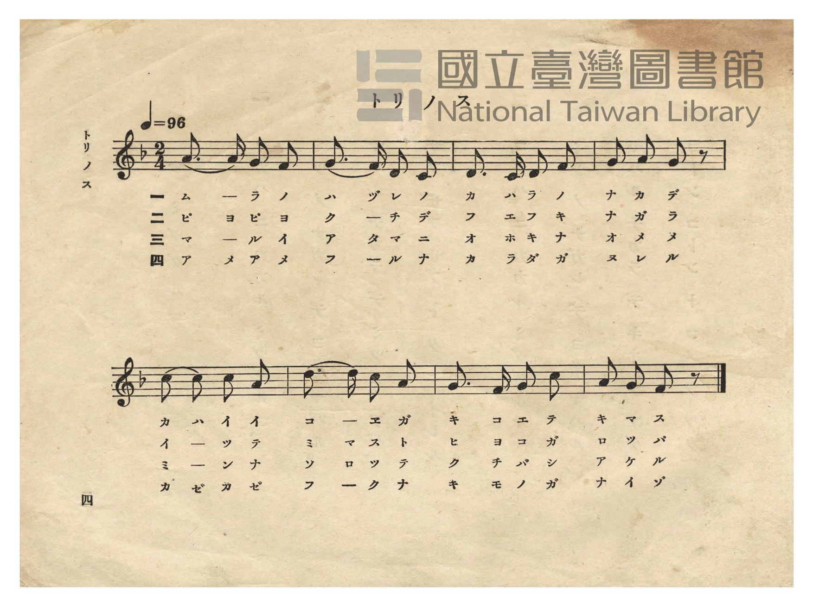
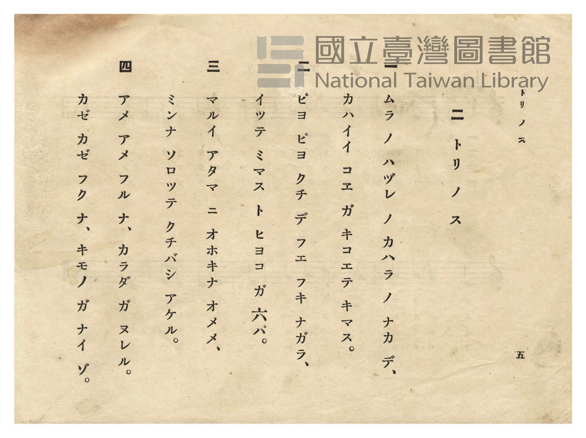

# トリ ノ ス（鳥の巣）

> Re:Shōka 使用 AI 協助辨識與重建樂譜，可能會有錯誤。歡迎[回報](https://github.com/TMDLang/reshoka/issues)。

- **鋼琴伴奏版**：<br><audio controls src="tori_no_su.mp3"></audio>
- **NEUTRINO 歌聲合成版**：<br><audio controls src="tori_no_su_neutrino.mp3"></audio>

- 日治時期公學校唱歌（第二學年・第二課）
- 國立臺灣圖書館典藏

## 說明


- 出處：臺灣總督府編《公學校唱歌》第二學年用，第二課〈トリ ノ ス〉（鳥の巣），原書第 4–5 頁（P006–P007）。
- 調性與拍號：ヘ調（F 大調），2/4 拍，速度 != 96。
- 背景與曲風：描寫村莊外圍河原草叢中的鳥巢，六隻雛鳥「ピヨ ピヨ」啾啾鳴叫、張大嘴巴等待餵食，
以及孩童叮囑風雨莫淋濕雛鳥的溫馨童心。
- 版本說明：本檔案為原書單聲部五線譜之忠實數位化版本。

### 編曲說明（鋼琴伴奏版）：

1. 前奏 (Intro, 4 小節)：以輕柔五聲音階下行與終止動機引出河床雛鳥鳴叫的溫馨氛圍。
2. 主歌伴奏 (ToriNoSu, 8 小節 × 4 段)：右手演奏原曲歌唱旋律；左手以柔和二拍子和弦伴奏。


## 歌詞

```text
一
ムラ ノ ハヅレ ノ カハラ ノ ナカ デ、
カハイイ コエ ガ キコエテ キマス。

二
ピヨ ピヨ クチ デ フエ フキ ナガラ、
イツテ ミマス ト ヒヨコ ガ 六パ。

三
マルイ アタマ ニ オホキナ オメメ、
ミンナ ソロツテ クチバシ アケル。

四
アメ アメ フル ナ、カラダ ガ ヌレル。
カゼ カゼ フク ナ、キモノ ガ ナイ ゾ。
```

## ABC

<div class="abc-score" data-abc-src="tori_no_su.abc" aria-label="五線譜載入中"></div>

[下載 ABC 原始檔](tori_no_su.abc)

## TMD 檔案連結

- [主旋律 TMD 檔案](tori_no_su.tmd) [[在 TMD Studio 編輯](https://tmdlang.github.io/Tmd-TS/#tmd=s7IKdvYPcrWy4qpTUCpJTLdSSM7PyUlNLsnMz7PKzk9PzM7Ojy_OyM9OVIKrKMvPKc1NtUovSkxJjTdCiBfnlxYlp1oVJ2fk5-fEl6RWlCTl52cj5AuK8stS8xLzgGoKijLzSlJTwIoQClLLMlNSQdKpKZkl-UWZiTlIlqYWFYPcBLEkvqQoMa84uSizAORQhCqgpvTMPKuSxMzyxLz4_LS0zGQUU6C6CxLTU60CDAzMdIGEObL2kox8oL8KMiqtMjKLQW5ITsyJz07MQ_J-SUYq0Pd5iSWlRalKXFpaCo-bOx43rwJSfQqPm3a-39PxcvPSx43rnm5f_H5Pp4KWFpeirYKlGZe9rYIbl42RvokdyKhn05c-27T72cymZ3PmP21d83TtjmcLFj6dsvHZ2h6gCc_XrHmyqwco-HTnlsfNuyHcF6s2AQ0EO-TpnO7nq7tftO963rj46Zxpz2bveLlkxdPWHS-m9ytxcelrKdhSC3ApKCg8bpjwbPam57PXvVi16tmMvscNE8Gizbuftu96MXPq-z2zIC55vmPv87mLn-6a83z7iscNXWjeetzQjeyt51NWvN_TA_fZ4wZgICKH4-OGTrSgBCp_2jcf6FegJgWTRw2TTRVeLmgEKgLFJJALikugsscNTVDnvVi1_1nD8hcd7c-6e1_MnA905-PmGUBBoBY3hadLloOZIGOBkaIAVANkvWyY_3TXMgVwjCEZ1NzzbOZ6kEGzN71cBHT3rGf9_U_Xr342d-KLvq6nS6Y9ndP7bNNmoOte9HY-7V_0ZMfa57NagG5_un0RyNWta1_O2v1y9myQbxp6HjdPedy8AmguiHrc0Pt06j4gerl5y9P-1Y8bGp_u2Qp029MZW55u3_J8befTfa0vl2x9uRjo_B6QcxQUnuxe-rS_6-nalc9XAxnrns6eCHTTy9krXvStfra9-9n-qRCbgC54tmv1y2UrQMr2NyN887yz49mcNZC4BHllzppnq6Y8W9jxvGkXJHyfTlv3onHTy-YVT3ZNeb591ou1c57s7H66f8HT9cueTd3xZG_v055pEENAhkJTCEQrMJ5frJz3tHXFs2ntwPACBgSIsWrei7XrgckGGPBPN_Q-a-9UAMWVXlZBOjD8wQY82dEAcd2Cx80rIUmguf9xc-vj5jXQBLEaLACT6wIKAKl2YHiB9UGkm5YAEZCz-XETMHybgFqb1kJ4j5vbwJzmeeCkBQ4KoGsgLgMGwtM5K4CR-XTtBGBkvlwAij1QfO7qgsTni8ULQdHYtPnJvrYnu9qe9q9_1jIbqAYYYcCAAhoH98YucByhxDDQ3vWPmxtBrgXiqWCngai1EG-sAXoK7oslj5tbwE5tng9xKqhwAeJJoJTStBnsJ2Bqetw8EZsfZmwBOhQYki-bup5O2Pli4nRIygI7dPHTySsgUi-2bnjZ2Pe0b_fzOd2QLAX01bM5nZBU-nRDPyyhIny1oxPiq3mPm1dDQnjR46b9QD5QrBvIW_W4eTY4dLsgnIUgBPUTyCebITJ7HzcD1UA8CA6Tx80THjdthxi3EWQ2toiZDERAL7xoXfZiUffL1t4nO4A5bjkQAQWfz9nzfO5skC-AIuu2PZu65eXerqdzNgDz0Mtp3UC_gLLRtJlIfnk6ezYkqBcB3QingPHRDEpPXUBXg9PSysfNDZAU1AzMr8A4grkNJNu0B06BInI9XCPQd0DzQKkVpBEYuaCg2ofFV8Dc-nRqF4R82rH0yY7upxMbgN54Acywq6c8m9MMychAH77fMxuYu0GKwSRQMTBqIYqfdy542jDxZRMwqU4Cxt_zlftfLFz8bE7v04mLoB4G2kp5DQAFClr6XFwhwBrRLz-41CogMzEv36HGoKYaXCbZGJpp2YFZNQrGCrpAaKxgBCQNgbgGzAKxzeKBlCmIqIGwwTwwC6EQpB1EG4BEwEb6GNaACgaw-sfNoEBfCWb1gfUA8z1UphWI1yDLAIsIiEw_hp4uEA8sD8qWKLYZgeSnQHWCMzGUBTFzPZI7GuH6QXqmQmQg-RvMWotiG8RtIHcg2WYMkp-HZCbYTcCEA7FtEdTM_VBVoPwGkVkF1TMbag_EFpgMKFXDSCTbTJDMhCR_uCokHyDcATcTFpKg8rcB7huQnh6wOMRvIFUQ26BpwRTIgWFQxALjHWyQGZIILHWAaJAoJAXBUg9aMoBGGSjKIYGECKrNiOCHBDUs-JFlgEUPcsSAgxRYyoLIZai2gZIBxIbmFjAJ1tk8H0knRC-ohAbJTILKgBIKSAZSWoNkYLZBzJkIlgUFPHoyAJkNLCzhAQ8sMaE6QSZAXALzASgZgmRASRAkMwEoth1uMsjtG-FRguE3cDKAyOwBkwg2ckIGF2wo4QVLOpAiDjmBQOJiH5gEJUCIbbVcXLp2CrBSQwHIVuYCAA)]
- [鋼琴伴奏 TMD 檔案](tori_no_su_piano.tmd) [[在 TMD Studio 編輯](https://tmdlang.github.io/Tmd-TS/#tmd=s7IKdvYPcrWy4qpTUCpJTLdSSM7PyUlNLsnMz7PKzk9PzM7Ojy_OyM9OVIKrKMvPKc1NtTJCiBTnlxYlp-JSD5GNL0hMT7UKMDAw0wUS5gjpgqL8stS8xDygASWJmeWJefHpQIGivPyi-PTUvNSixByE2tSyzJRUkMqCoszcxKLK-JT8ZKBb8kqQXJdaVAxyfEFmYl5-fGJRUWJeeiqqkvyikoz89KLEgoxKq4zM4pL8oszkxJz47MQ8JFeXZAB1WeUllpQWpSpxaWkpPG7ueNy8Ckj1KTxu2vl-T8fLzUsfN657un3x4-bdL7v3PJ-w5cmeLU-X9j_v7Hi_p1NBS4tL0VbB0ozL3lbBjcvGSN_EDmT4s-lLn23a_Wxm07M585-2rnm6dsezBQufTtn4bG0P0Mzna9Y82dUDFHy6cwvQWAj3xapNQAPBTns6p_v56u4X7bueNy5-Omfas9k7Xi5Z8bR1x4vp_UpcXPpaCrbUAlwKCgqPGyY8m73p-ex1L1atejaj73HDRLBo8-6n7btezJz6fs8siEue79j7fO7ip7vmPN--4nFDF5q3Hjd0I3vr-ZQV7_f0wH32uAEYrMgh-7ihEzlwgT4HKn_aNx_oV6AmBZNHDZNNFV4uaAQqAqUmIBeUnoDKHjc0QZ33YtX-Zw3LX3S0P-vufTFzPtCdj5tnAAWBWtwUni5ZDmaCjAVGigJQDZD1smH-013LFMAxhjAI6B9gAEB8D3IURiwDjQYpVVAw1FN42tkLFFfQ8MwrKcrXUTBReLqh__n6Bk2gmie7l77YM_XZ_ClPdk150bjp5fzNL2f1PdnR_WJhD9CVz7c2PVu76Gn31Gcr5z_dMxUYuM82bX66q-vl7NnAYHi5ecvT_tXPZ7U827X65bIVzzbMfjqnF-pEBQUjPYUnO3YDQxniKgWNEGBq9ssPLtVRsIA6QOHwdKBjnq3bCnLJ0_7Nzzq7n-2ZAlQMDtRNQL2geJre_XRf9_s9s59uXwZUAHQw0LVPJ_UAIwkYQE_XTgCyn-5ZBrEFajvliQwKFLT0ubjAwWYVAMq2QR4ONQY11WAf2hiaadmBWTUKpgq6cGwMxDUKZkBSF0giRIzAIoZgGiRaAxYH8QyB2AAkwlWLYpsPsm0WcMsM4xWiDWNhVI2CCZBhgsQ3BTJMY2EUWD2QDSQNIDbAIgK_l0COAzkd5kCEB8ziQT4AEUBvgigwD8xCKIT5DeIvkJE-hjXAlLsArP5x8x4gXglm9YH1PG7uh8g07QKy1yDLNK2G6unH0NMF1gGSf9zcjmqbEUh-ClTnCigbxIKYuR7JHY1w_SA9U6HuAOkBsR83rUWxDeI2kDuQbDMGyc9DMhPspqYlUNsWQc3cD1X1uLkbKrMKqmc21B6ILTCZx80L4SSSbSZIZgLlIGyIKiQfINwBNxMWkiuBuAHuG5CeHrA4xG8gVRDbqJy84ckAGmWgKIcEEiKoNiOCHxLUsOBHlmluQ4kYcJA27QSTy1BtAyUDiA3NLWASrLN5PpJOiF5gWQ-WmQSVASUUkMxmeJTDbIOYMxEsCwp49GQAMvtxM8i1sCSzF6oTZALEJTAfgJIhSAaUBEEyE4Bi2-Emg9y-ER4lGH4DJwOIzB4wiWAjJ-T1cHfAfABLOqBqDeI3WAKBxMU-MAlKgPBiCbXQILJkghZBRJRUoKKJOqWbrp0CuAgFGwfkwBwe7WMYiylmhEXMGIuYCVxMmQsA)]

## 分析

```text
================================================================================
📊 TMD Song Profile: [ トリ ノ ス（鳥の巣） ]
================================================================================
⏱  Duration:       0:10 (10.0s), 8 measures total
🎼 Key & Tempo:    首調基準 F, != 96.0 BPM, <2/4>
   - 分析範圍：      由實際發聲的音符與和弦推測調性；播放脈絡另行呈現
🎤 人聲音域:    C4 (MIDI 60) – D5 (MIDI 74) [跨度: 14 個半音 / 1.2 個八度, 難度: moderate]
   - 最低音:  C4 in [ToriNoSu #1 @ m.2, 0:02]
   - 最高音: D5 in [ToriNoSu #1 @ m.6, 0:06]
   - 適合: soprano, mezzo-soprano, contralto, tenor, baritone, bass
🏛  結構:      ToriNoSu (10.0s)
⚡ 編曲密度:        Peak 1 軌道同時演奏
🗝  調性診斷：       C 大調（純淨自然大調，未偵測到可信轉調）
   - 風格氣質:    純淨自然大調（陽光明朗、易唱易記，無明顯調外色彩）
   - 轉調歷程:    全曲維持單一推測調性（未偵測到可信轉調）
   - 核心骨幹音:  G, C, A, D, F
   - 調性數值:    C 大調 [相關度: 0.77, 穩定度: Moderate, 自然音純度: 100.0%]
   - 候選調性 (K-S): C 大調 (0.77), G 大調 (0.68), F 大調 (0.62)
   - 五度圈歷程:   +0
   - 各段落調性細節:
     • [ToriNoSu #1]: C 大調 (r: 0.77, 自然音純度: 100.0%)

  [ 五度圈游移軌跡 ]
              [C ]*
         F            G  
      Bb               D  
      Eb               A  
         Ab           E  
            Db       B  
               F# 
     (* = active key center)

  [ 十二半音累積音高分佈 ]
     C  : ████████████████████      21.7%
     C# :                            0.0%
     D  : █████████████████         18.3%
     D# :                            0.0%
     E  :                            0.0%
     F  : ████████████              13.3%
     F# :                            0.0%
     G  : ████████████████████████  26.7%
     G# :                            0.0%
     A  : ██████████████████        20.0%
     A# :                            0.0%
     B  :                            0.0%
--------------------------------------------------------------------------------
Assignment 軌道音域：
  - Piano         : C4 – D5 (14 個半音 / 1.2 個八度, 30 個音符)
================================================================================
```


## 原書掃描頁






