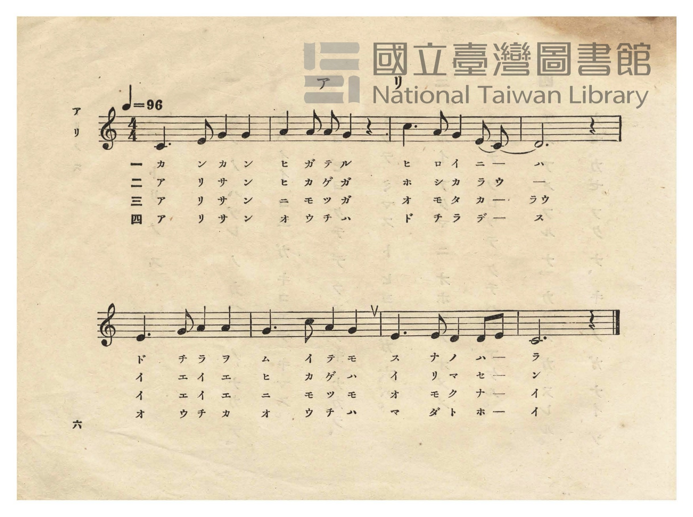
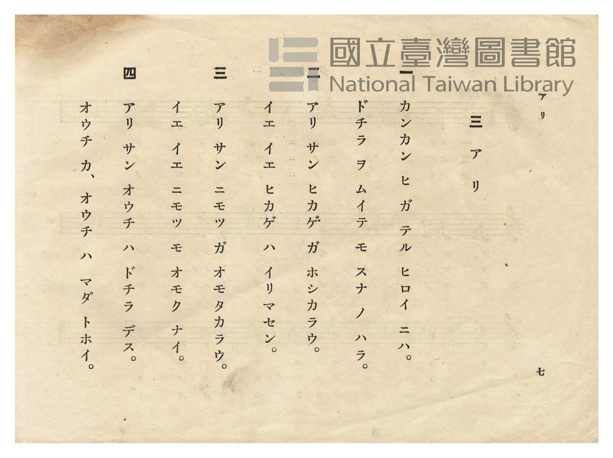

# アリ（蟻）

> Re:Shōka 使用 AI 協助辨識與重建樂譜，可能會有錯誤。歡迎回報。

- **NEUTRINO 歌聲合成版**：<br><audio controls src="ari_neutrino.mp3"></audio>
- **鋼琴伴奏版**：<br><audio controls src="ari.mp3"></audio>


- 日治時期公學校唱歌（第二學年・第三課）
- 國立臺灣圖書館典藏

## 說明


- 出處：臺灣總督府編《公學校唱歌》第二學年用，第三課〈アリ〉（蟻），原書第 6–7 頁（P008–P009）。
- 調性與拍號：ハ調（C 大調），4/4 拍，速度 != 96。
- 背景與曲風：透過孩童與螞蟻（アリサン）的一問一答，描寫烈日當空的沙地上，螞蟻不畏酷暑、
背負重物依然堅定奔走歸巢的勤勉形象。
- 版本說明：本檔案為原書單聲部五線譜之忠實數位化版本。

### 編曲說明（鋼琴伴奏版）：

1. 前奏 (Intro, 4 小節)：以後半樂句精神飽滿的五聲音階行進動機作為前奏。
2. 主歌伴奏 (Ari, 8 小節 × 4 段)：右手演奏原曲歌唱旋律；左手以穩健四拍子步伐伴奏。


## 歌詞

```text
一
カンカン ヒ ガ テル ヒロイ ニハ。
ドチラ ヲ ムイテ モ スナ ノ ハラ。

二
アリ サン ヒカゲ ガ ホシカラウ。
イエ イエ ヒカゲ ハ イリマセン。

三
アリ サン ニモツ ガ オモタカラウ。
イエ イエ ニモツ モ オモク ナイ。

四
アリ サン オウチ ハ ドチラ デス。
オウチ カ、オウチ ハ マダ トホイ。
```

## ABC

```abc
X:1
T:アリ（蟻）
M:4/4
L:1/16
Q:1/4=96
K:C
V:V1 name="Piano" snm="Pia"
[V:V1]
C6 D2 G4 G4 | A4 A2 A2 G4 z4 | c6 A2 G4 D2 C2 | D12 z4 |
w: 1.~カ ン カ ン | ヒ ガ テ ル | ヒ ロ イ ニ ハ | ア
w: 2.~ア リ サ ン | ヒ カ ゲ ガ | ホ シ カ ラ ウ | ウ
w: 3.~ア リ サ ン | ニ モ ツ ガ | オ モ タ カ ラ | ウ
w: 4.~ア リ サ ン | オ ウ チ ハ | ド チ ラ デ ス | ウ
E6 G2 A4 A4 | G6 c2 A4 G4 | E6 E2 D4 D2 E2 | C12 z4 |
w: 1.~ド チ ラ ヲ | ム イ テ モ | ス ナ ノ ハ ラ | ア
w: 2.~イ エ イ エ | ヒ カ ゲ ハ | イ リ マ セ ン | ン
w: 3.~イ エ イ エ | ニ モ ツ モ | オ モ ク ナ イ | イ
w: 4.~オ ウ チ カ | オ ウ チ ハ | マ ダ ト ホ イ | イ
```

## TMD 檔案連結

- [主旋律 TMD 檔案](ari.tmd) [[在 TMD Studio 編輯](https://tmdlang.github.io/Tmd-TS/#tmd=s7IKdvYPcrWy4qpTUCpJTLdSSM7PyUlNLsnMz7PKzk9PzM7Ojy_OyM9OVIKrKMvPKc1NtUovSkxJjTdCiBfnlxYlp1oVJ2fk5-fEl6RWlCTl52cj5AuK8stS8xLzgGoKijLzSlJTwIoQClLLMlNSQdKpKZkl-UWZiTlIlqYWFYPcBLEkvqQoMa84uSizAORQhCqgpvTMPKuSxMzyxLz4_LS0zGSwKVpaCo-bFj1uXvV-T8eL-bvf7-lU0NLiUrRVsDTjsrdVcOayMdE3sQMZ82z60mebdj-b2fRszvynrWuert3xbMHCp1M2PlvbA9T7fM2aJ7t6gIJPd2553LwbxN3R-WLVJqCBYEc8ndP9fHX3i_ZdzxsXP50z7dnsHS-XrHjauuPF9H4lLi59LQVbagEuBQWFxw0Tns3e9Hz2uherVj2b0fe4YSJYtHn30_ZdL2ZOfb9nFsQlz3fsfT538dNdc55vX_G4oQvNW48bupG99XzKivd7euA-e9zQAQm5xw2d8MADKnjaNx_oO6AyBbNHDZPNFV4uaARKBxgYWAC5QMoSqOxxQxPUQS9W7X_WsPxFR_uz7t4XM-cDXfa4uR8oCNTirPB0yXIwE2QsMBoUgGqArJcN85_uWqYAjiMkg5p7ns1cDzJo9qaXi4AunfWyof9lY9_TtSufr14KFH8xbx7YjTBXN2193LwZaPbzWS1PdjQ8ndoPJJ-vnQK04Fl__9P1q583dwCj_PnUbc9X7gKqebZp5tM5G57s6AIqgBj1ZEfv86n9L1u3P5s18XFDI8gdCgpAZ7zYtOBle-_zzpVP9s193rLt6YLWp-tmPV065cXWDc-AAbl9EdC0p91LnnZ3Pt276MXGhQg_PO_seDZnDSTOgB4Asp-tmvJsYcfzpl2QUH06bd2Lxk0vm1c82TXl-fZZL9bOebKz--n-BU_XL3s2dceTvb1Pe6ZBDAEZCk0JEK3A-Hyxct7T1hXPprUDQ-PJjrUgxqp5L9auByYPYLA83dD7rL1TARRDelkF6cCQARsADBWwOU2rgcEFIYFOnQQUWAOk2x43rwZxHzevfdy0BMjqBkYf3EOdj5sbHzevBLI2AfECoAqgDiBrEVD3zsfNXUBmHxD3A9VA9YASEthNQO-jREDr8hcNDS8mTn-6fs3T3YtBIbhr7cuZi0AJsmXhi9XTns2Z-3TyqqcN3c-m7Xw6YeKzObOf9gEju-dl895nM9aDorazHRSFffOBNsH9tqsH4jdQggBSoBQB9g3Qm01AJ4O9OPtx03awv1c-bloG8xrQJ00r4BRCR3M_WBCYvJrnPW7aDQoyTI89boCmoKetHc-nANN8z5O9C0BpEJhM9nU8a978YlnjsxU7X0xZ-3TC8vd7gC7uBWoBJjdgKgOSoBTaMRHIeDmnAa4SaA1QGSLSOrF5DBg5QIEWiMeagG5c9LhpPyG_wTWBow2iaT2Q1wVSQaTngPH1YmHPs7l9cF8Ccwguz8FVvtw978nO-SCPtgNlkf33dPZsLP4DOg7oi-ZGSDQgpb52UHKD-Q6uCOjvhkZ0TfMeNzcAqQ5wvJPiv6frtj2dswKYBl8sXvh0IjBhQn0GjCqo7HRgnp4P575sagEFQ-MCoGKE54CWUV4DQIGClj4Xl2NRplVAZmJevkONQU01uIyysdCyAzNqFAwVdIHQSMEUSIJwjYIZkDQDQhDPACxiGAdWBBHSMFIw1FTV0NXVBMoYgSUgEKwWbKqPYQ0obMGikGgBsUEskGmgogPIgxQeQAySg9gDkQGpXAtKfCDLgIkPFC0gu4BRjd02I4QcNC1gsQ1YRkHzM8K22RA9TduhLgTaBkwrTcsgti3Dbpsxftu6wTxgPoFmMrhtTaugekB5aD_YNpCjmlfitc0Er21gM0F6YakX4bdOqB6Q-EqI39pBZS4u26DJwRgsZApNBCCjQHGuC0oCIC4khUAUGYNjH5gcjOHJAZKYsCYHDAeBagSIUxdAowFUebRBgwjivZ1QPZBqAuwJUA6FBhm-5ABKPCAzwaUYlIWSxKAJAmQ6KNiQ9ICCuXke2Lam3aCwBtsGDnJcyQG3baDkgEgQyH5DTg7rIX4DerNpCcRvEBOxJweoTmi0Q_yCYiZCBuY3sH9AfHDJBrFtNj7barm4dO0UgEWHApBS5gIA)]
- [鋼琴伴奏 TMD 檔案](ari_piano.tmd) [[在 TMD Studio 編輯](https://tmdlang.github.io/Tmd-TS/#tmd=s7IKdvYPcrWy4tLSUnjctOhx86r3ezpezN_9uHn3y-49zydsebJny9Ol_c87O97v6VTQ0uJStFWwNOOyt1Vw5rIx0Tex46pTUHo2femzTbufzWx6Nmf-09Y1T9fueLZg4dMpG5-t7QGa9nzNmie7eoCCT3duARoL4u7ofLFqE9BAJZDup3O6n6_uftG-63nj4qdzpj2bvePlkhVPW3e8mN6vxMWlr6VgSy3ApaCg8LhhwrPZm57PXvdi1apnM_oeN0wEizbvftq-68XMqe_3zIK45PmOvc_nLn66a87z7SseN3SheetxQzeyt55PWfF-Tw_cZ48bOiBh-bihExKcQL8CFTztmw_0HVCZgtmjhsnmCi8XNAKlAwwMLIBcIGUJVPa4oQnqoBer9j9rWP6io_1Zd--LmfOBLnvc3A8UBGpxVni6ZDmYCTIWGA0KQDVA1suG-U93LVMAxxHCIKAPgF6G-BeoGTNegUaDlCooGOopPO3sBYoraHjmlRTl6yiYKDzd0P98fYMmUM2T3Uuf7ut52tv1bEXT0_6lzzfte7503svFe5_t3v98VsuTXVNeNG56OX_zy1l9LxYCnbLpaffUZyvnP9k753nTLoixUDcpKBjpKTzZsRsYkBBnKGg4FmXqKFhALVM4PB1o8bN1W0G2Pu3f_Kyz-9meKUB14ADcBNQGioXp3U_3db_fM_vp9mVABUDHPV-58mnj0qezZwMD4-naCc_WLn2yZwLEAqjFlCchKFDQ0ufiAgeRVUBmYl5-kIdDjUFNNdhzNhZadmBGjYKxgi4QmiqYAUkQrgGyQSKGcWAuiANTZKxgBCQ1jBSMNVU1dHU1gRKGYAkINAAp5apFsdQHu6WG8UC10YaxQNIEzDQBMbGIg5ko4qZgpimGOISEuwEYWXi9DXG4Edh_ED9CAsAMzAMbAwoCkCKIENDbhnBvg8IB1dsgU30Ma4AF1Gqw6OPmzVA2iAUy7XHzJBCvaQ2Q1QbEIDmIPRAZkMq1QPklIMseN3cDuf0gu4DZFLttRgg5YD4GsrdisW01EG8C24qwbTZET9N2qAuBtq0EMpdBbFuG3TZj_LZ1g3mLgLgF1bamVVA9QLmm_WDbQI5qXonXNhO8toHNBOl93NwICiYkv3VC9YDEV0L81g5UuhOXbTTKBfDkgOGgx82boE5dAI2GJeAEAQkiiPd2QvV0AXEfxBP9iCDDlxxAiQdk5gooG8RCSWLQBAEyHRRsSHpAwdw8D2xb025QWINtAwc5ruSA2zZQckAkCGS_ISeH9RC_Ab3ZtATiN4iJ2JMDVCc02iF-QTETIQPzG9g_IH4DEHdAbJuNzzbkkoNw2YXErEEuyMDikBSJLgpTjVSMgZkIz9KjdNS1UwAX0mALgRygn6N9DGNRuEaoXGNUrgmcq8wFAA)]

## 分析

```text
================================================================================
📊 TMD Song Profile: [ アリ（蟻） ]
================================================================================
⏱  Duration:       0:20 (20.0s), 8 measures total
🎼 Key & Tempo:    首調基準 C, != 96.0 BPM, <4/4>
   - 分析範圍：      由實際發聲的音符與和弦推測調性；播放脈絡另行呈現
🎤 人聲音域:    C4 (MIDI 60) – C5 (MIDI 72) [跨度: 12 個半音 / 1.0 個八度, 難度: easy]
   - 最低音:  C4 in [Ari #1 @ m.1, 0:00]
   - 最高音: C5 in [Ari #1 @ m.3, 0:05]
   - 適合: soprano, mezzo-soprano, contralto, tenor, baritone, bass
🏛  結構:      Ari (20.0s)
⚡ 編曲密度:        Peak 1 軌道同時演奏
🗝  調性診斷：       C 大調（純淨自然大調，未偵測到可信轉調）
   - 風格氣質:    純淨自然大調（陽光明朗、易唱易記，無明顯調外色彩）
   - 轉調歷程:    全曲維持單一推測調性（未偵測到可信轉調）
   - 核心骨幹音:  C, G, D, A, E
   - 調性數值:    C 大調 [相關度: 0.82, 穩定度: Moderate, 自然音純度: 100.0%]
   - 候選調性 (K-S): C 大調 (0.82), G 大調 (0.77), A 小調 (0.65)
   - 五度圈歷程:   +0
   - 各段落調性細節:
     • [Ari #1]: C 大調 (r: 0.82, 自然音純度: 100.0%)

  [ 五度圈游移軌跡 ]
              [C ]*
         F            G  
      Bb               D  
      Eb               A  
         Ab           E  
            Db       B  
               F# 
     (* = active key center)

  [ 十二半音累積音高分佈 ]
     C  : ████████████████████████  24.1%
     C# :                            0.0%
     D  : ███████████████████       19.0%
     D# :                            0.0%
     E  : ██████████████            13.8%
     F  :                            0.0%
     F# :                            0.0%
     G  : ████████████████████████  24.1%
     G# :                            0.0%
     A  : ███████████████████       19.0%
     A# :                            0.0%
     B  :                            0.0%
--------------------------------------------------------------------------------
Assignment 軌道音域：
  - Piano         : C4 – C5 (12 個半音 / 1.0 個八度, 28 個音符)
================================================================================
```


## 原書掃描頁






