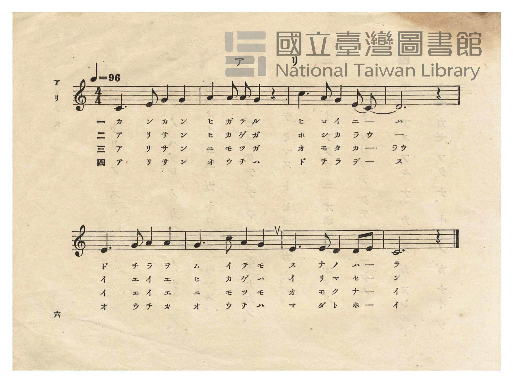
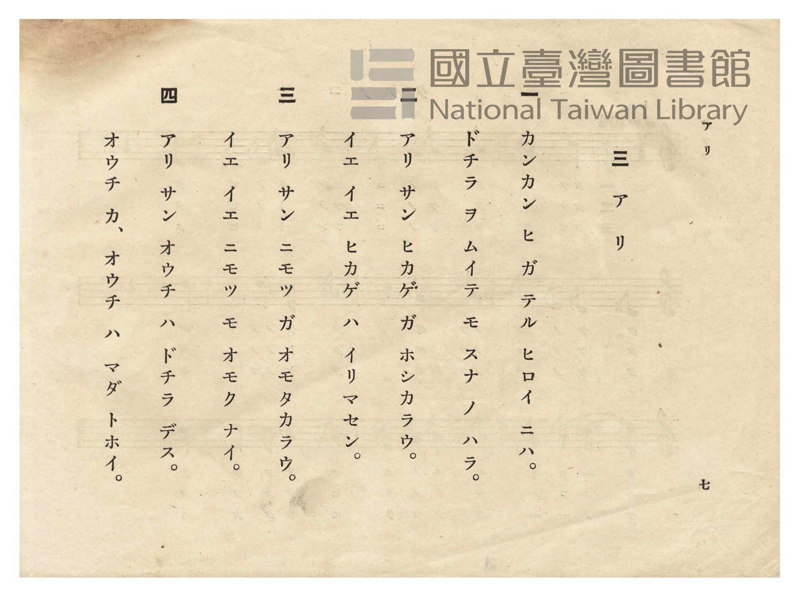

# アリ（蟻）

> Re:Shōka 使用 AI 協助辨識與重建樂譜，可能會有錯誤。歡迎回報。

- **鋼琴伴奏版**：<br><audio controls src="ari.mp3"></audio>
- **NEUTRINO 歌聲合成版**：<br><audio controls src="ari_neutrino.mp3"></audio>

- 日治時期公學校唱歌（第二學年・第三課）
- 國立臺灣圖書館典藏

## 說明


- 出處：臺灣總督府編《公學校唱歌》第二學年用，第三課〈アリ〉（蟻），原書第 6–7 頁（P008–P009）。
- 調性與拍號：ハ調（C 大調），4/4 拍，速度 != 96。
- 背景與曲風：透過孩童與螞蟻（アリサン）的一問一答，描寫烈日當空的沙地上，螞蟻不畏酷暑、
背負重物依然堅定奔走歸巢的勤勉形象。
- 版本說明：本檔案為原書單聲部五線譜之忠實數位化版本。

### 編曲說明（鋼琴伴奏版）：

1. 前奏 (Intro, 4 小節)：以後半樂句精神飽滿的五聲音階行進動機作為前奏。
2. 主歌伴奏 (Ari, 8 小節 × 4 段)：右手演奏原曲歌唱旋律；左手以穩健四拍子步伐伴奏。


## 歌詞

```text
一
カンカン ヒ ガ テル ヒロイ ニハ。
ドチラ ヲ ムイテ モ スナ ノ ハラ。

二
アリ サン ヒカゲ ガ ホシカラウ。
イエ イエ ヒカゲ ハ イリマセン。

三
アリ サン ニモツ ガ オモタカラウ。
イエ イエ ニモツ モ オモク ナイ。

四
アリ サン オウチ ハ ドチラ デス。
オウチ カ、オウチ ハ マダ トホイ。
```

## ABC

<div class="abc-score" data-abc-src="ari.abc" aria-label="五線譜載入中"></div>

[下載 ABC 原始檔](ari.abc)

## TMD 檔案連結

- [主旋律 TMD 檔案](ari.tmd) [[在 TMD Studio 編輯](https://tmdlang.github.io/Tmd-TS/#tmd=s7IKdvYPcrWy4qpTUCpJTLdSSM7PyUlNLsnMz7PKzk9PzM7Ojy_OyM9OVIKrKMvPKc1NtUovSkxJjTdCiBfnlxYlp1oVJ2fk5-fEl6RWlCTl52cj5AuK8stS8xLzgGoKijLzSlJTwIoQClLLMlNSQdKpKZkl-UWZiTlIlqYWFYPcBLEkvqQoMa84uSizAORQhCqgpvTMPKuSxMzyxLz4_LS0zGQUU6C6CxLTU60CDAwsdIGEJbL2kox8oL8KMiqtMjKLQW5ITsyJz07MQ_J-SUYq0Pd5iSWlRalKXFpaCo-bFj1uXvV-T8eL-bvf7-lU0NLiUrRVsDTjsrdVcOayMdE3sQNpfjZ96bNNu5_NbHo2Z_7T1jVP1-54tmDh0ykbn63tAep9vmbNk109QMGnO7c8bt4N4u7ofLFqE9BAsNVP53Q_X939on3X88bFT-dMezZ7x8slK5627ngxvV-Ji0tfS8GWWoBLQUHhccOEZ7M3PZ-97sWqVc9m9D1umAgWbd79tH3Xi5lT3--ZBXHJ8x17n89d_HTXnOfbVzxu6ELz1uOGbmRvPZ-y4v2eHrjPHjd0QELucUMnPPCACp72zQf6DqhMwexRw2RzhZcLGoHSoNgCckHxBVT2uKEJ6qAXq_Y_a1j-oqP9WXfvi5nzgS573NwPFARqcVZ4umQ5mAkyFhgNCkA1QNbLhvlPdy1TAMcRkkHNPc9mrgcZNHvTy0VAl8562dD_srHv6dqVz1cvBYq_mDcP7EaYq5u2Pm7eDDT7-ayWJzsank7tB5LP104BWvCsv__p-tXPmzuAUf586rbnK3cB1TzbNPPpnA1PdnQBFUCMerKj9_nU_pet25_Nmvi4oRHkDgUFoDNebFrwsr33eefKJ_vmPm_Z9nRB69N1s54unfJi64ZnwIDcvgho2tPuJU-7O5_uXfRi40KEH553djybswYSZ0APANnPVk15trDjedMuSKg-nbbuReOml80rnuya8nz7rBdr5zzZ2f10_4Kn65c9m7rjyd7epz3TIIaADIWmBIhWYHy-WDnvaeuKZ9PagaHxZMdaEGPVvBdr1wOTBzBYnm7ofdbeqQCKIb2sgnRgyIANAIYK2Jym1cDggpBAp04CCqwB0m2Pm1eDuI-b1z5uWgJkdQOjD-6hzsfNjY-bVwJZm4B4AVAFUAeQtQioe-fj5i4gsw-I-4FqoHpACQnsJqD3USKgdfmLhoYXE6c_Xb_m6e7FoBDctfblzEWgBNmy8MXqac_mzH06edXThu5n03Y-nTDx2ZzZT_uAkd3zsnnvsxnrQVHb2Q6Kwr75QJvgftvVA_EbKEEAKVCKAPsG6M0moJPBXpz9uGk72N8rHzctg3kN6JOmFXAKoaO5HywITF7N8x437QYFGabHHjdAU9DT1o7nU4BpvufJ3gWgNAhMJvs6njVvfrGs8dmKnS-mrH06Yfn7PUAX9wK1AJMbMJUBSVAK7ZgIZLyc0wBXCbQGqAwRaZ3YPAaMHKBAC8RjTUA3LnrctJ-Q3-CawNEG0bQeyOsCqSDSc8D4erGw59ncPrgvgTkEl-fgKl_unvdk53yQR9uBssj-ezp7Nhb_AR0H9EVzIyQakFJfOyi5wXwHVwT0d0MjuqZ5j5sbgFQHON5J8d_TdduezlkBTIMvFi98OhGYMKE-A0YVVHY6ME_Ph3NfNrWAgqFxAVAxwnNAyyivAaBAQUufi8uxKNMqIDMxL9-hxqCmGlxG2Vho2YEZNQqGCrpAaKRgCiRBuEbBDEiaASGIZwAWMYwDK4IIaRgpGGqqaujqagJljMASEAhWCzbVx7AGFLZgUUi0gNggFsg0UNEB5EEKDyAGyUHsgciAVK4FJT6QZcDEB4oWkF3AqMZumxFCDpoWsNgGLKOg-Rlh22yInqbtUBcCbQOmlaZlENuWYbfNGL9t3WAeMJ9AMxnctqZVUD2gPLQfbBvIUc0r8dpmgtc2sJkgvbDUi_BbJ1QPSHwlxG_toDIXl23Q5GAMFjKFJgKQUaA41wUlARAXkkIgiozBsQ9MDsbw5ABJTFiTA4aDQDUCxKkLoNEAqjzaoEEE8d5OqB5INQH2BCiHQoMMX3IAJR6QmeBSDMpCSWLQBAEyHRRsSHpAwdw8D2xb025QWINtAwc5ruSA2zZQckAkCGS_ISeH9RC_Ab3ZtATiN4iJ2JMDVCc02iF-QTETIQPzG9g_ID64ZIPYNhufbbVcXLp2CsCiQwFIKXMBAA)]
- [鋼琴伴奏 TMD 檔案](ari_piano.tmd) [[在 TMD Studio 編輯](https://tmdlang.github.io/Tmd-TS/#tmd=s7IKdvYPcrWy4qpTUCpJTLdSSM7PyUlNLsnMz7PKzk9PzM7Ojy_OyM9OVIKrKMvPKc1NtTJCiBTnlxYlp-JSD5GNL0hMT7UKMDCw0AUSlgjpgqL8stS8xDygASWJmeWJefHpQIGivPyi-PTUvNSixByE2tSyzJRUkMqCoszcxKLK-JT8ZKBb8kqQXJdaVAxyfEFmYl5-fGJRUWJeeiqqkvyikoz89KLEgoxKq4zM4pL8oszkxJz47MQ8JFeXZAB1WeUllpQWpSpxaWkpPG5a9Lh51fs9HS_m737cvPtl957nE7Y82bPl6dL-550d7_d0KmhpcSnaKliacdnbKjhz2Zjom9iBjHs2femzTbufzWx6Nmf-09Y1T9fueLZg4dMpG5-t7QGa9nzNmie7eoCCT3duARoL4u7ofLFqE9BAsGOezul-vrr7Rfuu542Ln86Z9mz2jpdLVjxt3fFier8SF5e-loIttQCXgoLC44YJz2Zvej573YtVq57N6HvcMBEs2rz7afuuFzOnvt8zC-KS5zv2Pp-7-OmuOc-3r3jc0IXmrccN3cjeej5lxfs9PXCfPW7ogITl44ZOSHAC_QpU8LRvPtB3QGUKZo8aJpsrvFzQCJQGpRggF5RmgMoeNzRBHfRi1f5nDctfdLQ_6-59MXM-0GWPm_uBgkAtzgpPlywHM0HGAqNBAagGyHrZMP_prmUK4DhCGAT0AdDLEP8CNWPGK9BokFIFBUM9haedvUBxBQ3PvJKifB0FE4WnG_qfr2_QBKp5snvp0309T3u7nq1oetq_9Pmmfc-Xznu5eO-z3fufz2p5smvKi8ZNL-dvfjmr78VCoFM2Pe2e-mzl_Cd75zxv2gUxFuomBQUjPYUnO3YDAxLiDAUNx6JMHQULqGUKh6cDLX62bivI1qf9m591dj_bMwWoDhyAm4DaQLEwvfvpvu73e2Y_3b4MqADouOcrVz5tXPp09mxgYDxdO-HZ2qVP9kyAWAC1mPIkBAUKWvpcXOAgsgoAZcMgD4cag5pqsOdsLLTswIwaBWMFXSA0VTADkiBcA2SDRAzjwFwQB6bIWMEISGoYKRhrqmro6moCJQzBEhBoAFLKVYtiqQ-ypSZwSw3jFaINYxVMgJRJLCofSMH5pkDKFIkPwgYQO4CRgddbEIcZgd0P8QPEg2ZgHtipIC-CFEGEgN4yhHsL5E9Ub4FM9TGsARZAq8Gij5s3Q9kgFsi0x82TQLymNUBWGxCD5CD2QGRAKtcC5ZeALHvc3A3k9oPsAmZD7LYZIeSA-RTI3orFttVAvAlsK8K22RA9TduhLgTathLIXAaxbRl224zx29YN5i0C4hZU25pWQfUA5Zr2g20DOap5JV7bTPDaBjYTpPdxcyMomJD81gnVAxJfCfFbO1DpTly20SiVw5MDhoMeN2-COnUBNBqWgBMEJIgg3tsJ1dMFxH0QT_QjggxfcgAlHpCZK6BsEAsliUETBMh0ULAh6QEFc_M8sG1Nu0FhDbYNHOS4kgNu20DJAZEgkP2GnBzWQ_wG9GbTEojfICZiTw5QndBoh_gFxUyEDMxvYP-A-A1A3AGxbTY-25BLDvxlE5SqgRVSQD6w6EHiQWShRRSQAhVM1CrddO0UwIUo2EAgB-jmaB_DWBSuESrXGJVrAucqcwEA)]

## 分析

```text
================================================================================
📊 TMD Song Profile: [ アリ（蟻） ]
================================================================================
⏱  Duration:       0:20 (20.0s), 8 measures total
🎼 Key & Tempo:    首調基準 C, != 96.0 BPM, <4/4>
   - 分析範圍：      由實際發聲的音符與和弦推測調性；播放脈絡另行呈現
🎤 人聲音域:    C4 (MIDI 60) – C5 (MIDI 72) [跨度: 12 個半音 / 1.0 個八度, 難度: easy]
   - 最低音:  C4 in [Ari #1 @ m.1, 0:00]
   - 最高音: C5 in [Ari #1 @ m.3, 0:05]
   - 適合: soprano, mezzo-soprano, contralto, tenor, baritone, bass
🏛  結構:      Ari (20.0s)
⚡ 編曲密度:        Peak 1 軌道同時演奏
🗝  調性診斷：       C 大調（純淨自然大調，未偵測到可信轉調）
   - 風格氣質:    純淨自然大調（陽光明朗、易唱易記，無明顯調外色彩）
   - 轉調歷程:    全曲維持單一推測調性（未偵測到可信轉調）
   - 核心骨幹音:  C, G, D, A, E
   - 調性數值:    C 大調 [相關度: 0.82, 穩定度: Moderate, 自然音純度: 100.0%]
   - 候選調性 (K-S): C 大調 (0.82), G 大調 (0.77), A 小調 (0.65)
   - 五度圈歷程:   +0
   - 各段落調性細節:
     • [Ari #1]: C 大調 (r: 0.82, 自然音純度: 100.0%)

  [ 五度圈游移軌跡 ]
              [C ]*
         F            G  
      Bb               D  
      Eb               A  
         Ab           E  
            Db       B  
               F# 
     (* = active key center)

  [ 十二半音累積音高分佈 ]
     C  : ████████████████████████  24.1%
     C# :                            0.0%
     D  : ███████████████████       19.0%
     D# :                            0.0%
     E  : ██████████████            13.8%
     F  :                            0.0%
     F# :                            0.0%
     G  : ████████████████████████  24.1%
     G# :                            0.0%
     A  : ███████████████████       19.0%
     A# :                            0.0%
     B  :                            0.0%
--------------------------------------------------------------------------------
Assignment 軌道音域：
  - Piano         : C4 – C5 (12 個半音 / 1.0 個八度, 28 個音符)
================================================================================
```


## 原書掃描頁






