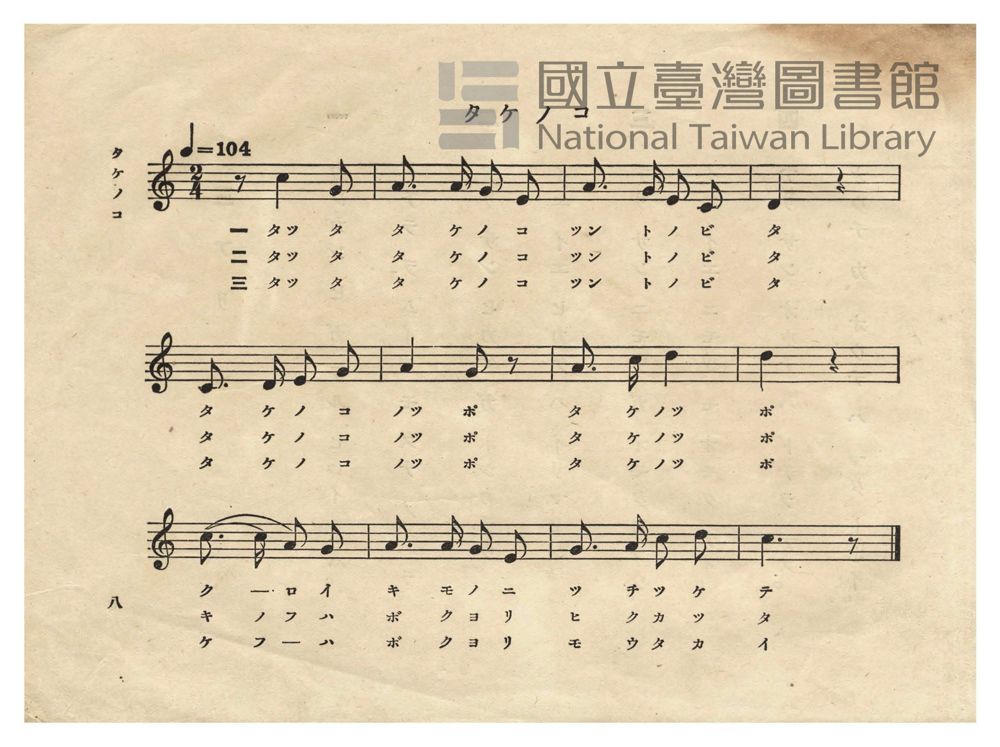
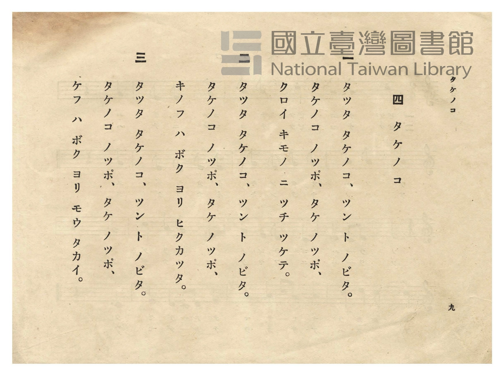

# タケノコ（筍）

> Re:Shōka 使用 AI 協助辨識與重建樂譜，可能會有錯誤。歡迎回報。

- **鋼琴伴奏版**：<br><audio controls src="takenoko.mp3"></audio>
- **NEUTRINO 歌聲合成版**：<br><audio controls src="takenoko_neutrino.mp3"></audio>

- 作詞：吉村守（1933 年公學校唱歌歌詞懸賞募集入選）
- 日治時期公學校唱歌（第二學年・第四課）
- 國立臺灣圖書館典藏

## 說明


- 出處：臺灣總督府編《公學校唱歌》第二學年用，第四課〈タケノコ〉（筍），原書第 8–9 頁（P010–P011）。
- 作詞：吉村守（臺南市鹽埕町一丁目五番地上信方，昭和 8 年［1933］臺灣總督府文教局公學校唱歌歌詞
懸賞募集入選作〈たけのこ〉；原應募歌詞共五節，編入課本時精選前三節，並將副歌「たけのこのつぼ、
たけのつぼ」改訂為「タケノコ ノッポ、タケ ノッポ」）。
- 調性與拍號：ハ調（C 大調），2/4 拍，速度 != 104。
- 背景與曲風：描寫春筍破土而出、裹著黑褐色筍籜沾著泥土，一轉眼從昨天比孩童矮、今天卻長得比孩童
還要高大的生機。第一小節以四分休止符弱起進入高音 `1^`（「タツタ」），形象化呈現竹筍突起之姿。
- 版本說明：本檔案為原書單聲部五線譜之忠實數位化版本。

### 編曲說明（鋼琴伴奏版）：

1. 前奏 (Intro, 4 小節)：以竹筍向上節節抽高的活潑五聲音階動機引出主歌。
2. 主歌伴奏 (Takenoko, 12 小節 × 3 段)：右手演奏原曲歌唱旋律；左手以輕快跳躍的二拍子伴奏。


## 歌詞

```text
一
タツタ タケノコ、ツン ト ノビタ。
タケノコ ノッポ、タケ ノッポ、
クロイ キモノ ニ ツチ ツケテ。

二
タツタ タケノコ、ツン ト ノビタ。
タケノコ ノッポ、タケ ノッポ、
キノフ ハ ボク ヨリ ヒクカツタ。

三
タツタ タケノコ、ツン ト ノビタ。
タケノコ ノッポ、タケ ノッポ、
ケフ ハ ボク ヨリ モウ タカイ。
```

## ABC

<div class="abc-score" data-abc-src="takenoko.abc" aria-label="五線譜載入中"></div>

[下載 ABC 原始檔](takenoko.abc)

## TMD 檔案連結

- [主旋律 TMD 檔案](takenoko.tmd) [[在 TMD Studio 編輯](https://tmdlang.github.io/Tmd-TS/#tmd=s7IKdvYPcrWy4qpTUCpJTLdSSM7PyUlNLsnMz7PKzk9PzM7Ojy_OyM9OVIKrKMvPKc1NtUovSkxJjTdCiBfnlxYlp1oVJ2fk5-fEl6RWlCTl52cj5AuK8stS8xLzgGoKijLzSlJTwIoQClLLMlNSQdKpKZkl-UWZiTlIlqYWFYPcBLEkvqQoMa84uSizAORQhCqgpvTMPKuSxMzyxLz4_LS0zGQUU1Dlk_OBjiguiTe0NDZG90Z8QWJ6qlWAgaGBLpAwRDaiJCMf6PeCjEqrjMxikDuTE3PisxPzkIKoJCMVGEJ5iSWlRalKXFpaCo-b9j9u2vi4ue9x0-b3ezqer-19v6dTQUuLS9FWwdDAhMveVsGZy8ZI38QOZMaz6Uufbdr9bGbTsznzn7auebp2x7MFC59O2fhsbQ9I85o1T3b1AAWf7tzyuHk3kPt09uwXqzYBTQS74MneOS9Wznu_Z9bTCZ3P5k58uq4DqAnkRwWgBjTjgAio9ln7jheb5z3tnv9ydtvT1qUvG3fAzHo6p_v56u4X7bueNy5-Omfas9k7Xi5Z8bR1x4vp_UpcXPpaCrbUAlwKCgqPGyY8m73p-ex1L1atejaj73HDRLBo8-6n7btezJwK9BLEJc937H0-d_HTXXOeb1_xuKELzU-PG7qRg-j5lBXv9_TAQ-lxQwdyZDxu6ITHB1DZ0775QD8CFStYPGqYbKnwckEjUBqUDIBcUEIAKnvc0AR1FtaQBjrxae_0pzuaXu7c-3T-1OdTdj3Z0fBkRyPQW092TXk-ddXTORue7Oh6sn_hs2k7gVY-m7H26aQeBQtQ7LzfsxsUUe_37EXz6LNp7c-mzny6sQFr_IGco6CAGYtA94G82zj_cePEx43rHjdOBnt3NsiX7Z1AlRDtT1s3gly2vgEUTtuB0bsUGE7P5qwBJsDnm_YBzXna2ftkRydEwZMdy55uaH_auR4c0j0ohoPIJY8b9zxuaIQ4CUkWIt77bMrOFyuanjftAulFigdgcPY9bm5-3DwXqBkigSwEih5EuL9Ytf9Zw_IXHe3PuntfzJwPjIDHzf1AQWDoOys8XbIczARFJzBDKQDVAFkvG-Y_3bVMAZLdkExq7nk2cz3IpNmbXi4CJpRZz_r7n65f_WzGUmCaeL5gy9M581809ADTH9BZLxbvfDFx-svdE18smfCicxNIwcY5zzbtAwo-27wUqBIcPA0v9nY-n7Pn6b55z2aseLpk5bP1U56uXfl89dLn89cBDXmyuwso-LR398up25_umw6XhQTYy6aWF8saX66eAfTF81ktz6fMf7ZyPtC5oAS9o-Hphn5gJDzZvRSYlJ92tD3ZM_HZ2kXP1yx7umfji63bXzZsAkX76hkv529WSDCMSwAGBzSUm1tAJDgUQYl876IXGxc-7Zn2dGLH8_59z1fvBHllVSPQjCc7u58uB6qEhc_zzg5gQoBkR1DgABPFqinPFnYAIxCSVZ5OW_eicdPL5hWgFLR91ou1c0BG7F_wdP2yZ1OBCbAXaA3EEJCh0EwO0QpLfCuAiRsYA092rAUxVs17sXY9MOcDHf90Qy8wmSqAsp1eVkE60PFgA4ABATYH5i-UwhWUeoCizaAE1QFJQZPBfof4iPgUB07Bj5vWP25e-7hpCZC19nHzIqA8UE03EAOtaARTIOPaoMaDcj_Y_cCggobq6pmgUN3X9mRXGyjkJ-0G5v6n-4DlQdezrr3AJADUCYrthu6nayeAIhysC2g7miCQAUrEwKQHTHezWl4sXPxi8WagIcD0gpwAgabBQ2lXD_1CCRg2QKGpQJl-IJ4DDDYgteJx8yogNQkUiE2rYWmQLgEFzXkz-oAIFETrpzzrmAjMf08nLkIOoh2d9AsioGLs4bPocdMyiHmrgQmNTgEELYW2b3q-bTK8IAKGEbz8AdoCDSmgayiv3aFAQUufiyskMTs1Lz873yogMzEv36FG17CmGlz62RiaadmBWTUKBgq6YGgYByRMgbhGwQwsYAbmGSOJmCoYgRSCRUAsEIRprwEb52OIMBAUz0CyuQWsHsKDiILiDSTTB5XZDJEBqgSlAhCrAyIDVgHiT4bqB5kNtcmIbjYZ08MmaGyAAlcXGLigYEeODAgPrBQqAowvI1CUgQMfwcSMD4QrwbkFzAK5CNktIFfOhVuAqQOiBqQDpAqLPcDYoIs9wLigtT2wmICEKJAChTeujAFigUTAqsGRANeJMBc5LtZDbV8LZC8Bu2kt1O2LoDKQig8plQHrP7ivoKmsDeqvFdhtAscGyFyYeVPBrH6oeXOgoQEuG8Eyq6AykxAyTauR3QANQQybwPEBchNILaTYBbFANiD7dgXUDogvQTLLoDaBcg7YJnBogGRANKpNtVxcunYKsNJMAchW5gIA)]
- [鋼琴伴奏 TMD 檔案](takenoko_piano.tmd) [[在 TMD Studio 編輯](https://tmdlang.github.io/Tmd-TS/#tmd=s7IKdvYPcrWy4qpTUCpJTLdSSM7PyUlNLsnMz7PKzk9PzM7Ojy_OyM9OVIKrKMvPKc1NtTJCiBTnlxYlp-JSD5GNL0hMT7UKMDA00AUShgjpgqL8stS8xDygASWJmeWJefHpQIGivPyi-PTUvNSixByE2tSyzJRUkMqCoszcxKLK-JT8ZKBb8kqQXJdaVAxyfEFmYl5-fGJRUWJeeiqqkvyikoz89KLEgoxKq4zM4pL8oszkxJz47MQ8JFeXZAB1WeUllpQWpSpxaWkpPG7a_7hp4-PmvsdNm9_v6Xi-tvdx8-6X3XueT9jyZM-Wp0v7n3d2vN_TqaClxaVoq2BoYMJlb6vgzGVjpG9iBzL12fSlzzbtfjaz6dmc-U9b1zxdu-PZgoVPp2x8trYHZNyaNU929QAFn-7cAjQXyH06e_aLVZuAJoLd9GTvnBcr573fM-vphM5ncyc-XQe0q8PQ0thYAagBzTggAqp91r7jxeZ5T7vnv5zd9rR16cvGHTCzns7pfr66-0X7rueNi5_OmfZs9o6XS1Y8bd3xYnq_EheXvpaCLbUAl4KCwuOGCc9mb3o-e92LVauezeh73DARLNq8-2n7rhczpwK9BHHJ8x17n89d_HTXnOfbVzxu6ELz0-OGbuQgej5lxfs9PfBQetzQgRw9jxs6ITEE9DFQ2dO--UA_AhUrWDxqmGyp8HJBI1AalBSBXFBiBCp73NAEdRY1QhpoBshJjfMfN0583LjuceNksJOQbHmxav-zhuUvOtqfdfe-mDkfaN3j5n6gINAuZ4WnS5aDmSDHA5OPAlANkPWyYf7TXcsUIIkLYRIwuIDhCwlcoG7MFAk0G6RUQcFQT-FpZy9QXEHDM6-kKF9HwUTh6Yb-5-sbNIFqnuxe-nz1TmCgPZ0w8cmOLqAoED3r2vty9Yzns1qebdn9bO_EJ7umvGjc9HL-5pez-p52T322cv7TPVOB8fhkx25wHIHdpKBgpKcAEYE4Q0EjJDE7NS8_G2ijoRHUSoXD0xWMFZ6t2wqy-2n_5med3c_2TAGqBsfWJqBmUBBP7366r_v9ntlPty8DKgA68QXQvv2rX2zf_GJXL9BZwAQBDJynaydAbIK6gPKECwUKWvpcXOCwsgoAlSdBHg41BjXVYF_aGJpp2YFZNQqGCrpAaAT0kK6CKRDXKJiBRczAPJBoDZgFEjGMAykFEUB9IAoGDUBCXLUoFvogW2iBsC9eIdowFkbVKJgAGSZIfFMgwzQWRsHVg7ABxA5YjCD8pWuIxWMgN4Eg2KG4fAYRMQX6H6gQLAJiwbwEgjVg43wMEQYCsyuIbG4Bq4fwIKLAXAyW6YPKbIbIAFU-bgaxHzd3QGTAKkD8yVD9kAAE22REN5uM6WETgWQG4YGVQkWA8QVOYuDARzAx4wPhyo1Q2yGuQ3YLyJVz4RZg6oCoAekAqcJiDzA26GIPMC5obQ8sJiAhCqRA4U1hlkfExXqo7WuB7CVgN62Fun0RVKYPiLuhLoTINCJ8BU1lbVB_rcBuEzg2QObCzJsKZvVDzZsDDY31QDbIhMfNq6AykxAyTauR3QANQQybwPEBchNI7VSoHRAbkH27AmoHxJcgmWVQm0A5B2wTODRAMiAa1SaMwgxUZiIKM5RC0wB3kQniAxmgIhO5CEX4Bl-pCyxUYTx4mUuSAcQW27p2CuDaAWwgkAPzebSPYSymmBEWMWO4mDIXAA)]

## 分析

```text
================================================================================
📊 TMD Song Profile: [ タケノコ（筍） ]
================================================================================
⏱  Duration:       0:12 (12.7s), 11 measures total
🎼 Key & Tempo:    首調基準 C, != 104.0 BPM, <2/4>
   - 分析範圍：      由實際發聲的音符與和弦推測調性；播放脈絡另行呈現
🎤 人聲音域:    C4 (MIDI 60) – D5 (MIDI 74) [跨度: 14 個半音 / 1.2 個八度, 難度: moderate]
   - 最低音:  C4 in [Takenoko #1 @ m.3, 0:03]
   - 最高音: D5 in [Takenoko #1 @ m.7, 0:07]
   - 適合: soprano, mezzo-soprano, contralto, tenor, baritone, bass
🏛  結構:      Takenoko (12.7s)
⚡ 編曲密度:        Peak 1 軌道同時演奏
🗝  調性診斷：       A 調性不明確（純淨自然大調，未偵測到可信轉調）
   - 風格氣質:    純淨自然大調（陽光明朗、易唱易記，無明顯調外色彩）
   - 轉調歷程:    全曲維持單一推測調性（未偵測到可信轉調）
   - 核心骨幹音:  A, C, D, G, E
   - 調性數值:    A 調性不明確 [相關度: 0.72, 穩定度: Ambiguous, 自然音純度: 100.0%]
   - 候選調性 (K-S): A 小調 (0.72), C 大調 (0.72), G 大調 (0.68)
   - 五度圈歷程:   +1
   - 各段落調性細節:
     • [Takenoko #1]: G 調性不明確 (r: 0.70, 自然音純度: 100.0%)

  [ 五度圈游移軌跡 ]
               C  
         F           [G ]*
      Bb               D  
      Eb               A  
         Ab           E  
            Db       B  
               F# 
     (* = active key center)

  [ 十二半音累積音高分佈 ]
     C  : ███████████████████████   25.0%
     C# :                            0.0%
     D  : ███████████████████       21.2%
     D# :                            0.0%
     E  : ███████                    7.5%
     F  :                            0.0%
     F# :                            0.0%
     G  : ██████████████████        20.0%
     G# :                            0.0%
     A  : ████████████████████████  26.2%
     A# :                            0.0%
     B  :                            0.0%
--------------------------------------------------------------------------------
Assignment 軌道音域：
  - Piano         : C4 – D5 (14 個半音 / 1.2 個八度, 34 個音符)
================================================================================
```


## 原書掃描頁






