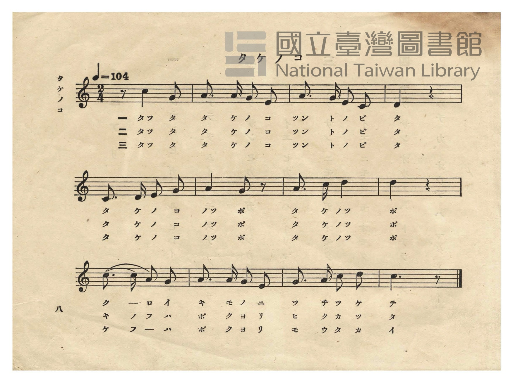
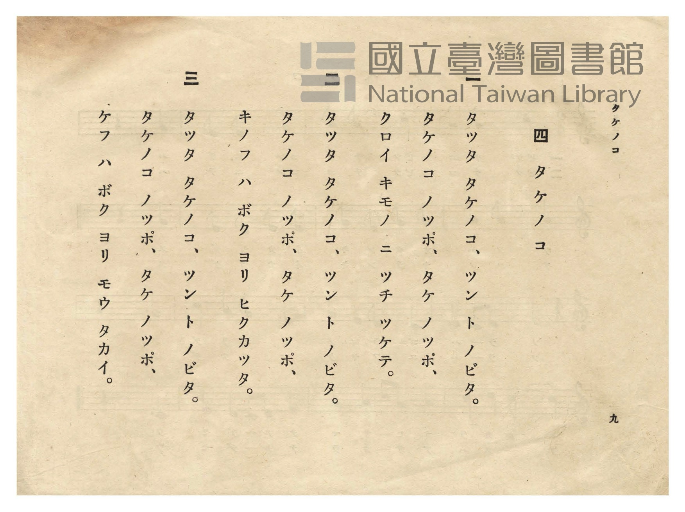

# タケノコ（筍）

> Re:Shōka 使用 AI 協助辨識與重建樂譜，可能會有錯誤。歡迎回報。

<audio controls src="takenoko.mp3"></audio>

- 作詞：吉村守（1933 年公學校唱歌歌詞懸賞募集入選）
- 日治時期公學校唱歌（第二學年・第四課）
- 國立臺灣圖書館典藏

## 說明

【曲目說明】
・出處：臺灣總督府編《公學校唱歌》第二學年用，第四課〈タケノコ〉（筍），原書第 8–9 頁（P010–P011）。
・作詞：吉村守（臺南市鹽埕町一丁目五番地上信方，昭和 8 年［1933］臺灣總督府文教局公學校唱歌歌詞
懸賞募集入選作〈たけのこ〉；原應募歌詞共五節，編入課本時精選前三節，並將副歌「たけのこのつぼ、
たけのつぼ」改訂為「タケノコ ノッポ、タケ ノッポ」）。
・調性與拍號：ハ調（C 大調），2/4 拍，速度 != 104。
・背景與曲風：描寫春筍破土而出、裹著黑褐色筍籜沾著泥土，一轉眼從昨天比孩童矮、今天卻長得比孩童
還要高大的生機。第一小節以四分休止符弱起進入高音 `1^`（「タツタ」），形象化呈現竹筍突起之姿。
・版本說明：本檔案為原書單聲部五線譜之忠實數位化版本。

・編曲說明（鋼琴伴奏版）：
1. 前奏 (Intro, 4 小節)：以竹筍向上節節抽高的活潑五聲音階動機引出主歌。
2. 主歌伴奏 (Takenoko, 12 小節 × 3 段)：右手演奏原曲歌唱旋律；左手以輕快跳躍的二拍子伴奏。

## 歌詞

```text
一
タツタ タケノコ、ツン ト ノビタ。
タケノコ ノッポ、タケ ノッポ、
クロイ キモノ ニ ツチ ツケテ。

二
タツタ タケノコ、ツン ト ノビタ。
タケノコ ノッポ、タケ ノッポ、
キノフ ハ ボク ヨリ ヒクカツタ。

三
タツタ タケノコ、ツン ト ノビタ。
タケノコ ノッポ、タケ ノッポ、
ケフ ハ ボク ヨリ モウ タカイ。
```

## ABC

```abc
X:1
T:タケノコ（筍）
M:2/4
L:1/16
Q:1/4=104
K:C
V:V1 name="Piano" snm="Pia"
[V:V1]
z4 c2 G2 | A3 A G2 E2 | A3 G D2 C2 | D4 z4 |
w: 1.~タ ツ | タ タ ケ ノ | コ ツ ン ト | ノ
w: 2.~タ ツ | タ タ ケ ノ | コ ツ ン ト | ノ
w: 3.~タ ツ | タ タ ケ ノ | コ ツ ン ト | ノ
C3 D E2 G2 | A4 G2 z2 | A3 c d4 | d4 z4 |
w: 1.~タ ケ ノ コ | ノ ポ | タ ケ ノ | ポ
w: 2.~タ ケ ノ コ | ノ ポ | タ ケ ノ | ポ
w: 3.~タ ケ ノ コ | ノ ポ | タ ケ ノ | ポ
c3 c A2 G2 | A3 A G2 E2 | G3 A c2 d2 | c6 z2 |
w: 1.~ク ロ イ キ | モ ノ ニ ツ | チ ツ ケ テ | エ
w: 2.~キ ノ フ ハ | ボ ク ヨ リ | ヒ ク カ ツ | タ
w: 3.~ケ フ ハ ボ | ク ヨ リ モ | ウ タ カ イ | イ
```

## TMD 檔案連結

- [主旋律 TMD 檔案](takenoko.tmd) [[在 TMD Studio 編輯](https://tmdlang.github.io/Tmd-TS/#tmd=s7IKdvYPcrWy4qpTUCpJTLdSSM7PyUlNLsnMz7PKzk9PzM7Ojy_OyM9OVIKrKMvPKc1NtUovSkxJjTdCiBfnlxYlp1oVJ2fk5-fEl6RWlCTl52cj5AuK8stS8xLzgGoKijLzSlJTwIoQClLLMlNSQdKpKZkl-UWZiTlIlqYWFYPcBLEkvqQoMa84uSizAORQJS4tLYXHTfsfN2183Nz3uGnz-z0dz9f2vt_TqaClxaVoq2BoYMJlb6vgzGVjpG9iBzLz2fSlzzbtfjaz6dmc-U9b1zxdu-PZgoVPp2x8trYHpHnNmie7eoCCT3duedy8G8h9Onv2i1WbgCaCXfRk75wXK-e93zPr6YTOZ3MnPl3XAdRkaGlsrADUgGYcEAHVPmvf8WLzvKfd81_ObnvauvRl4w6YWU_ndD9f3f2ifdfzxsVP50x7NnvHyyUrnrbueDG9X4mLS19LwZZagEtBQeFxw4Rnszc9n73uxapVz2b0PW6YCBZt3v20fdeLmVOBXoK45PmOvc_nLn66a87z7SseN3Sh-elxQzdyED2fsuL9nh54KD1u6ECOjMcNnfD4ACp72jcf6EegYgWLRw2TLRVeLmgESgcYGBoAuUDKEKjscUMT1FlYQxroxKe905_uaHq5c-_T-VOfT9n1ZEfDkx2NQG892TXl-dRVT-dseLKj68n-hc-m7QRa-WzG2qeTehQsQLHzfs9uUES937MXzaPPprU_mzrz6cYGrPEHco6CAmYsAt0H8m7j_MeNEx83rnvcOBns3dkgX7Z3AlVCtD9t3Qhy2foGUDhtB0bvUmA4PZuzBpgAn2_aBzTnaWfvkx2dEAVPdix7uqH9aed6cEj3oBgOIpc8btzzuKER4iQkWYh477MpO1-saHretAukFykegMHZ97i5-XHzXKBmiASyECh6EOH-YtX-Zw3LX3S0P-vufTFzPjACHjf3AwWBoe-s8HTJcjATFJ3ADKUAVANkvWyY_3TXMgVIdkMyqbnn2cz1IJNmb3q5CJhQZj3r73-6fvWzGUuBaeL5gi1P58x_0dADTH9AZ71YvPPFxOkvd098sWTCi85NIAUb5zzbtA8o-GzzUqBKcPA0vNjb-XzOnqf75j2bseLpkpXP1k95unbl89VLn89fBzTkye4uoODT3t0vp25_um86XBYSYC-bWl4sa3y5egbQF89ntTyfMv_ZyvlA54IS9I6Gpxv6gZHwZPdSYFJ-2tH2ZM_EZ2sXPV-z7OmejS-2bn_ZsAkU7atnvJy_WSHBMC4BGBzQUG5uAZHgUAQl8r2LXmxc-LRn2tOJHc_79z1fvRPklVWNQDOe7Ox-uhyoEhY-zzs7gAkBkh1BgQNMFKumPFvYAYxASFZ5Om3di8ZNL5tXgFLQ9lkv1s4BGbF_wdP1y55NBSbAXqA1EENAhkIzOUQrLPGtACZuYAw82bEWxFg178Xa9cCcD3T80w29wGSqAMp2elkF6UDHgw0ABgTYHJi_UApXUOoBijaDElQHJAVNBvsd4iPiUxw4BT9uWv-4ee3jpiVA1trHzYuA8kA13UAMtKIRTIGMa4MaD8r9YPcDgwoaqqtngkJ1X9uTXW2gkJ-0G5j7n-4Dlgddz7r2ApMAUCcothu6n66dAIpwsC6g7WiCQAYoEQOTHjDdzWp5sXDxi8WbgYYA0wtyAgSaBg-lXT30CyVg2ACFpgJl-oF4DjDYgNSKx82rgNQkUCA2rYalQboEFDTnzegDIlAQrZ_yrGMiMP89nbgIOYh2dNIviICKsYfPosdNyyDmrQYmNDoFELQU2r7p-bbJ8IIIGEbw8gdoCzSkgK6hvHaHAgUtfS6ukMTs1Lz87HyrgMzEvHyHGoOaanDhZ2NopmUHZtUoGCjogqFhHJAwBeIaBTOwgBmYZ4wkYqpgBFIIFgGxQBCmvQZsnI8hwkBQNAPJ5haweggPIgqKNpBMH1RmM0QGqBKUCECsDogMWAWIPxmqH2Q21CYjutlkTA-boLEBClxdYOCCgh05MiA8sFKoCDC-jEBRBg58BBMzPhCuBGcWMAvkImS3gFw5F24Bpg6IGpAOkCos9gBjgy72AOOC1vbAYgISokAKFN64MgaIBRIBqwZHAlwnwlzkuFgPtX0tkL0E7Ka1ULcvgspA6j2kVAas_uC-gqayNqi_VmC3CRwbIHNh5k0Fs_qh5s2Bhga4aATLrILKTELINK1GdgM0BDFsAscHyE0gtZBSF8QC2YDs2xVQOyC-BMksg9oEyjlgm8ChAZIB0ag21XJx6dopwAozBSBbmQsA)]
- [鋼琴伴奏 TMD 檔案](takenoko_piano.tmd) [[在 TMD Studio 編輯](https://tmdlang.github.io/Tmd-TS/#tmd=s7IKdvYPcrWy4tLSUnjctP9x08bHzX2Pmza_39PxfG3v4-bdL7v3PJ-w5cmeLU-X9j_v7Hi_p1NBS4tL0VbB0MCEy95WwZnLxkjfxI6rTkHp2fSlzzbtfjaz6dmc-U9b1zxdu-PZgoVPp2x8trYHZNyaNU929QAFn-7cAjQXyH06e_aLVZuAJiqBdD_ZO-fFynnv98x6OqHz2dyJT9cB7eowtDQ2VgBqQDMOiIBqn7XveLF53tPu-S9ntz1tXfqycQfMrKdzup-v7n7Rvut54-Knc6Y9m73j5ZIVT1t3vJjer8TFpa-lYEstwKWgoPC4YcKz2Zuez173YtWqZzP6HjdMBIs2737avuvFzKlAL0Fc8nzH3udzFz_dNef59hWPG7rQ_PS4oRs5iJ5PWfF-Tw88lB43dCBHz-OGTkgMAX0MVPa0bz7Qj0DFChaPGiZbKrxc0AiUDjAwNABygZQhUNnjhiaos6gR0kAzQE5qnP-4ceLjxnWPGyeDnYRky4tV-581LH_R0f6su_fFzPlA6x439wMFgXY5KzxdshzMBDkemHwUgGqArJcN85_uWqYASVwIk4DBBQxfSOACdWOmSKDZIKUKCoZ6Ck87e4HiChqeeSVF-ToKJgpPN_Q_X9-gCVTzZPfS56t3AgPt6YSJT3Z0AUWB6FnX3perZzyf1fJsy-5neyc-2TXlReOml_M3v5zV97R76rOV85_umQqMxyc7doPjCOwmBQUjPQWICMQZChohidmpefnZQBsNjaBWKhyermCs8GzdVpDdT_s3P-vsfrZnClA1OLY2ATWDgnh699N93e_3zH66fRlQAdCJL4D27V_9YvvmF7t6gc4CJghg4DxdOwFiE9QFlCdcKFDQ0ufiAoeVVUBmYl5-kIdDjUFNNdiXNoZmWnZgVo2CoYIuEBoBPaSrYArENQpmYBEzMA8kWgNmgUQM40BKQQRQH4iCQQOQEFctioU-uCyMByqONowFkkjMGgUTMMcEQ9wUzDEFcZCYKOZASLgjYFGG3-Mg5SAI9ggun0NETIHhA1QIFgGxYF4GwRqwcT6GCAOB2RlENreA1UN4EFFgLgfL9EFlNkNkgCofN4PYj5s7IDJgFSD-ZKh-iN_ANhnRzSZjethEIBlCeGClUBFgfIGTIDjwEUzM-EC4ciPUdojrkN0CcuVcuAWYOiBqQDpAqrDYA4wNutgDjAta2wOLCUiIAilQeFNYJCDiYj3U9rVA9hKwm9ZC3b4IKtMHxN1QF0JkGhG-gqayNqi_VmC3CRwbIHNh5k0Fs_qh5s2BhsZ6IBtkwuPmVVCZSQiZptXIboCGIIZN4PgAuQmkdirUDogNyL5dAbUD4kuQzDKoTaCcA7YJHBogGRCNahNGWYa3TAXpIapEhYiDOZASFbOkRU19xBfakHSHJIpSZFPBAvJrBV07BXDtBLYQyIGFbLSPYSymmBEWMWO4mDIXAA)]

## 分析

```text
================================================================================
📊 TMD Song Profile: [ タケノコ（筍） ]
================================================================================
⏱  Duration:       0:13 (13.8s), 12 measures total
🎼 Key & Tempo:    首調基準 C, != 104.0 BPM, <2/4>
   - 分析範圍：      由實際發聲的音符與和弦推測調性；播放脈絡另行呈現
🎤 人聲音域:    C4 (MIDI 60) – D5 (MIDI 74) [跨度: 14 個半音 / 1.2 個八度, 難度: moderate]
   - 最低音:  C4 in [Takenoko #1 @ m.3, 0:03]
   - 最高音: D5 in [Takenoko #1 @ m.7, 0:07]
   - 適合: soprano, mezzo-soprano, contralto, tenor, baritone, bass
🏛  結構:      Takenoko (13.8s)
⚡ 編曲密度:        Peak 1 軌道同時演奏
🗝  調性診斷：       A 調性不明確（純淨自然大調，未偵測到可信轉調）
   - 風格氣質:    純淨自然大調（陽光明朗、易唱易記，無明顯調外色彩）
   - 轉調歷程:    全曲維持單一推測調性（未偵測到可信轉調）
   - 核心骨幹音:  A, C, D, G, E
   - 調性數值:    A 調性不明確 [相關度: 0.72, 穩定度: Ambiguous, 自然音純度: 100.0%]
   - 候選調性 (K-S): A 小調 (0.72), C 大調 (0.72), G 大調 (0.68)
   - 五度圈歷程:   +3
   - 各段落調性細節:
     • [Takenoko #1]: A 調性不明確 (r: 0.72, 自然音純度: 100.0%)

  [ 五度圈游移軌跡 ]
               C  
         F            G  
      Bb               D  
      Eb              [A ]*
         Ab           E  
            Db       B  
               F# 
     (* = active key center)

  [ 十二半音累積音高分佈 ]
     C  : ███████████████████████   25.0%
     C# :                            0.0%
     D  : ███████████████████       21.2%
     D# :                            0.0%
     E  : ███████                    7.5%
     F  :                            0.0%
     F# :                            0.0%
     G  : ██████████████████        20.0%
     G# :                            0.0%
     A  : ████████████████████████  26.2%
     A# :                            0.0%
     B  :                            0.0%
--------------------------------------------------------------------------------
Assignment 軌道音域：
  - Piano         : C4 – D5 (14 個半音 / 1.2 個八度, 34 個音符)
================================================================================
```


## 原書掃描頁






