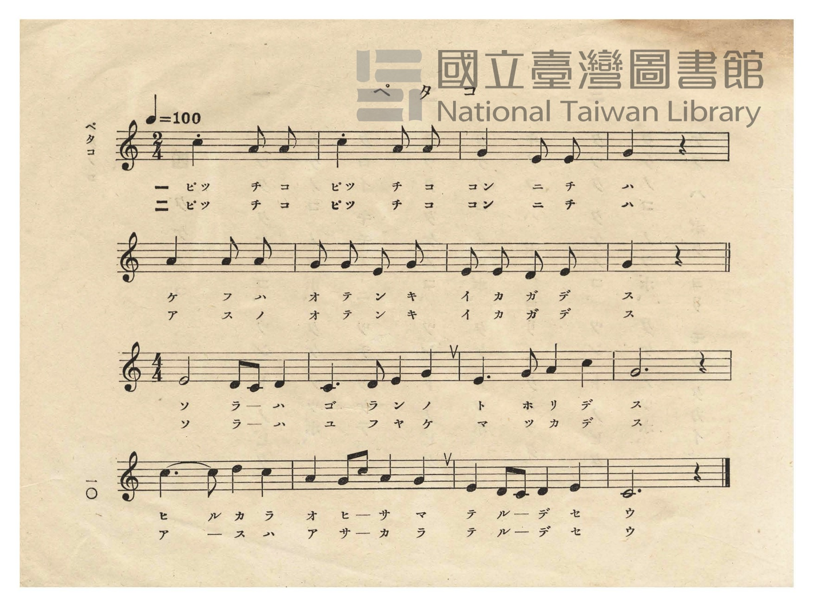
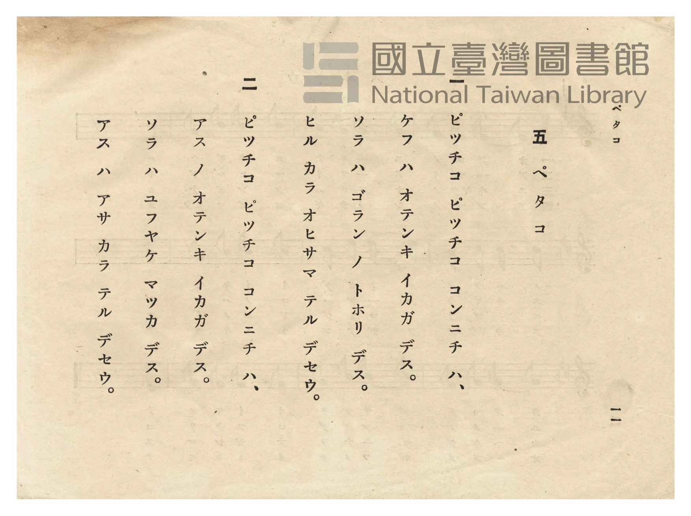

# ペタコ（白頭翁）

> Re:Shōka 使用 AI 協助辨識與重建樂譜，可能會有錯誤。歡迎回報。

- **NEUTRINO 歌聲合成版**：<br><audio controls src="petako_neutrino.mp3"></audio>
- **鋼琴伴奏版**：<br><audio controls src="petako.mp3"></audio>


- 作詞：岡本新市（1933 年公學校唱歌歌詞懸賞募集入選）
- 日治時期公學校唱歌（第二學年・第五課）
- 國立臺灣圖書館典藏

## 說明


- 出處：臺灣總督府編《公學校唱歌》第二學年用，第五課〈ペタコ〉（白頭翁），原書第 10–11 頁（P012–P013）。
- 作詞：岡本新市（花蓮港高等女學校教諭，昭和 8 年［1933］臺灣總督府文教局公學校唱歌歌詞懸賞募集
入選作；原應募題名為〈白頭鶴〉［按即臺灣常見鳥類白頭翁，臺語「白頭殼」pe̍h-thâu-khak 之日語音譯
「ペタコ」］，編入課本時將曲名改為〈ペタコ〉，並將首句叫聲「ぴつちえこ ぴつちえこ」改為
「ピッチコ ピッチコ」）。
- 調性與拍號：ハ調（C 大調），前段（第 1–8 小節）為 2/4 拍，後段（第 9–16 小節）轉為 4/4 拍，速度 != 100。
- 背景與曲風：極具臺灣鄉土色彩的童謠。前半段以輕快的 2/4 拍模擬白頭翁「ピッチコ ピッチコ」的清脆鳴叫
與孩童向小鳥問候天氣；後半段轉為開闊悠揚的 4/4 拍，描繪晴空豔陽與傍晚火紅晚霞預告明日好天氣。
（註：1943 年《うたのほん 下》第十三課〈ぺたこ〉為另一首描寫白頭翁吃木瓜的同名異曲。）
- 版本說明：本檔案為原書單聲部五線譜之忠實數位化版本。因原曲於第 9 小節由 2/4 拍轉為 4/4 拍，
此處統一以八分音符為基準時值（`<8*>`）分段記譜。

### 編曲說明（鋼琴伴奏版）：

1. 前奏 (Intro, 4 小節)：以 2/4 拍模擬白頭翁「ピッチコ ピッチコ」的清脆鳥鳴動機開場。
2. 主歌伴奏 (PetakoA 2/4 拍 8 小節 + PetakoB 4/4 拍 8 小節，共 2 段)：忠實呈現原譜由輕巧二拍子問答
轉入開闊四拍子晴空詠嘆的拍號轉換設計。


## 歌詞

```text
一
ピッチコ ピッチコ コンニチ ハ、
ケフ ハ オテンキ イカガ デス。
ソラ ハ ゴラン ノ トホリ デス。
ヒル カラ オヒサマ テル デセウ。

二
ピッチコ ピッチコ コンニチ ハ、
アス ノ オテンキ イカガ デス。
ソラ ハ ユフヤケ マッカ デス。
アス ハ アサ カラ テル デセウ。
```

## ABC

```abc
X:1
T:ペタコ（白頭翁）
M:2/4
L:1/16
Q:1/4=100
K:C
V:V1 name="Piano" snm="Pia"
[V:V1]
c4 A2 A2 | c4 A2 A2 | G4 E2 E2 | G4 z4 |
w: 1.~ピ ッ チ | コ ピ ッ | チ コ コ | ン
w: 2.~ピ ッ チ | コ ピ ッ | チ コ コ | ン
A4 A2 A2 | G2 G2 E2 G2 | E2 E2 D2 E2 | G4 z4 |
w: 1.~ニ チ ハ | ケ フ ハ オ | テ ン キ イ | カ
w: 2.~ニ チ ハ | ア ス ノ オ | テ ン キ イ | カ
```

## TMD 檔案連結

- [主旋律 TMD 檔案](petako.tmd) [[在 TMD Studio 編輯](https://tmdlang.github.io/Tmd-TS/#tmd=s7IKdvYPcrWy4qpTUCpJTLdSSM7PyUlNLsnMz7PKzk9PzM7Ojy_OyM9OVIKrKMvPKc1NtUovSkxJjTdCiBfnlxYlp1oVJ2fk5-fEl6RWlCTl52cj5AuK8stS8xLzgGoKijLzSlJTwIoQClLLMlNSQdKpKZkl-UWZiTlIlqYWFYPcBLEkvqQoMa84uSizAORQJS4tLYXHzbMeN-1_3LT5_Z6O5zP3vlyw9vn-xvd7OhW0tLgUbRUMDQy47G0VnLlsjPRN7EDGPpu-9Nmm3c9mNj2bM_9p65qna3c8W7Dw6ZSNz9b2gIxYs-bJrh6g4NOdWx437wZzp7xYtQloIthRT_bOebFy3vs9s55uWvhszppn0zY83dEE1GdoaWysANSDZiIQAZU_a9_xYvO8p93zX85ue9q69GXjDphxT-d0P1_d_aJ91_PGxU_nTHs2e8fLJSuetu54Mb1fiYtLX0vBllqAS0FB4XHDhGezNz2fve7FqlXPZvQ9bpgIFm3e_bR914uZU4G-grjk-Y69z-cufrprzvPtKx43dKH56XFDN3IoPZ-y4v2eHnhAPW7ogEfJ44ZOtFgBqnzaNx_oTaB6YNw8aphsaKjwcgFQqiPAwNAIyAdSxkCFjxuaoG7DFeIvuja-mLzu2Y71L1fPeL628-nSzRBHPps688XqtUCLns1Y-3RSj4IFKFre79kNiqH3e_ai-fDZtHaghqcbGwhGHMg5CgqQ6AO66f2e2SCftHeCZBf2PJ3Q-7xpF9DzEN--3LYF7Pndz3o6n_Zuhkbwjh0vlnW_3Lz05cJ5SIHSA5R9sWre44YeiOCzdXseN_QWpJ7pzdAtyTi8qFQ3OyMxW-HJzm5g0gUqfDl_84u16yHOAWpCCu1eoP9AcbEdmISAKjeBgmtm09MN7cBYBzrw2ZSdEDeiRlDPkx3LgGpeLpv2tH_p0_7VLxqBkdjzuHHL48YljxsXPm7seNw4WQGND7QMYhySO6Y8bm5-3NwINBcYbwgO2F1IEfpi1f5nDctfdLQ_6-59MXM-MGYfN_cDBYFx6qzwdMlyMBOcUjp7n63bCsmUCobAtAGMyg39z9c3AKWBNisAc7QC0AyQyn09CJWWoFRlhlD6Yi9YtQlc9cuG-U93LVOAlA5I7mrueTZzPchdsze9XARM1LOeLd36tHU7JPJetnQ-nTP_Reemp3tXPp_V8nz10hdrFgA1Ax35tLcLaPuT3Utf7Jn6dP9qoCzMac9WLHw2eQ08rgmEElDjsx2tL1raXm7eAowHSMgC3fN07UqgdU8nTAR6CZh6nk7tf9ow8-mSlc82LAalwn09EAdA_PlyWvfL6V3PmhY8658FcgnC28_6-5_vXPVs5pbnK3e92Djl5cy9ILObep_NnPW8cfXzLa1Axss5814umPB0YheweACmtqdL90LsgYaSggIo463YDQwbQ0sTcIEHLB8eN7Y9bpz_uHHd48bdj5smKzzZ0Q0pI572Nj7Z0QktFBp3gRUBUw7ImU_7lz3Z0QBMc0BXPV2_Gh5ETyc0P5uz4vnkOUC3P50AzlZTNwAjBOgAYFRCY-p5ZwcwaUMKMVA0AZP5qinPFnaAzAWXLk-nrQOm4pfNK4Bl0vPts16snQPMPU_3L3i6ftmzqcDc2_u0ZxrEEFAMzl4A1rXp2bQ94PQDTTrPp2yExSNGEoIExrO1S4DF5vOtG4FeAUb_09bVTzvagNnz-ZplIKfM3_Vs1zRQBmzYAwy2BBsLLbsEoCeAakCxtWIG0FmgcIWWzBCXQ8qdp60rgAUTMHqe7FgLYqyaB8zxwOIaaMzTDb3AQkcBVEzqZRWkgwIFZADQBZDAwZG8FEBJrBmIuoF8oEz_44ZGsIamjY-bp4IEgMxVj5vbQIqa1gI5Sx43rX7ctAYo1f64aScsmzTtfdy8EqocWEGuBCoH8vqAGFiqzH7cvApNffOkx82rgWpXg7WBbJj0uGnr4-Z5QCmgXUApkHJgslkG1QFKYGDvgsqFhp6nU5Y_nboP6FgIA1Ra7V0ASpYTgVm78cnuLmD6BCUVcCp91tD3cteeZysWP5246P2e-cAsBTIBqGDlrqcbNj5t7gfqfT6n-2nHBqAWYIgBVYILj3nAYH7a2wHMOk-Xdz9dsgqYNUDVARBt2PhsTvOzKftAuaZ1-YuGhie72p5OWA50K6RUg4T9LnB6ICPsFwFDChJ8JIZ98zJgrD1uBqrbCOTMA1nVBA1LhHKo6aCoAjK3wmOBCgEPzHhEBvyLRash5cqz-ZOf7pv-smEWsKQB184gE8Bh3wAs9J9NXwkN7BnrnzYAI2E5MMhBCpADG-hKyhtCUKCgpc_FFZBakpid72gVkJmYl-9QY1BTDc7YoJwKZtQoGMYp6CqYASEK0xTIMgZCCMsAiGvA6n0Ma0AxD-QDYwSIG4EqQAkAxJ8CFgPJN4L4kGQB5oPkkcwwoswMqMPNkBxrCnSqKZAFcrIRTmd3g60AJ1CwlaCUBS8ZwJa0gS2CJlGwmtVYnI5uziIghqdygubUwmLFCU-sGAOVgmAN0DuGQAxiGYJFjKCyIA_C1IG8DgoOcARC_A7RDCLRQgGY6WCywAwCcXnTXih_JVgG5q8tYDZIDBYBIH4fmNcBZs-Gyq3CZSMovIi3sXkZmD0VKrcEIgeMJxBvHjTBgOXA4YluI3KKBgcGMPRAbGiwgELIFCIMYcICEBTEoIAGJXlEQOMIP6APIK7aCXbVJLCrQK6BuQpaDyBkgQUTxD8QH4DSxmpoWIBkd0P1gvyOMwxRbQWmOAgbYm4_mAdKhVtRXAGRbYO6EGQGSBZkH8Q2XLYCU6iunQK06FAAMpW5AA)]
- [鋼琴伴奏 TMD 檔案](petako_piano.tmd) [[在 TMD Studio 編輯](https://tmdlang.github.io/Tmd-TS/#tmd=s7IKdvYPcrWy4tLSUnjcPOtx0_7HTZvf7-l4PnPvywVrn-9vfNy8-2X3nucTtjzZs-Xp0v7nnR3v93QqaGlxKdoqGBoYcNnbKjhz2Rjpm9hx1SkoPZu-9Nmm3c9mNj2bM_9p65qna3c8W7Dw6ZSNz9b2gAxds-bJrh6g4NOdW4DmgrlTXqzaBDRRCaT7yd45L1bOe79n1tNNC5_NWfNs2oanO5qA-gwtjY0VgHrQTAQioPJn7TtebJ73tHv-y9ltT1uXvmzcATPu6Zzu56u7X7Tvet64-Omcac9m73i5ZMXT1h0vpvcrcXHpaynYUgtwKSgoPG6Y8Gz2puez171YterZjL7HDRPBos27n7bvejFzKtBXEJc837H3-dzFT3fNeb59xeOGLjQ_PW7oRg6l51NWvN_TAw-oxw0d8Eh63NCJHE9ATwNVPu2bD_QmUD0wbh41TDY0VHi5ACjVEWBgaATkAyljoMLHDU1Qt-EK8RddG19MXvdsx_qXq2c8X9v5dOlmiCOfTZ35YvVaoEUkRgnQHqDbIY59uW0L2O1Iznixav-zhuUvOtqfdfe-mDkf6J7Hzf1AQaBLnBWeLlkOZoL919n7bN1WSFJSMAT6yELh6Yb-5-sbgNLPm3YpANOhAtAMkMp9PQiVlqCwMEMofbEXrNoErvplw_ynu5YpQNI0wl3AKALGKSRCgUZhZgSgS0FKFRQM9RSAbgOKK2h45pUU5esomECt0wSqebJ7Kcxpz1YsfDZ5DSJ7NfQ8bp7yuLn5cXMjMFKBliI4jxt6n89qebaj9UVL28vNS19u3vK0e-qzlfNfTut-ugAYhmBXKigY6Sk82bEbGPIQhyloBKSWJGbnO8JsVICFkYK2AkTKCeZzuBQowFo3KhgpAMMM5OCn-xc8Xb_s6cSO5_37gGnqxdo5z6dsfLFn6tPty4FpE6jz6doJT6f2P187BeIGIACGKSiup3W_nN71dPZsiJpnM7c8X7nrxcoFT2e0gfwCjl6gymf9s1-sWPtiRQfUF5RnQShQ0NLn4gLHgFVAZmJefpCHQ41BTTXYlTYWWnZgRo2CYZyCroIZEKIwTRWMgUFgDBIEihkAcQ1XLYpxPjiMi1eINoxVMAFSJrFY-KZAhmksjILLw22AxhhZTtYFOhjkZBALYiBIvY9hDSgtAfnA5ATEjUAVoPQF4k8Bi4HkG0F8UKoDYhAfJI9khhFlZkAdbobkWFAImwJZICdDQhqbs7vBVjQCcT_Yyo1A1lQw73HTKrAlbWCLHjetBeIlYDWrsTgd3ZxFQLwTyOsjyhz0eCEz7qF8KAVPCwi31sDU4tQCZcCTD4oRcGc64U0-xkDFIFgDDHdDIAaxQKlcF8iGyIJiAqYOFEegeAOnNEgkQTSDSLToaloDl33c3A4J4qa9UP5KsAwsAraA2SAxWEoB8fvAvA4wezZUbhUuG0ERS7yNzcvA7KlQuSUQOWCCAvHmQVM2WA4c8eg2Imc9cGAAQw_EhgYLKIRMIcIQJiwAQUEMCmhQ3kQENI7wA_oA4qqdYFdNArsK5BqYq0B-giVYsGzTVqh_ID4AJeLV0LAAye6G6gX5HWcYotoKzBoQNsTcfjAPlF22orgCItsGdSHIDJAsyD6IbbhsRU-juLOSLjilg9McmANM5uAARJbBzQHmICAHmIcwDABzkPMcFrtQDMHGIdJ9EBruc107BXANArYYyIEWKtE-hrGoQk6YQkBVRpiqEELKXAA)]

## 分析

```text
================================================================================
📊 TMD Song Profile: [ ペタコ（白頭翁） ]
================================================================================
⏱  Duration:       0:09 (9.6s), 8 measures total
🎼 Key & Tempo:    首調基準 C, != 100.0 BPM, <2/4>
   - 分析範圍：      由實際發聲的音符與和弦推測調性；播放脈絡另行呈現
🎤 人聲音域:    D4 (MIDI 62) – C5 (MIDI 72) [跨度: 10 個半音 / 0.8 個八度, 難度: easy]
   - 最低音:  D4 in [PetakoA #1 @ m.7, 0:07]
   - 最高音: C5 in [PetakoA #1 @ m.1, 0:00]
   - 適合: soprano, mezzo-soprano, contralto, tenor, baritone, bass
🏛  結構:      PetakoA (9.6s)
⚡ 編曲密度:        Peak 1 軌道同時演奏
🗝  調性診斷：       C 調性不明確（純淨自然大調，未偵測到可信轉調）
   - 風格氣質:    純淨自然大調（陽光明朗、易唱易記，無明顯調外色彩）
   - 轉調歷程:    全曲維持單一推測調性（未偵測到可信轉調）
   - 核心骨幹音:  G, A, E, C, D
   - 調性數值:    C 調性不明確 [相關度: 0.67, 穩定度: Ambiguous, 自然音純度: 100.0%]
   - 候選調性 (K-S): C 大調 (0.67), A 小調 (0.66), E 小調 (0.65)
   - 五度圈歷程:   +0
   - 各段落調性細節:
     • [PetakoA #1]: C 調性不明確 (r: 0.67, 自然音純度: 100.0%)

  [ 五度圈游移軌跡 ]
              [C ]*
         F            G  
      Bb               D  
      Eb               A  
         Ab           E  
            Db       B  
               F# 
     (* = active key center)

  [ 十二半音累積音高分佈 ]
     C  : ███████████               14.3%
     C# :                            0.0%
     D  : ███                        3.6%
     D# :                            0.0%
     E  : ████████████████          21.4%
     F  :                            0.0%
     F# :                            0.0%
     G  : ████████████████████████  32.1%
     G# :                            0.0%
     A  : █████████████████████     28.6%
     A# :                            0.0%
     B  :                            0.0%
--------------------------------------------------------------------------------
Assignment 軌道音域：
  - Piano         : D4 – C5 (10 個半音 / 0.8 個八度, 22 個音符)
================================================================================
```


## 原書掃描頁






