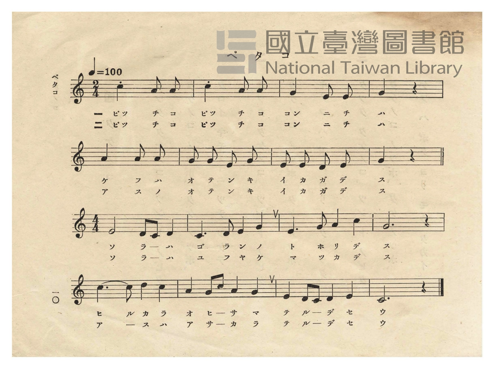
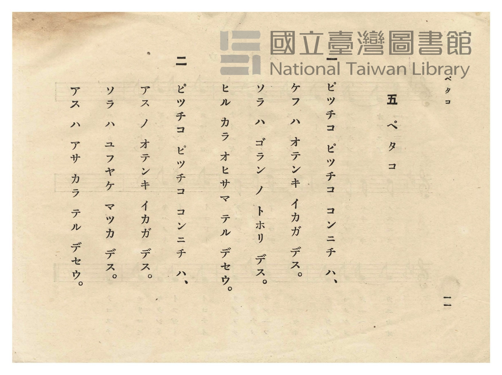

# ペタコ（白頭翁）

> Re:Shōka 使用 AI 協助辨識與重建樂譜，可能會有錯誤。歡迎回報。

- **鋼琴伴奏版**：<br><audio controls src="petako.mp3"></audio>
- **NEUTRINO 歌聲合成版**：<br><audio controls src="petako_neutrino.mp3"></audio>

- 作詞：岡本新市（1933 年公學校唱歌歌詞懸賞募集入選）
- 日治時期公學校唱歌（第二學年・第五課）
- 國立臺灣圖書館典藏

## 說明


- 出處：臺灣總督府編《公學校唱歌》第二學年用，第五課〈ペタコ〉（白頭翁），原書第 10–11 頁（P012–P013）。
- 作詞：岡本新市（花蓮港高等女學校教諭，昭和 8 年［1933］臺灣總督府文教局公學校唱歌歌詞懸賞募集
入選作；原應募題名為〈白頭鶴〉［按即臺灣常見鳥類白頭翁，臺語「白頭殼」pe̍h-thâu-khak 之日語音譯
「ペタコ」］，編入課本時將曲名改為〈ペタコ〉，並將首句叫聲「ぴつちえこ ぴつちえこ」改為
「ピッチコ ピッチコ」）。
- 調性與拍號：ハ調（C 大調），前段（第 1–8 小節）為 2/4 拍，後段（第 9–16 小節）轉為 4/4 拍，速度 != 100。
- 背景與曲風：極具臺灣鄉土色彩的童謠。前半段以輕快的 2/4 拍模擬白頭翁「ピッチコ ピッチコ」的清脆鳴叫
與孩童向小鳥問候天氣；後半段轉為開闊悠揚的 4/4 拍，描繪晴空豔陽與傍晚火紅晚霞預告明日好天氣。
（註：1943 年《うたのほん 下》第十三課〈ぺたこ〉為另一首描寫白頭翁吃木瓜的同名異曲。）
- 版本說明：本檔案為原書單聲部五線譜之忠實數位化版本。因原曲於第 9 小節由 2/4 拍轉為 4/4 拍，
此處統一以八分音符為基準時值（`<8*>`）分段記譜。

### 編曲說明（鋼琴伴奏版）：

1. 前奏 (Intro, 4 小節)：以 2/4 拍模擬白頭翁「ピッチコ ピッチコ」的清脆鳥鳴動機開場。
2. 主歌伴奏 (PetakoA 2/4 拍 8 小節 + PetakoB 4/4 拍 8 小節，共 2 段)：忠實呈現原譜由輕巧二拍子問答
轉入開闊四拍子晴空詠嘆的拍號轉換設計。


## 歌詞

```text
一
ピッチコ ピッチコ コンニチ ハ、
ケフ ハ オテンキ イカガ デス。
ソラ ハ ゴラン ノ トホリ デス。
ヒル カラ オヒサマ テル デセウ。

二
ピッチコ ピッチコ コンニチ ハ、
アス ノ オテンキ イカガ デス。
ソラ ハ ユフヤケ マッカ デス。
アス ハ アサ カラ テル デセウ。
```

## ABC

<div class="abc-score" data-abc-src="petako.abc" aria-label="五線譜載入中"></div>

[下載 ABC 原始檔](petako.abc)

## TMD 檔案連結

- [主旋律 TMD 檔案](petako.tmd) [[在 TMD Studio 編輯](https://tmdlang.github.io/Tmd-TS/#tmd=s7IKdvYPcrWy4qpTUCpJTLdSSM7PyUlNLsnMz7PKzk9PzM7Ojy_OyM9OVIKrKMvPKc1NtUovSkxJjTdCiBfnlxYlp1oVJ2fk5-fEl6RWlCTl52cj5AuK8stS8xLzgGoKijLzSlJTwIoQClLLMlNSQdKpKZkl-UWZiTlIlqYWFYPcBLEkvqQoMa84uSizAORQhCqgpvTMPKuSxMzyxLz4_LS0zGQUU1Dlk_OBjiguiTe0NDZG90Z8QWJ6qlWAgaGRLpBAks4vKsnIB_q9IKPSKiOzGOTO5MSc-OzEPKQgKslIBYZQUmZRSrESl5aWwuPmWY-b9j9u2vx-T8fzmXtfLlj7fH_j-z2dClpaXIq2CoYGBlz2tgrOXDZG-iZ2IFOeTV_6bNPuZzObns2Z_7R1zdO1O54tWPh0ysZna3tARqxZ82RXD1Dw6c4tj5t3g7lTXqzaBDQR7IYne-e8WDnv_Z5ZTzctfDZnzbNpG57uaALqA3lUAagHzUQgAip_1r7jxeZ5T7vnv5zd9rR16cvGHTDjns7pfr66-0X7rueNi5_OmfZs9o6XS1Y8bd3xYnq_EheXvpaCLbUAl4KCwuOGCc9mb3o-e92LVauezeh73DARLNq8-2n7rhczpwJ9BXHJ8x17n89d_HTXnOfbVzxu6ELz0-OGbuRQej5lxfs9PfCAetzQAY-Sxw2daLECVPm0bz7Qm0D1wLh51DDZ0FDh5QKgVAcoQQD5oCQBVPi4oQnqNlwh_qJr44vJ657tWP9y9YznazufLt0MceSzqTNfrF4LtOjZjLVPJ_UoWICi5f2e3aAYer9nL5oPn01rB2p4urGBYMSBnKOgAIk-oJve75kN8kl7J0h2Yc_TCb3Pm3YBPQ_x7cttW8Ce3_2sp_Np72ZoBO_Y8WJZ98vNS18unIcUKD1A2Rer5j1u6IEIPlu353FDb0Hqmd4M3ZKMw4tKdbMzErMVnuzsBiZdoMKX8ze_WLse4hygJqTQ7gX6DxQX24FJCKhyEyi4ZjY93dAOjHWgA59N2QlxI2oE9TzZsQyo5uWyaU_7lz7tX_2iERiJPY8btzxuXPK4ceHjxo7HjZMV0PhAyyDGIbljyuPm5sfNjUBzgfGG4IDdhRShL1btf9aw_EVH-7Pu3hcz5wNj9nFzP1AQGKfOCk-XLAczwSmls_fZuq2QTKlgCEwbwKjc0P98fQNQGmizAjBHKwDNAKnc14NQaQlKVWYIpS_2glWbwFW_bJj_dNcyBUjpgOSu5p5nM9eD3DV708tFwEQ969nSrU9bt0Mi72VL59M58190bnq6d-XzWS3PVy99sWYBUDPQkU97u4C2P9m99MWeqU_3rwbKwpz2bMXCZ5PXwOOaQCgBNT7b0fqipe3l5i3AeICELNA9T9euBFr3dMJEoJeAqefp1P6nDTOfLln5bMNiUCrc1wNxAMSfL6d1v5ze9axpwbP-WSCXILz9rL__-c5Vz2Zueb5y14uNU17O3Asyu6n32cxZzxtXP9_SCmS8nDPv5YIJTyd2AYsHYGp7unQvxB5oKCkogDLeit3AsDG0NAEXeMDy4XFj2-PG-Y8b1z1u3P24abLCkx3dkDLiaW_jkx2d0EKhcRdYETDlgJz5tH_Zkx0NwDQHdNXT9avhQfR0QvOzOSueT54DdPvTCeBsNXUDMEKADgBGJTSmnnd2AJM2pBADRRMwma-a8mxhB8hccOnydNo6YCp-2bwCWCY93z7rxdo5wNzzdP-Cp-uXPZsKzL29T3umQQwBxeDsBWBdm55N2wNOP9Ck83zKRlg8YiQhSGA8W7sEWGw-37oR6BVg9D9tXf20ow2YPZ-vWQZyyvxdz3ZNA2XAhj3AYEuwsdCySwB6AqgGFFsrZgCdBQpXaMkMcTmk3HnaugJYMAGj58mOtSDGqnnAHA8sroHGPN3QCyx0FEDFpF5WQTooUEAGAF0ACRwcyUsBlMSagagbyAfK9D9uaARraNr4uHkqSADIXPW4uQ2kqGktkLPkcdPqx01rgFLtj5t2wrJJ097HzSuhyoEV5EqgciCvD4iBpcrsx82r0NQ3T3rcvBqodjVYG8iGSY-btj5ungeUAtoFlAIpByabZVAdoAQG9i6oXGjoeTpl-dOp-4COhTBApdXeBaBkORGYtRuf7O4Cpk9QUgGn0mcNfS937Xm2YvHTiYve75kPzFIgE4AKVu56umHj0-Z-oN7nc7qfdmwAagGGGFAluPCYBwzmp70dwKzzdHn30yWrgFkDVB0A0YaNz-Y0P5uyD5RrWpe_aGh4sqvt6YTlQLdCSjVI2O8Cpwcywn4RMKQgwUdi2DcvA8ba42aguo1AzjyQVU3QsEQoh5oOiiogcys8FqgQ8MCMR2TAv1i0GlKuPJs_-em-6S8bZgFLGnDtDDIBHPYNwEL_2fSV0MCesf5pAzASlgODHKQAObCBrqS8IQQFClr6XFwBqSWJ2fmOVgGZiXn5DjUGNdXgjA3KqWBGjYJhnIKughkQojBNgSxjIISwDIC4Bqzex7AGFPNAPjBGgLgRqAKUAED8KWAxkHwjiA9JFmA-SB7JDCPKzIA63AzJsaZAp5oCWSAnG-F0djfYCnACBVsJSlnwkgFsSRvYImgSBatZjcXp6OYsAmJ4KidoTi0sVpzwxIoxUCkI1gC9YwjEIJYhWMQIKgvyIEwdyOug4ABHIMTvEM0gEi0UgJkOJgvMIBCXN-2F8leCZWD-2gJmg8RgEQDi94F5HWD2bKjcKlw2gsKLeBubl4HZU6FySyBywHgC8eZBEwxYDhye6DYip2hwYABDD8SGBgsohEwhwhAmLABBQQwKaFCSRwQ0jvAD-gDiqp1gV00CuwrkGpiroPUAQhZYMEH8A_EBKG2shoYFSHY3VC_I7zjDENVWYIqDsCHm9oN5oFS4FcUVENk2qAtBZoBkQfZBbMNlKzCF6topQIsOBSBTmQsA)]
- [鋼琴伴奏 TMD 檔案](petako_piano.tmd) [[在 TMD Studio 編輯](https://tmdlang.github.io/Tmd-TS/#tmd=s7IKdvYPcrWy4qpTUCpJTLdSSM7PyUlNLsnMz7PKzk9PzM7Ojy_OyM9OVIKrKMvPKc1NtTJCiBTnlxYlp-JSD5GNL0hMT7UKMDA00gUSxgjpgqL8stS8xDygASWJmeWJefHpQIGivPyi-PTUvNSixByE2tSyzJRUkMqCoszcxKLK-JT8ZKBb8kqQXJdaVAxyfEFmYl5-fGJRUWJeeiqqkvyikoz89KLEgoxKq4zM4pL8oszkxJz47MQ8JFeXZAB1WSVlFqUUK3FpaSk8bp71uGn_46bN7_d0PJ-59-WCtc_3Nz5u3v2ye8_zCVue7NnydGn_886O93s6FbS0uBRtFQwNDLjsbRWcuWyM9E3sQOY-m7702abdz2Y2PZsz_2nrmqdrdzxbsPDplI3P1vaADF2z5smuHqDg051bgOaCuVNerNoENBHsqid757xYOe_9nllPNy18NmfNs2kbnu5oAuoztDQ2VgDqQTMRiIDKn7XveLF53tPu-S9ntz1tXfqycQfMuKdzup-v7n7Rvut54-Knc6Y9m73j5ZIVT1t3vJjer8TFpa-lYEstwKWgoPC4YcKz2Zuez173YtWqZzP6HjdMBIs2737avuvFzKlAX0Fc8nzH3udzFz_dNef59hWPG7rQ_PS4oRs5lJ5PWfF-Tw88oB43dMAj6XFDJ3I8AT0NVPm0bz7Qm0D1wLh51DDZ0FDh5QKgVAcoUQL5oGQJVPi4oQnqNlwh_qJr44vJ657tWP9y9YznazufLt0MceSzqTNfrF4LtIjEKAHaA3Q7xLEvt20Bux3JGS9W7X_WsPxFR_uz7t4XM-cD3fO4uR8oCHSJs8LTJcvBTLD_OnufrdsKSUoKhkAfWSg83dD_fH0DUPp50y4FYDpUAJoBUrmvB6HSEhQWZgilL_aCVZvAVb9smP901zIFSJpGuAsYRcA4hUQo0CjMjAB0KUipgoKhngLQbUBxBQ3PvJKifB0FE6h1mkA1T3YvhTnt2YqFzyavQWSvhp7HzVMeNzc_bm4ERirQUgTncUPv81ktz3a0vmhpe7l56cvNW552T322cv7Lad1PFwDDEOxKBQUjPYUnO3YDQx7iMAWNgNSSxOx8R5iNCrAwUtBWgEg5wXwOlwIFWOtGBSMFYJiBHPx0_4Kn65c9ndjxvH8fME29WDvn-ZSNL_ZMfbp9OTBtAnU-XTvh6dT-52unQNwABMAwBcX1tO6X07uezp4NUfNs5pbnK3e9WLng6Yw2kF_A0QtU-ax_9osVa1-s6ID6gvIsCAUKWvpcXOAYsAoAFY9BHg41BjXVYFfaWGjZgRk1CoZxCroKZkCIwjRVMAYGgTFIEChmAMQ1XLUoxvngMC5eIdowVsEESJnEYuGbAhmmsTAKLg-3ARpjZDlZF-hgkJNBLIiBIPU-hjWgtATkA5MTEDcCVYDSF4g_BSwGkm8E8UGpDohBfJA8khlGlJkBdbgZkmNBIWwKZIGcDAlpbM7uBlvRCMT9YCs3AllTwbzHTavAlrSBLXrctBaIl4DVrMbidHRzFgHxTiCvjyhz0OOFzLiH8qEUPC0g3FoDU4tTC5QBTz4oRsCd6YQ3-RgDFYNgDTDcDYEYxAKlcl0gGyILigmYOlAcgeINnNIgkQTRDCLRoqtpDVz2cXM7JIib9kL5K8EysAjYAmaDxGApBcTvA_M6wOzZULlVuGwERSzxNjYvA7OnQuWWQOSACQrEmwdN2WA5cMSj24ic9cCBAQw9EBsaLKAQMoUIQ5iwAAQFMSigQXkTEdA4wg_oA4irdoJdNQnsKpBrYK4C-QmWYMGyTVuh_oH4AJSIV0PDAiS7G6oX5HecYYhqKzBrQNgQc_vBPFB22YriCohsG9SFIDNAsiD7ILbhshU9jaJkJRP0rARP4EgimAz0whXMMIDnKRSz4BpQGXjsgxTPYJfr2imAawCwwUAOtFCI9jGMRRVywhQCqjLCVIUQUuYCAA)]

## 分析

```text
================================================================================
📊 TMD Song Profile: [ ペタコ（白頭翁） ]
================================================================================
⏱  Duration:       0:09 (9.6s), 8 measures total
🎼 Key & Tempo:    首調基準 C, != 100.0 BPM, <2/4>
   - 分析範圍：      由實際發聲的音符與和弦推測調性；播放脈絡另行呈現
🎤 人聲音域:    D4 (MIDI 62) – C5 (MIDI 72) [跨度: 10 個半音 / 0.8 個八度, 難度: easy]
   - 最低音:  D4 in [PetakoA #1 @ m.7, 0:07]
   - 最高音: C5 in [PetakoA #1 @ m.1, 0:00]
   - 適合: soprano, mezzo-soprano, contralto, tenor, baritone, bass
🏛  結構:      PetakoA (9.6s)
⚡ 編曲密度:        Peak 1 軌道同時演奏
🗝  調性診斷：       C 調性不明確（純淨自然大調，未偵測到可信轉調）
   - 風格氣質:    純淨自然大調（陽光明朗、易唱易記，無明顯調外色彩）
   - 轉調歷程:    全曲維持單一推測調性（未偵測到可信轉調）
   - 核心骨幹音:  G, A, E, C, D
   - 調性數值:    C 調性不明確 [相關度: 0.67, 穩定度: Ambiguous, 自然音純度: 100.0%]
   - 候選調性 (K-S): C 大調 (0.67), A 小調 (0.66), E 小調 (0.65)
   - 五度圈歷程:   +0
   - 各段落調性細節:
     • [PetakoA #1]: C 調性不明確 (r: 0.67, 自然音純度: 100.0%)

  [ 五度圈游移軌跡 ]
              [C ]*
         F            G  
      Bb               D  
      Eb               A  
         Ab           E  
            Db       B  
               F# 
     (* = active key center)

  [ 十二半音累積音高分佈 ]
     C  : ███████████               14.3%
     C# :                            0.0%
     D  : ███                        3.6%
     D# :                            0.0%
     E  : ████████████████          21.4%
     F  :                            0.0%
     F# :                            0.0%
     G  : ████████████████████████  32.1%
     G# :                            0.0%
     A  : █████████████████████     28.6%
     A# :                            0.0%
     B  :                            0.0%
--------------------------------------------------------------------------------
Assignment 軌道音域：
  - Piano         : D4 – C5 (10 個半音 / 0.8 個八度, 22 個音符)
================================================================================
```


## 原書掃描頁






