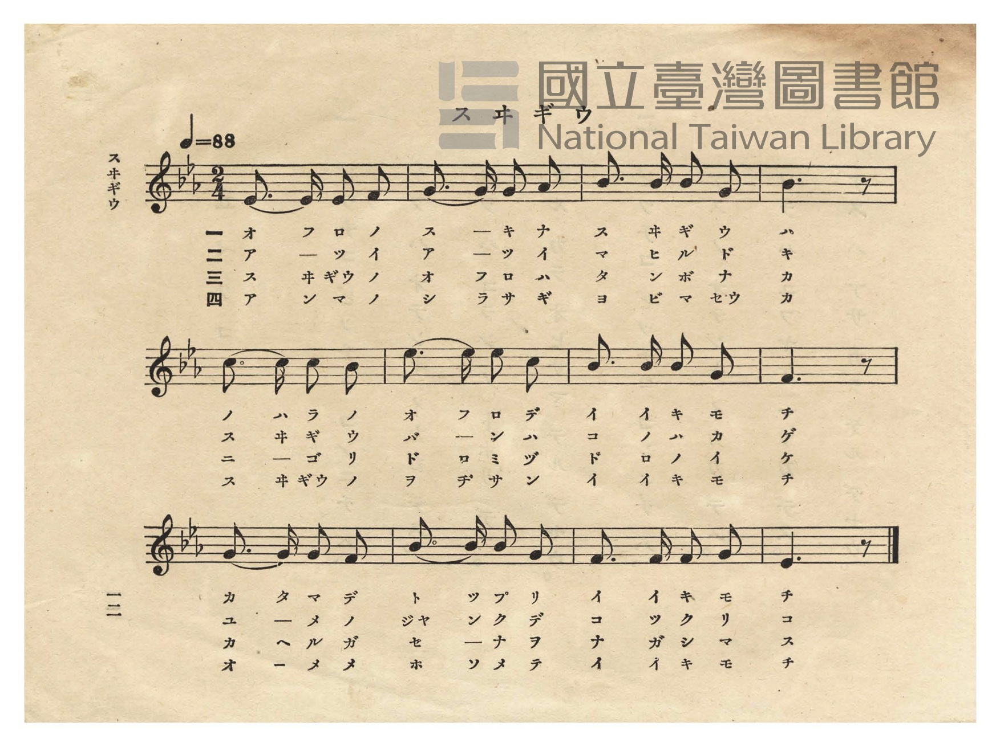
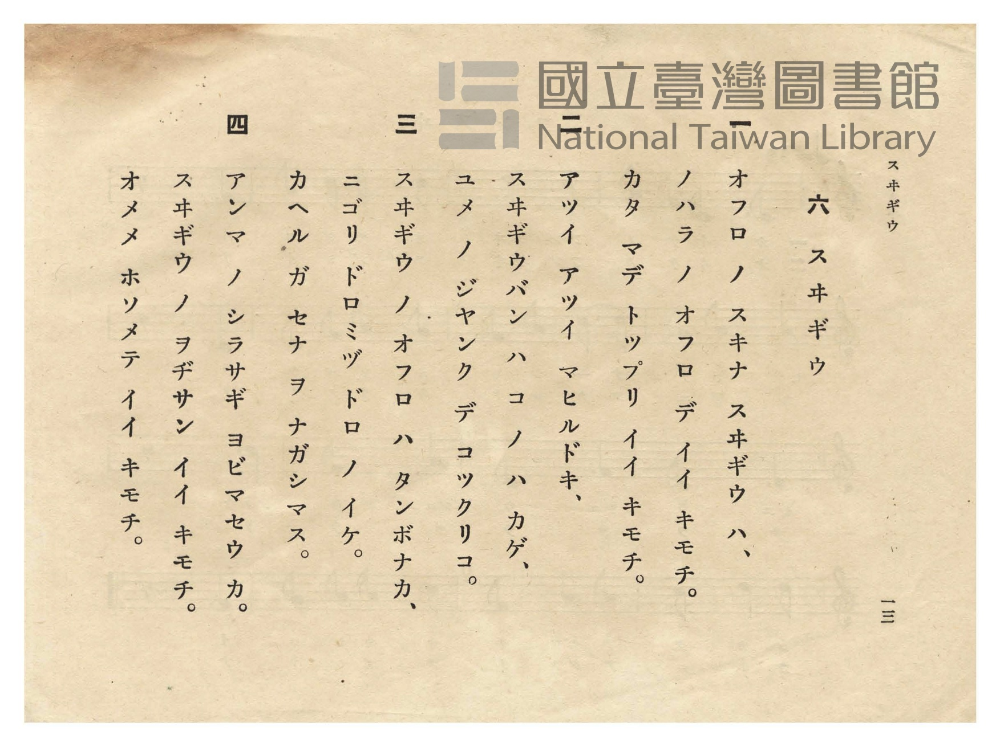

# スヰギウ（水牛）

> Re:Shōka 使用 AI 協助辨識與重建樂譜，可能會有錯誤。歡迎回報。

- **鋼琴伴奏版**：<br><audio controls src="suigyu.mp3"></audio>
- **NEUTRINO 歌聲合成版**：<br><audio controls src="suigyu_neutrino.mp3"></audio>

- 日治時期公學校唱歌（第二學年・第六課）
- 國立臺灣圖書館典藏

## 說明


- 出處：臺灣總督府編《公學校唱歌》第二學年用，第六課〈スヰギウ〉（水牛），原書第 12–13 頁（P014–P015）。
- 調性與拍號：變ホ調（Eb 大調），2/4 拍，速度 != 88。
- 背景與曲風：臺灣最具代表性的水牛童謠之一。歌詞前三節與《新定公學校唱歌集》尋常第一學年用第五課
〈スヰギウ〉（`shinte_kogakko_shokashu/3_05_suigyu`）相同，描寫愛泡水澡的水牛在田間泥水池泡到肩膀、
牧童（スヰギウバン）在樹蔭下打瞌睡、青蛙幫水牛洗背；本冊（1934 年版《公學校唱歌》第二學年用）特別
新增第四節「アンマ ノ シラサギ ヨビマセウ カ」（要不要叫按摩師白鷺鷥來呢？水牛伯伯真舒服，瞇起眼睛真舒服），
並重新譜寫為一首 12 小節、變ホ大調、2/4 拍的全新旋律，曲風悠閒溫厚。
- 版本說明：本檔案為原書單聲部五線譜之忠實數位化版本。

### 編曲說明（鋼琴伴奏版）：

1. 前奏 (Intro, 4 小節)：以第三行慵懶舒暢的五聲音階終止樂句引出午後田間水牛泡澡的愜意景象。
2. 主歌伴奏 (Suigyu, 12 小節 × 4 段)：右手演奏原曲歌唱旋律；左手以溫厚沉穩的二拍子和聲伴奏。


## 歌詞

```text
一
オフロ ノ スキナ スヰギウ ハ、
ノハラ ノ オフロ デ イイ キモチ。
カタ マデ トツプリ イイ キモチ。

二
アツイ アツイ マヒルドキ、
スヰギウバン ハ コ ノ ハ カゲ、
ユメ ノ ジヤンク デ コツクリコ。

三
スヰギウ ノ オフロ ハ タンボナカ、
ニゴリ ドロミヅ ドロ ノ イケ。
カヘル ガ セナ ヲ ナガシマス。

四
アンマ ノ シラサギ ヨビマセウ カ。
スヰギウ ノ ヲヂサン イイ キモチ。
オメメ ホソメテ イイ キモチ。
```

## ABC

<div class="abc-score" data-abc-src="suigyu.abc" aria-label="五線譜載入中"></div>

[下載 ABC 原始檔](suigyu.abc)

## TMD 檔案連結

- [主旋律 TMD 檔案](suigyu.tmd) [[在 TMD Studio 編輯](https://tmdlang.github.io/Tmd-TS/#tmd=s7IKdvYPcrWy4qpTUCpJTLdSSM7PyUlNLsnMz7PKzk9PzM7Ojy_OyM9OVIKrKMvPKc1NtUovSkxJjTdCiBfnlxYlp1oVJ2fk5-fEl6RWlCTl52cj5AuK8stS8xLzgGoKijLzSlJTwIoQClLLMlNSQdKpKZkl-UWZiTlIlqYWFYPcBLEkvqQoMa84uSizAORQhCqgpvTMPKuSxMzyxLz4_LS0zGSwKVpaCo-bdj5u3vC4ad3jpmXv93Q827Dleefs93s6FbS0uBRtFSwsuOxtFVyTuGyM9E3sQAY-m7702abdz2Y2PZsz_2nrmqdrdzxbsPDplI3P1vYA9T9fs-bJrh6g4NOdWx437wZyn7aufbFqE9BEsHOezul-vrr7Rfuu542Ln86Z9mz2jpdLVjxt3fFier8SF5e-loIttQCXgoLC44YJz2Zvej573YtVq57N6HvcMBEs2rz7afuuFzOnvt8zC-KS5zv2Pp-7-OmuOc-3r3jc0IXmrccN3cjeej5lxfs9PXCfPW7oQA7Dxw2dyMEIVPm0bz7Qm0D1CoZGjxomGxorvFzQCFQTYGBoAuQDKVOgwscNTVC3vVi1_1nD8hcd7c-6e1_MnA9y5Lqux82zgeJAXa5JCk-XLAezQYYDY0UBqA7Ietkw_-muZQrgOEMyrLnn2cz1IMNmb3q5COhwqI-fzWl42rr9ye7FLxauANr2fFYLxMnPVy99sWbBk53dT3Y0AE0B-v7FynlPO3uf7Oh8vr4BaA4weJ5N2_B03Sy0QHo5uw0YTk83dD_dAfIrUDs8tMCBNwUYVCA3gSIFS4AlFGeAkn48St4qzijVN443MI0vLs1MryxNAHr5-ewdTycAE1rPs_7-p-tXP2uZ_WzzQqDTn-1bCPfD0zkrnk_Z8HLa5Gebl4KkNi4AqnnaseFF08oXbUBfNULc8bxzOdC3QLtRXNM84XHzZqBFQEOerdj5YsraJzu6n3VOfj6v5_nchUC9L-dOejF75tOdqyF2PdsyHRjE7_fMfjZnzdO2LqBphpbGJgogj3d2EJeUOp937nzasRTiKFDYLpoHSlyzZwMD_HFDz-OmRUAXPW6eB4zOPmB23f64eeXjpq1A5wIFVjxungyUety0G-h2oOTqxw3AtNDxYlnjkx29QPJp_-pnPZ3PJq58umP185l7X27f9XL70if72p5OXPR-z3yIF57sWQ9Ez-fMf9Ex6dkcUFJ6Pq_9xdbtz-fseT53NpI4KL1BXPlkx7KX7b1At75YOwcYC8-bdgHj--WyacAUrvB0Qz_Y4Y2QVAtJrEAuNKUCY-lp6wqg1mfTu5_u6wbFJDhlPmta8HLapGe7Vj_tm4VIvsBABAYsJPcC0y6Q_WzVlGcLO4A2QrLV02nrXjRuetm8ApjCnm-fBXQPMO0-3b_g6fplz6bueLK392nPNIghIEOhZQJEKzRtgxzTDkzYT3asBTFWzXuxdj2woACG4tMNvc_aOxVAGVQvqyAdGABgA4BeBZvTtOpx89THzWuh8bLzcdPax81dKAUqUKofmt6AikCc5pVQ5QjN7UDeEiACUkADgJHdCPM_MDqb9gNVzAMrau543NzyuHn64-ZVuHSAoh7sAWBYPZ0259nahaDcgZQ1QMXRnBVA_79s7wMJ7lsIzB0vFi8ExvKzGcBiApoAkPPLs-0bkWWBNsEDYhc4OYATaAvEOXAWyM2THjevftzcCXIkNAwwMhoogIDCIBoYKGA20M_AMhUaZkBlC6EBtuNx8xJQRmhaDw0zYJ4A2rUeGBwgNmYAPG_qe9628XnLwmfrp4D8unbx094OYL31tKMN5MUp-0DF3awWSDEAze4TOyE5HhpOSxYBUwVIb0ff09buFx073-_Z_XRHG5ix98mOrpe7571csBapeECEzY5OdB9jRDzIt_vBeXsOMOGAMy_U292Pm4C1JzCagaHXDIzi-Y-bW6EcqCnA6N-IlEyaZwDDGshaA8S7wamweRMQAw1dAy4xgCXETixBBC3zwQnh6YImSMEJ9PLTJetAQbR9-7P9jSBZcDkKqkQ2L326HVSgguobcEEILEuezd7_vHPB047tkLLwRUsXUjgAizF4GiGhEIN6DD3wmjc9bm4C6QOlHFyZBhjACyHJZvbjpr1gThsxGYakQvNFQyO83ETOOZCi8-XsmaDSEzPbAK2kvGUDBQpa-lxcweCa0SogMzEv36HGoKYaXEDbGJpp2YFZNQqGCrpAaAimjYC4RsEYLGIMpk3AIqZgEVMwDRKFiUCgAUgEbJqPYQ0ogMGiwGQMxGvBrD6wHmB8QWX2gAIazOpCk9kAZK8DsYBRCpYB5gKsNhmBdC1CmNfcAta1BGoeThlgEoPITALi1WBWJ1QPyEVYbDLG7z6Q30B8UG6cClYDMgfhckgRvRksMwcqA_I1RA7kAiS7TJDdDir1QK5FhN92qAywkmjaCtYPcgvIxBVQmckwPU27oXpA7kS3Cxr1ZmAJMzANilBgYogDCwEpMAskgS32QekER-zDwgNUegHdiex6zHTRDpUBxQ0kjmDpAhQGINMasdsEjn3ccTIBKQRBsQCqQVBiC1KTgGU2Qd0ACUGssd_cDXXfFiAb5At4mgH7A8SfD8StWGXApTFY90b8NoHjnmA6A5fbTWAZUAoAyYD8Bgs9iE2wFAhJSSBdoHBEiXvkTA7J9rii2QhMQ0QghQXWiAcHJyy5Q5ItNHqbO6COaAHi6WAWKBDJjvhmSJKGVf0g_TuguqDmgYv_9chuACcAqBugMjA3QGSwRjzMT80zgBiSXNZAdYGyF6QAA0UJclEGUgFSuR2eFUGRipwVsUU8LHOA_LQQzJoN1bUXSaYNGlqoobcWGm6QUEPIINtUy8Wla6cAqQ4UgCxlLgA)]
- [鋼琴伴奏 TMD 檔案](suigyu_piano.tmd) [[在 TMD Studio 編輯](https://tmdlang.github.io/Tmd-TS/#tmd=s7IKdvYPcrWy4tLSUnjctPNx84bHTeseNy17v6fj2YYtzztnP27e_bJ7z_MJW57s2fJ0af_zzo73ezoVtLS4FG0VLCy47G0VXJO4bIz0Tey46hSUnk1f-mzT7mczm57Nmf-0dc3TtTueLVj4dMrGZ2t7gCY-X7Pmya4eoODTnVuA5gK5T1vXvli1CWiiEkj30zndz1d3v2jf9bxx8dM5057N3vFyyYqnrTteTO9X4uLS11KwpRbgUlBQeNww4dnsTc9nr3uxatWzGX2PGyaCRZt3P23f9WLm1Pd7ZkFc8nzH3udzFz_dNef59hWPG7rQvPW4oRvZW8-nrHi_pwfus8cNHcih-rihEx6wQE8DVT7tmw_0JlC9gqHRo4bJhsYKLxc0AtUEGBiaAPlAyhSo8HFDE9RtL1btf9aw_EVH-7Pu3hcz54Mcua7rcfNsoDhQl2uSwtMly8FskOHAWFEAqgOyXjbMf7prmQI4zhCGAT0EDAGI94G6MeMZaDxIqYKCoZ7C085eoLiChmdeSVG-joKJwtMN_c_XN2gC1TzZvRQUBjs6Xyzseda69Vn7thcdk57NWvR8VsuTXVNeNG56OX_zy1l9z7c2PVu76NmKpqf9S5_umQoM5qe9HU_39TyfsuHltMmQUHm2eeGzfQuBGp-1zHnW0v9s5voXGxdCXaygYKSn8GTHbmCoQxypoBFcmpleWaoDDDyocxQOTwc67dm6rSB3Pe3f_Kyz-9meKUC14IDeBNQKirbp3U_3db_fM_vp9mVABUDnP9u1-mnfrGebOp-vXAl2dQ8w3J6unfB0Ug_Q-RDboK6gPPFBgYKWPhcXODStAjIT8_KDPBxqDGqqwT61MTTTsgOzahSMFXSB0BhMGwFxjYIpWMQUTINEa8DiIFkQDRExBItAoAFIhKsWxTYfHLYZxgMVRxvGgiwAM01BTBRxJCbQLQhFuNRDSLgjIHGG388Q1xuCaYifkUPBBEcoQESQ_QwyzcewBli0rQKLPm6eCsRrwaw-sB5g9oTK7AGyITJdaDIbgOx1IFbTMohMcz92m4xAuhYhzGtuAetaAjUPp0zzPKjMJCBeDWZ1QvWAXITFJmP87gP5DcRfBfYxSA3IHITLHzftB7I3g2XmQGVAvobIgVyAZJcJsts3Q12LCL_tUJmVQPZWsH6QW0AmroDKTIbpadoN1QNyJ7pd0Kg3A0uYgWlQhAITQxxYCEiBWSAJ3HkAa-zDwgPoe5A7kV2PmS7aoTKguIHEESxdgMIAZFojdpvAsY87TiYghSAoFh43gcIfzXXg8HjctAnqBkgIYo395m6o-7YA2SBfwNMM2B8g_nwgbsUq0wf13-OmjfhtAsc9wXTWvAmIm8AyoBQAkgH5DRZ6EJtgKRCSkkC6QOGIEvfUKuoQ2R4UnLDkDkm20Oht7oA6ogWIp4NZoEAkO-KbIUn6cfNCaLA8btoB1QU1DxTxTeuR3QBOAFA3QGVgboDIYI14mJ-aZwAxJLmsgeoCZS9IAQaKEuSiDKQCpHI7PCuCIhU5K2KLeFjmAPlpIZg1G6prL5JMGzS0UENvLTTcIKGGkEG2Ca02oKBOIquuQni3RsEELGeCoQdJHIlJnh20r1t17RTAdTzYQiAHErrRPoax6CJGGCLGGCImcBFlLgA)]

## 分析

```text
================================================================================
📊 TMD Song Profile: [ スヰギウ（水牛） ]
================================================================================
⏱  Duration:       0:16 (16.4s), 12 measures total
🎼 Key & Tempo:    首調基準 E,, != 88.0 BPM, <2/4>
   - 分析範圍：      由實際發聲的音符與和弦推測調性；播放脈絡另行呈現
🎤 人聲音域:    D#4 (MIDI 63) – D#5 (MIDI 75) [跨度: 12 個半音 / 1.0 個八度, 難度: easy]
   - 最低音:  D#4 in [Suigyu #1 @ m.1, 0:00]
   - 最高音: D#5 in [Suigyu #1 @ m.6, 0:06]
   - 適合: soprano, mezzo-soprano, contralto, tenor, baritone, bass
🏛  結構:      Suigyu (16.4s)
⚡ 編曲密度:        Peak 1 軌道同時演奏
🗝  調性診斷：       D# 調性不明確（純淨自然大調，未偵測到可信轉調）
   - 風格氣質:    純淨自然大調（陽光明朗、易唱易記，無明顯調外色彩）
   - 轉調歷程:    全曲維持單一推測調性（未偵測到可信轉調）
   - 核心骨幹音:  A#, G, D#, F, C
   - 調性數值:    D# 調性不明確 [相關度: 0.82, 穩定度: Ambiguous, 自然音純度: 100.0%]
   - 候選調性 (K-S): D# 大調 (0.82), A# 大調 (0.80), G 小調 (0.70)
   - 五度圈歷程:   -3
   - 各段落調性細節:
     • [Suigyu #1]: D# 調性不明確 (r: 0.82, 自然音純度: 100.0%)

  [ 五度圈游移軌跡 ]
               C  
         F            G  
      Bb               D  
     [Eb]*              A  
         Ab           E  
            Db       B  
               F# 
     (* = active key center)

  [ 十二半音累積音高分佈 ]
     C  : ███████                    8.9%
     C# :                            0.0%
     D  :                            0.0%
     D# : █████████████████         20.0%
     E  :                            0.0%
     F  : ███████████████           17.8%
     F# :                            0.0%
     G  : ██████████████████        22.2%
     G# : ██                         2.2%
     A  :                            0.0%
     A# : ████████████████████████  28.9%
     B  :                            0.0%
--------------------------------------------------------------------------------
Assignment 軌道音域：
  - Piano         : D#4 – D#5 (12 個半音 / 1.0 個八度, 39 個音符)
================================================================================
```


## 原書掃描頁






