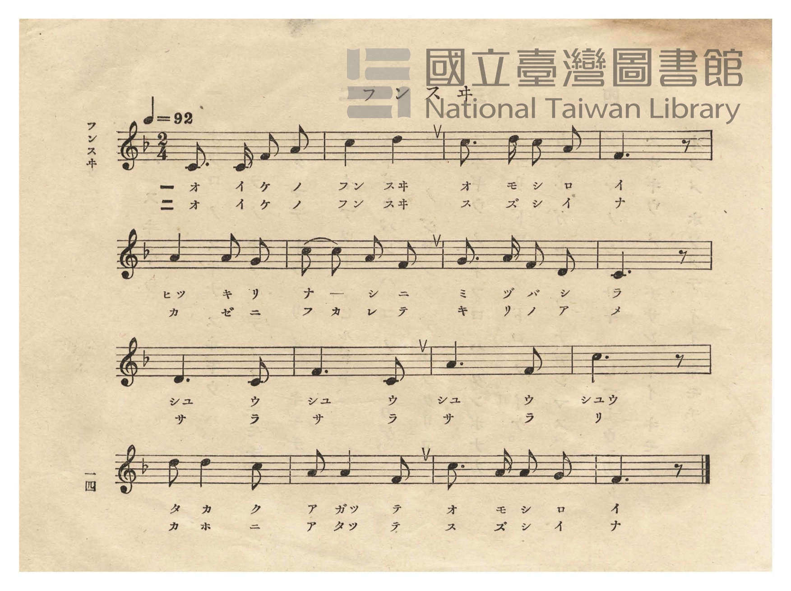
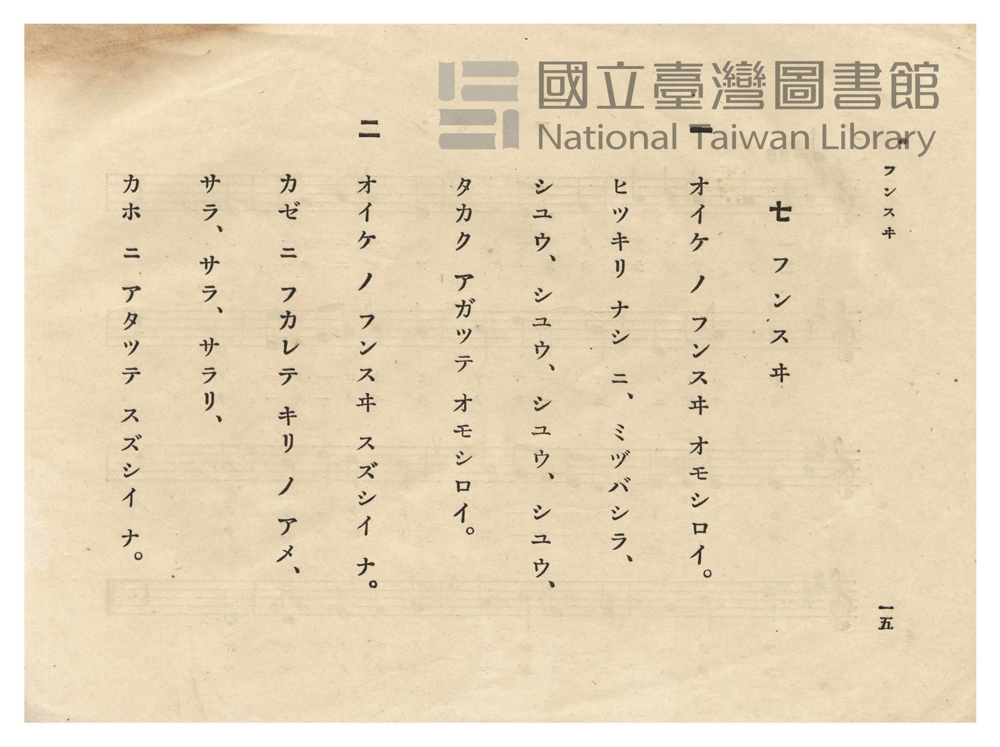

# フンスヰ（噴水）

> Re:Shōka 使用 AI 協助辨識與重建樂譜，可能會有錯誤。歡迎[回報](https://github.com/TMDLang/reshoka/issues)。

- **鋼琴伴奏版**：<br><audio controls src="funsui.mp3"></audio>
- **NEUTRINO 歌聲合成版**：<br><audio controls src="funsui_neutrino.mp3"></audio>

- 日治時期公學校唱歌（第二學年・第七課）
- 國立臺灣圖書館典藏

## 說明


- 出處：臺灣總督府編《公學校唱歌》第二學年用，第七課〈フンスヰ〉（噴水），原書第 14–15 頁（P016–P017）。
- 調性與拍號：ヘ調（F 大調），2/4 拍，速度 != 92。
- 背景與曲風：描寫公園池塘裡的噴水池（フンスヰ），水柱源源不絕「シユウ、シユウ」高高噴起，微風吹來
化作細霧水雨「サラ、サラ、サラリ」拂過臉龐的清涼感。第三行以四小節由低音 `6_ - 5_`、`1 - 5_`、
`3 - 1`、`5` 逐級向上攀升的音型，生動描繪水柱節節沖天的視覺效果。
- 版本說明：本檔案為原書單聲部五線譜之忠實數位化版本。

### 編曲說明（鋼琴伴奏版）：

1. 前奏 (Intro, 4 小節)：以分解琶音向上揚起再落下，模擬噴水池水柱沖天與水珠散落的晶瑩感。
2. 主歌伴奏 (Funsui, 16 小節 × 2 段)：右手演奏原曲歌唱旋律；左手以清澈流動的二拍子和聲伴奏。


## 歌詞

```text
一
オイケ ノ フンスヰ オモシロイ。
ヒツキリ ナシ ニ、ミヅバシラ、
シユウ、シユウ、シユウ、シユウ、
タカク アガツテ オモシロイ。

二
オイケ ノ フンスヰ スズシイ ナ。
カゼ ニ フカレテ キリ ノ アメ、
サラ、サラ、サラリ、
カホ ニ アタツテ スズシイ ナ。
```

## ABC

<div class="abc-score" data-abc-src="funsui.abc" aria-label="五線譜載入中"></div>

[下載 ABC 原始檔](funsui.abc)

## TMD 檔案連結

- [主旋律 TMD 檔案](funsui.tmd) [[在 TMD Studio 編輯](https://tmdlang.github.io/Tmd-TS/#tmd=s7IKdvYPcrWy4qpTUCpJTLdSSM7PyUlNLsnMz7PKzk9PzM7Ojy_OyM9OVIKrKMvPKc1NtUovSkxJjTdCiBfnlxYlp1oVJ2fk5-fEl6RWlCTl52cj5AuK8stS8xLzgGoKijLzSlJTwIoQClLLMlNSQdKpKZkl-UWZiTlIlqYWFYPcBLEkvqQoMa84uSizAORQhCqgpvTMPKuSxEygm0HuLk-Mz03MzMtJzEtBd2h8QWJ6qlWAgaGZLpAwRzakJCMf6LuCjEqrjMxikEuSE3PisxPzkAKhJCMVGAYpiZk5lfE5mWmpSlxaWgqPm6c-bt78uGnn4-YN7_d0PJ255dmGLe_3dCpoaXEp2ipYGnHZ2yq4cdkY6ZvYgUx6Nn3ps027n81sejZn_tPWNU_X7ni2YOHTKRufre0Ban--Zs2TXT1Awac7tzxu3g3i7mh-sWoT0ECwO57O6X6-uvtF-67njYufzpn2bPaOl0tWPG3d8WJ6vxIXl76Wgi21AJeCgsLjhgnPZm96Pnvdi1Wrns3oe9wwESzavPtp-64XM6e-3zML4pLnO_Y-n7v46a45z7eveNzQheatxw3dyN56PmXF-z09cJ89buhADsLHDZ3IoQhU-bRvPtCbQPUKhiaPGiYbmiq8XNAIVAOKRSAfFI9AhY8bmqBue7Fq_7OG5S862p91976YOR_oyMfNM4CCQC1uCk-XLAczQQYDY0QBqAbIetkw_-muZQrg6EIyqLnn2cz1IINmb3q5COjoWc_6-5-uXw3y3pxJzzYueLpwxovFC5_PaoE4FygCtAM1PYDsAUnN3_hs1wQgerKj9_nWqY8beh43bX_cvOxx07LHDY1I7N6Xq2cAEdDAF1u3gzy_bx3Q6qcTdj7Z1wZyloLC055pT_bOeb5lw8s5y4Emv5wNDHGgaVsfN68EG4XKaF4FNPNZd9PLxr4X7Z0v900AuvbZjtZn2_Y8a5kP9Co4GjpfLOx5snvp09mzn27of76-4fmUjU_29r2cv1khwSxeQVfBND4BaGKCIZwJcUmCMVDAECxlmqDwsmHC8y2znk6Y-GRH17MpDU9724FWAc14Oq8bFN1T5j_tngoMv-c7V0HCA2TP-oZnm6Y9XbISqPLFsmkvlu16NrXj2bw5iCh43tnxbM4aSOoDhf-cNc9WTXm2sON50y5Isng6bd2Lxk0vm1c82TXl-fZZL9bOebKz--n-BU_XL3s2dceTvb3A4IIYAjIUmqYhWoEp88XKeU9bVzyb1g6M5Cc71oIYq-a9WLsemNBBiXBD77P2TgVQAtPLKkgHRibYgCc7GsDmNK163LTkcdNGoDv7UEoBsFTzInCsrgWpgXln0uPmlsdNa4GRAuR0AeWBVDcorprnP25ufdw8AawFFHsQC7CmEJxsiJ79j5tWP25aD2QBHbAGZGFzGw4HAb0I8S4oZLGl5udz5j-b0_li22KgBkikAf3-bE7z09ZJT3bOByblp41znq1tByXTSbuBLkAjn87ZgJaakQ2EB-euHoLBufNx0y6Q65uWgAMOGp4gj-4BBSFYOZDXDPQvyLPQEAYaAwyE5oXwsMGTR6AqgGbMhpgICr798ODD6gCiwm_bnqf7Vz-d2ADU82LRakh2BoYiMEdDMjIwFwO5LzrWgDRu6AdmZ1CJsWnm06mgOEVjgNCcDcDs_HTOCmB2BuY0aKAi2QIKV6DjKK8AoEBBS5-Ly600r7g00yogMzEv36HGoKYaXALYGJpp2YFZNcCCAVgYgMoHBVAxASoZgGJgIV0FMygNEzED0xA1INUwaAASAZvnY1gDShFgUXCgA9MFkAWMUpAeYHRDZJo3g-IGyt4AkoHpaV4Eyj9g1lqIHqApWG0yItcmKK9pF8wmsA0gPV0YNkEDCeRlEATRRvAAgQUGKChqwOIgPogHLn3hYYs1kJonQR3VAkr4YBbIMzBnwAKhG0zOh8q0QvVMgMuvhAbSIjyBtBrqYUieA-kCBQ5MBpj7wGQbWA000MFugQQnxGxgdoTqWYErkMCehkGw11FTCVQIFpYgCAk5WHLDlpRAvoRBYIkJdQOIhouC1YDcjCoKUwszASIPFUcKna0oNsDCkwRRaFhhCxEgB5aHQJ6EeB4WAMieN0ZKWvhy1n6wFyARCmKthzoMHEVNoIiEOK0F6jRQpIJkQMUqRA0ssNbCzQClfmxJBlSkwswDJRuEPSBXYLdnJzhfIdkDz72QZA2xp5aLS9dOAVI2KQBZylwA)]
- [鋼琴伴奏 TMD 檔案](funsui_piano.tmd) [[在 TMD Studio 編輯](https://tmdlang.github.io/Tmd-TS/#tmd=s7IKdvYPcrWy4qpTUCpJTLdSSM7PyUlNLsnMz7PKzk9PzM7Ojy_OyM9OVIKrKMvPKc1NtTJCiBTnlxYlp-JSD5GNL0hMT7UKMDA00wUS5gjpgqL8stS8xDygASWJmeWJefHpQIGivPyi-PTUvNSixByE2tSyzJRUkMqCoszcxKLK-JT8ZKBb8kqQXJdaVAxyfEFmYl5-fGJRUWJeeiqqkvyikoz89KLEgoxKq4zM4pL8oszkxJz47MQ8JFeXZAB1WaUkZuZUxudkpqUqcWlpKTxunvq4efPjpp2Pmze839PxdOaWZxu2PG7e_bJ7z_MJW57s2fJ0af_zzo73ezoVtLS4FG0VLI247G0V3LhsjPRN7EBmP5u-9Nmm3c9mNj2bM_9p65qna3c8W7Dw6ZSNz9b2AA18vmbNk109QMGnO0HGgrg7ml-s2gQ0EOyyp3O6n6_uftG-63nj4qdzpj2bvePlkhVPW3e8mN6vxMWlr6VgSy3ApaCg8LhhwrPZm57PXvdi1apnM_oeN0wEizbvftq-68XMqe_3zIK45PmOvc_nLn66a87z7SseN3SheetxQzeyt55PWfF-Tw_cZ48bOpAD9XFDJzxcgZ4GqnzaNx_oTaB6BUOTRw2TDU0VXi5oBKoBpSQgH5SWgAofNzRB3fZi1f5nDctfdLQ_6-59MXM-0JGPm2cABYFa3BSeLlkOZoIMBsaIAlANkPWyYf7TXcsUwNGFMAjoGaDvIV4HasaMYqDRIKUKCoZ6Ck87e4HiChqeeSVF-ToKJgpPN_Q_X9-gCVTzZPfSpx1tL5Yvfj5h28v5m59OmPhkR9ez_lkvtm5_2tb7YsLeJzu6gY54tmLhs8lrID5_tnEBiJy_8dmmaU-XrAR5ZsOW5_0Lnk1dDFT_fFbLs5nbnk9c-axlPtS5CgpGegpPduwGBjfEhQoabqV5xaWZOgqGZlC3KByermCk8GzdVpCjnvZvftbZ_WzPFKBacAhvAmoFxdf07qf7gM6Z_XT7MqACoNuf7Wh9tq_j2dbGp91TgTYD4xEYaE_XTng6qedF4yaIbVBXUJ7qoEBBS5-LCxyUVgGgbBzk4VBjUFMN9qmNoZmWHZhVo2Aar6ALhEDKEEgZAzFQDCykq2AGpWEixmB5I7AISDUMGoBEuGpR7PNBts8Cbp1hvEK0YSyMgvNNgJQJiA90R7RpLIyCy4OwAcQOSKRQz1NmYBqiBtNTIPN8DGsUHjetAos-bloCxBtBrOY-sB5g1oPING8GyuyEq0LS07wIyN4OZq2F6AHKY7XJiFybYLxdMJvANoD0dGHYBA0kkJchsQqLU1BAwAIDFBQ1YHEQH8QzAwUqPGyxBlLzJKgDW4AOAHn1cTPIMzBnwAKhG0zOhwbFLqieCXD5lVCZRXgCaTXUw3vg5oECBybzuHkNmGwDq4EGOtgtkOCEmP24eSFUzwpcgQT2NAyCvY6aSqBCsLAEQUjIwZIbtqQE8iUMPm5eBnUDiIaLgtWA3IwqClMLMwEiDxVHCp2tKDbAwpMEUWhYYQsRIAeWh0CehHgeFgDInsdfXCCCYz_YC5AIBbHWQx0GjqImUERCnNYCdRooUkEyq8A5Czmw1sLNAKV-bEnmcfNsuHmgZIOwB-QK7PbshCZSuD3w3AtJ1vDiD7loIrP8wyEPpEDFH4oZ6GUkXA9UwiweSJvlopaqCFOgVmKxCTufHDMIl-a6dgrgSgNsIJADCcJoH8NYdBEjuIgyFwA)]

## 分析

```text
================================================================================
📊 TMD Song Profile: [ フンスヰ（噴水） ]
================================================================================
⏱  Duration:       0:20 (20.9s), 16 measures total
🎼 Key & Tempo:    首調基準 F, != 92.0 BPM, <2/4>
   - 分析範圍：      由實際發聲的音符與和弦推測調性；播放脈絡另行呈現
🎤 人聲音域:    C4 (MIDI 60) – D5 (MIDI 74) [跨度: 14 個半音 / 1.2 個八度, 難度: moderate]
   - 最低音:  C4 in [Funsui #1 @ m.1, 0:00]
   - 最高音: D5 in [Funsui #1 @ m.2, 0:01]
   - 適合: soprano, mezzo-soprano, contralto, tenor, baritone, bass
🏛  結構:      Funsui (20.9s)
⚡ 編曲密度:        Peak 1 軌道同時演奏
🗝  調性診斷：       F 大調（純淨自然大調，未偵測到可信轉調）
   - 風格氣質:    純淨自然大調（陽光明朗、易唱易記，無明顯調外色彩）
   - 轉調歷程:    全曲維持單一推測調性（未偵測到可信轉調）
   - 核心骨幹音:  C, F, A, D, G
   - 調性數值:    F 大調 [相關度: 0.84, 穩定度: Moderate, 自然音純度: 100.0%]
   - 候選調性 (K-S): F 大調 (0.84), A 小調 (0.73), C 大調 (0.69)
   - 五度圈歷程:   -1
   - 各段落調性細節:
     • [Funsui #1]: F 大調 (r: 0.84, 自然音純度: 100.0%)

  [ 五度圈游移軌跡 ]
               C  
        [F ]*          G  
      Bb               D  
      Eb               A  
         Ab           E  
            Db       B  
               F# 
     (* = active key center)

  [ 十二半音累積音高分佈 ]
     C  : ████████████████████████  31.7%
     C# :                            0.0%
     D  : ████████████              15.8%
     D# :                            0.0%
     E  :                            0.0%
     F  : ██████████████████        23.3%
     F# :                            0.0%
     G  : ████                       5.8%
     G# :                            0.0%
     A  : ██████████████████        23.3%
     A# :                            0.0%
     B  :                            0.0%
--------------------------------------------------------------------------------
Assignment 軌道音域：
  - Piano         : C4 – D5 (14 個半音 / 1.2 個八度, 41 個音符)
================================================================================
```


## 原書掃描頁






