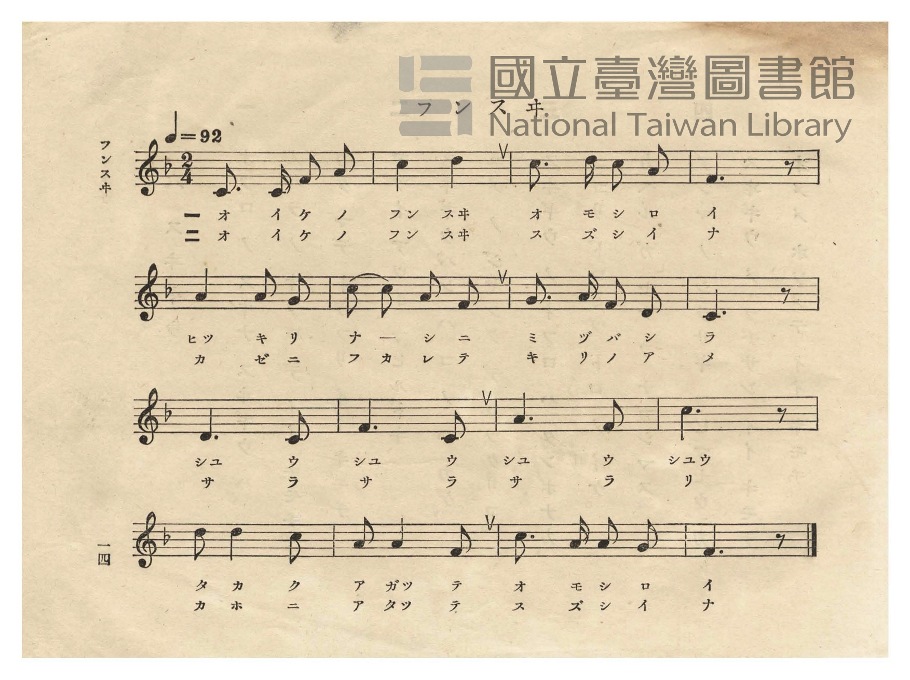
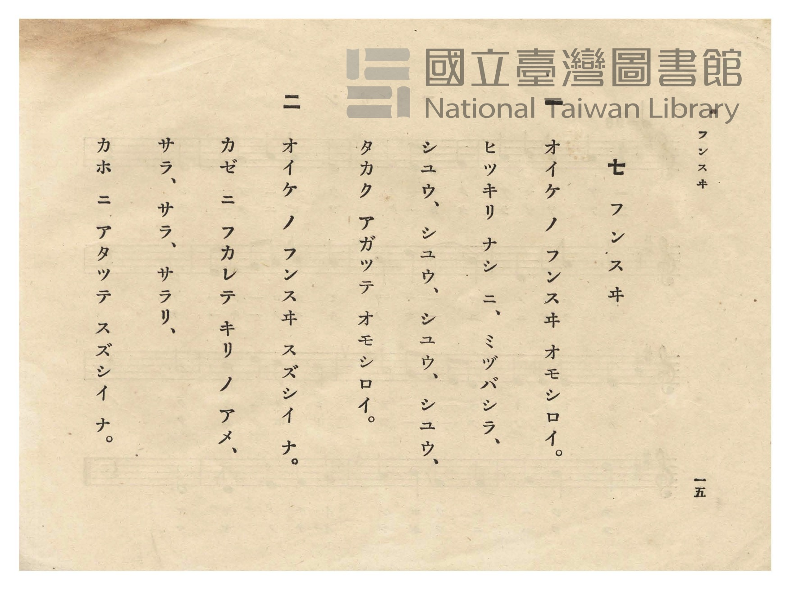

# フンスヰ（噴水）

> Re:Shōka 使用 AI 協助辨識與重建樂譜，可能會有錯誤。歡迎回報。

- **NEUTRINO 歌聲合成版**：<br><audio controls src="funsui_neutrino.mp3"></audio>
- **鋼琴伴奏版**：<br><audio controls src="funsui.mp3"></audio>


- 日治時期公學校唱歌（第二學年・第七課）
- 國立臺灣圖書館典藏

## 說明


- 出處：臺灣總督府編《公學校唱歌》第二學年用，第七課〈フンスヰ〉（噴水），原書第 14–15 頁（P016–P017）。

- 調性與拍號：ヘ調（F 大調），2/4 拍，速度 != 92。

- 背景與曲風：描寫公園池塘裡的噴水池（フンスヰ），水柱源源不絕「シユウ、シユウ」高高噴起，微風吹來

化作細霧水雨「サラ、サラ、サラリ」拂過臉龐的清涼感。第三行以四小節由低音 `6_ - 5_`、`1 - 5_`、
`3 - 1`、`5` 逐級向上攀升的音型，生動描繪水柱節節沖天的視覺效果。
- 版本說明：本檔案為原書單聲部五線譜之忠實數位化版本。


### 編曲說明（鋼琴伴奏版）：

1. 前奏 (Intro, 4 小節)：以分解琶音向上揚起再落下，模擬噴水池水柱沖天與水珠散落的晶瑩感。
2. 主歌伴奏 (Funsui, 16 小節 × 2 段)：右手演奏原曲歌唱旋律；左手以清澈流動的二拍子和聲伴奏。


## 跨冊／重複收錄參照

> 同曲（《公學校唱歌》、《新定兒童唱歌》共同收錄教材）

- **[同曲]** 《新定兒童唱歌》尋常科第一學年用（2020.006.0847.0001）：[**〈フンスヰ（噴泉）〉**](../../../shintei_jido_shoka/grade_1_2020.006.0847.0001/2_02_funsui/index.md)（`F` / `2/4` — [原始 TMD](../../../shintei_jido_shoka/grade_1_2020.006.0847.0001/2_02_funsui/funsui.tmd)）
- 總表：[跨冊重複與同名歌曲總索引](../../../duplicate_songs.md)

## 歌詞

```text
一
オイケ ノ フンスヰ オモシロイ。
ヒツキリ ナシ ニ、ミヅバシラ、
シユウ、シユウ、シユウ、シユウ、
タカク アガツテ オモシロイ。

二
オイケ ノ フンスヰ スズシイ ナ。
カゼ ニ フカレテ キリ ノ アメ、
サラ、サラ、サラリ、
カホ ニ アタツテ スズシイ ナ。
```

## ABC

```abc
X:1
T:フンスヰ（噴水）
M:2/4
L:1/16
Q:1/4=92
K:F
V:V1 name="Piano" snm="Pia"
[V:V1]
C3 C F2 A2 | c4 d4 | c3 d c2 A2 | F6 z2 |
w: 1.~オ イ ケ ノ | フ ス | オ モ シ ロ | イ
w: 2.~オ イ ケ ノ | フ ス | ス ズ シ イ | ナ
A4 A2 G2 | c2 c2 A2 F2 | G3 A F2 D2 | C6 z2 |
w: 1.~ヒ キ リ | ナ シ ニ ミ | ヅ バ シ ラ | ア
w: 2.~カ ニ フ | カ レ テ キ | リ ノ ア メ | エ
D6 C2 | F6 C2 | A6 F2 | c6 z2 |
w: 1.~シ ユ | ウ シ | ユ ウ | シ
w: 2.~サ ラ | サ ラ | サ ラ | リ
d2 d4 c2 | A2 A4 F2 | c3 A A2 G2 | F6 z2 |
w: 1.~タ カ ク | ア ガ ツ | テ オ モ シ | ロ
w: 2.~カ ホ ニ | ア タ ツ | テ ス ズ シ | イ
```

## TMD 檔案連結

- [主旋律 TMD 檔案](funsui.tmd) [[在 TMD Studio 編輯](https://tmdlang.github.io/Tmd-TS/#tmd=s7IKdvYPcrWy4qpTUCpJTLdSSM7PyUlNLsnMz7PKzk9PzM7Ojy_OyM9OVIKrKMvPKc1NtUovSkxJjTdCiBfnlxYlp1oVJ2fk5-fEl6RWlCTl52cj5AuK8stS8xLzgGoKijLzSlJTwIoQClLLMlNSQdKpKZkl-UWZiTlIlqYWFYPcBLEkvqQoMa84uSizAORQJS4tLYXHzVMfN29-3LTzcfOG93s6ns7c8mzDlvd7OhW0tLgUbRUsjbjsbRXcuGyM9E3sQKY-m7702abdz2Y2PZsz_2nrmqdrdzxbsPDplI3P1vYAtT9fs-bJrh6g4NOdWx437wZxdzS_WLUJaCDYTU_ndD9f3f2ifdfzxsVP50x7NnvHyyUrnrbueDG9X4mLS19LwZZagEtBQeFxw4Rnszc9n73uxapVz2b0PW6YCBZt3v20fdeLmVPf75kFccnzHXufz138dNec59tXPG7oQvPW44ZuZG89n7Li_Z4euM8eN3QgB-Hjhk7kUASqfNo3H-hNoHoFQ5NHDZMNTRVeLmgEqgkwMDQD8oGUOVDh44YmqNterNr_rGH5i472Z929L2bOBzrycfMMoCBQi5vC0yXLwUyQwcAYUQCqAbJeNsx_umuZAji6kAxq7nk2cz3IoNmbXi4COnrWs_7-p-tXg7w3Z9KzjQueLpzxYvHC57NaIM4FigDtQE0PIHtAUvM3Pts1AYie7Oh9vnXq44aex03bHzcve9y07HFDIxK79-XqGUAENPDF1u0gz-9bB7T66YSdT_a1gZyloPC0Z9qTvXOeb9nwcs5yoMkvZwNDHGja1sfNK8FGoTKaVwHNfNbd9LKx70V758t9E4Cufbaj9dm2Pc9a5gO9Co6GzhcLe57sXvp09uynG_qfr294PmXjk719L-dvVkgwi1fQVTCNTwCamGAIZ0JckmAMFDAES5kmKLxsmPB8y6ynEyY-2dH1bErD0952oFVAM57O6wZF95T5T7unAsPv-c5VkPAA2bO-4dmmaU-XrASqfLFs2otlu55N7Xg2bw4iCp53djybswaS-kDhP2fNs1VTni3seN60C5Isnk5b96Jx08vmFU92TXm-fdaLtXOe7Ox-un_B0_XLnk3d8WRvLzC4IIaADIWmaYhWYMp8sXLe09YVz6a1AyP5yY61IMaqeS_WrgcmdFAi3ND7rL1TAZTA9LIK0oGRCTbgyY4GsDlNqx43LXnctBHozj6UUgAs1bwIHKtrQWpg3pn0uLnlcdNaYKQAOV1AeSDVDYqr5vmPm1sfN08AawHFHsQCrCkEJxuiZ__jptWPm9YDWUAHrAFZ2NyGw0FAL0K8CwpZbKn5-Zz5z-Z0vti2GKgBEmlAvz-b0_y0ddKTnfOBSflp45xna9tByXTSbqAL0MinczagpWZkA-HBuauHYHDufNy0C-T6piXggIOGJ8ije0BBCFYO5DUD_QvyLDSEgcYAA6F5ITxs8OQRqAqgGbMhJoKCbz88-LA6gKjw27bn6f7VTyc2APW8WLQakp2BoQjM0ZCMDMzFQO6LjjUgjRv6gdkZVGJsmvl0KihO0RggNGcDMDs_nbMCmJ2BOQ0aqEi2gMIV6DjKKwAoUNDS5-JyK80rLs20CshMzMt3qDGoqQaXADaGZlp2YFYNsGAAFgag8kEBVEyASgagGFhIV8EMSsNEzMA0RA1INQwagETA5vkY1oBSBFgUHOjAdAFkAaMUpAcY3RCZ5s2guIGyN4BkYHqaF4HyD5i1FqIHaApWm4zItQnKa9oFswlsA0hPF4ZN0EACeRkEQbQRPEBggQEKihqwOIgP4oFLX3jYYg2k5klQR7WAEj6YBfIMzBmwQOgGk_OhMq1QPRPg8iuhgbQITyCthnoYkudAukCBA5MB5j4w2QZWAw10sFsgwQkxG5gdoXpW4AoksKdhEOx11FQCFYKFJQhCQg6W3LAlJZAvYRBYYkLdAKLhomA1IDejisLUwkyAyEPFkUJnK4oNsPAkQRQaVthCBMiB5SGQJyGehwUAsueNkZIWvpy1H-wFSISCWOuhDgNHURMoIiFOa4E6DRSpIBlQsQpRAwustXAzQKkfW5IBFakw80DJBmEPyBXY7dkJzldI9sBzLyRZQ-yp5eLStVOAlE0KQJYyFwA)]
- [鋼琴伴奏 TMD 檔案](funsui_piano.tmd) [[在 TMD Studio 編輯](https://tmdlang.github.io/Tmd-TS/#tmd=s7IKdvYPcrWy4tLSUnjcPPVx8-bHTTsfN294v6fj6cwtzzZsedy8-2X3nucTtjzZs-Xp0v7nnR3v93QqaGlxKdoqWBpx2dsquHHZGOmb2HHVKSg9m7702abdz2Y2PZsz_2nrmqdrdzxbsPDplI3P1vYADXy-Zs2TXT1Awac7QcaCuDuaX6zaBDRQCaT76Zzu56u7X7Tvet64-Omcac9m73i5ZMXT1h0vpvcrcXHpaynYUgtwKSgoPG6Y8Gz2puez171YterZjL7HDRPBos27n7bvejFz6vs9syAueb5j7_O5i5_umvN8-4rHDV1o3nrc0I3sredTVrzf0wP32eOGDuRAfdzQCQ9XoKeBKp_2zQd6E6hewdDkUcNkQ1OFlwsagWoCDAzNgHwgZQ5U-LihCeq2F6v2P2tY_qKj_Vl374uZ84GOfNw8AygI1OKm8HTJcjATZDAwRhSAaoCslw3zn-5apgCOLoRBQM8AfQ_xOlAzZhQDjQYpVVAw1FN42tkLFFfQ8MwrKcrXUTBReLqh__n6Bk2gmie7lz7taHuxfPHzCdtezt_8dMLEJzu6nvXPerF1-9O23hcT9j7Z0Q10xLMVC59NXgPx-bONC0Dk_I3PNk17umQlyDMbtjzvX_Bs6mKg-uezWp7N3PZ84spnLfOhzlVQMNJTeLJjNzC4IS5U0HArzSsuzdRRMDSDukXh8HQFI4Vn67aCHPW0f_Ozzu5ne6YA1YJDeBNQKyi-pnc_3Qd0zuyn25cBFQDd_mxH67N9Hc-2Nj7tngq0GRiPwEB7unbC00k9Lxo3QWyDuoLyVAcFClr6XFzgoLQKyEzMyw_ycKgxqKkG-9TG0EzLDsyqUTCNV9AFQiBlCKSMgRgoBhbSVTCD0jARY7C8EVgEpBoGDUAiXLUo9vngsM8QZF-0YSyQRGKiiJuAmSYQcbD7ok1BHCQminoICXcEJNao52szMA1Rg-lrkHk-hjUKj5tWgUUfNy0B4o0gVnMfWA8wb0JkmjcDZXZC2RtAMjA9zYuA7O1g1lqIHqApWG0yItcmKK9pF8wmsA0gPV0YNkEDCeRlSLTDIh0UELDAAAVFDVgcxAfxzECBCg9brIHUPAnqqBagA0BefdwM8gzMGbBA6AaT86EyrVA9E-DyK6GBtAhPIK2GengP3DxQ4MBkHjevAZNtYDXQQAe7BRKcELMfNy-E6lmBK5DAnoZBsNdRUwlUCBaWIAgJOVhyw5aUQL6EwcfNy6BuANFwUbAakJtRRWFqYSZA5KHiSKGzFcUGWHiSIAoNK2whAuTA8hDIkxDPwwIA2fP4yxNEcOwHewESoSDWeqjDwFHUBIpIiNNaoE4DRSpIZhU4ZyEH1lq4GaDUjy3JPG6eDTcPlGwQ9oBcgd2eneB8hWQPPPdCkjXWoolaBSQR6sFMhGdR5HAVqihmISkyiwezzXKxF8_ItiA5E6_LCIlT0w7SqxNdOwVwtQa2EMiBxGG0j2EsuogRXESZCwA)]

## 分析

```text
================================================================================
📊 TMD Song Profile: [ フンスヰ（噴水） ]
================================================================================
⏱  Duration:       0:20 (20.9s), 16 measures total
🎼 Key & Tempo:    首調基準 F, != 92.0 BPM, <2/4>
   - 分析範圍：      由實際發聲的音符與和弦推測調性；播放脈絡另行呈現
🎤 人聲音域:    C4 (MIDI 60) – D5 (MIDI 74) [跨度: 14 個半音 / 1.2 個八度, 難度: moderate]
   - 最低音:  C4 in [Funsui #1 @ m.1, 0:00]
   - 最高音: D5 in [Funsui #1 @ m.2, 0:01]
   - 適合: soprano, mezzo-soprano, contralto, tenor, baritone, bass
🏛  結構:      Funsui (20.9s)
⚡ 編曲密度:        Peak 1 軌道同時演奏
🗝  調性診斷：       F 大調（純淨自然大調，未偵測到可信轉調）
   - 風格氣質:    純淨自然大調（陽光明朗、易唱易記，無明顯調外色彩）
   - 轉調歷程:    全曲維持單一推測調性（未偵測到可信轉調）
   - 核心骨幹音:  C, F, A, D, G
   - 調性數值:    F 大調 [相關度: 0.84, 穩定度: Moderate, 自然音純度: 100.0%]
   - 候選調性 (K-S): F 大調 (0.84), A 小調 (0.73), C 大調 (0.69)
   - 五度圈歷程:   -1
   - 各段落調性細節:
     • [Funsui #1]: F 大調 (r: 0.84, 自然音純度: 100.0%)

  [ 五度圈游移軌跡 ]
               C  
        [F ]*          G  
      Bb               D  
      Eb               A  
         Ab           E  
            Db       B  
               F# 
     (* = active key center)

  [ 十二半音累積音高分佈 ]
     C  : ████████████████████████  31.7%
     C# :                            0.0%
     D  : ████████████              15.8%
     D# :                            0.0%
     E  :                            0.0%
     F  : ██████████████████        23.3%
     F# :                            0.0%
     G  : ████                       5.8%
     G# :                            0.0%
     A  : ██████████████████        23.3%
     A# :                            0.0%
     B  :                            0.0%
--------------------------------------------------------------------------------
Assignment 軌道音域：
  - Piano         : C4 – D5 (14 個半音 / 1.2 個八度, 41 個音符)
================================================================================
```


## 原書掃描頁






