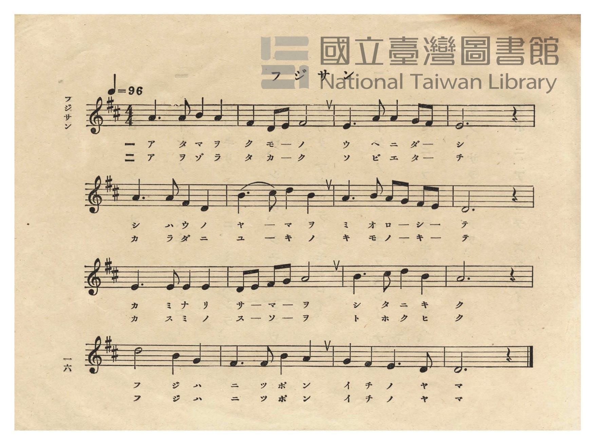
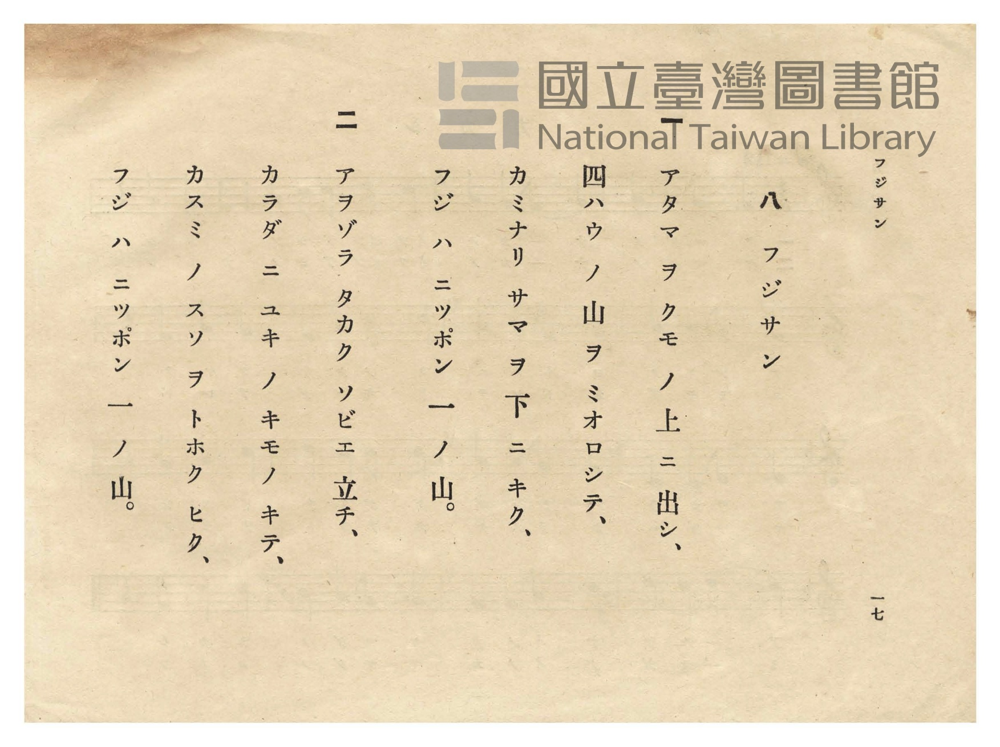

# フジサン（富士山）

> Re:Shōka 使用 AI 協助辨識與重建樂譜，可能會有錯誤。歡迎回報。

- **NEUTRINO 歌聲合成版**：<br><audio controls src="fujisan_neutrino.mp3"></audio>
- **鋼琴伴奏版**：<br><audio controls src="fujisan.mp3"></audio>


- 作詞：巖谷小波（文部省尋常小學唱歌）
- 日治時期公學校唱歌（第二學年・第八課）
- 國立臺灣圖書館典藏

## 說明


- 出處：臺灣總督府編《公學校唱歌》第二學年用，第八課〈フジサン〉（富士山），原書第 16–17 頁（P018–P019）。

- 調性與拍號：ニ調（D 大調），4/4 拍，速度 != 96。

- 背景與曲風：原出自 1910 年《尋常小學讀本唱歌》及 1911 年《尋常小學唱歌（二）》第一課〈富士山〉

（亦收錄於《新定公學校唱歌集》第三學年用第十二課 `3_12_fujisan`），描寫富士山高聳入雲、俯瞰四方群山、
身披白雪與雲霞裙裾的雄偉姿態。
- 版本說明：本檔案為原書單聲部五線譜之忠實數位化版本。


### 編曲說明（鋼琴伴奏版）：

1. 前奏 (Intro, 4 小節)：取全曲第四行「フジハ ニッポン 一ノ山」莊嚴寬廣的終止樂句作為前奏。
2. 主歌伴奏 (Fujisan, 16 小節 × 2 段)：右手演奏原曲歌唱旋律；左手以穩重開闊的四拍子和聲伴奏。


## 歌詞

```text
一
アタマ ヲ クモ ノ 上 ニ 出シ、
四ハウ ノ 山 ヲ ミオロシテ、
カミナリ サマ ヲ 下 ニ キク、
フジ ハ ニッポン 一 ノ 山。

二
アヲゾラ タカク ソビエ 立チ、
カラダ ニ ユキ ノ キモノ キテ、
カスミ ノ スソ ヲ トホク ヒク、
フジ ハ ニッポン 一 ノ 山。
```

## ABC

```abc
X:1
T:フジサン（富士山）
M:4/4
L:1/16
Q:1/4=96
K:D
V:V1 name="Piano" snm="Pia"
[V:V1]
A6 A2 B4 A4 | F4 D2 E2 F8 | E6 A2 A4 G2 F2 | E12 z4 |
w: 1.~ア タ マ ヲ | ク モ ノ ウ | ニ ダ シ ー _ | イ
w: 2.~ア ヲ ゾ ラ | タ カ ク ソ | エ タ チ ー _ | イ
A6 A2 F4 D4 | B6 c2 d4 B4 | A6 B2 A2 G2 F2 E2 | D12 z4 |
w: 1.~シ ハ ウ ノ | ヤ マ ヲ ミ | オ ロ シ _ テ _ | エ
w: 2.~カ ラ ダ ニ | ユ キ ノ キ | モ ノ キ _ テ _ | エ
E6 E2 E4 E4 | D2 E2 F2 G2 A8 | B6 c2 d4 B4 | A12 z4 |
w: 1.~カ ミ ナ リ | サ マ ヲ ー シ | ニ キ ク ウ | ウ
w: 2.~カ ス ミ ノ | ス ソ ヲ ー ト | ク ヒ ク ウ | ウ
d8 B4 G4 | F6 F2 B4 A4 | G4 F4 E6 D2 | D12 z4 |
w: 1.~フ ジ ハ | ニ ッ ポ ン | イ チ ノ ヤ | マ
w: 2.~フ ジ ハ | ニ ッ ポ ン | イ チ ノ ヤ | マ
```

## TMD 檔案連結

- [主旋律 TMD 檔案](fujisan.tmd) [[在 TMD Studio 編輯](https://tmdlang.github.io/Tmd-TS/#tmd=s7IKdvYPcrWy4qpTUCpJTLdSSM7PyUlNLsnMz7PKzk9PzM7Ojy_OyM9OVIKrKMvPKc1NtUovSkxJjTdCiBfnlxYlp1oVJ2fk5-fEl6RWlCTl52cj5AuK8stS8xLzgGoKijLzSlJTwIoQClLLMlNSQdKpKZkl-UWZiTlIlqYWFYPcBLEkvqQoMa84uSizAORQJS4tLYXHzVMfN-143LT1cfPm93s6nq7vebp49dONG9_v6VTQ0uJStFWwNOOyt1Vw4bIx0TexAxn8bPrSZ5t2P5vZ9GzO_Keta56u3fFswcKnUzY-W9sDNOH5mjVPdvUABZ_u3PK4eTeQ-7R19YtVm4AGgp31ZO-cFyvnvd8z6-n2aS82bH-6of_Z5kVAfc-mtb9sXvF8TuPTDd1Pd-wAioPMgJoK0fp0Tvfz1d0v2nc9b1z8dM60Z7N3vFyy4mnrjhfT-5W4uPS1FGypBbgUFBQeN0x4NnvT89nrXqxa9WxG3-OGiWDR5t1P23e9mDkV6AOIS57v2Pt87uKnu-Y8377icUMXWog8buhGDpHnU1a839MDD5THDR3IEfC4oRMtDoCKn_bNB_oUqEXB0OxRw2RDc4WXCxqBygIMDC2AfCBlCVT4uKEJ6rwXq_Y_a1j-oqP9WXfvi5nzge583NwNFARqcVF4umQ5mAkyGBifCkA1QNbLhvlPdy1TAEc2kkHNPc9mrgcZNHvTy0VAd88COgXk-fZVCoaWhgYKoBgGehgpvl6sa3g2Zw3c50_7u0AqDbGohKcXYNCAnQ8Oph0NkECBBwEwRECuUVAAq1z2bMq2lz0tz6btAZr2bNqGp-tmoQX3y9ltMKM64SEOCu7eRqBFQMMVEozjDY3i00qzMosT8xIgIfGsv__p-tVwS1-unvGicfPT1qUvZwMd0_hk__rn8zY8nT372bSdz_ctAbuqEeKqF7tWP-ta_Xzm3pezVwEDCqj-5Zx5LxbPfLF43_NZLS9ntzxt7Hy6fP-z1m5EsD7v7ACGESRRAcMUyH62asqzhR3Pm3ZBovrptHUvGjcBM8OTXVOeb5_1Yu2cJzu7n-5f8HT9smdTdzzZ2_u0ZxrEEJCh0KQK0QoMAWDmetq6ApibgO55smMtiLFq3ou164HpF5S2NvQ-a-9UACUavayCdKD3wQYAAx5sTtOix037HzfPA7pzE5C3_nHzIiCzDyjfBaS7FYCx_7hpO9T7wBB53Nz_uGkZWAkwWCC6muc_blr1uHktSGEzMDbAah83rQZJNHc9bl4F5AATO8SOJzu6wQY_bgKqB7oRohicJYBUP0jucXPz4-a5wNwBciXMKmhwAn0E8R0oILu6Xi5Y-2TPDqAjgRHxfPV6YLABHQ6MX0gMvpg4Hejkl3MXAfMeKCpntUBiE5TH5qx40br56a6pQPe8aNwLVPly9nZg0nqxd_7LzVtACmBp49mM9aDyb84aSHIFxfLqGRAHwQNzVw8sMJs3PW7a97h5JZCzHxQETeuBrL2Pmyc_blqhACzLHjc3IgfQysfNIB-CgmQZMETAngWFTDPQJCgLOUCbdgLDFKpoJ9BcaPgDi5TZYJuaJ1EapkC_QTID0K2gMJoy68X03qdLVj5fuQsYUsBwAWYAYBA_X7kfGGSQbPB855RnHROA4fJi4eIXi4F1Ss_LxgVA9KwbWGBvBocsKJMAFQBNeDZ5FwmBC3Qc5UU7FCho6XNxuUFKAauAzMS8fIcag5pqcLa2sdCyAzNqFEwVdIHQVMEMTOoCRYyBpKGCEZgGwRogG6IGJG8CFIeJQKABSA3YNB_DGlCiAIsC0wMw2OeBWMA4A5kCijEQD5LhQLkKrK55BkgOmCQgPGBkNW0Hs_ZAdS3BbpcRkl3gvLwPzFoJ1bUf7IbVYFtBKQeibjJYbgWSCxsJ2IUWTJDAASkGBZiugrmCYRyQAnFgisyANCiUjIAiIKW4wgnkS5DdwPQKDgtQqIBd0QxxBawEAbHmQ923CioDzDnQUGqDykD8hD2UVkN1AXMpMHxBLFBog2yCxgE0J0JYEBlYyIJzJQGboGEESRRGYBqEQd4HJSMTaMDgDTXsYQRzOagQ6AKzQCEAktkKDx9Q7MFDExinSKkJ5C9IqgOHMEgfxMd4w6lpJzTE4TECEoGXPkDbmjug7poNT9cg3iQibIOGFdj_kNQCylOwfKcLJBE5ESQOEoUErCH-9NQ8FSoOKgUh6QoSk7Cc1QzEc8GszVDXgdIZLAeAfAqil4D1gPItjlCisT21XFy6dgrQcksByFTmAgA)]
- [鋼琴伴奏 TMD 檔案](fujisan_piano.tmd) [[在 TMD Studio 編輯](https://tmdlang.github.io/Tmd-TS/#tmd=s7IKdvYPcrWy4tLSUnjcPPVx047HTVsfN29-v6fj6fqep4tXP9248XHz7pfde55P2PJkz5anS_ufd3a839OpoKXFpWirYGnGZW-r4MJlY6JvYsdVp6D0bPrSZ5t2P5vZ9GzO_Keta56u3fFswcKnUzY-W9sDNPP5mjVPdvUABZ_u3AI0Fsh92rr6xapNQAOVQLqf7J3zYuW893tmPd0-7cWG7U839D_bvAio79m09pfNK57PaXy6ofvpjh1AcZAZUFMhWp_O6X6-uvtF-67njYufzpn2bPaOl0tWPG3d8WJ6vxIXl76Wgi21AJeCgsLjhgnPZm96Pnvdi1Wrns3oe9wwESzavPtp-64XM6cCfQBxyfMde5_PXfx015zn21c8buhCC5HHDd3IIfJ8yor3e3rggfK4oQM5Sh43dCLHCtDfQMVP--YDfQrUomBo9qhhsqG5wssFjUBlAQaGFkA-kLIEKnzc0AR13otV-581LH_R0f6su_fFzPlAdz5u7gYKArW4KDxdshzMBBkMjE8FoBog62XD_Ke7limAIxthENA_wACA-B6oGTOBAI0GKVVQMNRTeNrZCxRX0PDMKynK11EwUQBG4PP1DZqgiO6f9rQVZBTI27Nnv1gIDJQeqLeb-4E2dT9ubn7cPBcYAApPdjQ8bu4DpciG3hd9XU9nbXm6fs3T3Yufz2p5vrXp2dpFz1Y0Pe1fCkxEz5t2QeyEOlhBwUgPqH03MMwhblTQcCvNyixOzNMBBhzUOQqHpysYKTxbtxXirs3POruf7ZkCVAwO5E1AvaBYm979dF_3-z2zn25fBlTwZPfS5ytXvmzvfTmt--X0LqBLgJ4AhtvTtROeTup50bgJYh3UGZSnPShQ0NLn4gKHplVAZmJefpCHQ41BTTXYqzYWWnZgRo2CYZyCLhiaAbEJENcoGIP5xmARU7AISBwkagSWMQRpg-oCQQOQGq5aFNt8cNgWD1QbbRgLsgvMNAExsYiDmTUKRgiOKYgJJlCUQ0i4E6BRhtfLID-BfIbwH8hvhkDfQXwOthiqBiRvAhSHiSD7GGSaj2GNwuOmRWDRx037gYlxHojVvAlsyuOm9WDeIiDuA_KWQdQ1zwDJNXdDeQ1Ame1g1h6oriXY7TJCsgtow-OmfWDWSqiu_WA3rAbb-rhpL1TdZLDcCiQXNhKwCy2YIIEDUgwKMF0Fc0iaAXFgisyANCiUjLCmDEQ4gXwJshuYacFhAQoVsCuaIa4AhR4k7B43z4e6bxVUZi08lNqgMhA_YQ-l1VBdK8HhC2KBQhtkEzQOmoDmgW0HsSAysJAFxRRIDJ9N0DCCJAojMA3CIO-DkpEJNGDwhhr2MIK5fD4Qd4FZoBAAyWyFhw8o9uChCYxTpNQE8hck1YFDGKQP4mO84dS0Exri8BgBiQDTENy25g6ou2bD0zWIN4kI26hd0sDDqnkqVBxYE4Bd0w9xAzxnNQPxXDBrM9R1oHQGywEgn4LoJWA9oHyLI5RobA96sUVs2QktI5HEkZjARAbmmOITBzMRnsVtFlJhjVJuo5sFYWKag2wHsXpItRuHP2hTz-jaKYBrO7B9QA40AqN9DGMxhIzgQspcAA)]

## 分析

```text
================================================================================
📊 TMD Song Profile: [ フジサン（富士山） ]
================================================================================
⏱  Duration:       0:40 (40.0s), 16 measures total
🎼 Key & Tempo:    首調基準 D, != 96.0 BPM, <4/4>
   - 分析範圍：      由實際發聲的音符與和弦推測調性；播放脈絡另行呈現
🎤 人聲音域:    D4 (MIDI 62) – D5 (MIDI 74) [跨度: 12 個半音 / 1.0 個八度, 難度: easy]
   - 最低音:  D4 in [Fujisan #1 @ m.2, 0:03]
   - 最高音: D5 in [Fujisan #1 @ m.6, 0:13]
   - 適合: soprano, mezzo-soprano, contralto, tenor, baritone, bass
🏛  結構:      Fujisan (40.0s)
⚡ 編曲密度:        Peak 1 軌道同時演奏
🗝  調性診斷：       D 大調（純淨自然大調，未偵測到可信轉調）
   - 風格氣質:    純淨自然大調（陽光明朗、易唱易記，無明顯調外色彩）
   - 轉調歷程:    全曲維持單一推測調性（未偵測到可信轉調）
   - 核心骨幹音:  A, D, E, F#, B
   - 調性數值:    D 大調 [相關度: 0.86, 穩定度: Moderate, 自然音純度: 100.0%]
   - 候選調性 (K-S): D 大調 (0.86), A 大調 (0.81), B 小調 (0.60)
   - 五度圈歷程:   +2
   - 各段落調性細節:
     • [Fujisan #1]: D 大調 (r: 0.86, 自然音純度: 100.0%)

  [ 五度圈游移軌跡 ]
               C  
         F            G  
      Bb              [D ]*
      Eb               A  
         Ab           E  
            Db       B  
               F# 
     (* = active key center)

  [ 十二半音累積音高分佈 ]
     C  :                            0.0%
     C# : ██                         1.7%
     D  : █████████████████████     20.8%
     D# :                            0.0%
     E  : ███████████████████       19.2%
     F  :                            0.0%
     F# : ██████████████            14.2%
     G  : ██████                     5.8%
     G# :                            0.0%
     A  : ████████████████████████  24.2%
     A# :                            0.0%
     B  : ██████████████            14.2%
--------------------------------------------------------------------------------
Assignment 軌道音域：
  - Piano         : D4 – D5 (12 個半音 / 1.0 個八度, 55 個音符)
================================================================================
```


## 原書掃描頁






