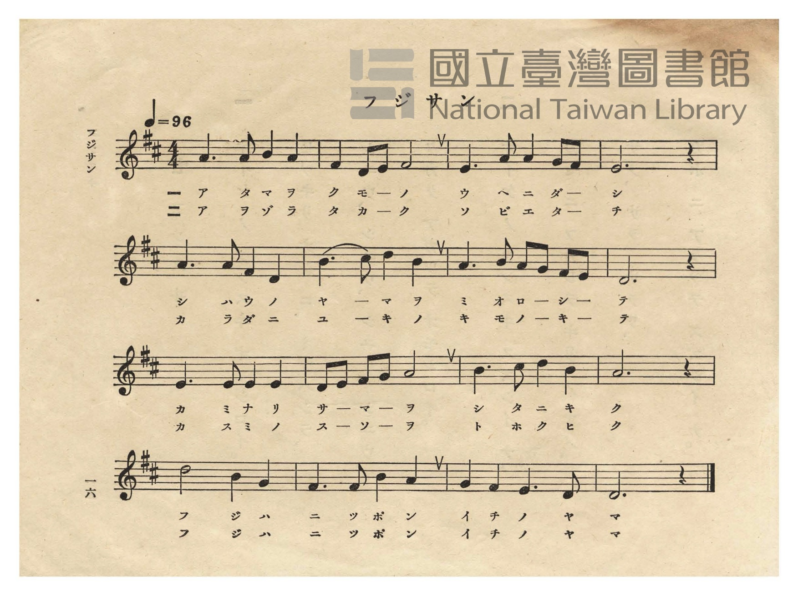
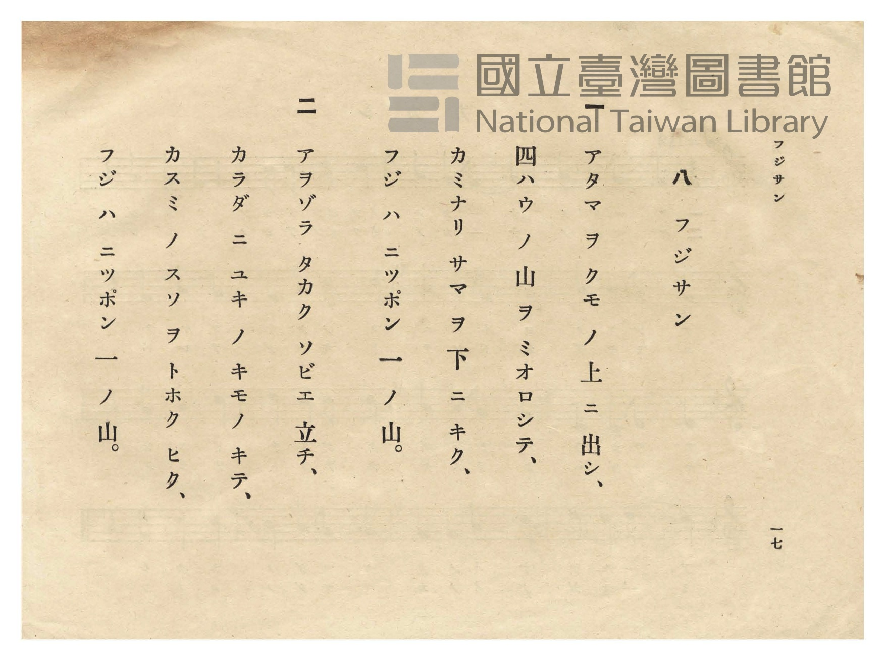

# フジサン（富士山）

> Re:Shōka 使用 AI 協助辨識與重建樂譜，可能會有錯誤。歡迎[回報](https://github.com/TMDLang/reshoka/issues)。

- **鋼琴伴奏版**：<br><audio controls src="fujisan.mp3"></audio>
- **NEUTRINO 歌聲合成版**：<br><audio controls src="fujisan_neutrino.mp3"></audio>

- 作詞：巖谷小波（文部省尋常小學唱歌）
- 日治時期公學校唱歌（第二學年・第八課）
- 國立臺灣圖書館典藏

## 說明


- 出處：臺灣總督府編《公學校唱歌》第二學年用，第八課〈フジサン〉（富士山），原書第 16–17 頁（P018–P019）。
- 調性與拍號：ニ調（D 大調），4/4 拍，速度 != 96。
- 背景與曲風：原出自 1910 年《尋常小學讀本唱歌》及 1911 年《尋常小學唱歌（二）》第一課〈富士山〉
（亦收錄於《新定公學校唱歌集》第三學年用第十二課 `3_12_fujisan`），描寫富士山高聳入雲、俯瞰四方群山、
身披白雪與雲霞裙裾的雄偉姿態。
- 版本說明：本檔案為原書單聲部五線譜之忠實數位化版本。

### 編曲說明（鋼琴伴奏版）：

1. 前奏 (Intro, 4 小節)：取全曲第四行「フジハ ニッポン 一ノ山」莊嚴寬廣的終止樂句作為前奏。
2. 主歌伴奏 (Fujisan, 16 小節 × 2 段)：右手演奏原曲歌唱旋律；左手以穩重開闊的四拍子和聲伴奏。


## 歌詞

```text
一
アタマ ヲ クモ ノ 上 ニ 出シ、
四ハウ ノ 山 ヲ ミオロシテ、
カミナリ サマ ヲ 下 ニ キク、
フジ ハ ニッポン 一 ノ 山。

二
アヲゾラ タカク ソビエ 立チ、
カラダ ニ ユキ ノ キモノ キテ、
カスミ ノ スソ ヲ トホク ヒク、
フジ ハ ニッポン 一 ノ 山。
```

## ABC

<div class="abc-score" data-abc-src="fujisan.abc" aria-label="五線譜載入中"></div>

[下載 ABC 原始檔](fujisan.abc)

## TMD 檔案連結

- [主旋律 TMD 檔案](fujisan.tmd) [[在 TMD Studio 編輯](https://tmdlang.github.io/Tmd-TS/#tmd=s7IKdvYPcrWy4qpTUCpJTLdSSM7PyUlNLsnMz7PKzk9PzM7Ojy_OyM9OVIKrKMvPKc1NtUovSkxJjTdCiBfnlxYlp1oVJ2fk5-fEl6RWlCTl52cj5AuK8stS8xLzgGoKijLzSlJTwIoQClLLMlNSQdKpKZkl-UWZiTlIlqYWFYPcBLEkvqQoMa84uSizAORQhCqgpvTMPKvc_LykUqCrMSVSM7MysTgNampBYnqqVYCBoYUukLBE1l2SkQ_0b0FGpVVGZjHIbcmJOfHZiXlIwVKSkQoKlVSoQiUuLS2Fx81THzfteNy09XHz5vd7Op6u73m6ePXTjRvf7-lU0NLiUrRVsDTjsrdVcOGyMdE3sQOZ9Wz60mebdj-b2fRszvynrWuert3xbMHCp1M2PlvbAzTh-Zo1T3b1AAWf7tzyuHk3kPu0dfWLVZuABoJd8mTvnBcr573fM-vp9mkvNmx_uqH_2eZFQH3PprW_bF7xfE7j0w3dT3fsAIqDzICaCtH6dE7389XdL9p3PW9c_HTOtGezd7xcsuJp644X0_uVuLj0tRRsqQW4FBQUHjdMeDZ70_PZ616sWvVsRt_jholg0ebdT9t3vZg5FegDiEue79j7fO7ip7vmPN--4nFDF1qIPG7oRg6R51NWvN_TAw-Uxw0dyBHwuKETLQ6Aip_2zQf6FKhFwdDsUcNkQ3OFlwsagcpAqQDIB6UDoMLHDU1Q571Ytf9Zw_IXHe3PuntfzJwPdOfj5m6gIFCLi8LTJcvBTJDBwPhUAKoBsl42zH-6a5kCOLKRDGrueTZzPcig2ZteLgK6exbQKSDPt69SMLQ0NFAAxTDQw0jx9WJdw7M5a-A-f9rfBVJpiEUlPL0AgwbsfHAw7WiABAo8CIAhAnKNggJY5bJnU7a97Gl5Nm0P0LRn0zY8XTcLLbhfzm6DGdUJD3FQcPc2Ai0CGq6QYBxvaBSfVpqVWZyYlwAJiWf9_U_Xr4Zb-nL1jBeNm5-2Ln05G-iYxif71z-ft-Hp7NnPpu18vm8J2FWNEFe92LX6Wdfq5zP3vpy9ChhQQPUv58x7sXjmi8X7ns9qeTm75Wlj59Pl-5-1diOC9XlnBzCMIIkKGKZA9rNVU54t7HjetAsS1U-nrXvRuAmYGZ7smvJ8-6wXa-c82dn9dP-Cp-uXPZu648ne3qc90yCGgAyFJlWIVmAIADPX09YVwNwEdM-THWtBjFXzXqxdD0y_oLS1ofdZe6cCKNHoZRWkA70PNgAY8GBzmhY9btr_uHke0J2bgLz1j5sXAZl9QPkuIN2tAIz9x03bod4Hhsjj5v7HTcvASoDBAtHVPP9x06rHzWtBCpuBsQFW-7hpNUiiuetx8yogB5jYIXY82dENNvhxE1A90I0QxeAsAaT6QXKPm5sfN88F5g6QK2FWQYMT6COI70AB2dX1csHaJ3t2AB0JjIjnq9cDgw3ocGD8QmLwxcTpQCe_nLsImPdAUTmrBRKboDw2Z8WL1s1Pd00FuudF416gypeztwOT1ou9819u3gJSAEsbz2asB5V_c9ZAkisollfPgDgIHpi7emCB2bzpcdO-x80rgZz9oCBoWg9k7X3cPPlx0woFYFn2uLkROYBWPm4G-RAUJMuAIQL2LChkmoEmQVnIAdq0EximUEU7geZCwx9YpMwG29Q8idIwBfoNkhmAbgWF0ZRZL6b3Pl2y8vnKXcCQAoYLMAMAg_j5yv3AIINkg-c7pzzrmAAMlxcLF79YDKxTel42LgCiZ93AAnszOGRBmQSoAGjCs8m7SAhcoOMoL9qhQEFLn4vLDVIKWAVkJublO9QY1FSDs7WNhZYdmFGjYKqgC4SmCmZgUhcoYgwkDRWMwDQI1gDZEDUgeROgOEwEAg1AasCm-RjWgBIFWBSYHoDBPg_EAsYZyBRQjIF4kAwHylVgdc0zQHLAJAHhASOraTuYtQeqawl2u4yQ7ALn5X1g1kqorv1gN6wG2wpKORB1k8FyK5Bc2EjALrRgggQOSDEowHQVzBUM44AUiANTZAakQaFkBBQBKcUVTiBfguwGpldwWIBCBeyKZogrYCUIiDUf6r5VUBlgzoGGUhtUBuIn7KG0GqoLmEuB4QtigUIbZBM0DqA5EcKCyMBCFpwrCdgEDSNIojAC0yAM8j4oGZlAAwZvqGEPI5jLQYVAF5gFCgGQzFZ4-IBiDx6awDhFSk0gf0FSHTiEQfogPsYbTk07oSEOjxGQCLz0AdrW3AF112x4ugbxJhFhGzSswP6HpBZQnoLlO10giciJIHGQKCRgDfGnp-apUHFQKQhJV5CYhOWsZiCeC2ZthroOlM5gOQDkUxC9BKwHlG9xhBKN7anl4tK1U4CWWwpApjIXAA)]
- [鋼琴伴奏 TMD 檔案](fujisan_piano.tmd) [[在 TMD Studio 編輯](https://tmdlang.github.io/Tmd-TS/#tmd=s7IKdvYPcrWy4qpTUCpJTLdSSM7PyUlNLsnMz7PKzk9PzM7Ojy_OyM9OVIKrKMvPKc1NtTJCiBTnlxYlp-JSD5GNL0hMT7UKMDC00AUSlgjpgqL8stS8xDygASWJmeWJefHpQIGivPyi-PTUvNSixByE2tSyzJRUkMqCoszcxKLK-JT8ZKBb8kqQXJdaVAxyfEFmYl5-fGJRUWJeeiqqkvyikoz89KLEgoxKq4zM4pL8oszkxJz47MQ8JFeXZAB1WaWnQhUqcWlpKTxunvq4acfjpq2Pmze_39PxdH3P08Wrn27c-Lh598vuPc8nbHmyZ8vTpf3POzve7-lU0NLiUrRVsDTjsrdVcOGyMdE3sQOZ_mz60mebdj-b2fRszvynrWuert3xbMHCp1M2PlvbAzTz-Zo1T3b1AAWf7twCNBbIfdq6-sWqTUADwW57snfOi5Xz3u-Z9XT7tBcbtj_d0P9s8yKgvmfT2l82r3g-p_Hphu6nO3YAxUFmQE2FaH06p_v56u4X7bueNy5-Omfas9k7Xi5Z8bR1x4vp_UpcXPpaCrbUAlwKCgqPGyY8m73p-ex1L1atejaj73HDRLBo8-6n7btezJwK9AHEJc937H0-d_HTXXOeb1_xuKELLUQeN3Qjh8jzKSve7-mBB8rjhg7kKHnc0IkcK0B_AxU_7ZsP9ClQi4Kh2aOGyYbmCi8XNAKVgVIikA9Ki0CFjxuaoM57sWr_s4blLzran3X3vpg5H-jOx83dQEGgFheFp0uWg5kgg4HxqQBUA2S9bJj_dNcyBXBkIwwC-gcYABDfAzVjJhCg0SClCgqGegpPO3uB4goannklRfk6CiYKwAh8vr5BExTR_dOetoKMAnl79uwXC4GB0gP1dnM_0Kbux83Nj5vnAgNA4cmOhsfNfaAU2dD7oq_r6awtT9evebp78fNZLc-3Nj1bu-jZiqan_UuBieh50y6InVAHKygY6QG17waGOcSNChpupVmZxYl5OsCAgzpH4fB0BSOFZ-u2Qty1-Vln97M9U4CKwYG8CagXFGvTu5_u636_Z_bT7cuACp7sXvp85cqX7b0vp3W_nN4FdAnQE8Bwe7p2wtNJPS8aN0GsgzqD8rQHBQpa-lxc4NC0CgCVBEEeDjUGNdVgr9pYaNmBGTUKhnEKumBoBsQmQFyjYAzmG4NFTMEiIHGQqBFYxhCkDaoLBA1AarhqUWzzQbbNBGFbvEK0YayCCZAyiUXlA6kaBSMIwzQehODSIGwAsQIaJXi9BHIzyOUI94Pcbgh0PcRnIBGIT0zB8iZAcZgIso9ApvkY1ig8bloEFn3ctB-Y2OaBWM2bwKY8bloP5i0C4j4gbxlEXfMMkFxzN5TXAJTZDmbtgepagt0uIyS7gDY8btoHZq2E6toPdsNqsK2Pm_ZC1U0Gy61AcmEjAbvQggkSOCDFoADTVTCHpAkQB6bIDEiDQskIa8wjwgnkS5DdwEwJDgtQqIBd0QxxBSj0IGH3uHk-1H2roDJr4aHUBpWB-Al7KK2G6loJDl8QCxTaIJugcdAENA9sO4gFkYGFLCimQGL4bIKGESRRGIFpEAZ5H5SMTKABgzfUsIcRzOXzgbgLzAKFAEhmKzx8QLEHD01gnCKlJpC_IKkOHMIgfRAf4w2npp3QEIfHCEgEmIbgtjV3QN01G56uQbxJRNhG7ZIEHlbNU6HiwJIe7Jp-iBvgOasZiOeCWZuhrgOlM1gOAPkURC8B6wHlWxyhRGN70IstwmUjuCyE8qEUMFEBGaaYfCAFKhtRzICrgRa08PIWoQdEIatHmIFbDSEzMdxBfjmva6cArk3A5gE50ACM9jGMxRAyggspcwEA)]

## 分析

```text
================================================================================
📊 TMD Song Profile: [ フジサン（富士山） ]
================================================================================
⏱  Duration:       0:40 (40.0s), 16 measures total
🎼 Key & Tempo:    首調基準 D, != 96.0 BPM, <4/4>
   - 分析範圍：      由實際發聲的音符與和弦推測調性；播放脈絡另行呈現
🎤 人聲音域:    D4 (MIDI 62) – D5 (MIDI 74) [跨度: 12 個半音 / 1.0 個八度, 難度: easy]
   - 最低音:  D4 in [Fujisan #1 @ m.2, 0:03]
   - 最高音: D5 in [Fujisan #1 @ m.6, 0:13]
   - 適合: soprano, mezzo-soprano, contralto, tenor, baritone, bass
🏛  結構:      Fujisan (40.0s)
⚡ 編曲密度:        Peak 1 軌道同時演奏
🗝  調性診斷：       D 大調（純淨自然大調，未偵測到可信轉調）
   - 風格氣質:    純淨自然大調（陽光明朗、易唱易記，無明顯調外色彩）
   - 轉調歷程:    全曲維持單一推測調性（未偵測到可信轉調）
   - 核心骨幹音:  A, D, E, F#, B
   - 調性數值:    D 大調 [相關度: 0.86, 穩定度: Moderate, 自然音純度: 100.0%]
   - 候選調性 (K-S): D 大調 (0.86), A 大調 (0.81), B 小調 (0.60)
   - 五度圈歷程:   +2
   - 各段落調性細節:
     • [Fujisan #1]: D 大調 (r: 0.86, 自然音純度: 100.0%)

  [ 五度圈游移軌跡 ]
               C  
         F            G  
      Bb              [D ]*
      Eb               A  
         Ab           E  
            Db       B  
               F# 
     (* = active key center)

  [ 十二半音累積音高分佈 ]
     C  :                            0.0%
     C# : ██                         1.7%
     D  : █████████████████████     20.8%
     D# :                            0.0%
     E  : ███████████████████       19.2%
     F  :                            0.0%
     F# : ██████████████            14.2%
     G  : ██████                     5.8%
     G# :                            0.0%
     A  : ████████████████████████  24.2%
     A# :                            0.0%
     B  : ██████████████            14.2%
--------------------------------------------------------------------------------
Assignment 軌道音域：
  - Piano         : D4 – D5 (12 個半音 / 1.0 個八度, 55 個音符)
================================================================================
```


## 原書掃描頁






