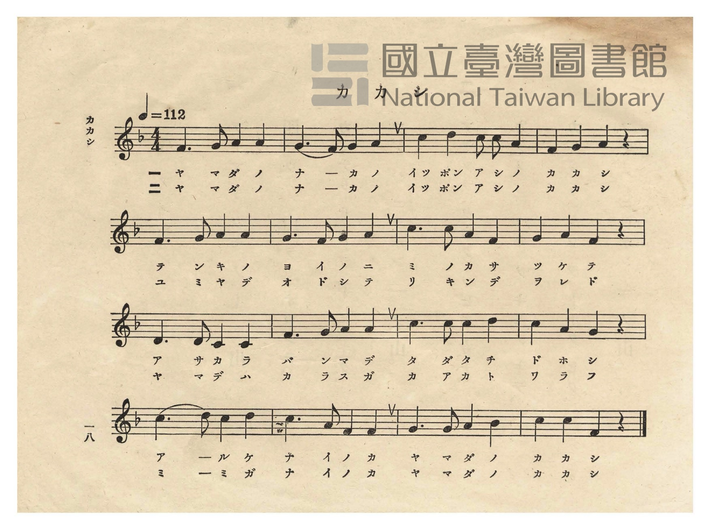
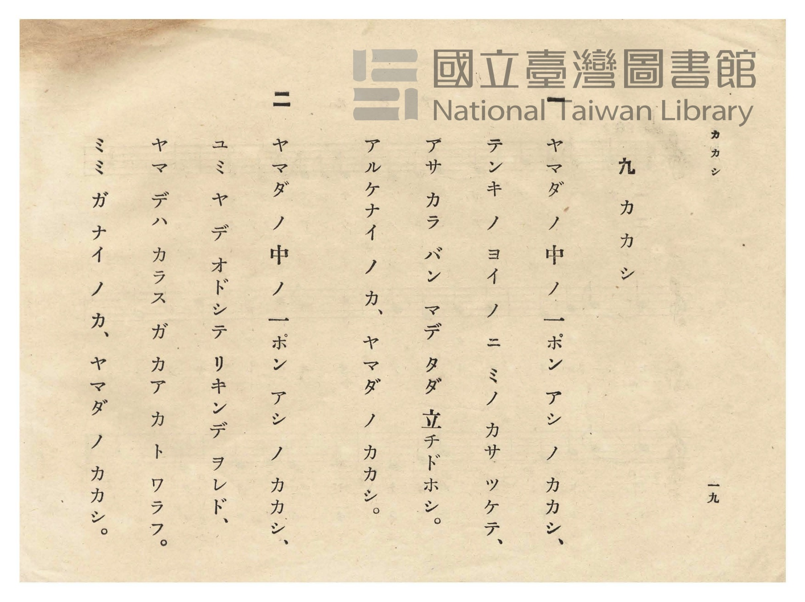

# カカシ（案山子）

> Re:Shōka 使用 AI 協助辨識與重建樂譜，可能會有錯誤。歡迎[回報](https://github.com/TMDLang/reshoka/issues)。

- **鋼琴伴奏版**：<br><audio controls src="kakashi.mp3"></audio>
- **NEUTRINO 歌聲合成版**：<br><audio controls src="kakashi_neutrino.mp3"></audio>

- 作詞：武笠三（文部省尋常小學唱歌）
- 作曲：山田源一郎（文部省尋常小學唱歌）
- 日治時期公學校唱歌（第二學年・第九課）
- 國立臺灣圖書館典藏

## 說明


- 出處：臺灣總督府編《公學校唱歌》第二學年用，第九課〈カカシ〉（案山子），原書第 18–19 頁（P020–P021）。
- 調性與拍號：ヘ調（F 大調），4/4 拍，速度 != 112。
- 背景與曲風：原出自 1911 年文部省《尋常小學唱歌（二）》第十二課〈案山子〉（亦收錄於《新定公學校唱歌集》
第二學年用第十課 `2_10_kakashi`），描寫山田中央單腳站立的稻草人，無論晴天或烏鴉嘲笑，始終戴著蓑笠、
張弓搭箭守護稻田的模樣。
- 版本說明：本檔案為原書單聲部五線譜之忠實數位化版本。

### 編曲說明（鋼琴伴奏版）：

1. 前奏 (Intro, 4 小節)：以第四行「アルケナイ ノ カ、ヤマダ ノ カカシ」詼諧明快的終止句引出主歌。
2. 主歌伴奏 (Kakashi, 16 小節 × 2 段)：右手演奏原曲歌唱旋律；左手以輕快四拍子和聲伴奏。


## 歌詞

```text
一
ヤマダ ノ 中 ノ 一ポン アシ ノ カカシ、
テンキ ノ ヨイ ノ ニ ミノ カサ ツケテ、
アサ カラ バン マデ タダ 立チドホシ。
アルケナイ ノ カ、ヤマダ ノ カカシ。

二
ヤマダ ノ 中 ノ 一ポン アシ ノ カカシ、
ユミ ヤ デ オドシテ リキンデ ヲレド、
ヤマ デハ カラス ガ カアカ ト ワラフ。
ミミ ガ ナイ ノ カ、ヤマダ ノ カカシ。
```

## ABC

<div class="abc-score" data-abc-src="kakashi.abc" aria-label="五線譜載入中"></div>

[下載 ABC 原始檔](kakashi.abc)

## TMD 檔案連結

- [主旋律 TMD 檔案](kakashi.tmd) [[在 TMD Studio 編輯](https://tmdlang.github.io/Tmd-TS/#tmd=s7IKdvYPcrWy4qpTUCpJTLdSSM7PyUlNLsnMz7PKzk9PzM7Ojy_OyM9OVIKrKMvPKc1NtUovSkxJjTdCiBfnlxYlp1oVJ2fk5-fEl6RWlCTl52cj5AuK8stS8xLzgGoKijLzSlJTwIoQClLLMlNSQdKpKZkl-UWZiTlIlqYWFYPcBLEkvqQoMa84uSizAORQhCqgpvTMPKvc_LykUqCrMSVSM7MysTgNampBYnqqVYCBkYEukDBE1l2SkQ_0b0FGpVVGZjHIbcmJOfHZiXlIwVKSkQoMlaLSIpCztbQUHjetBqPt7_d0PFvY8XTjxqdrJ7zf06mgpcWlaKtgaGjEZW-r4MZlY6JvYgcy5dn0pc827X42s-nZnPlPW9c8Xbvj2YKFT6dsfLa2B2jE8zVrnuzqAQo-3bnlcfNuEHfn3BerNgFNBLvhyd45L1bOe79n1rO1y56vWfBkRyfI3mntL5tXPJ_T-HRD99MdO55u6AcZADUSru_ZbKAps4AOfD5lw7NdE57saHjZ3Eec7qdzup-v7n7Rvut54-Knc6Y9m73j5ZIVT1t3vJjer8TFpa-lYEstwKWgoPC4YQLQrc9nr3uxatWzGX2PGyaCRZt3P23f9WLmVKAnIC55vmPv87mLn-6a83z7iscNXWiB-bihGzkwn09Z8X5PDzw8Hzd0wGPucQM4EJEiD6jyad98oDeB6hUMLR41TDa0VHi5oBGoDJRugHxQygEqfNzQBHXbi1X7nzUsf9HR_qy798XM-UBHPm6eARQEanFTeLpkOZgJMhiYDhSAaoCslw3zn-5apgBJJUgmNfc8m7keZNLsTS8XAV09C-gWkNfbVykYWhoaKgB9A48zkL-xRFsH0N9g54HC4GlvI5AL8TTclxBPP9m17NmUbS97Wp5N2wM06tm0DU_XzUILyJez24DmgBynoIAWohDDgSYrJBjFGxoAs0p2YnFGZgLEp8_6-5-uXw1JcE92rH26ZN3TaetetG5-vnomMDU9n9XyfMXuF72dT3btAsVMy8IXq6c9m7nl6ZKVzzqmPW_uf7ml8-mMTc_XTATFxvLu51ubnnVseTFx-ovJE4Ep_3FDI8RJT_dsfbpn8rMJa5-vW_t0XceLtduBxgJtBJr_bMXCZysWI0L2eWfHszlrIKkKlIXmrHm2agowRJ437YJEN8h9jZuAIftk15Tn22e9WDvnyc7up_sXPF2_7NnUHU_29j7tmQYxBGQoNK1CtAIDCpgxn7auAEYNMO6A_gUxVs17sXY9MAEDg_rpht5n7Z0KoISjl1WQDgwisAHAbAhx3ZLHzfMeNzcAWX1AwbVQuuFx89zHzZuBxcwiYEoFCyKlW3AQPG5uA6p43ATR8rh5xeOmJVBmNxDPh-vZCuS1PG7aCNIA1QoyFSgMlG1eCZSdALYK5I52oOB-kHOAMfW4ufFxc-fj5tlgOyGBCdTYDDQSaFYX3DqgKQ1AlcgeQXIrWB8wHCBhAi-JCCYMYFyB0fqnS_eC0saGxU97dz9fuR-eGF4sXPx0Us-zadOBqQKUVPbNezZ95dOODc9mzgKG3_PZW4DGAlU-2dH7tHsq0B0go2YvAMY5UOTZnOYXWze82L7-6XRgipgPcdKLxQuR3QDUAo-sXT0UR9YyYJSATABiUCCvAgUtULq5DSiwChiLoLgEyTRvety8BiQJ0wiyE6TpcXM_NMYeN-0EstZALAFauRoo3QHE60FyzSC_QnQCkwDQSpBCmsfWy9nTnrdse9a9HxjiwGwJypMrGp_Oagfa9WTv_qfdjS8WzwWWZUBBYNEGzqKLwUVuD9D8Jzu6QKZBcn7v7qcz-p5O7QKRczZACoInu6chx9-zTZOezel80bD52ZythOMP6B_KqycoUNDS5-LyhhR2VgGZiXn5DjUGNdXgAsnGQssOzKhRMFTQBUIjBWMgCcI1QDZIxBBMQ0RMgaQZEJsCIUQEpAsmbwASAZvmY1gDTjUg_ZCE0ABm9YH1ACMWIgNOAyAxUDxDZJrB6uaCSXDaBOLtUDmIytVIJFgGYqMRPW0kMchAAQbigdRD1MB46EHWBvUAyCFrUTywAuoBSIYAyXRDZeZD9YCzBFjNVqhMC5i3ESwLMhnJNnBwLYPqhGRxEKsdorNpFVSmE-pliH6QHqgMuADfjKyneROYtwaqD2YbNKjM4sH6gJQpiAUmsAUgLLhgKQ0iApIDBRtacAHjCuIYcK0Atngl1DETEAEJTA3IXtsPlQGWImA2sMKA6gE5GlhxgE0EeRo9uJBTF8g0UNkGMRNkN8R2UCkH0g8KBiQZcKqCuLADatt6uHuBpR96cEGCwQwtGEABAQoyRDqCBZ4JXA0IY0lZsKBqBmYAaIoAZQmQDMxb8PQD9ijIiaCAgwYVUlaAeQuaMsD60YMKliYhJTltbKvl4tK1U4AWbApApjIXAA)]
- [鋼琴伴奏 TMD 檔案](kakashi_piano.tmd) [[在 TMD Studio 編輯](https://tmdlang.github.io/Tmd-TS/#tmd=s7IKdvYPcrWy4qpTUCpJTLdSSM7PyUlNLsnMz7PKzk9PzM7Ojy_OyM9OVIKrKMvPKc1NtTJCiBTnlxYlp-JSD5GNL0hMT7UKMDAy0AUShgjpgqL8stS8xDygASWJmeWJefHpQIGivPyi-PTUvNSixByE2tSyzJRUkMqCoszcxKLK-JT8ZKBb8kqQXJdaVAxyfEFmYl5-fGJRUWJeeiqqkvyikoz89KLEgoxKq4zM4pL8oszkxJz47MQ8JFeXZAB1WRWVgu3X0lJ43LQajLa_39PxbGHH040bn66d8Lh598vuPc8nbHmyZ8vTpf3POzve7-lU0NLiUrRVMDQ04rK3VXDjsjHRN7EDmfts-tJnm3Y_m9n0bM78p61rnq7d8WzBwqdTNj5b2wM09PmaNU929QAFn-7cAjQXxN0598WqTUATwa56snfOi5Xz3u-Z9WztsudrFjzZ0QlyybT2l80rns9pfLqh--mOHU839IMMgBoJ1_dsNtCUWUAnP5-y4dmuCU92NLxs7iNO99M53c9Xd79o3_W8cfHTOdOezd7xcsmKp607XkzvV-Li0tdSsKUW4FJQUHjcMAHo1uez171YterZjL7HDRPBos27n7bvejFzKtATEJc837H3-dzFT3fNeb59xeOGLrTAfNzQjRyYz6eseL-nBx6ejxs64HH5uAEciLDoBHoaqPJp33ygN4HqFQwtHjVMNrRUeLmgEagMlHaBfFDqBSp83NAEdduLVfufNSx_0dH-rLv3xcz5QEc-bp4BFARqcVN4umQ5mAkyGJgOFIBqgKyXDfOf7lqmAEklCJOAvgF6H-J3oG7MpAU0G6RUQcFQT-FpZy9QXEHDM6-kKF9HwUQBGH3P1zdoAtU82b0U6Pyns2e_WAgMjJ7HTYseNwO9u_Fxc9fjpiVAm_rAybmh8XHzksfN8x43N8DFoMHS-2LlnherlwPd8XT_6uezWp5vbXq2dtHT_qVP90wFxsWTHbvB4Qx2uIKCkZ4CRATiVgUN78TsxOKMTB0FQzOosxQOT1cwUni2bivIfU_7Nz_r7H62ZwpQMTi0NwH1guJuevfTfd3v98x-un0ZUAHQGy-A1u1fDfQJMNyAEfR0Us-Lxk0QW6C2U57woEBBS5-LCxyYVgGgsiPIw6HGoKYa7EMbCy07MKNGwVRBFwjNwLQZEMNEjBUMgSQI1wA9ChIxAorpAuMFpgaEQfIGIBGuWhTLfJAtM4FbZhivEG0Yq2ACpExiEXwoBTQWyDCF8MHyCL4BxApoROD1EchNMNeCMMz9hmAaIgLzrSkQQkRAumDyEB-BTPMxrAEmpSVg_cCUBcQNYFYfWA8w_UFkmlZDxUDJESLTDFY3F0xuBoovAuLtUDmIytVIJFgGYqMRPW0kMchAAQbiIZIFjIceZG1QD4AcshbFAyugHoDkW5BMN1RmPlQPOOeC1WyFyrSAeRvBsiCTkWwDB9cyqM750KB73NwO0dm0CirTCfUyRD9ID1QG6DqQK5H0NG8C89ZA9cFsgwaVWTxYH5ACJk5geIAIbAEICy7UfAWSAwUbWnAB4wrimK0wrzevhDpmAiIggakB2Wv7oTLAwg7MftzcCNUDcvTj5tlgE0GeRg8u5NQFMu1xcz_UTJDdENsfN-0E6wcFA5IMOFVBXNgBtW093L2Pm6eiBxe1iheMoGoGZgBoigBlCZAMzFvw9AP2KMiJoICDBhVSVoB5C5oywPrRgwqWJoEpCxwUtLANvVzDX3iiF5YgCsyHlppweSADKActO4k3Ant5jDADWngjW4OiB4mPXMYDjcJwB_n1gK6dAri2AZsH5EDDL9rHMBZDyAgupMwFAA)]

## 分析

```text
================================================================================
📊 TMD Song Profile: [ カカシ（案山子） ]
================================================================================
⏱  Duration:       0:34 (34.3s), 16 measures total
🎼 Key & Tempo:    首調基準 F, != 112.0 BPM, <4/4>
   - 分析範圍：      由實際發聲的音符與和弦推測調性；播放脈絡另行呈現
🎤 人聲音域:    C4 (MIDI 60) – D5 (MIDI 74) [跨度: 14 個半音 / 1.2 個八度, 難度: moderate]
   - 最低音:  C4 in [Kakashi #1 @ m.9, 0:18]
   - 最高音: D5 in [Kakashi #1 @ m.3, 0:04]
   - 適合: soprano, mezzo-soprano, contralto, tenor, baritone, bass
🏛  結構:      Kakashi (34.3s)
⚡ 編曲密度:        Peak 1 軌道同時演奏
🗝  調性診斷：       F 調性不明確（純淨自然大調，未偵測到可信轉調）
   - 風格氣質:    純淨自然大調（陽光明朗、易唱易記，無明顯調外色彩）
   - 轉調歷程:    全曲維持單一推測調性（未偵測到可信轉調）
   - 核心骨幹音:  C, A, F, G, D
   - 調性數值:    F 調性不明確 [相關度: 0.80, 穩定度: Ambiguous, 自然音純度: 100.0%]
   - 候選調性 (K-S): F 大調 (0.80), C 大調 (0.79), A 小調 (0.72)
   - 五度圈歷程:   -1
   - 各段落調性細節:
     • [Kakashi #1]: F 調性不明確 (r: 0.80, 自然音純度: 100.0%)

  [ 五度圈游移軌跡 ]
               C  
        [F ]*          G  
      Bb               D  
      Eb               A  
         Ab           E  
            Db       B  
               F# 
     (* = active key center)

  [ 十二半音累積音高分佈 ]
     C  : ████████████████████████  26.7%
     C# :                            0.0%
     D  : ████████                   9.2%
     D# :                            0.0%
     E  :                            0.0%
     F  : █████████████████         19.2%
     F# :                            0.0%
     G  : █████████████████         19.2%
     G# :                            0.0%
     A  : ██████████████████████    24.2%
     A# : ██                         1.7%
     B  :                            0.0%
--------------------------------------------------------------------------------
Assignment 軌道音域：
  - Piano         : C4 – D5 (14 個半音 / 1.2 個八度, 61 個音符)
================================================================================
```


## 原書掃描頁






