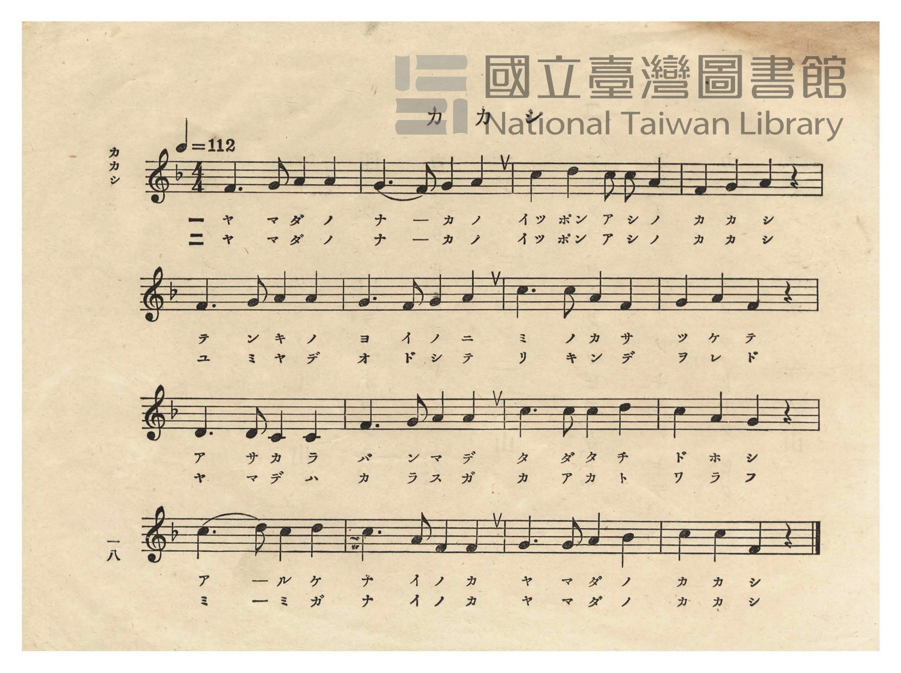
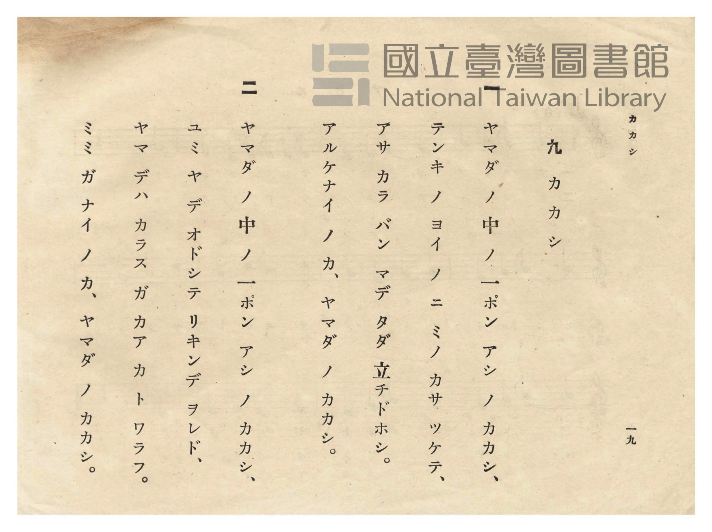

# カカシ（案山子）

> Re:Shōka 使用 AI 協助辨識與重建樂譜，可能會有錯誤。歡迎回報。

- **鋼琴伴奏版**：<br><audio controls src="kakashi.mp3"></audio>
- **NEUTRINO 歌聲合成版**：<br><audio controls src="kakashi_neutrino.mp3"></audio>

- 作詞：武笠三（文部省尋常小學唱歌）
- 作曲：山田源一郎（文部省尋常小學唱歌）
- 日治時期公學校唱歌（第二學年・第九課）
- 國立臺灣圖書館典藏

## 說明


- 出處：臺灣總督府編《公學校唱歌》第二學年用，第九課〈カカシ〉（案山子），原書第 18–19 頁（P020–P021）。
- 調性與拍號：ヘ調（F 大調），4/4 拍，速度 != 112。
- 背景與曲風：原出自 1911 年文部省《尋常小學唱歌（二）》第十二課〈案山子〉（亦收錄於《新定公學校唱歌集》
第二學年用第十課 `2_10_kakashi`），描寫山田中央單腳站立的稻草人，無論晴天或烏鴉嘲笑，始終戴著蓑笠、
張弓搭箭守護稻田的模樣。
- 版本說明：本檔案為原書單聲部五線譜之忠實數位化版本。

### 編曲說明（鋼琴伴奏版）：

1. 前奏 (Intro, 4 小節)：以第四行「アルケナイ ノ カ、ヤマダ ノ カカシ」詼諧明快的終止句引出主歌。
2. 主歌伴奏 (Kakashi, 16 小節 × 2 段)：右手演奏原曲歌唱旋律；左手以輕快四拍子和聲伴奏。


## 歌詞

```text
一
ヤマダ ノ 中 ノ 一ポン アシ ノ カカシ、
テンキ ノ ヨイ ノ ニ ミノ カサ ツケテ、
アサ カラ バン マデ タダ 立チドホシ。
アルケナイ ノ カ、ヤマダ ノ カカシ。

二
ヤマダ ノ 中 ノ 一ポン アシ ノ カカシ、
ユミ ヤ デ オドシテ リキンデ ヲレド、
ヤマ デハ カラス ガ カアカ ト ワラフ。
ミミ ガ ナイ ノ カ、ヤマダ ノ カカシ。
```

## ABC

```abc
X:1
T:カカシ（案山子）
M:4/4
L:1/16
Q:1/4=112
K:F
V:V1 name="Piano" snm="Pia"
[V:V1]
F6 G2 A4 A4 | G6 F2 G4 A4 | c4 d4 c2 c2 A4 | F4 G4 A4 z4 |
w: 1.~ヤ マ ダ ノ | ナ カ ノ イ | ッ ポ ン ア シ | ノ カ カ
w: 2.~ヤ マ ダ ノ | ナ カ ノ イ | ッ ポ ン ア シ | ノ カ カ
F6 G2 A4 A4 | G6 F2 G4 A4 | c6 c2 A4 F4 | G4 A4 F4 z4 |
w: 1.~テ ン キ ノ | ヨ イ ノ ニ | ミ ノ カ サ | ツ ケ テ
w: 2.~ユ ミ ヤ デ | オ ド シ テ | リ キ ン デ | ヲ レ ド
D6 D2 C4 C4 | F6 G2 A4 A4 | c6 c2 c4 d4 | c4 A4 G4 z4 |
w: 1.~ア サ カ ラ | バ ン マ デ | タ ダ タ チ | ド ホ シ
w: 2.~ヤ マ デ ハ | カ ラ ス ガ | カ ア カ ト | ワ ラ フ
c6 d2 c4 d4 | c6 A2 F4 F4 | G6 G2 A4 B4 | c4 c4 F4 z4 |
w: 1.~ア ル ケ ナ | イ ノ カ ヤ | マ ダ ノ カ | カ シ イ
w: 2.~ミ ミ ガ ナ | イ ノ カ ヤ | マ ダ ノ カ | カ シ イ
```

## TMD 檔案連結

- [主旋律 TMD 檔案](kakashi.tmd) [[在 TMD Studio 編輯](https://tmdlang.github.io/Tmd-TS/#tmd=s7IKdvYPcrWy4qpTUCpJTLdSSM7PyUlNLsnMz7PKzk9PzM7Ojy_OyM9OVIKrKMvPKc1NtUovSkxJjTdCiBfnlxYlp1oVJ2fk5-fEl6RWlCTl52cj5AuK8stS8xLzgGoKijLzSlJTwIoQClLLMlNSQdKpKZkl-UWZiTlIlqYWFYPcBLEkvqQoMa84uSizAORQhCqgpvTMPKvc_LykUqCrMSVSM7MykZympaXwuGk1GG1_v6fj2cKOpxs3Pl074f2eTgUtLS5FWwVDQyMue1sFNy4bE30TO5B5z6YvfbZp97OZTc_mzH_auubp2h3PFix8OmXjs7U9QCOer1nzZFcPUPDpzi2Pm3eDuDvnvli1CWgi2DVP9s55sXLe-z2znq1d9nzNgic7OkH2Tmt_2bzi-ZzGpxu6n-7Y8XRDP8gAqJFwfc9mA02ZBXTg8ykbnu2a8GRHw8vmPuJ0P53T_Xx194v2Xc8bFz-dM-3Z7B0vl6x42rrjxfR-JS4ufS0FW2oBLgUFhccNE4BufT573YtVq57N6HvcMBEs2rz7afuuFzOnAj0BccnzHXufz138dNec59tXPG7oQgvMxw3dyIH5fMqK93t64OH5uKEDHnOPG8CBiBR5QJVP--YDvQlUr2Bo8ahhsqGlwssFjUBlAQZGBkA-kDIEKnzc0AR124tV-581LH_R0f6su_fFzPlARz5ungEUBGpxU3i6ZDmYCTIYmA4UgGqArJcN85_uWqYASSVIJjX3PJu5HmTS7E0vFwFdPQvoFpDX21cpGFoaGioAfQOPM5C_sURbB9DfYOeBwuBpbyOQC_E03JcQTz_ZtezZlG0ve1qeTdsDNOrZtA1P181CC8iXs9uA5oAcp6CAFqIQw4EmKyQYxRsaxGcnZicWZ2QmQHz6rL__6frVkAT3ZMfap0vWPZ227kXr5uerZwJT0_NZLc9X7H7R2_lk1y5QzLQsfLF62rOZW54uWfmsY9rz5v6XWzqfztj0fM1EUGws736-telZx5YXE6e_mDwRmPIfNzRCnPR0z9aneyY_m7D2-bq1T9d1vFi7HWgs0Eag-c9WLHy2YjEiZJ93djybswaSqkBZaM6aZ6umAEPkedMuSHSD3Ne4CRiyT3ZNeb591ou1c57s7H66f8HT9cueTd3xZG_v055pEENAhkLTKkQrMKCAGfNp6wpg1ADjDuhfEGPVvBdr1wMTMDCon27ofdbeqQBKOHpZBenAIAIbAMyGENctedw873FzA5DVBxRcC6UbHjfPfdy8GVjMLAKmVLAgUroFB8Hj5jagisdNEC2Pm1c8bloCZXYD8Xy4nq1AXsvjpo0gDVCtIFOBwkDZ5pVA2Qlgq0DuaAcK7gc5BxhTj5sbHzd3Pm6eDbYTEphAjc1AI4FmdcGtA5rSAFSJ7BEkt4L1AcMBEibwkohgwgDGFRitf7p0LyhtbFj8tHf385X74YnhxcLFTyf1PJs2HZgqQEll37xn01c-7djwbOYsYPg9n70FaCxQ5ZMdvU-7pwLdATJq9gJgnANFns1pfrF1w4vt659OB6aI-RAnvVi8ENkNQC3wyNrVQ3FkLQNGCcgEIAYF8ipQ0AKlm9uAAquAsQiKS5BM86bHzWtAkjCNIDtBmh4390Nj7HHTTiBrDcQSoJWrgdIdQLweJNcM8itEJzAJAK0EKaR5bL2cPe15y7Zn3fuBIQ7MlqA8uaLx6ax2oF1P9u5_2t34YvFcYFkGFAQWbeAsuhhc5PYAzX-yowtkGiTn9-5-OqPv6dQuEDlnA6QgeLJ7GnL8Pds06dmczhcNm5_N2Uo4_oD-obx6ggIFLX0uLm9IYWcVkJmYl-9QY1BTDS6QbCy07MCMGgVDBV0gNFIwBpIgXANkg0QMwTRExBRImgGxKRBCREC6YPIGIBGwaT6GNeBUA9IPSQgNYFYfWA8wYiEy4DQAEgPFM0SmGaxuLpgEp00g3g6Vg6hcjUSCZSA2GtHTRhKDDBRgIB5IPUQNjIceZG1QD4AcshbFAyugHoBkCJBMN1RmPlQPOEuA1WyFyrSAeRvBsiCTkWwDB9cyqE5IFgex2iE6m1ZBZTqhXoboB-mByoAL8M3Iepo3gXlroPpgtkGDyiwerA9ImYJYYAJbAMKCC5bSICIgOVCwoQUXMK4gjgHXCmCLV0IdMwERkMDUgOy1_VAZYCkCZgMrDKgekKOBFQfYRJCn0YMLOXWBTAOVbRAzQXZDbAeVciD9oGBAkgGnKogLO6C2rYe7F1j6oQcXJBjM0IIBFBCgIEOkI1jgmcDVgDCWlAULqmZgBoCmCFCWAMnAvAVPP2CPgpwICjhoUCFlBZi3oCkDrB89qGBpElKS08a2Wi4uXTsFaMGmAGQqcwEA)]
- [鋼琴伴奏 TMD 檔案](kakashi_piano.tmd) [[在 TMD Studio 編輯](https://tmdlang.github.io/Tmd-TS/#tmd=s7IKdvYPcrWy4tLSUnjctBqMtr_f0_FsYcfTjRufrp3wuHn3y-49zydsebJny9Ol_c87O97v6VTQ0uJStFUwNDTisrdVcOOyMdE3seOqU1B6Nn3ps027n81sejZn_tPWNU_X7ni2YOHTKRufre0BGvp8zZonu3qAgk93bgGaC-LunPti1SagiUog3U_2znmxct77PbOerV32fM2CJzs6QS6Z1v6yecXzOY1PN3Q_3bHj6YZ-kAFQI-H6ns0GmjIL6OTnUzY82zXhyY6Gl819xOl-Oqf7-eruF-27njcufjpn2rPZO14uWfG0dceL6f1KXFz6Wgq21AJcCgoKjxsmAN36fPa6F6tWPZvR97hhIli0effT9l0vZk4FegLikuc79j6fu_jprjnPt6943NCFFpiPG7qRA_P5lBXv9_TAw_NxQwc8Lh83gAMRFp1ATwNVPu2bD_QmUL2CocWjhsmGlgovFzQClQUYGBkA-UDKEKjwcUMT1G0vVu1_1rD8RUf7s-7eFzPnAx35uHkGUBCoxU3h6ZLlYCbIYGA6UACqAbJeNsx_umuZAiSVIEwC-gbofYjfgboxkxbQbJBSBQVDPYWnnb1AcQUNz7ySonwdBRMFYPQ9X9-gCVTzZPdSoPOfzp79YiEwMHoeNy163Az07sbHzV2Pm5YAbeoDJ-eGxsfNSx43z3vc3AAXgwZL74uVe16sXg50x9P9q5_Panm-tenZ2kVP-5c-3TMVGBdPduwGhzPY4QoKRnoKEBGIWxU0vBOzE4szMnUUDM2gzlI4PF3BSOHZuq0g9z3t3_yss_vZnilAxeDQ3gTUC4q76d1P93W_3zP76fZlQAVAb7wAWrd_NdAnwHADRtDTST0vGjdBbIHaTnnCgwIFLX0uLnBgWgVkJublB3k41BjUVIN9aGOhZQdm1CiYKugCoRmYNgNimIixgiGQBOEaoEdBIkZAMV1gvMDUgDBI3gAkwlWLYpkPdssM44Fqow1jQeaAmSYgJoo4EhNoDZhjihCHqkcXhzsBGlF4fQxyM8w3IAzznyGYhojAQsMUCCEiIF0weYh1INN8DGuASW0JWD8w5QFxA5jVB9YDTJ8QmabVUDFQcoXINIPVzQWTm4Hii4B4O1QOonI1EgmWgdhoRE8bSQwyUICBeIhkA-OhB1kb1AMgh6xF8cAKqAcg-Rok0w2VmQ_VA87ZYDVboTItYN5GsCzIZCTbwMG1DKpzPjToHje3Q3Q2rYLKdEK9DNEP0gOVAboO5EokPc2bwLw1UH0w26BBZQZKj8DEEw9JpGACWwDCggs134HkQMGGFlzAuII4ZivM680roY6ZgAhIYGpA9tp-qAywMASzHzc3QvWAHP24eTbYRJCn0YMLOXWBTHvc3A81E2Q3xPbHTTvB-kHBgCQDTlUQF3ZAbVsPd-_j5qnowUWt4gcjqJqBGQCaIkBZAiQD8xY8_YA9CnIiKOCgQYWUFWDegqYMsH70oIKlSWDKAgcFLWxDL9cIF664ClEIEyqOVKKiqAdzwCqRylZKrCBcriPbgVQxYDoLi1kY4ph1Ctg6HP6gTT2ka6cArg3B9gE50PiL9jGMxRAyggspcwEA)]

## 分析

```text
================================================================================
📊 TMD Song Profile: [ カカシ（案山子） ]
================================================================================
⏱  Duration:       0:34 (34.3s), 16 measures total
🎼 Key & Tempo:    首調基準 F, != 112.0 BPM, <4/4>
   - 分析範圍：      由實際發聲的音符與和弦推測調性；播放脈絡另行呈現
🎤 人聲音域:    C4 (MIDI 60) – D5 (MIDI 74) [跨度: 14 個半音 / 1.2 個八度, 難度: moderate]
   - 最低音:  C4 in [Kakashi #1 @ m.9, 0:18]
   - 最高音: D5 in [Kakashi #1 @ m.3, 0:04]
   - 適合: soprano, mezzo-soprano, contralto, tenor, baritone, bass
🏛  結構:      Kakashi (34.3s)
⚡ 編曲密度:        Peak 1 軌道同時演奏
🗝  調性診斷：       F 調性不明確（純淨自然大調，未偵測到可信轉調）
   - 風格氣質:    純淨自然大調（陽光明朗、易唱易記，無明顯調外色彩）
   - 轉調歷程:    全曲維持單一推測調性（未偵測到可信轉調）
   - 核心骨幹音:  C, A, F, G, D
   - 調性數值:    F 調性不明確 [相關度: 0.80, 穩定度: Ambiguous, 自然音純度: 100.0%]
   - 候選調性 (K-S): F 大調 (0.80), C 大調 (0.79), A 小調 (0.72)
   - 五度圈歷程:   -1
   - 各段落調性細節:
     • [Kakashi #1]: F 調性不明確 (r: 0.80, 自然音純度: 100.0%)

  [ 五度圈游移軌跡 ]
               C  
        [F ]*          G  
      Bb               D  
      Eb               A  
         Ab           E  
            Db       B  
               F# 
     (* = active key center)

  [ 十二半音累積音高分佈 ]
     C  : ████████████████████████  26.7%
     C# :                            0.0%
     D  : ████████                   9.2%
     D# :                            0.0%
     E  :                            0.0%
     F  : █████████████████         19.2%
     F# :                            0.0%
     G  : █████████████████         19.2%
     G# :                            0.0%
     A  : ██████████████████████    24.2%
     A# : ██                         1.7%
     B  :                            0.0%
--------------------------------------------------------------------------------
Assignment 軌道音域：
  - Piano         : C4 – D5 (14 個半音 / 1.2 個八度, 61 個音符)
================================================================================
```


## 原書掃描頁






