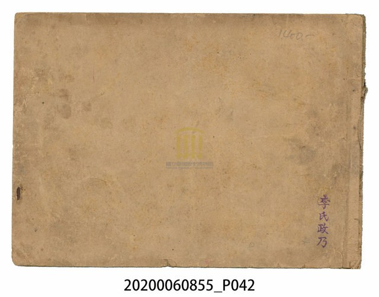
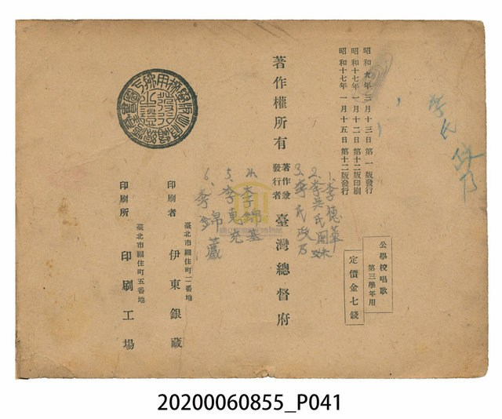
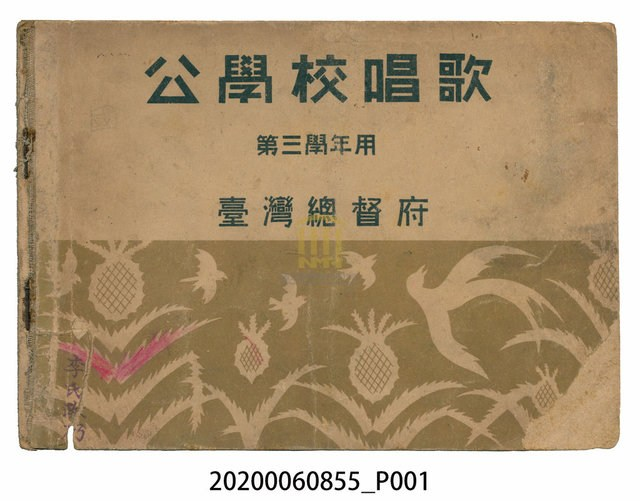
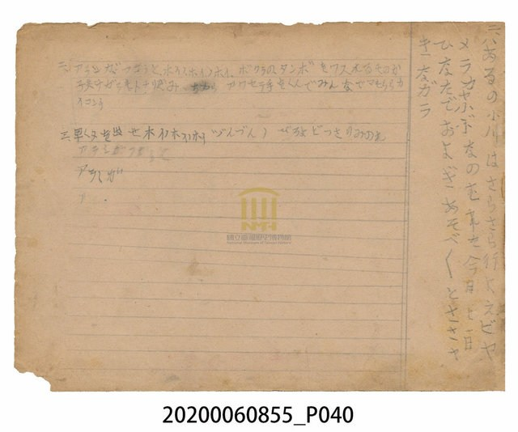
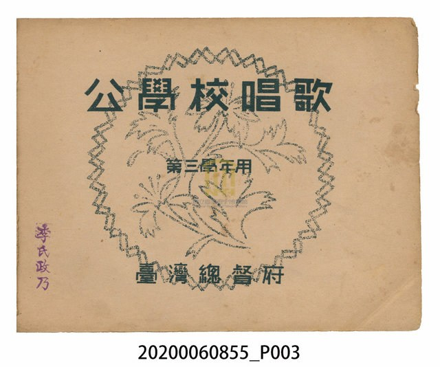
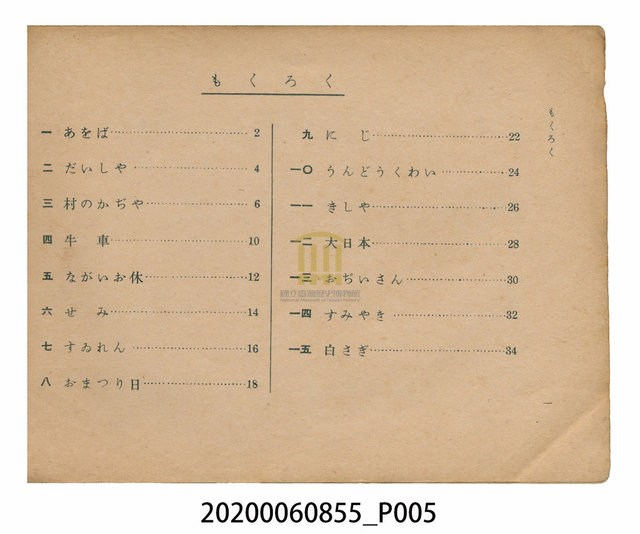

# 書訊與卷首／卷末掃描頁 — 《公學校唱歌》 尋常科 第三學年用

本頁收錄本冊之封面、扉頁、目次（もくろく）、樂典大要、版權頁與封底等原書掃描圖檔（共 6 頁）。

### back_cover.jpeg

### colophon.jpeg

### cover.jpeg

### endpaper_notes.jpeg

### title_page.jpeg

### toc_mokuroku.jpeg

