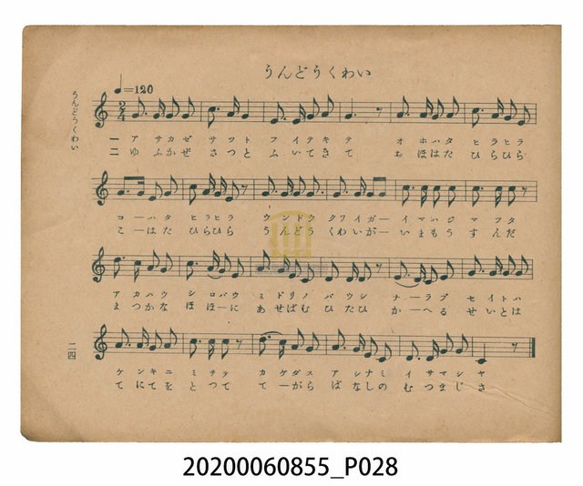
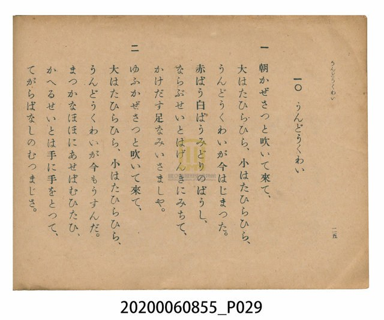

# うんどうくわい（運動會）

<audio controls src="undokai.mp3"></audio>

- 日治時期公學校唱歌（第三學年・第十課）
- 國立臺灣歷史博物館典藏

## 說明

【曲目說明】
・出處：臺灣總督府編《公學校唱歌》第三學年用，第十課〈うんどうくわい〉（運動會），原書第 24–25 頁。
・調性與拍號：ハ調（C 大調），2/4 拍，速度 != 120。
・背景與曲風：描寫公學校秋季運動會的朝氣與熱鬧場面。第一段寫晨風吹拂、大小旗幟迎風飄揚
（大はたひらひら、小はたひらひら），頭戴紅帽、白帽、綠帽的學生精神抖擻地列隊起跑；
第二段寫暮風吹起、運動會圓滿結束，滿臉通紅、額頭冒汗的學生們手牽著手，和樂融融地細數今日佳績。
全曲貫穿輕快活潑的附點進行曲節奏，充滿青春活力。
・版本說明：本檔案為原書單聲部簡譜（數字譜）之忠實數位化版本。

・編曲說明（鋼琴伴奏版）：
1. 前奏 (Intro, 4 小節)：以號角般的同音附點動機「5--5 5 5」與明亮終止式揭開運動會序幕。
2. 主歌伴奏 (Undokai, 24 小節 × 2 段)：右手 (PianoRH) 演奏精神飽滿的進行曲旋律；
左手 (PianoLH) 採用輕快有彈性的八分音符進行曲伴奏（`1_ [1] 5_ [1]`），帶出整齊劃一的步伐感。

## 跨冊／重複收錄參照

> 同曲＋同名異曲（《公學校唱歌》第三學年與《新定兒童唱歌》三年級為同曲；《新定兒童唱歌》高等科男子用為同名異曲）

- **[同曲]** 《新定兒童唱歌》尋常科第三學年用（2020.006.0847.0003）：[**〈運動會〉**](../../../shintei_jido_shoka/grade_3_2020.006.0847.0003/2_08_undokai/index.md)（`C` / `2/4` — [原始 TMD](../../../shintei_jido_shoka/grade_3_2020.006.0847.0003/2_08_undokai/undokai.tmd)）
- **[同名異曲]** 《新定兒童唱歌》高等科男子用（2020.006.0848）：[**〈運動會〉**](../../../shintei_jido_shoka/koto_boys_2020.006.0848/1_2_02_undokai/index.md)（`G` / `2/4` — [原始 TMD](../../../shintei_jido_shoka/koto_boys_2020.006.0848/1_2_02_undokai/undokai.tmd)）
- 總表：[跨冊重複與同名歌曲總索引](../../../duplicate_songs.md)

## 歌詞

```text
一　朝かぜさつと吹いて來て、
大はたひらひら、小はたひらひら、
うんどうくわいが今はじまつた。
赤ばう白ばうみどりのばうし、
ならぶせいとはげんきにみちて、
かけだす足なみいさましや。

二　ゆふかぜさつと吹いて來て、
大はたひらひら、小はたひらひら、
うんどうくわいが今もうすんだ。
まつかなほほにあせばむひたひ、
かへるせいとは手に手をとつて、
てがらばなしのむつまじさ。
```

## ABC

```abc
X:1
T:うんどうくわい（運動會）
M:2/4
L:1/16
Q:1/4=120
K:C
V:V1 name="Piano" snm="Pia"
[V:V1]
G3 G G2 G2 | c3 A G4 | E3 E G2 A2 | G6 z2 |
A3 A A2 A2 | c3 A G2 E2 | A3 A E2 A2 | c2 A G E2 z2 |
G3 G G2 G2 | G3 G G2 G2 | c3 c c2 c2 | c3 c c2 z2 |
d3 c A2 G2 | c3 A G2 E2 | A3 A E2 C2 | D3 D D2 z2 |
E3 E E2 G2 | G3 G G2 G2 | A3 A G2 A2 | c3 c c2 z2 |
d3 c A2 G2 | A3 G E2 C2 | D3 D G2 G2 | C6 z2 |
```

## TMD 檔案連結

- [主旋律 TMD 檔案](undokai.tmd) [[在 TMD Studio 編輯](https://tmdlang.github.io/Tmd-TS/#tmd=s7IKdvYPcrWy4qpTUCpJTLdSSM7PyUlNLsnMz7PKzk9PzM7Ojy_OyM9OVIKrKMvPKc1NtUovSkxJjTdGiBfnlxYlp1oVJ2fk5-fEl6RWlCTl52cj5AuK8stS8xLzgGoKijLzSlJTwIoQClLLMlNSQdKpKZkl-UWZiTlIlqYWFYPcBLEkvqQoMa84uSizAORQhKqSjFSgy6AuyMlMS1Xi0tJSeNzY9rhp8uPGlSBGY__jpv7HjS3v93S8bOx-2j312Zzm93s6FbS0uBRtFQyNDLjsbRWcuWyM9E3sQOY-m7702abdz2Y2PZsz_2nrmqdrdzxbsPDplI3P1vYAjXi-Zs2THZ1Awac7tzxu3g3kPu1tfLFqE9BEsKuezul-vrr7Rfuu542Ln63d_rR_09PeWc87V75csuJp644X0_uVuLj0tRRsqQW4FBQUHjdMeDZ70_PZ616sWvVsRt_jholg0ebdT9t3vZg59f2eWRD3PN-x9_ncxU93zXm-fcXjhi40zz1u6Eb23PMpK97v6YH773FDB9ZQfdzQiRawQF1P--Y_m70DqFfByORRw2QjU4WXCxofNzRBnfVi1f5nDctfdLQ_6-59MXM-0H2Pm_uBgkCDnBWeLlkOZoLMAUaJAlANkPWyYf7TXcsUIBGGZFJzz7OZ60Emzd70chHQwbOe9fc_Xb8a7rXny7ufrl0Md97zWS3P5sx9tmExUMvzto0v1yx_umDLy7mLgCaC_d7wbN1WoPZnM1cATXs6Yeez7qbHDY1AJz3d0P9s-vSnO-e_2N8HlHq5uOVZ_yyQIxQUgK4GKnjcuP5x4_zHjZseN3VCSaDGDcAgQheHeO3lgrXPOrY839L6dMdeoMrnM_dCGdsWABlAdwLd_3zK_Oeb9j1fOu9Z17Rnk3c_nbPhacf0l7O6Xmzd_mL7xPd7ZkMcAHL5rh6oy2etg7gcqAZoGtzjT-dMfrZ7__OtE57NBYZ3D5D9or3zZcMsoANAyhb2At3ztG3Ss43T4VY_bZj4rLP7eefeFxOnAxmgaJ3U82xF04t5vUAEdMzzLRueTd3xZHcXMMc82bv5-Y590IhRUHjaugIYIy82rX6-cv-LPVOf7l_9bMvuZ3snAg1_ObPl5e55Lxs2vVjYA0q16xueLu0HGd7aCnTVy7mTns1YClT8tGs2Ipqfd3Y8m7MGkrpBcTxnzbNVU54t7HjetAuS1J5OW_eicdPL5hXPNyx8sXYOMEqALnu6djqY3flkZ_fT_Querl8Gcu7e3qc90yAGgiyA5h-IMcBc8GLlPJDjp7UDU8iTHWtBjFXzXqxdD8xUoIje0PusvVMhMzcxPdVIL6sgNV1BXyHAwMgSaAvYKGASetzQAExjjxu7HzfOedw49XHjkseNoBgBZZbGZU_2AfPOMmCYg1STlG6gerDnwsYeYDyA9cx43LgPbOd8aPi92ArkbACqBqYxCONx436Q_iaghnUwkelw41eBbdz2uHE22OAVYFMnge3sfdy4Gqx5IcIPYI9OfNy44HHjzBfbNoP0g1QAdQK9DnTJ9MdNwEIC7BJgAEICExSH4Cz2ctF6IAIl7Ak7n-xqe9nYBwwfUGJYshyY3YC5DIgg4QHngvIOPDv373s6Z8XLad1Pl3cDtYNyMWqGAmXzbQtedG4Cpeode5-unQBK_H2TgPno2dQtL_d2Iad2SAqElA8gW5oan61dCslroHJj7dIneyY8XTLr5a49T7vbn_fMhuRNoKXwyN8FLEQbHjcBg3PrgMR_UxNYcCZYwQJY_oGmB6B7gFGzG4yAsQhUCozgDY-bGkDGQ6xCitEdj5uAJCIJAEsAoDYQ2TQJLAI0EZEElgEdAHYoMDEBLZkOSlggg4GKgJYDk-RUrElgFrWSwNPtm55vmwwp3uAJAVi8gUq4WS2gom7BBmBaeLpv3bP9U-HlHKTYA5r2Ykf_kx1dz9bueNkwBU_592LZqqfr2yClINDBLxq7gFLAcH-6ZCVI177pz1r6n3VseDZvDjRRAD1MeQ0PBQpa-lxcoXkpwJZZplVAZmJevkONQY1CNbjAtbHQsgMzsDUtwBXEjgZgeaugYaYADEhgmasDKcOQijALTSw6gXZCTQUaYKXwuGkRKLqbtgLxaiDeo1AD5oEK6RYg7gCygCLNU8GqlgBZbUB6LVisDVwxgOWbVoF1zAbifiBvP1h-ElhsJZgFopGs3tUDshpkADBjgZInEM8BaWoEW9QItKhxBcRooDxIBOiYxmVA3AsWW4awurELLL8biNcD8Xyw2CawczvBLBANtbpGQcNUQVdXwVRTVUNXV1PBFAiBYoZxIEEzuKAuSNAYJGYMFzMDioFkdBUMQLJmyDrMwLIYxhgr1IALEdxRuKuHKlG4GRzQe9ACHxjksJCHxBEo0B43bwZiYMAAeSCx9Y-bgaEGitimNWAzQIJLwArnQc3bATZvHixJAM1XwIjKxskwJ6BEAqSkA8cAJK7AMd40GcgCJgsgDyQGKvCgEdwDcwKQBy7mgIqb4ApnwjUvQDgBPS6MwXEBjAqgMDiaQULgKMMW87hTg2EcVBTIBSKs4kBjCUTwjk4q5lFg_myeAI-57eAQX4ss1jwfLAaM3eZVQNwHFpsA1gvMOmAdIBFwhgEnF1DenAY2bTc8f3eAox0jgvfB8yUor64CRwhYEyjngSN-NVisCSwGLAgaNwANbEDkRmCigLBAIt3w5LIDqKobLDYbns9XgJMRIoKNUEMeGLE4shtGWjAEaweJGUHFjCCJASV3G-NKDPhj9-ns2VSJXXDwgPIlsFx93AwODGhMNkJLWVAMrQbH0EagSAOQ3gkWg6SL7eA4BemBZ15QeQ7KwEA5kGkgMQjAiFdwoQCMO3Dp2jQJHBOgkhcS1yBZWHkLiS9gFgXmZpDYBrAqYEJrnA7E68CWN8B1ArNu4wx4iY5iOXo0QQpX7PkLV-SDDYDFFbZ4hmRmQ1iJzVXLxaVrpwCtbUFMZS4uAA)]
- [鋼琴伴奏 TMD 檔案](undokai_piano.tmd) [[在 TMD Studio 編輯](https://tmdlang.github.io/Tmd-TS/#tmd=s7IKdvYPcrWy4tLSUnjc2Pa4afLjxpUgRmP_46b-x40t7_d0vGzsfto99dmc5sfNu19273k-YcuTPVueLu1_3tnxfk-ngpYWl6KtgqGRAZe9rYIzl42RvokdV52C0rPpS59t2v1sZtOzOfOftq55unbHswULn07Z-GxtD9DQ52vWPNnRCRR8unML0Fwg92lv44tVm4AmKoF0P53T_Xx194v2Xc8bFz9bu_1p_6anvbOed658uWTF09YdL6b3K3Fx6Wsp2FILcCkoKDxumPBs9qbns9e9WLXq2Yy-xw0TwaLNu5-273oxc-r7PbMg7nm-Y-_zuYuf7przfPuKxw1daJ573NCN7LnnU1a839MD99_jhg6s4fy4oRM5qIHBANT1tG_-s9k7gHoVjEweNUw2MlV4uaDxcUMT1FkvVu1_1rD8RUf7s-7eFzPnA933uLkfKAg0yFnh6ZLlYCbIHGCUKADVAFkvG-Y_3bVMARJhSCY19zybuR5k0uxNLxcBHTzrWX__0_Wr4V6DO-zFhDXAqHk2ffrLxS3P-mc9bmgEKni-eumzji0vJk5_vqX1-cy9z7cteAoMok37ni-d93TpVCB62bDp6YItQPOfLp3yYvvE57NanrdtfLlmOcjSjQsR7gAGKNAFkOAHBQdGagO6DKRUQcFQT-FpZy9QXEHDM6-kKF9HwUTh6Yb-5-sbNIFqnuxeCgyQF8snvehYA7Ts6YSel_M3v5zZ8nL3PJA3Vs5_3NBjqqtrqgCEjxt6QR6f0fdk17rnW5uerV30dE__s_61L6d1w339dFf_051Toe5UUDDSU3iyYzcwriFOU9AIzUvJz07M1AHGE9QVCoenKxgpPFu3FeScp_2bn3V2K2gEZCbm5Qd5aCo82zMF5CVwCL1cvPfZ7v1AVwID6cXCHqD_n03vfrqv-_2e2RDbgODp9mUIA3xABvQtBCasF3umPt2_-tmczqd7O4ApAeTT1tVPO9qAnn2-ZhncPIgrgeGZYBivEG0Yq2AKphKgiWzHNmD6fjZ1y8u9XU-7mp_saACa82zt0id7JjxrAQZUExc0b0BSI9DXL1bOe9q64tm0dmC4PdmxFsRYNe_F2vXADAO05OmG3mftnQqZuYnpqUZ6WQWp6Qr6CgEGRpZA68BGAW143NDwbM7cx43djxvnPG6c-rhxyePGFU8n7ARlhMZlT_YB88UyYNICqQam48eN6x83zn_cuOlxUyeUBCa7DcBsg0Uc7FisOayx58nuLrCeGY8b94HtBHsPqOHFViBnA1A1MPVCGI8b94P0NwE1rIOJTIcbvwps47bHjbPBBq8AmzoJbGfv48bVYM0LEX4Ae3Ti48YFjxtnvti2GaQfpAKoE-h1oEumP24CFgBglwADEBKYoDw4cwUwM75ctB6Ins7ZAAyfJ7vaXjb2AcMHFG9LlkOyIRBBwgPOBWV0WNJ93r_v6ZwVwMT8dHk3UDvQGmAmBWZPoBagZ4EMYCQCM-yLzk2g5LNj79O1E4Dan_VNetoxHZIoQOLAPD5l_tOGiU9bW4GJFRh3zzYsBtnS1AhMKS-2bodkakiqebpk1stde552tz_vmQ1J4kBL4ZG_C1hANjxuAgbn1gGJ_6YmsOBMsIIFsKIHmh6A7gFGzW4wAsYiUCkwgjc8bmoAGQ-xCilGdzxuApKIJADMokBtILJpElgEaCIiCSwDOgDsUGBiAloyHZSwQAYDFQEtByZJWPmCmgRmUSsJPN2-6fm2yc-3Tng2dz48IbxsmAVEwKh70d75csEGUAm9b92z_VOftk16tnE6qFBa2PtywVqgaS929D_Z0fVs7Y6XDVOQUwTQu8879wLLfiADpGzZqqfr255O6nm2ogno4BeNXUApYLg_XbISpGvf9Gct_c86NjybNweaKIAeprz2hgIFLX0KWwXgFIdcr2hawSsWBQ1oPaoJTsi7l8IDGJS7dk6F1TjtwEh4unM-pIIEBS24lIaXxkCTgMY_3TgVqIsy34O9C3alFbRmcagxqFGoBlcbNhZadmBGjYKGqYKuroKppqqGrq4mqMoDiRnGgQTN4ILGIEEjkJgRikKQOiA0UKjhqkWxzQeHbSh1DJBvAmSYxMKEa8ASphB5IAVXD8JQSyiOQUjlDKx84TUzMBoRVTNKPELq5udNuyCtN5BWaPXbA6l1gVKQ8u7F5DVPu5uRK2pIxUqFSIS6El80YgsUBXBDswHoGAUNM6jvdCA1L1LFa6GJRSfQVqipQAOsFB43LQIVUk1bgXg1EO8BRgyIB2qVtQBxBzhqHzdPBataAmS1Aem1YLE2aCMFpGMVWMdsIO4H8vaD5SeBxVaCWSAayepdPSCrQQYAqwNQoQrEc0CaGsEWNQItalwBMRooDxIBOqZxGRD3gsWWIaxu7ALL7wbi9UA8Hyy2CezcTjALREOtJjJL6IIEjUFixnAxM1AKhuUIUKgj6TADy2LLWeCqD3cU7uqhShRuBgf0HrTABwY5LOQhcQQKtMfNm4EYGDBAHkhs_eNmYKiBIrZpDdgMkOASsMJ5UPN2gM2bB0sSQPMVMKKycTLMCSiRAKmfwTEAiStwjDdNBrKAyQLIA4mBqmloBPfAnADkgStnoOImuMKZcM0LEE5AjwtjcFwAowIoDI5mkBA4yrDFPO7UYBgHFQVygQirOKjYIpBHO6mYR4H5s3kCPOa2g0N8LbJY83ywGDB2m1cBcR9YbAJYLzDrgHWARMAZBpxcQHlzGti03fD83QGOdowI3gfPl6C8ugocIWBNoJwHjvjVYLEmsBiwIGjcADSwAZEbgYkCwgKJdMOTyw6gqm6w2Gx4Pl8BTkaICDZCDXlgxOKsyNDSgiFG5WYESQwoudsYV2LAH7tPZ8-mSuyCgweUL4Hl6uNmcGBAY7IRWsqCYmg1OIY2AkUagPROsBgkXWwHxylIDzzzgspzUAYGyoFMA4lBAEa8ggsFYNyBS9emSeCYAJW8kLgGycLKW0h8AbMoMDeDxDaAVQETWuN0IF4HtrwBrhOYdRtnwEt0FMvRowlSuGLPX7giH2wALK6wxTO0EYPchkGpbLG3YoitbPHEK-GGEJQBFUZuGIE8DBWGy6KZRlqNgtedZkAjzXJjFYyhNLJdIJdA3WUEa7Ch89H9idagI6lkxOtQqMW4ggTuESxNTZA_cLiTuBBFz-R4HYo77vDELMz1xLSQde0UwC1xBSADmpzRmMpcXAA)]

## 分析

```text
================================================================================
📊 TMD Song Profile: [ うんどうくわい（運動會） ]
================================================================================
⏱  Duration:       0:24 (24.0s), 24 measures total
🎼 Key & Tempo:    首調基準 C, != 120.0 BPM, <2/4>
   - 分析範圍：      由實際發聲的音符與和弦推測調性；播放脈絡另行呈現
🎤 人聲音域:    C4 (MIDI 60) – D5 (MIDI 74) [跨度: 14 個半音 / 1.2 個八度, 難度: moderate]
   - 最低音:  C4 in [Undokai #1 @ m.15, 0:14]
   - 最高音: D5 in [Undokai #1 @ m.13, 0:12]
   - 適合: soprano, mezzo-soprano, contralto, tenor, baritone, bass
🏛  結構:      Undokai (24.0s)
⚡ 編曲密度:        Peak 1 軌道同時演奏
🗝  調性診斷：       C 大調（純淨自然大調，未偵測到可信轉調）
   - 風格氣質:    純淨自然大調（陽光明朗、易唱易記，無明顯調外色彩）
   - 轉調歷程:    全曲維持單一推測調性（未偵測到可信轉調）
   - 核心骨幹音:  G, C, A, E, D
   - 調性數值:    C 大調 [相關度: 0.82, 穩定度: Moderate, 自然音純度: 100.0%]
   - 候選調性 (K-S): C 大調 (0.82), G 大調 (0.75), A 小調 (0.58)
   - 五度圈歷程:   +0
   - 各段落調性細節:
     • [Undokai #1]: C 大調 (r: 0.82, 自然音純度: 100.0%)

  [ 五度圈游移軌跡 ]
              [C ]*
         F            G  
      Bb               D  
      Eb               A  
         Ab           E  
            Db       B  
               F# 
     (* = active key center)

  [ 十二半音累積音高分佈 ]
     C  : █████████████████         23.9%
     C# :                            0.0%
     D  : ██████                     8.9%
     D# :                            0.0%
     E  : █████████                 12.2%
     F  :                            0.0%
     F# :                            0.0%
     G  : ████████████████████████  34.4%
     G# :                            0.0%
     A  : ██████████████            20.6%
     A# :                            0.0%
     B  :                            0.0%
--------------------------------------------------------------------------------
Assignment 軌道音域：
  - Piano         : C4 – D5 (14 個半音 / 1.2 個八度, 86 個音符)
================================================================================
```


## 原書掃描頁






