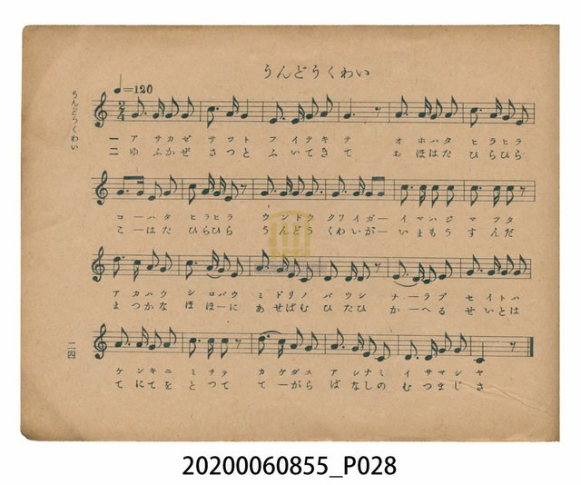
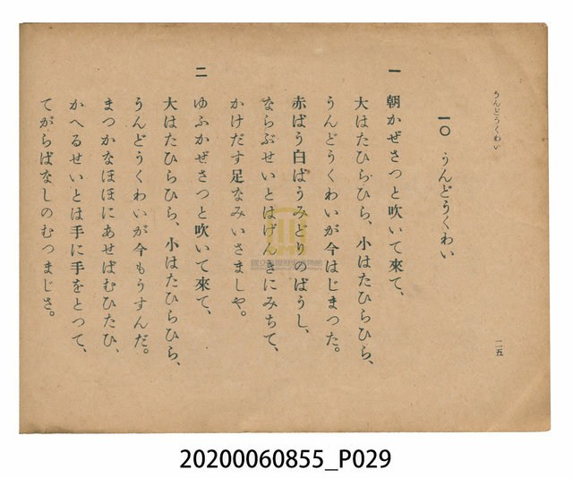

# うんどうくわい（運動會）

> Re:Shōka 使用 AI 協助辨識與重建樂譜，可能會有錯誤。歡迎回報。

- **鋼琴伴奏版**：<br><audio controls src="undokai.mp3"></audio>
- **NEUTRINO 歌聲合成版**：<br><audio controls src="undokai_neutrino.mp3"></audio>

- 日治時期公學校唱歌（第三學年・第十課）
- 國立臺灣歷史博物館典藏

## 說明


- 出處：臺灣總督府編《公學校唱歌》第三學年用，第十課〈うんどうくわい〉（運動會），原書第 24–25 頁（image.jpeg / P028、image2.jpeg / P029）。
- 調性與拍號：ハ調（C 大調），2/4 拍，速度 != 120。
- 背景與曲風：描寫公學校秋季運動會的朝氣與熱鬧場面。第一段寫晨風吹拂、大小旗幟迎風飄揚
（大はたひらひら、小はたひらひら），頭戴紅帽、白帽、綠帽的學生精神抖擻地列隊起跑；
第二段寫暮風吹起、運動會圓滿結束，滿臉通紅、額頭冒汗的學生們手牽著手，和樂融融地細數今日佳績。
全曲貫穿輕快活潑的附點進行曲節奏，充滿青春活力。
- 版本與記譜校勘說明：
1. 原書為單聲部五線譜（24 小節，每行 6 小節，共 4 行）。
2. 第 10 小節第一拍附點八分音符下方印作合拗音「クワ／くわ」。
3. 第 14 小節第二段歌詞印作「ほ ほ ー に」，圓滑線連接第 2–3 音（`6` 與 `5`）。
4. 譜面第 13 小節印作「ア カ ハ ウ」、第 19 小節印作「ケ ン キ ニ」（原譜未印濁點），歌詞頁（image2.jpeg）則印作「赤ばう」「げんきに」；譜面依原圖如實保留。

### 編曲說明（鋼琴伴奏版）：

1. 前奏 (Intro, 4 小節)：以號角般的同音附點動機與明亮終止式揭開運動會序幕。
2. 主歌伴奏 (Undokai, 24 小節 × 2 段)：右手 (PianoRH) 演奏精神飽滿的進行曲旋律；
左手 (PianoLH) 採用輕快有彈性的八分音符進行曲伴奏，帶出整齊劃一的步伐感。


## 歌詞

```text
一　朝かぜさつと吹いて來て、
大はたひらひら、小はたひらひら、
うんどうくわいが今はじまつた。
赤ばう白ばうみどりのばうし、
ならぶせいとはげんきにみちて、
かけだす足なみいさましや。

二　ゆふかぜさつと吹いて來て、
大はたひらひら、小はたひらひら、
うんどうくわいが今もうすんだ。
まつかなほほにあせばむひたひ、
かへるせいとは手に手をとつて、
てがらばなしのむつまじさ。
```

## ABC

<div class="abc-score" data-abc-src="undokai.abc" aria-label="五線譜載入中"></div>

[下載 ABC 原始檔](undokai.abc)

## TMD 檔案連結

- [主旋律 TMD 檔案](undokai.tmd) [[在 TMD Studio 編輯](https://tmdlang.github.io/Tmd-TS/#tmd=s7IKdvYPcrWy4qpTUCpJTLdSSM7PyUlNLsnMz7PKzk9PzM7Ojy_OyM9OVIKrKMvPKc1NtUovSkxJjTdGiBfnlxYlp1oVJ2fk5-fEl6RWlCTl52ejy8cXJKanWgUYGFkgZAqK8stS8xLzgLoLijLzSlJTwNoRClLLMlNSQdLFyYl58WWpRZlpmakpSE5KLSoGuRhqRUlRYl5xclFmAcgbCFX5RSUZ-UBnF2RUWmVkFpfkF2UmJ-bEZyfmIfmuJCMV6DmoJ3Iy01IxpAqA5iAbmpmemWdVkphZDnRaflpaZnJmYo4Sl5aWwuPGtsdNkx83rgQxGvsfN_U_bmx5v6fjZWP30-6pz-Y0v9_TqaClxaVoq2BoZMBlb6vgzGVjpG9iBzL82fSlzzbtfjaz6dmc-U9b1zxdu-PZgoVPp2x8trYHaMTzNWue7OgECj7dueVx824g92lv44tVm4Amgp32dE7389XdL9p3PW9c_Gzt9qf9m572znreufLlkhVPW3e8mN6vxMWlr6VgSy3ApaCg8LhhwrPZm57PXvdi1apnM_oeN0wEizbvftq-68XMqe_3zIK45_mOvc_nLn66a87z7SseN3Shee5xQzey555PWfF-Tw_cf48bOrCG6uOGTrSABep62jf_2ewdQL0KRiaPGiYbmSq8XNAIVJaZC0yCelkFqekK-gqglPi4oREsZoQkaAk043FDE9QLL1btf9aw_EVH-7Pu3hcz5wP98ri5HygINM1Z4emS5WAmyE5g9CkA1QBZLxvmP921TAESuUgmNfc8m7keZNLsTS8XAT0361l__9P1q-HB8Hx599O1i-FeeT6r5dmcuc82LAZqed628eWa5U8XbHk5dxHQRHA4NTxbtxWo_dnMFUDTnk7Y-ay7CegdoJOebuh_Nn36053zX-zvA0q9XNzyrH8WyBEKCkBXAxU8blz_uHH-48ZNj5s6oSRQ4wZgcKKLQ7z2csHaZx1bnm9pfbpjL1Dl85l7oYxtC4AMoDuB7n8-Zf7zTfueL533rGvas8m7n87Z8LRj-stZXS-2bn-xfeL7PbMhDgC5fFcP1OWz1kFcDlQDNA3u8adzJj_bvf_51gnP5gLDuwfIftHe-bJhFtABIGULe4Huedo26dnG6XCrnzZMfNbZ_bxz74uJ04EMUBKY1PNsRdOLeb1ABHTM8y0bnk3d8WR3FzB3Pdm7-fmOfdCIUVB42roCGCMvNq1-vnL_iz1Tn-5f_WzL7md7JwINfzmz5eXueS8bNr1Y2ANK4esbni7tBxne2gp01cu5k57NWApU_LRrNiKan3d2PJuzBhhnL1bMeLF2Dih5d8-AZAxglEOsNNRTgCbRpl1Pp6170bjpZfOKJ7umPN8-C6gFGElGJgrA-ADaB_L_-n6g9QpmCJGnrRsVTBSAgoiUqqBgpAcKXAVDA6g6aBrp7oV44mnr6qcdbS_nb36-ZtmTHd3Ppu182rvhyd45Tyd0POueDhR_3NDzuGn94-b17_cAEwI4dzX0wk03hpoOcxc8HoEZ98XKeRCzQEY07gaWfkDcvAdIrwYaAXIvKEInAj33smHxs76l4HwJzJbGCkBrgZ5NMEtQAIaXQoJpArKHTPQUgIEBTPBgi42hFiNsalqk8LhpNdCmfiC9DOzYRrBSS0ylG4HKNgOVrQXS3WBHdQAjABQ9c1YBlT3b3wgMIkhih3gIqbyAlA1Ayaed7XAjX2xd8rhxA6ggAtkL9PYkcNHUC_PzbIjTn-ybC7Tn6ZxpT5c1PV2_7Mn-uc-nzgT5EFpsQlIBNAyB6XBaOzAgnuxYC2Ksmvdi7XpgWQpy64beZ-2dCliLKrBRwJh-3NAALC4eN3Y_bpzzuHHq40agA0GZC1RGNi57sg9YZAIDqRGkmqQiAKoHe-Hb2APMUmA9Mx437gPbOR8agfAQAhYX0KBq3A_S3wTUsA4mMh1u_CqwjdseN84GG7wCbCpSqII0L0T4AezRiY8bFzxunPli22aQfpAKoE6g14Eumf64CVg3gF0CDEBIYIKKXHBp-XLReiAClVETdj7Z1faysQ8YPqCEumQ5sOQEFphABAkPOBdUDMJL5v59T-eseDmt--nybqB2UIGMWjaCSuxtC150bgIVUDv2Pl07AZSw-iYBi8RnU7e83NuFXHBBChNIUQ-ypanx2dqlkGITVAWsXfpkz4SnS2a93LXnaXf7857ZkGIWaCk88ncB686Gx03A4Nw6IPHf1AQWnAlWsABWFELTA9A9wKjZDUbAWAQqBUbwhsdNDSDjIVYhxeiOx01AEpEEgIU5UBuIbJoEFgGaiEgCy4AOADsUmJiAlkwHJSyQwUBFQMuBSXIq1iQwi1pJ4On2Tc-3TYbUVPCEAKypQJXVrBZQrbVgAzAtPN237tn-qfAqC1KDAU17saP_yY6uZ2t3vGyYgqcqe7Fs1dP1bZAKDejgF41dQClguD9dshKka9_0Zy39zzo2PJsHLJjAiQLoYcobdlCgoKXPxRWalwLsCGRaBWQm5uU71BjUVIOLaBtDMy07MAtbixJc1-9oANVdGrDKSwdShiE3wTSx6ATaCTK1RsFUQRcITcE0CNcoGMaBhcygUiAhYzBtDBYxA4vA5EDQACwCEofpgqhBMQhkRA3YTh_DGmA9sQgs97hpK7iKAbH2gDWBRMAyzS1A3AF3wuPmqVAdS4DsNjBrLVQGxIPBeKgpq6CmzAZXXyDV-6GqJ0FlVkLZIBbcbUYgvRDzgHkdlGPArDkQvY1QNzQC3dC4AuE2oEqIONDNjcvArF6oDIiH5rbGLqhqUEW-HsyaD5XZBPVjJ5QNYoHchj8J7OqhShIARRFSEgDFG0gIEr2Y6QRnygFSYBaYwBAFG4eUEDZDAwdbNMEiCRJFsKiFBCm4udEMCh6ICEgG1LiChiAwhprWIGIIyIdomge3aAfUonlQGWDcgS0HW4NIDY2TYQ7EElewmILEEyx-oemnaTKQDXI4RAQkAyrVoYaBkkoPwoFAPkR8H1BjE4qmmUjGLYA7kECp0ElRkjCCxxkoK2MpF8DZGZrnIcnEECxiBBYxAtOQhAMpO4zA8hBdGAkHS7EAaXUix-12aDSBGpgTkGWaQRECkgFGRTMo2z9u7oPKgNRBVEL0QyOoGZIBYVn_cfM0qB27oepBRQyo6IG4ATkx7IPGEqgAgBQNIBtBMlC9cBpUqIHEQXEJ4gMLosYNYNMboDLQzA5MUBA2LPmAzIXIgJIosLqGis-GioJSDqjwgSRIAinh6ezZFKUEnMU6Sn7GmmBwpw6kIgPqVxBELxk2QuMI0q0AsaAhAY_xRmjhDysZQGEOCjFQZwQUyo-bdkJlYOlqOzT2IWYgFQygighcFEBSCsgWiAxS0Y2UDqBlEDCWoQV-E6i8AslAqgVICgHJwGIVVhFAcj20YIemCUg6AjavwKx1UJeBfAAzCZTugO0tqB5INYTsslouLl07BWgrItrHMFYBmWsE5ipzAQA)]
- [鋼琴伴奏 TMD 檔案](undokai_piano.tmd) [[在 TMD Studio 編輯](https://tmdlang.github.io/Tmd-TS/#tmd=s7IKdvYPcrWy4qpTUCpJTLdSSM7PyUlNLsnMz7PKzk9PzM7Ojy_OyM9OVIKrKMvPKc1NtTJGiBTnlxYlp-JSX1CUX5aal5gHVFGSmFmemBefDhQoyssvik9PzUstSsxBqE0ty0xJBaksKMrMTSyqjE_JTwZalleCZH1qUTHIdQWZiXn58YlFRYl56amoSvKLSjLy04sSCzIqrTIyi0vyizKTE3PisxPzkJxVkgHUZZWaUpqcCPKtEpeWlsLjxrbHTZMfN64EMRr7Hzf1P25seb-n42Vj99Puqc_mND9u3v2ye8_zCVue7NnydGn_886O93s6FbS0uBRtFQyNDLjsbRWcuWyM9E3sQPY8m7702abdz2Y2PZsz_2nrmqdrdzxbsPDplI3P1vYADX2-Zs2THZ1Awac7twDNBXKf9ja-WLUJaCLYlU_ndD9f3f2ifdfzxsXP1m5_2r_pae-s550rXy5Z8bR1x4vp_UpcXPpaCrbUAlwKCgqPGyY8m73p-ex1L1atejaj73HDRLBo8-6n7btezJz6fs8siHue79j7fO7ip7vmPN--4nFDF5rnHjd0I3vu-ZQV7_f0wP33uKEDazg_buhEDmpgMAB1Pe2b_2z2DqBeBSOTRw2TjUwVXi5ofNzQBHXWi1X7nzUsf9HR_qy798XM-UD3PW7uBwoCDXJWeLpkOZgJMgcYJQpANUDWy4b5T3ctU4BEGMIkoEeAPod4G-QMjFgGmg1SqqBgqKfwtLMXKK6g4ZlXUpSvo2Ci8HRD__P1DZpANU92LwU65MXySS861jyf1fJ0Qs_L-Ztfzmx5uXseyF8r54McO6Pvya51z7c2PVu76Ome_mf9a19O64Z7_Omu_qc7p0JdpqBgpKfwZMduYKhCHKOgEZqXAsxfmTrAEIHaq3B4uoKRwrN1W0EOeNq_-Vlnt4JGACh_BHloKjzbMwXkiU37ni-d93Lx3me79wPd9bJh04uFPUAfP5ve_XRf9_s9syG2AcHT7csQBviADOhbCIzCF3umPt2_-tmczqd7O4BhDvJb6-qnHW1A7z1fswxuHsSVoJjbsQ2YaJ5N3fJyb9fTruYnOxqAWp6tXfpkz4RnLfOh3qM81UKBgpY-Fxc4OqygHneoMaipBnvKxtBMyw7MqlEwVdAFQlMwDcI1CoZxYCEzMNcYLGQEFjHCVASBBiAhrloU-3yQ7bOAW2cYrxBtGKtgCqEw-SCGKYQPpODyIGwAsQMa2_h8ha0QUABnwAZgnChomEGTiY4CsExNT9XLKkhNV9BXCDAwstDEohMYkkSFFQjWgEMMFG4gETOwCEwOHlRgcZguiBrMQAfb6WNYo_C4aRFY7nHTViBeDWbtAWsCiYBlmluAuAPuhMfNU6E6lgDZbWDWWqgMiAeD8VBTVkFNmQ3E_WDV-6GqJ0FlVkLZIBbcbUYgvRDzHjcC3dbYDWbNgehthLqhEeiGxhUItwFVQsSBbm5cBmb1QmVAPDS3NXZBVe8G4vVg1nyozCaoHzuhbBAL5Db8SWBXD1WSACiKkJIAKN5AQpDoxUwnOFMOkAKzwASGKCRjIRLCZmjgYIsmWCRBoggWtZAgfdy8GYhBwQMRAcmsf9wMCk9oKmlag4ghIB-iaR7coh1Qi-ZBZYBxB7YcbA0iNTROhjkQS1zBYgoST7D4haafpslANsjhEBGQDKgWhBoGSio9CAcC-RDxfUCNTSiaZiIZtwDuQAKlQidFScIIHmegrIyzDIXkeUgyMQSLwEpVEA1JOJCywwgsD9GFkXCwFAur4dEEi9vt0GhaC8QTkGWaQRECkgFGRTMo2z9u7oPKgNRBVEL0QyOoGZIBYVn_cfM0qB27oepBRQyo6IG4ATkx7IPGEqgAgBQNIBtBMlC9cBpUqIHEQXEJ4gMLosYNYNMboDLQzA5MUBA2LPmAzIXIgJLo4yYQHyQ-GyoKSjmgwgeSIAmkhKezZ1OUEnAW6yj5GWuCwZ06kIoMqF9BEL1k2AiNI2A-Bxf1j5uhIQGP8UZo4Q8rGUBhDgqxjUBxUCg_btoJlYGlq-3Q2IeYgVQwgCoicFEASSkgWyAySEU3UjqAlkHAWIYW-E2g8gokA6kWICkEJAOLVVhFAMn10IIdmiYg6ehx43Qwax3UZSAfwEwCpbvHjTOgeiDVELLL0BsRWJsqxLYh8CYI9NaNCZBhEgsThsuDKKAwcusH2NhBVg2WRTONtIqOJHci-CB3QF1lBGuTofNx6Ia12UgqfPFXvvEgS0HBgrXtiB66qKFJoOVJWsmA15m44w0amsiewO1oXA1gXTsFcDtbAciApuNoH6A0MtcIzFXmAgA)]

## 分析

```text
================================================================================
📊 TMD Song Profile: [ うんどうくわい（運動會） ]
================================================================================
⏱  Duration:       0:48 (48.0s), 48 measures total
🎼 Key & Tempo:    首調基準 C, != 120.0 BPM, <2/4>
   - 分析範圍：      由實際發聲的音符與和弦推測調性；播放脈絡另行呈現
🎤 人聲音域:    C4 (MIDI 60) – D5 (MIDI 74) [跨度: 14 個半音 / 1.2 個八度, 難度: moderate]
   - 最低音:  C4 in [Undokai[L1] #1 @ m.15, 0:14]
   - 最高音: D5 in [Undokai[L1] #1 @ m.13, 0:12]
   - 適合: soprano, mezzo-soprano, contralto, tenor, baritone, bass
🏛  結構:      Undokai[L1] (24.0s) -> Undokai[L2] (24.0s)
⚡ 編曲密度:        Peak 1 軌道同時演奏
🗝  調性診斷：       C 大調（純淨自然大調，未偵測到可信轉調）
   - 風格氣質:    純淨自然大調（陽光明朗、易唱易記，無明顯調外色彩）
   - 轉調歷程:    全曲維持單一推測調性（未偵測到可信轉調）
   - 核心骨幹音:  G, C, A, E, D
   - 調性數值:    C 大調 [相關度: 0.83, 穩定度: Moderate, 自然音純度: 100.0%]
   - 候選調性 (K-S): C 大調 (0.83), G 大調 (0.79), E 小調 (0.57)
   - 五度圈歷程:   +0 -> +0
   - 各段落調性細節:
     • [Undokai[L1] #1]: C 大調 (r: 0.83, 自然音純度: 100.0%)
     • [Undokai[L2] #1]: C 大調 (r: 0.83, 自然音純度: 100.0%)

  [ 五度圈游移軌跡 ]
              [C ]*
         F            G  
      Bb               D  
      Eb               A  
         Ab           E  
            Db       B  
               F# 
     (* = active key center)

  [ 十二半音累積音高分佈 ]
     C  : ████████████████          25.0%
     C# :                            0.0%
     D  : ██████                     9.4%
     D# :                            0.0%
     E  : ███████                   11.7%
     F  :                            0.0%
     F# :                            0.0%
     G  : ████████████████████████  38.3%
     G# :                            0.0%
     A  : ██████████                15.6%
     A# :                            0.0%
     B  :                            0.0%
--------------------------------------------------------------------------------
Assignment 軌道音域：
  - Piano         : C4 – D5 (14 個半音 / 1.2 個八度, 172 個音符)
================================================================================
```


## 原書掃描頁






