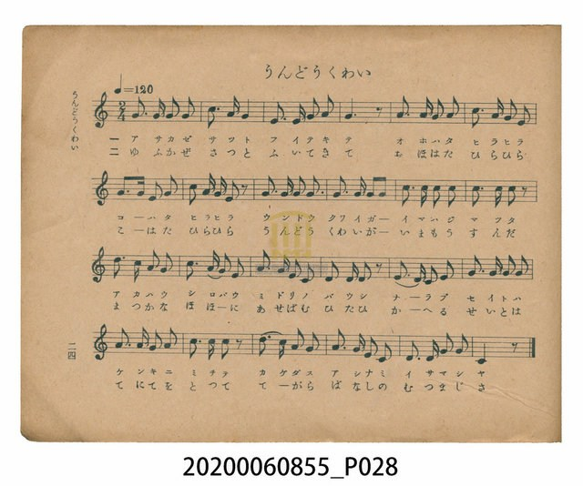
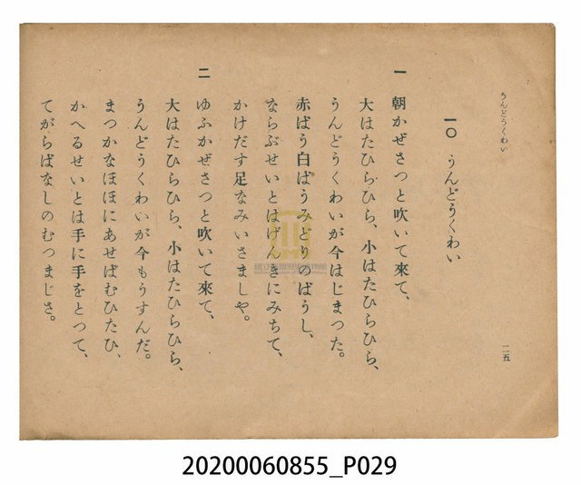

# うんどうくわい（運動會）

> Re:Shōka 使用 AI 協助辨識與重建樂譜，可能會有錯誤。歡迎回報。

- **鋼琴伴奏版**：<br><audio controls src="undokai.mp3"></audio>
- **NEUTRINO 歌聲合成版**：<br><audio controls src="undokai_neutrino.mp3"></audio>

- 日治時期公學校唱歌（第三學年・第十課）
- 國立臺灣歷史博物館典藏

## 說明


- 出處：臺灣總督府編《公學校唱歌》第三學年用，第十課〈うんどうくわい〉（運動會），原書第 24–25 頁。
- 調性與拍號：ハ調（C 大調），2/4 拍，速度 != 120。
- 背景與曲風：描寫公學校秋季運動會的朝氣與熱鬧場面。第一段寫晨風吹拂、大小旗幟迎風飄揚
（大はたひらひら、小はたひらひら），頭戴紅帽、白帽、綠帽的學生精神抖擻地列隊起跑；
第二段寫暮風吹起、運動會圓滿結束，滿臉通紅、額頭冒汗的學生們手牽著手，和樂融融地細數今日佳績。
全曲貫穿輕快活潑的附點進行曲節奏，充滿青春活力。
- 版本說明：本檔案為原書單聲部簡譜（數字譜）之忠實數位化版本。

### 編曲說明（鋼琴伴奏版）：

1. 前奏 (Intro, 4 小節)：以號角般的同音附點動機「5--5 5 5」與明亮終止式揭開運動會序幕。
2. 主歌伴奏 (Undokai, 24 小節 × 2 段)：右手 (PianoRH) 演奏精神飽滿的進行曲旋律；
左手 (PianoLH) 採用輕快有彈性的八分音符進行曲伴奏（`1_ [1] 5_ [1]`），帶出整齊劃一的步伐感。


## 歌詞

```text
一　朝かぜさつと吹いて來て、
大はたひらひら、小はたひらひら、
うんどうくわいが今はじまつた。
赤ばう白ばうみどりのばうし、
ならぶせいとはげんきにみちて、
かけだす足なみいさましや。

二　ゆふかぜさつと吹いて來て、
大はたひらひら、小はたひらひら、
うんどうくわいが今もうすんだ。
まつかなほほにあせばむひたひ、
かへるせいとは手に手をとつて、
てがらばなしのむつまじさ。
```

## ABC

```abc
X:1
T:うんどうくわい（運動會）
M:2/4
L:1/16
Q:1/4=120
K:C
V:V1 name="Piano" snm="Pia"
[V:V1]
G3 G G2 G2 | c3 A G4 | E3 E G2 A2 | G6 z2 |
w: 1.~ア サ カ ゼ | サ ツ ト | フ イ テ キ | テ
w: 2.~ゆ ふ か ぜ | さ つ と | ふ い て き | て
A3 A G2 A2 | c3 A G2 E2 | A3 G E2 G2 | c2 A G E2 z2 |
w: 1.~オ ホ ハ タ | ヒ ラ ヒ ラ | コ _ ハ タ | ヒ ラ ヒ ラ
w: 2.~お ほ は た | ひ ら ひ ら | こ _ は た | ひ ら ひ ら
G3 G G2 G2 | G3 G G2 G2 | c3 c c2 c2 | c3 c c2 z2 |
w: 1.~ウ ン ド ウ | クヮ イ ガ _ | イ マ ハ ジ | マ ツ タ
w: 2.~う ん ど う | くゎ い が _ | い ま も う | す ん だ
d3 c A2 G2 | c3 A G2 E2 | A3 A E2 C2 | D3 D D2 z2 |
w: 1.~ア カ バ ウ | シ ロ バ ウ | ミ ド リ ノ | バ ウ シ
w: 2.~ま つ か な | ほ ほ _ に | あ せ ば む | ひ た ひ
E3 D C2 E2 | G3 G G2 G2 | A3 A G2 A2 | c3 c c2 z2 |
w: 1.~ナ _ ラ ブ | セ イ ト ハ | ゲ ン キ ニ | ミ チ テ
w: 2.~か _ へ る | せ い と は | て に て を | と つ て
d3 c A2 G2 | A3 G E2 C2 | D3 D G2 G2 | C6 z2 |
w: 1.~カ ケ ダ ス | ア シ ナ ミ | イ サ マ シ | ヤ
w: 2.~て _ が ら | ば な し の | む つ ま じ | さ
```

## TMD 檔案連結

- [主旋律 TMD 檔案](undokai.tmd) [[在 TMD Studio 編輯](https://tmdlang.github.io/Tmd-TS/#tmd=s7IKdvYPcrWy4qpTUCpJTLdSSM7PyUlNLsnMz7PKzk9PzM7Ojy_OyM9OVIKrKMvPKc1NtUovSkxJjTdGiBfnlxYlp1oVJ2fk5-fEl6RWlCTl52cj5AuK8stS8xLzgGoKijLzSlJTwIoQClLLMlNSQdKpKZkl-UWZiTlIlqYWFYPcBLEkvqQoMa84uSizAORQhKqSjFSgy6AuyMlMS0VIAc1Lz8yzKknMLE_Mi89PS8tMBlugpaXwuLHtcdPkx40rQYzG_sdN_Y8bW97v6XjZ2P20e-qzOc3v93QqaGlxKdoqGBoZcNnbKjhz2Rjpm9iBDH82femzTbufzWx6Nmf-09Y1T9fueLZg4dMpG5-t7QEa8XzNmic7OoGCT3duedy8G8h92tv4YtUmoIlgpz2d0_18dfeL9l3PGxc_W7v9af-mp72znneufLlkxdPWHS-m9ytxcelrKdhSC3ApKCg8bpjwbPam57PXvVi16tmMvscNE8Gizbuftu96MXPq-z2zIO55vmPv87mLn-6a83z7iscNXWiee9zQjey551NWvN_TA_ff44YOrKH6uKETLWCBup72zX82ewdQr4KRyaOGyUamCi8XND5uaII668Wq_c8alr_oaH_W3fti5nyg-x439wMFgQY5KzxdshzMBJkDjBIFoBog62XD_Ke7lilAIgzJpOaeZzPXg0yavenlIqCDZz3r73-6fjXca8-Xdz9duxjuvOezWp7Nmftsw2KgludtG1-uWf50wZaXcxcBTQT7veHZuq1A7c9mrgCa9nTCzmfdTY8bGoFOerqh_9n06U93zn-xvw8o9XJxy7P-WSBHKCgAXQ1U8Lhx_ePG-Y8bNz1u6oSSQI0bgEGELg7x2ssFa591bHm-pfXpjr1Alc9n7oUyti0AMoDuBLr_-ZT5zzfte7503rOuac8m7346Z8PTjukvZ3W92Lr9xfaJ7_fMhjgA5PJdPVCXz1oHcTlQDdA0uMefzpn8bPf-51snPJsLDO8eIPtFe-fLhllAB4CULewFuudp26RnG6fDrX7aMPFZZ_fzzr0vJk4HMkDROqnn2YqmF_N6gQjomOdbNjybuuPJ7i5gjnmyd_PzHfugEaOg8LR1BTBGXmxa_Xzl_hd7pj7dv_rZlt3P9k4EGv5yZsvL3fNeNmx6sbAHlGrXNzxd2g8yvLUV6KqXcyc9m7EUqPhp12xEND_v7Hg2Zw0kdYPieM6aZ6umPFvY8bxpFySpPZ227kXjppfNK55vWPhi7RxglABd9nTtdDC788nO7qf7Fzxdvwzk3L29T3umQQwEWQDNPxBjgLngxcp5IMdPawemkCc71oIYq-a9WLsemKlAEb2h91l7p0JmbmJ6qpFeVkFquoK-QoCBkSXQFrBRwCT0uKEBmMYeN3Y_bpzzuHHq48YljxtBMQLKLI3LnuwD5p1lwDAHqSYp3UD1YM-FjT3AeADrmfG4cR_YzvnQ8HuxFcjZAFQNTGMQxuPG_SD9TUAN62Ai0-HGrwLbuO1x42ywwSvApk4C29n7uHE1WPNChB_AHp34uHHB48aZL7ZtBukHqQDqBHod6JLpj5uAhQTYJcAAhAQmKA7BWezlovVABErYE3Y-2dX2srEPGD6gxLBkOTC7AXMZEEHCA84F5R14du7f93TOipfTup8u7wZqB-Vi1AwFyubbFrzo3ARK1Tv2Pl07AZT4-yYB89GzqVte7u1CTu2QFAgpH0C2NDU-W7sUktdA5cbapU_2THi6ZNbLXXuedrc_75kNyZtAS-GRvwtYiDY8bgIG59YBif-mJrDgTLCCBbD8A00PQPcAo2Y3GAFjEagUGMEbHjc1gIyHWIUUozseNwFJRBIAlgBAbSCyaRJYBGgiIgksAzoA7FBgYgJaMh2UsEAGAxUBLQcmyalYk8AsaiWBp9s3Pd82GVK8wRMCsHgDlXCzWkBF3YINwLTwdN-6Z_unwss5SLEHNO3Fjv4nO7qerd3xsmEKnvLvxbJVT9e3QUpBoINfNHYBpYDh_nTJSpCufdOftfQ_69jwbN4caKIAepjyGh4KFLT0ubhC81KALbdMq4DMxLx8hxqDmmpweWtjoWUHZmBrWYDrhx0NwOJWQcNMARiOwCJXB1KEIZVgFppYdAKtBJlao6BhqqALhKaaqhq6upoKpkAIFDSMA4uawUV1QaLGYEFjuKAZUBCi3QAkbYamBySNaZKxQg3Yah9DoOzjpkVg6cdNWzWBxGog3gPSBeRDxJtbgOLNHRD7HzdPhapeAhJtAzLWAsVBLLgjHjetguqcDVLTD1SzH6J3ElR8JUh8EogBc4kRWB_EEGAGB8o3dgPxHLC-RqidjSA7G1dAXdIIdV8jyH2Ny4C4F-QSIAvhksYuqJrdIDXrgXg-RHwT1BedIPFNIAbQJfhjeVcPZbEMiRtYLBuDYxkYNUBxsBhICOxorKkBXxIxjIMKA_lAhF0CaDRynG8GKwBKIeIHFCPAOFoJYoDEV8JiExKgj5s3g0Q7gaqXQcTXP25eh5QYmtZAI6ZpCVTDPJjxOyDRPw8pQQGthDsJHPmNk-FOgkcUKGqA5gHtbNwE0tMJi1ZoQmmaDFINdDFQACwOLLH7kFNFDyyttEBF94GMaUJomIls0AKwkwjk9U7KUoERWtQAYx9XHkXPzsYKhmATwIJGUEEjSJBAygWYoCFEO5ZEgy3frwZF0wREvG6HRtNaVPHm-VBxUJ5pXgXEfRDxCVBzloHCdjs0ipohOQ-cwkBJahrE7N1ICQZYpoCSB0oi2AeNJ3BOB5UAqyDxBNUHyscgajVEtAkqCipnGjcAjW1Ayd2N8yG5G5pouhEJbAdQbTdEdDZyelkBTnwE0sDT2bOpURJgL6XR8izOBINemmBJGpBSwhAshpb9oQEEztLAAvxxMyQw4FHcCCncoQXAamikbQSJNgAZOyHisAS0HSTeBcSQwhWW_8EVCjDTgxIFqHiBCKPlemjh0ghKhKBCvGkSJFpApTw8ISyDRSFENTgKeyCFNkh0A1TtKpD4dCBeB3FHA7IZ-4B4BrhMgdQmIHfUcnHp2ilA632wq4BcZS4A)]
- [鋼琴伴奏 TMD 檔案](undokai_piano.tmd) [[在 TMD Studio 編輯](https://tmdlang.github.io/Tmd-TS/#tmd=s7IKdvYPcrWy4tLSUnjc2Pa4afLjxpUgRmP_46b-x40t7_d0vGzsfto99dmc5sfNu19273k-YcuTPVueLu1_3tnxfk-ngpYWl6KtgqGRAZe9rYIzl42RvokdV52C0rPpS59t2v1sZtOzOfOftq55unbHswULn07Z-GxtD9DQ52vWPNnRCRR8unML0Fwg92lv44tVm4AmKoF0P53T_Xx194v2Xc8bFz9bu_1p_6anvbOed658uWTF09YdL6b3K3Fx6Wsp2FILcCkoKDxumPBs9qbns9e9WLXq2Yy-xw0TwaLNu5-273oxc-r7PbMg7nm-Y-_zuYuf7przfPuKxw1daJ573NCN7LnnU1a839MD99_jhg6s4fy4oRM5qIHBANT1tG_-s9k7gHoVjEweNUw2MlV4uaDxcUMT1FkvVu1_1rD8RUf7s-7eFzPnA933uLkfKAg0yFnh6ZLlYCbIHGCUKADVAFkvG-Y_3bVMARJhSCY19zybuR5k0uxNLxcBHTzrWX__0_Wr4V6DO-zFhDXAqHk2ffrLxS3P-mc9bmgEKni-eumzji0vJk5_vqX1-cy9z7cteAoMok37ni-d93TpVCB62bDp6YItQPOfLp3yYvvE57NanrdtfLlmOcjSjQsR7gAGKNAFkOAHBQdGagO6DKRUQcFQT-FpZy9QXEHDM6-kKF9HwUTh6Yb-5-sbNIFqnuxeCgyQF8snvehYA7Ts6YSel_M3v5zZ8nL3PJA3Vs5_3NBjqqtrqgCEjxt6QR6f0fdk17rnW5uerV30dE__s_61L6d1w339dFf_051Toe5UUDDSU3iyYzcwriFOU9AIzUvJz07M1AHGE9QVCoenKxgpPFu3FeScp_2bn3V2K2gEZCbm5Qd5aCo82zMF5CVwCL1cvPfZ7v1AVwID6cXCHqD_n03vfrqv-_2e2RDbgODp9mUIA3xABvQtBCasF3umPt2_-tmczqd7O4ApAeTT1tVPO9qAnn2-ZhncPIgrgeGZYBivEG0Yq2AKphKgiWzHNmD6fjZ1y8u9XU-7mp_saACa82zt0id7JjxrAQZUExc0b0BSI9DXL1bOe9q64tm0dmC4PdmxFsRYNe_F2vXADAO05OmG3mftnQqZuYnpqUZ6WQWp6Qr6CgEGRpZA68BGAW143NDwbM7cx43djxvnPG6c-rhxyePGFU8n7ARlhMZlT_YB88UyYNICqQam48eN6x83zn_cuOlxUyeUBCa7DcBsg0Uc7FisOayx58nuLrCeGY8b94HtBHsPqOHFViBnA1A1MPVCGI8b94P0NwE1rIOJTIcbvwps47bHjbPBBq8AmzoJbGfv48bVYM0LEX4Ae3Ti48YFjxtnvti2GaQfpAKoE-h1oEumP24CFgBglwADEBKYoDw4cwUwM75ctB6Ins7ZAAyfJ7vaXjb2AcMHFG9LlkOyIRBBwgPOBWV0WNJ93r_v6ZwVwMT8dHk3UDvQGmAmBWZPoBagZ4EMYCQCM-yLzk2g5LNj79O1E4Dan_VNetoxHZIoQOLAPD5l_tOGiU9bW4GJFRh3zzYsBtnS1AhMKS-2bodkakiqebpk1stde552tz_vmQ1J4kBL4ZG_C1hANjxuAgbn1gGJ_6YmsOBMsIIFsKIHmh6A7gFGzW4wAsYiUCkwgjc8bmoAGQ-xCilGdzxuApKIJADMokBtILJpElgEaCIiCSwDOgDsUGBiAloyHZSwQAYDFQEtByZJWPmCmgRmUSsJPN2-6fm2yc-3Tng2dz48IbxsmAVEwKh70d75csEGUAm9b92z_VOftk16tnE6qFBa2PtywVqgaS929D_Z0fVs7Y6XDVOQUwTQu8879wLLfiADpGzZqqfr255O6nm2ogno4BeNXUApYLg_XbISpGvf9Gct_c86NjybNweaKIAeprz2hgIFLX0KWwXgFIdcr2hawSsWBQ1oPaoJTsi7l8IDGJS7dk6F1TjtwEh4unM-pIIEBS24lIaXxkCTgMY_3TgVqIsy34O9C3alFbRmcagxqKkG1xo2Flp2YEaNgoapgi4QmmqqaujqaoKqPJCgYRxY1AwuagwSNQILGqEohao0UKjhqkWxzwe7fSiVDJBvAmSYxMKEa8ASphB5IAVXD8JQOyiOQkjtDKx94VUzMB4RdTNKREIq5-dNuyDNN5BWaP3bA6l2gVKQAu_F5DVPu5uRa2pIzUqFWIS6Ek88YgsTBXBDswHoFgUNM6jndCA1L1LFa6GJRSfQUpJShy5I1BgsaAwXNAPFJixxgJyAqgckjTWdga32MQTKPm5aBJZ-3LRVE0isBuI9IF1APkS8uQUo3twBsf9x81So6iUg0TYgYy1QHMSCO-Jx0yqoztkgNf1ANfsheidBxVeCxCeBGDCXGIH1QQwB1ktA-cZuIJ4D1tcItbMRZGfjCqhLGqHuawS5r3EZEPeCXAJkIVzS2AVVsxukZj0Qz4eIb4L6ohMkvgnEALoEfyzv6qEsliFxA4tlY1jGBoqDxUBCYEdjTQ34kohhHFQYyAci7BKgfI0U55vBCoBSiPgBxQgwjlaCGCDxlbDYhATo4-bNINFOoOplEPH1j5vXISWGpjXQiGlaAtUwD2b8Dkj0z0NKUEAr4U4CR37jZLiT4BEFihqgeUA7GzeB9HTCohWaUJomg1QDXQwUAIsDGxp9yKmiB5ZWWqCi-0DGNCE0zEQ2aAHYSQTyeidlqcAILWqAsY-7LkDNzsYKhpgVhBEkSCDlAkzQEKIdS6LBlu9Xg6JpAiJet0OjaS2qePN8qDgozzSvAuI-iPgEqDnLQGG7HRpFzZCcB05hoCQ1DWL2bqQEAyxTQMkDJRHsg8YTOKeDSoBVkHiC6gPlYxC1GiLaBBUFlTONG4DGNqDk7sb5kNwNTTTdiAS2A6i2GyI6Gzm9rAAnPgJp4Ons2dQoCbCX0mh5FmeCQS9NsCQNaNsBLIaW_aEBBM7SwAL8cTMkMOBR3Agp3KEFwGpopG0EiTYAGTsh4rAEtB0k3gXEkMIVlv_BFQow04MSBah4gQij5Xpo4dIISoSgQrxpEiRaQKU8PCEsg0UhRDU4CnsghTZIdANU7SqQ-HQgXgdxRwOyGfuAeAa4TIHUJtCGDkq1j7U5RWy1jzfOCbXIoAyoMHILDeRzqDBcFs000iouvO40AxpplhurYAylke0CuQTqLiNYyxGdj-5PtJYlSWUrXodCLcYVJHCPYGnzgvyBw53EhSh6AYDXobjjDk_MwlxPTFNd104B3CMA2wfkQFN0tI9hLIaQEVxImQsA)]

## 分析

```text
================================================================================
📊 TMD Song Profile: [ うんどうくわい（運動會） ]
================================================================================
⏱  Duration:       0:24 (24.0s), 24 measures total
🎼 Key & Tempo:    首調基準 C, != 120.0 BPM, <2/4>
   - 分析範圍：      由實際發聲的音符與和弦推測調性；播放脈絡另行呈現
🎤 人聲音域:    C4 (MIDI 60) – D5 (MIDI 74) [跨度: 14 個半音 / 1.2 個八度, 難度: moderate]
   - 最低音:  C4 in [Undokai #1 @ m.15, 0:14]
   - 最高音: D5 in [Undokai #1 @ m.13, 0:12]
   - 適合: soprano, mezzo-soprano, contralto, tenor, baritone, bass
🏛  結構:      Undokai (24.0s)
⚡ 編曲密度:        Peak 1 軌道同時演奏
🗝  調性診斷：       C 大調（純淨自然大調，未偵測到可信轉調）
   - 風格氣質:    純淨自然大調（陽光明朗、易唱易記，無明顯調外色彩）
   - 轉調歷程:    全曲維持單一推測調性（未偵測到可信轉調）
   - 核心骨幹音:  G, C, A, E, D
   - 調性數值:    C 大調 [相關度: 0.83, 穩定度: Moderate, 自然音純度: 100.0%]
   - 候選調性 (K-S): C 大調 (0.83), G 大調 (0.77), E 小調 (0.56)
   - 五度圈歷程:   +0
   - 各段落調性細節:
     • [Undokai #1]: C 大調 (r: 0.83, 自然音純度: 100.0%)

  [ 五度圈游移軌跡 ]
              [C ]*
         F            G  
      Bb               D  
      Eb               A  
         Ab           E  
            Db       B  
               F# 
     (* = active key center)

  [ 十二半音累積音高分佈 ]
     C  : █████████████████         25.0%
     C# :                            0.0%
     D  : ██████                     9.4%
     D# :                            0.0%
     E  : ████████                  11.7%
     F  :                            0.0%
     F# :                            0.0%
     G  : ████████████████████████  36.1%
     G# :                            0.0%
     A  : ████████████              17.8%
     A# :                            0.0%
     B  :                            0.0%
--------------------------------------------------------------------------------
Assignment 軌道音域：
  - Piano         : C4 – D5 (14 個半音 / 1.2 個八度, 86 個音符)
================================================================================
```


## 原書掃描頁






