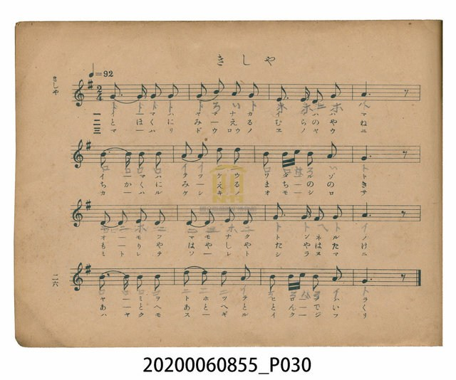
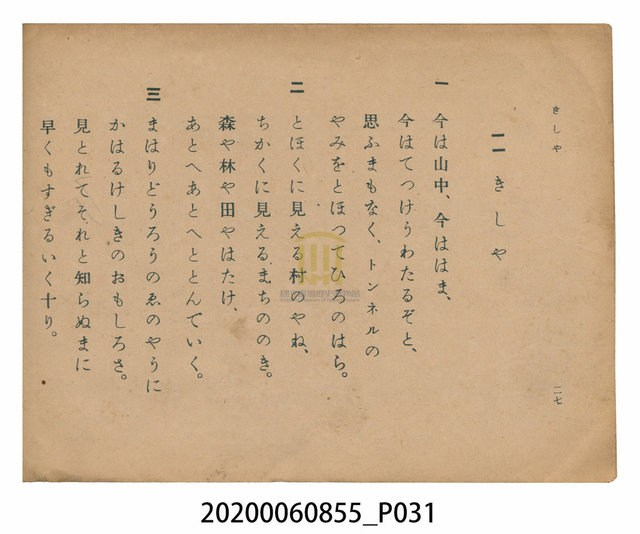

# きしゃ（火車）

<audio controls src="kisha.mp3"></audio>

- 日治時期公學校唱歌（第三學年・第十一課／原曲：1912年『尋常小学唱歌』）
- 國立臺灣歷史博物館典藏

## 說明

【曲目說明】
・出處：臺灣總督府編《公學校唱歌》第三學年用，第十一課〈きしゃ〉（火車／汽車），原書第 26–27 頁。
原曲出自 1912 年（大正元年）日本文部省《尋常小學唱歌》第三學年（大和田愛羅作曲）。
・調性與拍號：ト調（G 大調），2/4 拍，速度 != 92。
・背景與曲風：日本與臺灣日治時期最廣為人知的鐵道唱歌經典。歌詞描寫搭乘蒸汽火車飛馳，
窗外景物瞬息萬變：才剛在深山中、轉眼來到海濱，正想著要過鐵橋（てつけう）便已穿過漆黑隧道
（トンネル）駛向廣闊平原；遠村屋頂、近鎮屋簷、森林田野有如走馬燈（まはりどうろう）般向後飛逝。
・版本說明：本檔案為原書單聲部簡譜（數字譜）之忠實數位化版本。

・編曲說明（鋼琴伴奏版）：
1. 前奏 (Intro, 4 小節)：引用第四行衝出隧道、馳騁原野的明亮樂句，有如火車鳴笛啟程。
2. 主歌伴奏 (Kisha, 16 小節 × 3 段)：右手 (PianoRH) 演奏節奏鮮明的主旋律；
左手 (PianoLH) 以持續不斷的八分音符交替音型（`1_ [1] 5_ [1]`），模擬蒸汽火車車輪在鐵軌上奔馳的推進力。

## 歌詞

```text
一　今は山中、今ははま、
今はてつけうわたるぞと、
思ふまもなく、トンネルの
やみをとほつてひろのはら。

二　とほくに見える村のやね、
ちかくに見えるまちののき。
森や林や田やはたけ、
あとへあとへととんでいく。

三　まはりどうろうのゑのやうに
かはるけしきのおもしろさ。
見とれてそれと知らぬまに
早くもすぎるいく十り。
```

## ABC

```abc
X:1
T:きしゃ（火車）
C:TMD (Chen, Chih-Han / aguai)
M:2/4
L:1/16
Q:1/4=92
K:G
V:V1 name="Piano" snm="Pia"
[V:V1]
G3 G G2 G2 | G2 B2 A2 G2 | E3 E E2 G2 | A6 z2 |
B3 B B2 B2 | A2 A2 d2 d2 | B2 B c B2 A2 | G6 z2 |
D2 D2 E2 D2 | D2 D2 E2 D2 | G3 G F2 G2 | A6 z2 |
B3 B B2 B2 | d2 d2 B2 A2 | B2 B c B2 A2 | G6 z2 |
```

## TMD 檔案連結

- [主旋律 TMD 檔案](kisha.tmd) [[在 TMD Studio 編輯](https://tmdlang.github.io/Tmd-TS/#tmd=s7IKdvYPcrWy4tLSUnjc2Pu4cfrjpub3ezqeN65-sbvr_Z5OBS0tLkVbBUsjLntbBXcuGyN9EzuuOgWlZ9OXPtu0-9nMpmdz5j9tXfN07Y5nCxY-nbLx2doekPY1a57s6AQKPt255XHzbiD3aW_jkx0NL1Zter-n_2nf_GezgYxZhpaGRiAVDX1PN3Q_3bHj6Yb-p2uXQUx53NAPtF4JZNfTOd3PV3e_aN_1vHHxs7Xbn_Zveto763nnypdLVjxt3fFier8SF5e-loIttQCXgoLC44YJQDc-n73uxapVz2b0PW6YCBZt3v20fdeLmVOBjoe45_mOvc_nLn66a87z7SseN3ShBcXjhm7koHg-ZcX7PT3IofG4oQMe7I8bOpFCvv_Zxr2QKABqAYfYDqBGBSOzRw2TjcwVXi5ofNzQBHKTggIkPEEOa1-lAApTBaBdQKOeLln-bO3ip63NYG4nKMrmrHk2rf1l84rnc4Dau5BCfQdWB0MMeTqp5_mUDc9aZj_f1_pk7xxw3HVCbQeGyItV-581LH_R0f6su_fFzPnAoHnc3AEUBGp2VwBqBzNBvgCmHQWgGiDrZcP8p7uWKYATFpJBzT3PZq4HGTR708tFwKCaBXEyUAQa-UiJ7tmchqe7Fz9v2vVk167n85c-n9XycsLWl42TIf54vm0yMGkAjQayX6yc96y__-n61c8mrH2yc8aLSTuAQQsJ5peLZ79cthnoIEhAPl81_emSaUA3ABPX83lrnjWufzFhzYt1wEiY9ayz92nn7KdzVjzbvvHpxo1Pdqx93ND4Ym_n8zl7nuxre9qx4dnW7c_2bwQaBQzyZ82bX0yc_mJZ48vGPqCrnq3sBobF48ZljxuXPG6c-LixDRgeT_btf7p90_OV-4Fqnu1pe7l74stZy4Huh7gEpL4ZiDY_bu593LwaqP7l8tlPJ0wEevnl9K6nOzcD4_z9ntkvGxc8mzvx6cbulwuaQO7ZP_Fl3zog9_mG7UDus8Xrns2bDoy6l-19z-Z0Pl3W9GLrhpfL1jxv7wC7Z9_jxvWPm7oeN64EOulxEzAZghz2omMNyKJ9PaDAaZiLiJ7nnR2gyADnB1CIANPSqinPFnYA4wCSPp9OW_eicRModW1Y-GLtHKAdz6bueLp2Opjd-WRn99P9C56uXwYUfLK392nPNIiBIAugOQ5iDCTKnrauACZVYNQDgxrEWDXvxdr1wGwISpIbep-1dypk5iampxrpZRWkpivoKwQYGBsCbQEbBcxbjxsanuwGem09PLIgXDDaB-SC1UGFEBHzuKn_ceP8x03djxvnPW4E5miwumfAYGjcCtLX1PS4cdXjxn6gBHL8PG5cB_ZCU8vjxv2PmyaBtDbuBpsKNHsTOGzXgUMblm-A3oB4CRiSwIQFTF4vm1qAyQviXGAygqQtYBKBpK2XTcBUCFIGUgxOXs_79wHVIyeyJ7uA8QfWOG_Ny2mTkVMYJG2BMsnuic9mTQcqg6RaSHoCigODHphKgI6Dh-EuYGHQAPMIMFRWv1gGDJUOYNgAkxzIOyDPggIW7PPGhY8bgdIo6sApDCgO9DkQ9UJ9DkyVQK3AhAkkgWkTbAwwDuaDIgBmGDCUgfbuQGIAyRWPmyY_blz-uBGoARgBGMEIzAzAkvn5nO6n-4B5D-TKF31gr4GzByhk9k9EVvBi4XRgboEoAGYYUPCCMwwo56zYCWVsABbaG0BF0vSNQAaoKG5d8bJ5LzCFPd05FYT2NUCyytOlU140AAvq3chhuAMY3cAwxJLRwAEID0YgdzXE58BAAyoFkkC56eCqARh0XeB0BwwwIHcq1OfgUAYGSQ84ic0FM1YAC0JQEmtcA7YTbOSz6UBL-8EGzHzc2Ac2GxSAwCoI5CQsqXHDxqfN_fCS4skOcBjOmfZ86mqgr5-tWAxKPDt6n03bDiwZn_XPBsqCSu3OTU-XzHq5aw-woHmxDahmNrAchAT109alz5fOA-XAHb1ABwLJF8t2AUsDYBIFFZfTVwJTKSgA969-OmcDsJgDJldgSgYVHb2NL9t7XmwHZntwkAIdSnnlDgUKWvpcXN6ZxRmJVgGZiXn5DjUGNQrV4MLXxkLLDszA1qZQAFePDS8W9ihomCgAq87n6xt0IEURUklkoIlFJ9BGqKlAA6yAhcUScLm6B4jnAXG_Qg2QXALldQHlVwPlgWJQdRA1MHXzwNUECCAZu6sHaGzjCnBC2g3EQOWNq0HKG_cDcQfEsqZuqLEN4BKrEyizDlRygdWtxWbsjk6gsWAbIa4FuWIV2BVAzU3LgPRaCNUHFtwIVtgH8QxQHCQGshPF3BoFDUMFXV0FQ01VDV1dTQVDIKwBYmMFIzBLwyweJG0WD5UHckHCRgq6QGigUAPOX7hjaFcPzWKoDYhbgHIbwZ4DB2XzeiAbGMRglauB7H1g0Q6cUbQQktcJRVHjPrBasBgokoAYJNqLK47AKQYRR2Bzwe7cDsRrwZECifpVQPYiqF1Auea1YNGtmHFkDIoEY2gcGAMhKAqMFEyBsAbIA8qbgCRBckbg-CMuenZ0UiV6QN4AeRbklanQqABFFIgPykDroWKgiADW1UDcCwsWcFBgj52mJmjIgIxogcYEKIaBsd44HUlsPshYsChQFsgDiU3EZiwkA80Hu-Rx8xpwIoJExF6oD0BiIFeCxLaDXbsSiHvA_sGRf0zjQQiYL4AkOg81b5mTlHeezp5NjcgBZn5YWgR5fBM0Ih43z4bkH1gQNE8Cpz-ISlChAcllK3HFTmMTzFxgQQdsGoBDHRhjUB6k-AOJAflNk6EqlwMxpIDrxxk9IBlIkQWMTWASAkXFTiAG5jtovoaVxhAVoBSyA5zuQO5dhRE_2PIOKN9Acgq-vFPLxaVrpwCunEAMZS4uAA)]
- [鋼琴伴奏 TMD 檔案](kisha_piano.tmd) [[在 TMD Studio 編輯](https://tmdlang.github.io/Tmd-TS/#tmd=s7IKdvYPcrWy4tLSUnjc2Pu4cfrjpub3ezqeN65-sbvrcfPul917nk_Y8mTPlqdL-593drzf06mgpcWlaKtgacRlb6vgzmVjpG9ix1WnoPRs-tJnm3Y_m9n0bM78p61rnq7d8WzBwqdTNj5b2wMycM2aJzs6gYJPd24BGgvkPu1tfLKj4cWqTe_39D_tm_9sNpAxy9DS0AikoqHv6Ybupzt2PN3Q_3TtMogpjxv6gdYrgex6Oqf7-eruF-27njcufrZ2-9P-TU97Zz3vXPlyyYqnrTteTO9X4uLS11KwpRbgUlBQeNwwAejG57PXvVi16tmMvscNE8Gizbuftu96MXMq0PEQ9zzfsff53MVPd815vn3F44YutKB43NCNHBTPp6x4v6cHOTQeN3TAI-JxQyc8LoCh9GzjXjADKNgDDrEdQI0KRmaPGiYbmSu8XND4uKEJ5CYFBUh4ghzWvkoBFKYKQLtAETRnzbNp7S-bVzyfA1TchRTGO7A6D2j70yXLn07qeT5lw7OW2c_3tT7ZOwccU51Qu4D-f7Fq_7OG5S862p91976YOR8YEI-bO4CCQM3uCkDtYCbIzcCUogBUA2S9bJj_dNcyBXAyQjKouefZzPUgg2ZverkIGDCznvX3P12_-sWkHUCvQ4Lh5eLZL5dtftnY93Tjxmfzpj9uaHy2dfuz_RuBjJcTtj5b2Q1izFr-snEy0Jynuxe_nN4FDIyX7X2gYF41_emSaSAr2rc8Xdb0YuuGl8vWPG_veNGx5sW6rmf9s5_Panm-bTIwBQGNApoADA-gSxDuA0YokA-JfqDnMLMG0MWQ8DfUU3ja2QsUV9DwzCspytdRMFEABvPz9Q2aQDVP90wFxjso0mfPfrGw58XCucCYgjga5Hqg91Y0QhwNdBDQrie71j1b0fS0fynQD8_mdAKdDg2LzVuer5n9dOr85yuA3oZGvZGewpMdu4FOhzhMQcM7szgjUUfB0AzqAoXD0xWMFZ6t2wp2Sv_mZ53dChoBmYl5-UEemgrP9kwBeWd9A5B8uW4d0HagG0AGTu9-uq_7_Z7ZEFtAaWz7MoRWH6DWJ7uXPutpfL6r58mO3mfTtgP1PW1d_bSj7eX8zc_XLHuya8mz2fuB7KfzgMZ0JBjGK0QbxiqYgqkESAJ5tmLhs8lrkKMbhPasejpnBTBGXuwGmtz1dOkUYAiBAqZvxcuGTU-7ZoO8Ds2gkFwB9PyLlfOetq4ApnVgKniyYy2IsWrei7XrgbkWlKY39D5r71TIzE1MTzXSyypITVfQVwgwMDYEOgNsFDArPm5oeAIsARvXAxMa0ARgxEC4YLQPyAWrgwote9y45HHjxMeNbY-b-h83zn_c1P24cd7jRmABAFb3rGHu48atIH1NTY8bVz1u7AdKAHPJ4-bNj5t7Hzevfty4DuyFppbHjfsfN00CaW3cDTYVaPamx03AEmEdyKomWMYDegPiJVAsds5-1tn7sqkFGFAQ5wID88Xezudz9jzdvulpxwZgHnnZBCw5QMpAips3v5g4_Xn_PqD6F8sagbkJknee7GqDapy35uW0yU_27Qdqf75yP0gBOHkCg_3l7onPZk0HKnuyrw1oMiSLgeIanGCBjoOH4S5gadIA8wgwVFa_WAYMlQ5g2DybCwyqdWDPggIW7PPGhY8bgdIo6kABBhIH-hyIeqE-f7YYpBWU-ZtagOUS2BhgHMwHRQDMMGAoA-3dgcQAkiseN01-3Lj8cSNQAzACMILxZeMCYEH-fA4wpU8HugHoyhd9YK9t7H65AOivnhf7JyIreLFw-su-dRAFzzdsBwXv4nXQQmnFTihjA7CM3wAq06ZvBDJAJXfripfNe4Ep7OnOqSC0r-Hpvh5gsQZM2C8agOX6buQw3AGMbmAYAoMBGPXAtLYSnMSAiaENHIDwYARyV0N8Dgw0oFIgCZSbDq5JgEHXBU53wAADcqdCfQ4OZWCQ9ICT2FwwY8Xz-UtBSaxxDdhOsJHPpgMt7QcbMPNxYx_YbFAAAmsskJOwpMYNG58298NLV2CeBQXRnGnPp64G-vrZisWgxAMuIuClLqhM7tz0dMmsl7v2AEu4F9uAamY_W7sYEtRPW5c-XzoPlAN39AIdCCRfLNv1ZGc3MImCCo3pK4GpFBSA-1c_nbPh5fLZwOQKTMnPpu4AOvFle8-L7cBsDw5SoEMpbwtAgYKWPoVtDJBzUGoJTSt4NaGgAa0sNSHFzFLk4vD5tH1AX4LSFLCYXANkrAEG4Ys9U0EB0D312cr5TzdOfTmtmzLvgv0HdpYVtHJwqDGoUagGl_82Flp2YEaNgoaxgq6ugrGmqoauriawYjEGipkCobGCEZBlDJI3AUmC5EAihgq6QGigUMNVi2K-Dw7zUeoJkNlAhimED6RQ5JH5IAy1hOJIgtSnwBoTWpkC4wlRm6JEFKQ6fd60C9KaQqo3eyDVJVAKEpNo1RikwoVU2VSIN7Az8cUbtjBRALf8GoAtEgUNWDrUgVSSSHWkgSYWnUA7oaYCDbACVmNLwC2mPUA8D4j7gfHyuHkJlNcFlF8NjluYOogamLp5sBYGsrG7eoDGNq4AF3G7gRiovHE1SHnjfiDugFjW1A01tgFcl3YCZdaB6lSwurXYjN3RCTQWbCPEtSBXrAK7Aqi5aRmQXguh-sCCG8EK-yCeAYqDxEB2opgLzBPARK6rYAjNE4ZACEr3oPQPYmmYxYOkzeKh8kAuSNgInjHwx9AuYIORRjHUBsQtQLmNYM-Bg7J5PZANDGKwytVA9j6waAfOKFoIjqJuQlHUuA-sFiwGiiQgBon24oojcIpBxBHYXLA7twPxWnCkQKJ-FZC9CGoXUK55LVh0K2YcYSm3jIAQVHbhL7cIZKBOqkQPyBsgz4K8MhUaFaCIAvFBGWg9VAwUEcBWJBD3woIFHBTYY6epCRoyICNaoDEBimFgrDdORxKbDzIWLAqUBfJAYhOxGQvJQPPBLnncvAaciCARsRfqA5AYyJUgse1g164E4h6wf3DkH2BhDkTAfAEk0XmoecucpLwD6W9RHDnAzA9LiyCPb4JGxOPm2ZD8AwuC5kng9AdRCSo0ILlsJa7YaWyCmQss6ICNVnCoA2MMyoMUfyAxIL9pMlTlciCGFHD9OKMHJAMpsoCxCUxCoKjYCcTAfAfN17DSGKIClEJ2gNMdyL2rMOKHojofqW7CXucTWzfhiSrMZgM6H5icos1yY-E0csOC5DKYJJcQ2YABUiQXNnjdAbXACGYPOh-3O0nOV7QID6QGna6dArjhqABkgFMTdoYyFxcA)]

## 分析

```text
================================================================================
📊 TMD Song Profile: [ きしゃ（火車） ]
================================================================================
⏱  Duration:       0:20 (20.9s), 16 measures total
🎼 Key & Tempo:    首調基準 G, != 92.0 BPM, <2/4>
   - 分析範圍：      由實際發聲的音符與和弦推測調性；播放脈絡另行呈現
🎤 人聲音域:    D4 (MIDI 62) – D5 (MIDI 74) [跨度: 12 個半音 / 1.0 個八度, 難度: easy]
   - 最低音:  D4 in [Kisha #1 @ m.9, 0:10]
   - 最高音: D5 in [Kisha #1 @ m.6, 0:07]
   - 適合: soprano, mezzo-soprano, contralto, tenor, baritone, bass
🏛  結構:      Kisha (20.9s)
⚡ 編曲密度:        Peak 1 軌道同時演奏
🗝  調性診斷：       G 大調（純淨自然大調，未偵測到可信轉調）
   - 風格氣質:    純淨自然大調（陽光明朗、易唱易記，無明顯調外色彩）
   - 轉調歷程:    全曲維持單一推測調性（未偵測到可信轉調）
   - 核心骨幹音:  G, B, A, D, E
   - 調性數值:    G 大調 [相關度: 0.83, 穩定度: High, 自然音純度: 100.0%]
   - 候選調性 (K-S): G 大調 (0.83), D 大調 (0.66), B 小調 (0.65)
   - 五度圈歷程:   +1
   - 各段落調性細節:
     • [Kisha #1]: G 大調 (r: 0.83, 自然音純度: 100.0%)

  [ 五度圈游移軌跡 ]
               C  
         F           [G ]*
      Bb               D  
      Eb               A  
         Ab           E  
            Db       B  
               F# 
     (* = active key center)

  [ 十二半音累積音高分佈 ]
     C  : ██                         1.7%
     C# :                            0.0%
     D  : ███████████████           16.7%
     D# :                            0.0%
     E  : ████████                   8.3%
     F  :                            0.0%
     F# : ██                         1.7%
     G  : ████████████████████████  26.7%
     G# :                            0.0%
     A  : ██████████████████        20.0%
     A# :                            0.0%
     B  : ███████████████████████   25.0%
--------------------------------------------------------------------------------
Assignment 軌道音域：
  - Piano         : D4 – D5 (12 個半音 / 1.0 個八度, 54 個音符)
================================================================================
```


## 原書掃描頁






