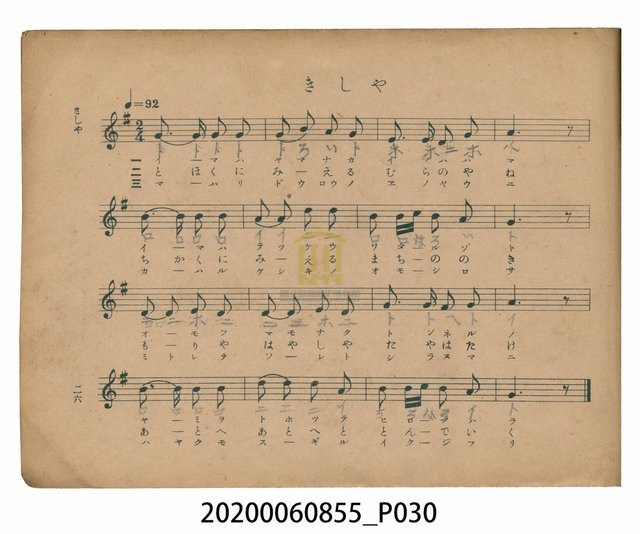
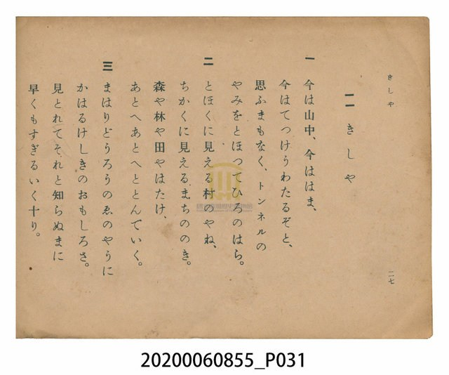

# きしゃ（火車）

> Re:Shōka 使用 AI 協助辨識與重建樂譜，可能會有錯誤。歡迎回報。

- **NEUTRINO 歌聲合成版**：<br><audio controls src="kisha_neutrino.mp3"></audio>
- **鋼琴伴奏版**：<br><audio controls src="kisha.mp3"></audio>


- 日治時期公學校唱歌（第三學年・第十一課／原曲：1912年『尋常小学唱歌』）
- 國立臺灣歷史博物館典藏

## 說明


- 出處：臺灣總督府編《公學校唱歌》第三學年用，第十一課〈きしゃ〉（火車／汽車），原書第 26–27 頁。

原曲出自 1912 年（大正元年）日本文部省《尋常小學唱歌》第三學年（大和田愛羅作曲）。
- 調性與拍號：ト調（G 大調），2/4 拍，速度 != 92。

- 背景與曲風：日本與臺灣日治時期最廣為人知的鐵道唱歌經典。歌詞描寫搭乘蒸汽火車飛馳，

窗外景物瞬息萬變：才剛在深山中、轉眼來到海濱，正想著要過鐵橋（てつけう）便已穿過漆黑隧道
（トンネル）駛向廣闊平原；遠村屋頂、近鎮屋簷、森林田野有如走馬燈（まはりどうろう）般向後飛逝。
- 版本說明：本檔案為原書單聲部簡譜（數字譜）之忠實數位化版本。


### 編曲說明（鋼琴伴奏版）：

1. 前奏 (Intro, 4 小節)：引用第四行衝出隧道、馳騁原野的明亮樂句，有如火車鳴笛啟程。
2. 主歌伴奏 (Kisha, 16 小節 × 3 段)：右手 (PianoRH) 演奏節奏鮮明的主旋律；
左手 (PianoLH) 以持續不斷的八分音符交替音型（`1_ [1] 5_ [1]`），模擬蒸汽火車車輪在鐵軌上奔馳的推進力。


## 跨冊／重複收錄參照

> 同曲＋同名異曲（《公學校唱歌》第三學年、《公學校唱歌集》與《新定兒童唱歌》三年級為大和田愛羅作曲同曲；《唱歌帖》P071 為《大正幼年唱歌》同名異曲）

- **[同曲]** 《公學校唱歌集》（大正4年／1915，國臺圖 0725 26）：[**〈汽車〉**](../../../kogakko_shokashu_1915/5_05_kisha/index.md)（`G` / `2/4` — [原始 TMD](../../../kogakko_shokashu_1915/5_05_kisha/kisha.tmd)）
- **[同曲]** 《新定兒童唱歌》尋常科第三學年用（2020.006.0847.0003）：[**〈汽車（火車）〉**](../../../shintei_jido_shoka/grade_3_2020.006.0847.0003/2_10_kisha/index.md)（`G` / `2/4` — [原始 TMD](../../../shintei_jido_shoka/grade_3_2020.006.0847.0003/2_10_kisha/kisha.tmd)）
- **[同名異曲]** 楊金土手抄《唱歌帖》第 2 冊・II（2020.006.0843）：[**〈汽車〉**](../../../shokacho/vol_02/p071_kisha/index.md)（`C` / `2/4` — [原始 TMD](../../../shokacho/vol_02/p071_kisha/kisha.tmd)）
- 總表：[跨冊重複與同名歌曲總索引](../../../duplicate_songs.md)

## 歌詞

```text
一　今は山中、今ははま、
今はてつけうわたるぞと、
思ふまもなく、トンネルの
やみをとほつてひろのはら。

二　とほくに見える村のやね、
ちかくに見えるまちののき。
森や林や田やはたけ、
あとへあとへととんでいく。

三　まはりどうろうのゑのやうに
かはるけしきのおもしろさ。
見とれてそれと知らぬまに
早くもすぎるいく十り。
```

## ABC

```abc
X:1
T:きしゃ（火車）
M:2/4
L:1/16
Q:1/4=92
K:G
V:V1 name="Piano" snm="Pia"
[V:V1]
G3 G G2 G2 | G2 B2 A2 G2 | E3 E E2 G2 | A6 z2 |
w: 1.~イ _ マ ハ | ヤ マ ナ カ | イ マ ハ ハ | マ
w: 2.~と ほ く に | み え _ る | む ら の や | ね
w: 3.~マ _ ハ リ | ド ウ ロウ ノ | ヱ ノ ヤ ウ | ニ
B3 B B2 B2 | A2 A2 d2 d2 | B2 B c B2 A2 | G6 z2 |
w: 1.~イ _ マ ハ | テ ツ ケ ウ | ワ タ _ ル ゾ | ト
w: 2.~ち か く に | み え _ る | ま ち _ の の | き
w: 3.~カ _ ハ ル | ケ シ キ ノ | オ モ _ シ ロ | サ
D2 D2 E2 D2 | D2 D2 E2 D2 | G3 G F2 G2 | A6 z2 |
w: 1.~オ _ モ フ | マ モ ナ ク | ト ン ネ ル | ノ
w: 2.~も _ り や | は や し や | た や は た | け
w: 3.~ミ ト レ テ | ソ _ レ ト | シ ラ ヌ マ | ニ
B3 B B2 B2 | d2 d2 B2 A2 | B2 B c B2 A2 | G6 z2 |
w: 1.~ヤ _ ミ ヲ | ト ホ ツ テ | ヒ ロ _ ノ ハ | ラ
w: 2.~あ _ と へ | あ と へ と | と ん _ で い | く
w: 3.~ハ ヤ ク モ | ス ギ _ ル | イ ク _ ジ フ | リ
```

## TMD 檔案連結

- [主旋律 TMD 檔案](kisha.tmd) [[在 TMD Studio 編輯](https://tmdlang.github.io/Tmd-TS/#tmd=s7IKdvYPcrWy4qpTUCpJTLdSSM7PyUlNLsnMz7PKzk9PzM7Ojy_OyM9OVIKrKMvPKc1NtUovSkxJjTdGiBfnlxYlp1oVJ2fk5-fEl6RWlCTl52cj5AuK8stS8xLzgGoKijLzSlJTwIoQClLLMlNSQdKpKZkl-UWZiTlIlqYWFYPcBLEkvqQoMa84uSizAORQhKqSjFSgy8CSBflFQKO1tBQeN_Y-bpz-uKn5_Z6O542rX-zuer-nU0FLi0vRVsHSiMveVsGdy8ZI38QOZMqz6Uufbdr9bGbTsznzn7auebp2x7MFC59O2fhsbQ9I-5o1T3Z0AgWf7tzyuHk3kPu0t_HJjoYXqza939P_tG_-s9lAxixDS0MjkIqGvqcbup_u2PF0Q__Ttcsgpjxu6AdaD3bx0zndz1d3v2jf9bxx8bO125_2b3raO-t558qXS1Y8bd3xYnq_EheXvpaCLbUAl4KCwuOGCUA3Pp-97sWqVc9m9D1umAgWbd79tH3Xi5lTgY6HuOf5jr3P5y5-umvO8-0rHjd0oQXF44Zu5KB4PmXF-z09yKHxuKEDHuyPGzqRQr7_2ca9kCgAagGH2A6gRgUjs0cNk43MFV4uaHzc0ARyk4ICJDxBDmtfpQAKUwWgXUCjni5Z_mzt4qetzWBuJyjK5qx5Nq39ZfOK53OA2ruQQn0HVgdDDHk6qef5lA3PWmY_39f6ZO8ccNx1Qm0HhsiLVfufNSx_0dH-rLv3xcz5wKB53NwBFARqdlcAagczQb4Aph0FoBog62XD_Ke7limAExaSQc09z2auBxk0e9PLRcCgmgVxMlAEGvlIie7ZnIanuxc_b9r1ZNeu5_OXPp_V8nLC1peNkyH-eL5tMjBpAI0Gsl-snPesv__p-tXPJqx9snPGi0k7gEELCeaXi2e_XLYZ6CBIQD5fNf3pkmlANwAT1_N5a541rn8xYc2LdcBImPWss_dp5-ync1Y8277x6caNT3asfdzQ-GJv5_M5e57sa3vaseHZ1u3P9m8EGgUM8mfNm19MnP5iWePLxj6gq56t7AaGxePGZY8blzxunPi4sQ0YHk_27X-6fdPzlfuBap7taXu5e-LLWcuB7oe4BKS-GYg2P27ufdy8Gqj-5fLZTydMBHr55fSupzs3A-P8_Z7ZLxsXPJs78enG7pcLmkDu2T_xZd86IPf5hu1A7rPF657Nmw6Mupftfc_mdD5d1vRi64aXy9Y8b-8Au2ff48b1j5u6HjeuBDrpcRMwGYIc9qJjDciifT2gwGmYi4ie550doMgA5wdQiADT0qopzxZ2AOMAkj6fTlv3onETKHVtWPhi7RygHc-m7ni6djqY3flkZ_fT_Querl8GFHyyt_dpzzSIgSALoDkOYgwkyp62rgAmVWDUA4MaxFg178Xa9cBsCEqSG3qftXcqZOYmpqca6WUVpKYr6CsEGBgbAm0BGwXMW48bGp7sBnptPTyyIFww2gfkgtVBhRAR87ip_3Hj_MdN3Y8b5z1uBOZosLpnwGBo3ArS19T0uHHV48Z-oARy_DxuXAf2QlPL48b9j5smgbQ27gabCjR7Ezhs14FDG5ZvgN6AeAkYksCEBUxeL5tagMkL4lxgMoKkLWASgaStl03AVAhSBlIMTl7P-_cB1SMnsie7gPEH1jhvzctpk5FTGCRtgTLJ7onPZk0HKoOkWkh6AooDgx6YSoCOg4fhLmBh0ADzCDBUVr9YBgyVDmDYAJMcyDsgz4ICFuzzxoWPG4HSKOrAKQwoDvQ5EPVCfQ5MlUCtwIQJJIFpE2wMMA7mgyIAZhgwlIH27kBiAMkVj5smP25c_rgRqAEYARjBCMwMwJL5-Zzup_uAeQ_kyhd9YK-BswcoZPZPRFbwYuF0YG6BKABmGFDwgjMMKOes2AllbAAW2htARdL0jUAGqChuXfGyeS8whT3dORWE9jVAssrTpVNeNAAL6t3IYbgDGN3AMMSS0cABCA9GIHc1xOfAQAMqBZJAuengqgEYdF3gdAcMMCB3KtTn4FAGBkkPOInNBTNWAAtCUBJrXAO2E2zks-lAS_vBBsx83NgHNhsUgMAqCOQkLKlxw8anzf3wkuLJDnAYzpn2fOpqoK-frVgMSjw7ep9N2w4sGZ_1zwbKgkrtzk1Pl8x6uWsPsKB5sQ2oZjawHIQE9dPWpc-XzgPlwB29QAcCyRfLdgFLA2ASBRWX01cCUykoAPevfjpnA7CYAyZXYEoGFR29jS_be15sB2Z7cJACHUp55Q4FClr6XFzemcUZiVYBmYl5-Q41BjXV4LLXxkLLDszA1qRQANeODS8W9ihomCgAa87n6xt0ICURUkFkoIlFJ9BCkKk1ChqGCrpAaKipqqGrq6lgCIQ1QGysYARmaZjFg-XN4qEKgHyQuBFY1EChBmyMjyFQ5eOmJWBBoKLHzfOAuB-o7nHzEiivC1ggrQaZCFMHFAap7IernIdqphFIbeMKiNrG3UC1jUC1jSAzgOUaEHeAJJq6IWY2QNQ1dYLUrQMVfmB1a1HNNAaphVoEdifI9lVg2zuBepYB6bUQqg9sbPNGqFP7QIqBXgHKgRR3w43FHzm7eiiLHGOwPcbQsDcGQlDQGymYAmENkAdUYAKSBMkZgSOO2GhpA-IWoH82wv20HqR2P0TdaqDoPrAoKJAxImUhNFK68UUKMNdD1UKjBIhBor1YogSYMlCiBGwe2G3bgXgtND4eN60CxckisDqQTPNasOhWImNjRydFsWEaD0LADAAk0Xlo2cgcVy4BeQGUnhYB8VRoqofwQPljPSTRQcIcWJ-DgqMXFhzAIECPCmBBCg5ukF5Iel8PZgGLZ6gIMALmQ3NGCygagPJAAZDKiRjR8Lh5PjjCHzevAScQkPl7wQ4B8Tsg-Ww71G0rQW7rAbufhAzxdPZs6mcIUGaAJH_iMgQwH8MTG8jHm6AJ_XHzbEimgPi9eRJILbAAAanrg2ecldgyBCgaICYCCyxgEwEcwk1wHogGiawAheBkiLrlQAyJs35sZRREEOhWUFIHxhowjYDiYycQrwNLQLLIEpCJ6yEZAmgPNE2B0hjExFouLl07BXDVAjYdyFHmAgA)]
- [鋼琴伴奏 TMD 檔案](kisha_piano.tmd) [[在 TMD Studio 編輯](https://tmdlang.github.io/Tmd-TS/#tmd=s7IKdvYPcrWy4tLSUnjc2Pu4cfrjpub3ezqeN65-sbvrcfPul917nk_Y8mTPlqdL-593drzf06mgpcWlaKtgacRlb6vgzmVjpG9ix1WnoPRs-tJnm3Y_m9n0bM78p61rnq7d8WzBwqdTNj5b2wMycM2aJzs6gYJPd24BGgvkPu1tfLKj4cWqTe_39D_tm_9sNpAxy9DS0AikoqHv6Ybupzt2PN3Q_3TtMogpjxv6gdYrgex6Oqf7-eruF-27njcufrZ2-9P-TU97Zz3vXPlyyYqnrTteTO9X4uLS11KwpRbgUlBQeNwwAejG57PXvVi16tmMvscNE8Gizbuftu96MXMq0PEQ9zzfsff53MVPd815vn3F44YutKB43NCNHBTPp6x4v6cHOTQeN3TAI-JxQyc8LoCh9GzjXjADKNgDDrEdQI0KRmaPGiYbmSu8XND4uKEJ5CYFBUh4ghzWvkoBFKYKQLtAETRnzbNp7S-bVzyfA1TchRTGO7A6D2j70yXLn07qeT5lw7OW2c_3tT7ZOwccU51Qu4D-f7Fq_7OG5S862p91976YOR8YEI-bO4CCQM3uCkDtYCbIzcCUogBUA2S9bJj_dNcyBXAyQjKouefZzPUgg2ZverkIGDCznvX3P12_-sWkHUCvQ4Lh5eLZL5dtftnY93Tjxmfzpj9uaHy2dfuz_RuBjJcTtj5b2Q1izFr-snEy0Jynuxe_nN4FDIyX7X2gYF41_emSaSAr2rc8Xdb0YuuGl8vWPG_veNGx5sW6rmf9s5_Panm-bTIwBQGNApoADA-gSxDuA0YokA-JfqDnMLMG0MWQ8DfUU3ja2QsUV9DwzCspytdRMFEABvPz9Q2aQDVP90wFxjso0mfPfrGw58XCucCYgjga5Hqg91Y0QhwNdBDQrie71j1b0fS0fynQD8_mdAKdDg2LzVuer5n9dOr85yuA3oZGvZGewpMdu4FOhzhMQcM7szgjUUfB0AzqAoXD0xWMFZ6t2wp2Sv_mZ53dChoBmYl5-UEemgrP9kwBeWd9A5B8uW4d0HagG0AGTu9-uq_7_Z7ZEFtAaWz7MoRWH6DWJ7uXPutpfL6r58mO3mfTtgP1PW1d_bSj7eX8zc_XLHuya8mz2fuB7KfzgMZ0JBjGK0QbxiqYgqkESAJ5tmLhs8lrkKMbhPasejpnBTBGXuwGmtz1dOkUYAiBAqZvxcuGTU-7ZoO8Ds2gkFwB9PyLlfOetq4ApnVgKniyYy2IsWrei7XrgbkWlKY39D5r71TIzE1MTzXSyypITVfQVwgwMDYEOgNsFDArPm5oeAIsARvXAxMa0ARgxEC4YLQPyAWrgwote9y45HHjxMeNbY-b-h83zn_c1P24cd7jRmABAFb3rGHu48atIH1NTY8bVz1u7AdKAHPJ4-bNj5t7Hzevfty4DuyFppbHjfsfN00CaW3cDTYVaPamx03AEmEdyKomWMYDegPiJVAsds5-1tn7sqkFGFAQ5wID88Xezudz9jzdvulpxwZgHnnZBCw5QMpAips3v5g4_Xn_PqD6F8sagbkJknee7GqDapy35uW0yU_27Qdqf75yP0gBOHkCg_3l7onPZk0HKnuyrw1oMiSLgeIanGCBjoOH4S5gadIA8wgwVFa_WAYMlQ5g2DybCwyqdWDPggIW7PPGhY8bgdIo6kABBhIH-hyIeqE-f7YYpBWU-ZtagOUS2BhgHMwHRQDMMGAoA-3dgcQAkiseN01-3Lj8cSNQAzACMILxZeMCYEH-fA4wpU8HugHoyhd9YK9t7H65AOivnhf7JyIreLFw-su-dRAFzzdsBwXv4nXQQmnFTihjA7CM3wAq06ZvBDJAJXfripfNe4Ep7OnOqSC0r-Hpvh5gsQZM2C8agOX6buQw3AGMbmAYAoMBGPXAtLYSnMSAiaENHIDwYARyV0N8Dgw0oFIgCZSbDq5JgEHXBU53wAADcqdCfQ4OZWCQ9ICT2FwwY8Xz-UtBSaxxDdhOsJHPpgMt7QcbMPNxYx_YbFAAAmsskJOwpMYNG58298NLV2CeBQXRnGnPp64G-vrZisWgxAMuIuClLqhM7tz0dMmsl7v2AEu4F9uAamY_W7sYEtRPW5c-XzoPlAN39AIdCCRfLNv1ZGc3MImCCo3pK4GpFBSA-1c_nbPh5fLZwOQKTMnPpu4AOvFle8-L7cBsDw5SoEMpbwtAgYKWPoVtDJBzUGoJTSt4NaGgAa0sNSHFzFLk4vD5tH1AX4LSFLCYXANkrAEG4Ys9U0EB0D312cr5TzdOfTmtmzLvgv0HdpYVtHJwqDGoqQYX_zYWWnZgRo2ChrGCLhAaa6pq6OpqAisWY6CgKRAaKxgBWcYgBSYgSZAcSMQQrN5AoYarFsV8H-zmo1QTIKOBDFMIH0ihyCPzQRhqB8VxBKlOgRUmtC4FRhOiMkWJJ0ht-rxpF6QxhVRt9kBqS6AUJCLRajFIfQupsakQbWBn4ok2bEGiAG73NQDbIwoasFSoA6kikWpIA00sOoFWQhMDJHINoYnBEAhBEQ6KeBBLwyweLG8WD1UA5IPEjeBJAmSMjyFQ5eOmJWBBoKLHzfOAuB-o7nHzEiivC1hTrgaZCFMHFAap7IernIdqphFIbeMKiNrG3UC1jUC1jSAzgBUuEHeAJJq6IWY2QNQ1dYLUrQPVymB1a1HNNAaphVoEdifI9lVg2zuBepYB6bUQqg9sbPNGqFP7QIqBXgHKgRR3w43FHzm7gC1FSiIHW041AkJQbsWfUwlFSxsQtwD9sxHup_Ugtfsh6lYDRfeBRUGBjBEpC6GR0o0vUoDVEVQtNEqAGCTaiyVKgCkDJUrA5oHdth2I10Lj43HTKlCcLAKrA8k0rwWLbiUyNnZ0UhQbwAILiIAZAEii89CykTmuXALyAig9LQLiqdBUD-GB8sd6SKKDhDmwoQkKjl5YcACDAD0qgDU8OLhBeiHpfT2YBWw3QEWAETAfmjNaQNEAlAcKgFROxIiGx83zwRH-uHkNOIGAzN8LdgiI3wHJZ9uhblsJclsP2P0kZAhI74nKGYK4qguRIYD5GJ7YQD7eBE3oj5tnQzIFxO_Nk0BqgQUISF0fPOOsxJYhQNEAMRFYYAHbruAQboLzQDRIZAUoBCdD1C0HYkic9WMroyCCQLeCkjow1oBpBBQfO4F4HVgCkkWWgExcD8kQQHugaQqUxuAVNlLNgrXCJrZmwRsx6HU-Oh-YT6LNcmPhNHKrgORilCSXENn6AFIkFyCESguQBUYwe9D5uN1Jci6iRXggtcZ07RTAjT6wgUAOOEFF-xjGogkYoQsYwwWUuQA)]

## 分析

```text
================================================================================
📊 TMD Song Profile: [ きしゃ（火車） ]
================================================================================
⏱  Duration:       0:20 (20.9s), 16 measures total
🎼 Key & Tempo:    首調基準 G, != 92.0 BPM, <2/4>
   - 分析範圍：      由實際發聲的音符與和弦推測調性；播放脈絡另行呈現
🎤 人聲音域:    D4 (MIDI 62) – D5 (MIDI 74) [跨度: 12 個半音 / 1.0 個八度, 難度: easy]
   - 最低音:  D4 in [Kisha #1 @ m.9, 0:10]
   - 最高音: D5 in [Kisha #1 @ m.6, 0:07]
   - 適合: soprano, mezzo-soprano, contralto, tenor, baritone, bass
🏛  結構:      Kisha (20.9s)
⚡ 編曲密度:        Peak 1 軌道同時演奏
🗝  調性診斷：       G 大調（純淨自然大調，未偵測到可信轉調）
   - 風格氣質:    純淨自然大調（陽光明朗、易唱易記，無明顯調外色彩）
   - 轉調歷程:    全曲維持單一推測調性（未偵測到可信轉調）
   - 核心骨幹音:  G, B, A, D, E
   - 調性數值:    G 大調 [相關度: 0.83, 穩定度: High, 自然音純度: 100.0%]
   - 候選調性 (K-S): G 大調 (0.83), D 大調 (0.66), B 小調 (0.65)
   - 五度圈歷程:   +1
   - 各段落調性細節:
     • [Kisha #1]: G 大調 (r: 0.83, 自然音純度: 100.0%)

  [ 五度圈游移軌跡 ]
               C  
         F           [G ]*
      Bb               D  
      Eb               A  
         Ab           E  
            Db       B  
               F# 
     (* = active key center)

  [ 十二半音累積音高分佈 ]
     C  : ██                         1.7%
     C# :                            0.0%
     D  : ███████████████           16.7%
     D# :                            0.0%
     E  : ████████                   8.3%
     F  :                            0.0%
     F# : ██                         1.7%
     G  : ████████████████████████  26.7%
     G# :                            0.0%
     A  : ██████████████████        20.0%
     A# :                            0.0%
     B  : ███████████████████████   25.0%
--------------------------------------------------------------------------------
Assignment 軌道音域：
  - Piano         : D4 – D5 (12 個半音 / 1.0 個八度, 54 個音符)
================================================================================
```


## 原書掃描頁






