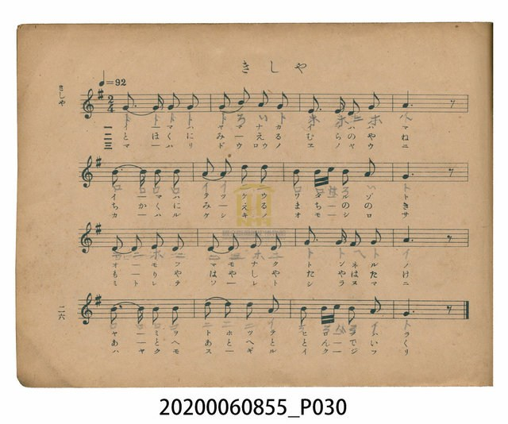
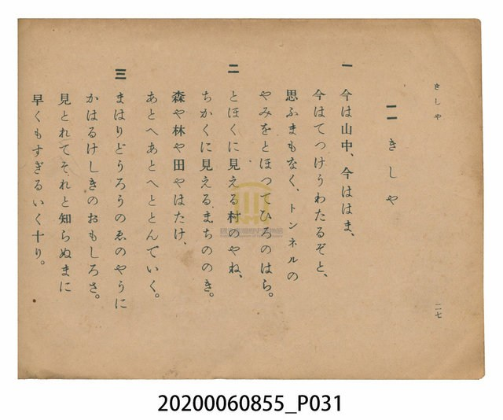

# きしゃ（火車）

> Re:Shōka 使用 AI 協助辨識與重建樂譜，可能會有錯誤。歡迎回報。

- **鋼琴伴奏版**：<br><audio controls src="kisha.mp3"></audio>
- **NEUTRINO 歌聲合成版**：<br><audio controls src="kisha_neutrino.mp3"></audio>

- 日治時期公學校唱歌（第三學年・第十一課／原曲：1912年『尋常小学唱歌』）
- 國立臺灣歷史博物館典藏

## 說明


- 出處：臺灣總督府編《公學校唱歌》第三學年用，第十一課〈きしゃ〉（火車／汽車），原書第 26–27 頁。
原曲出自 1912 年（大正元年）日本文部省《尋常小學唱歌》第三學年（大和田愛羅作曲）。
- 調性與拍號：ト調（G 大調），2/4 拍，速度 != 92。
- 背景與曲風：日本與臺灣日治時期最廣為人知的鐵道唱歌經典。歌詞描寫搭乘蒸汽火車飛馳，
窗外景物瞬息萬變：才剛在深山中、轉眼來到海濱，正想著要過鐵橋（てつけう）便已穿過漆黑隧道
（トンネル）駛向廣闊平原；遠村屋頂、近鎮屋簷、森林田野有如走馬燈（まはりどうろう）般向後飛逝。
- 版本說明：本檔案為原書單聲部簡譜（數字譜）之忠實數位化版本。

### 編曲說明（鋼琴伴奏版）：

1. 前奏 (Intro, 4 小節)：引用第四行衝出隧道、馳騁原野的明亮樂句，有如火車鳴笛啟程。
2. 主歌伴奏 (Kisha, 16 小節 × 3 段)：右手 (PianoRH) 演奏節奏鮮明的主旋律；
左手 (PianoLH) 以持續不斷的八分音符交替音型（`1_ [1] 5_ [1]`），模擬蒸汽火車車輪在鐵軌上奔馳的推進力。


## 歌詞

```text
一　今は山中、今ははま、
今はてつけうわたるぞと、
思ふまもなく、トンネルの
やみをとほつてひろのはら。

二　とほくに見える村のやね、
ちかくに見えるまちののき。
森や林や田やはたけ、
あとへあとへととんでいく。

三　まはりどうろうのゑのやうに
かはるけしきのおもしろさ。
見とれてそれと知らぬまに
早くもすぎるいく十り。
```

## ABC

<div class="abc-score" data-abc-src="kisha.abc" aria-label="五線譜載入中"></div>

[下載 ABC 原始檔](kisha.abc)

## TMD 檔案連結

- [主旋律 TMD 檔案](kisha.tmd) [[在 TMD Studio 編輯](https://tmdlang.github.io/Tmd-TS/#tmd=s7IKdvYPcrWy4qpTUCpJTLdSSM7PyUlNLsnMz7PKzk9PzM7Ojy_OyM9OVIKrKMvPKc1NtUovSkxJjTdGiBfnlxYlp1oVJ2fk5-fEl6RWlCTl52cj5AuK8stS8xLzgGoKijLzSlJTwIoQClLLMlNSQdKpKZkl-UWZiTlIlqYWFYPcBLEkvqQoMa84uSizAORQhKqSjFSgy8CSBflFSEYDTUvPzLPKzc9LKgV6B1MiNTMrE4ubgYZk5AN9WpBRaZWRWQxyVXJiTnx2Yh5SgEDdVJCYnmoVYGBsoMSlpaXwuLH3ceP0x03N7_d0PG9c_WJ31_s9nQpaWlyKtgqWRlz2tgruXDZG-iZ2IGOeTV_6bNPuZzObns2Z_7R1zdO1O54tWPh0ysZna3tA2tesebKjEyj4dOeWx827gdynvY1PdjS8WLXp_Z7-p33zn80GMmYZWhoagVQ09D3d0P10x46nG_qfrl0GMeVxQz_QerCTn87pfr66-0X7rueNi5-t3f60f9PT3lnPO1e-XLLiaeuOF9P7lbi49LUUbKkFuBQUFB43TAC68fnsdS9WrXo2o-9xw0SwaPPup-27XsycCnQ8xD3Pd-x9Pnfx011znm9f8bihCy0oHjd0IwfF8ykr3u_pQQ6Nxw0d8GB_3NCJFPL9zzbuhUQBUAs4xHYANSoYmT1qmGxkrvByQePjhiaQmxQUIOEJclj7KgVQmCoA7QIa9XTJ8mdrFz9tbQZzO0FRNmfNs2ntL5tXPJ8D1N6FFOo7sDoYYsjTST3Pp2x41jL7-b7WJ3vngOOuE2o7MERerNr_rGH5i472Z929L2bOBwbN4-YOoCBQs7sCUDuYCfIFMO0oANUAWS8b5j_dtUwBnLCQDGrueTZzPcig2ZteLgIG1SyIk4Ei0MhHSnTP5jQ83b34edOuJ7t2PZ-_9PmslpcTtr5snAzxx_Ntk4FJA2g0kP1i5bxn_f1P169-NmHtk50zXkzaAQxaSDC_XDz75bLNQAdBAvL5qulPl0wDugGYuJ7PW_Oscf2LCWterANGwqxnnb1PO2c_nbPi2faNTzdufLJj7eOGxhd7O5_P2fNkX9vTjg3Ptm5_tn8j0ChgkD9r3vxi4vQXyxpfNvYBXfVsZTcwLB43LnvcuORx48THjW3A8Hiyb__T7Zuer9wPVPNsT9vL3RNfzloOdD_EJSD1zUC0-XFz7-Pm1UD1L5fPfjphItDLL6d3Pd25GRjn7_fMftm44NnciU83dr9c0ARyz_6JL_vWAbnPN2wHcp8tXvds3nRg1L1s73s2p_PpsqYXWze8XLbmeXsH2D37Hjeuf9zU9bhxJdBJj5uAyRDksBcda0AW7esBBU7DXET0PO_sAEUGOD-AQgSYllZNebawAxgHkPT5dNq6F42bQKlrw8IXa-cA7Xg2dcfTtdPB7M4nO7uf7l_wdP0yoOCTvb1Pe6ZBDARZAM1xEGMgUfa0dQUwqQKjHhjUIMaqeS_WrgdmQ1CS3ND7rL1TITMXWHwZ6WUVpKYr6CsAizFDoC1go4B563FDw5PdQK-th0cWhAtG-4BcsDqoECJiHjf1P26c_7ip-3HjvMeNwBwNVvcMGAyNW0H6mpoeN6563NgPlECOn8eN68BeaGp53Lj_cdMkkNbG3WBTgWZvAoftOnBow_IN0BsQLwFDEpiwgMnrZVMLMHlBnAtMRpC0BUwikLT1sgmYCkHKQIrByet5_z6geuRE9mQXMP7AGueteTltMnIKg6QtUCbZPfHZrOlAZZBUC0lPQHFg0ANTCdBx8DDcBSwMGmAeAYbK6hfLgKHSAQwbYJIDeQfkWVDAgn3euPBxI1AaRR04hQHFgT4Hol6oz4GpEqgVmDCBJDBtgo0BxsF8UATADAOGMtDeHUgMILnicdPkx43LHzcCNQAjACMYgZkBWDI_n9P9dB8w74Fc-aIP7DVw9gCFzP6JyApeLJwOzC0QBcAMAwpecIYB5ZwVO6GMDcBCewOoSJq-EcgAFcWtK1427wWmsKc7p4LQvgZIVnm6dMqLBmBBvRs5DHcAoxsYhlgyGjgA4cEI5K6G-BwYaEClQBIoNx1cNQCDrguc7oABBuROhfocHMrAIOkBJ7G5YMYKYEEISmKNa8B2go18Nh1oaT_YgJmPG_vAZoMCEFgFgZyEJTVu2Pi0uR9eUjzZAQ7DOdOeT10N9PWzFYtBiWdH77Np24El47P-2UBZUKnduenpklkvd-0BFjQvtgHVzAaWg5Cgftq69PnSeaAcuKMX6EAg-WLZLmBpAEyioOJy-kpgKgUF4P7VT-dsABZzwOQKTMmgoqO38WV7z4vtwGwPDlKgQymv3KFAQUufi8s7szgj0SogMzEv36HGoKYaXPbaWGjZgRnYmhQK4Nqx4cXCHgUNEwVgzfl8fYMOpCRCKogMNLHoBFoIMrVGQcNQQRcIDTVVNXR1NRUMgbAGiI0VjMAsDbN4sLxZPFQBkA8SNwKLGijUgI3xMQSqfNy0BCwIVPS4eR4Q9wPVPW5eAuV1AQuk1SATYeqAwiCV_XCV81DNNAKpbVwBUdu4G6i2Eai2EWQGsFwD4g6QRFM3xMwGiLqmTpC6daDCD6xuLaqZxiC1UIvA7gTZvgpseydQzzIgvRZC9YGNbd4IdWofSDHQK0A5kOJuuLH4I2dXD2WRYwy2xxga9sZACAp6IwVTIKwB8oAKTECSIDkjcMQRGy1tQNwC9M9GuJ_Wg9Tuh6hbDRTdBxYFBTJGpCyERko3vkgB5nqoWmiUADFItBdLlABTBkqUgM0Du207EK-FxsfjplWgOFkEVgeSaV4LFt1KZGzs6KQoNkzjQQiYAYAkOg8tG5njyiUgL4DS0yIgngpN9RAeKH-shyQ6SJgD63NQcPTCggMYBOhRASxIwcEN0gtJ7-vBLGDxDBUBRsB8aM5oAUUDUB4oAFI5ESMaHjfPB0f44-Y14AQCMn8v2CEgfgckn22Hum0lyG09YPeTkCGezp5N_QwBygyQ5E9chgDmY3hiA_l4EzShP26eDckUEL83TwKpBRYgIHV98IyzEluGAEUDxERggQVsIoBDuAnOA9EgkRWgEJwMUbcciCFx1o-tjIIIAt0KSurAWAOmEVB87ATidWAJSBZZAjJxPSRDAO2BpilQGoOYWMvFpWunAK5awKYDOcpcAA)]
- [鋼琴伴奏 TMD 檔案](kisha_piano.tmd) [[在 TMD Studio 編輯](https://tmdlang.github.io/Tmd-TS/#tmd=s7IKdvYPcrWy4qpTUCpJTLdSSM7PyUlNLsnMz7PKzk9PzM7Ojy_OyM9OVIKrKMvPKc1NtTJGiBTnlxYlp-JSX1CUX5aal5gHVFGSmFmemBefDhQoyssvik9PzUstSsxBqE0ty0xJBaksKMrMTSyqjE_JTwZalleCZH1qUTHIdQWZiXn58YlFRYl56amoSvKLSjLy04sSCzIqrTIyi0vyizKTE3PisxPzkJxVkgHUZZWaUpqcCPItum_iCxLTU60CDIwNlLi0tBQeN_Y-bpz-uKn5_Z6O542rX-zuety8-2X3nucTtjzZs-Xp0v7nnR3v93QqaGlxKdoqWBpx2dsquHPZGOmb2IEMfjZ96bNNu5_NbHo2Z_7T1jVP1-54tmDh0ykbn63tARm4Zs2THZ1Awac7twCNBXKf9jY-2dHwYtWm93v6n_bNfzYbyJhlaGloBFLR0Pd0Q_fTHTuebuh_unYZxJTHDf1A68GeeDqn-_nq7hftu543Ln62dvvT_k1Pe2c971z5csmKp607XkzvV-Li0tdSsKUW4FJQUHjcMAHoxuez171YterZjL7HDRPBos27n7bvejFzKtDxEPc837H3-dzFT3fNeb59xeOGLrSgeNzQjRwUz6eseL-nBzk0Hjd0wCPicUMnPC6AofRs414wAyjYAw6xHUCNCkZmjxomG5krvFzQ-LihCeQmBQVIeIIc1r5KARSmCkC7QBE0Z82zae0vm1c8nwNU3IUUxjuwOg9o-9Mly59O6nk-ZcOzltnP97U-2TsHHFOdULuA_n-xav-zhuUvOtqfdfe-mDkfGBCPmzuAgkDN7gpA7WAmyM3AlKIAVANkvWyY_3TXMgVwMkIyqLnn2cz1IINmb3q5CBgws5719z9dv_rFpB1Ar0OC4eXi2S-XbX7Z2Pd048Zn86Y_bmh8tnX7s_0bgYyXE7Y-W9kNYsxa_rJxMtCcp7sXv5zeBQyMl-19oGBeNf3pkmkgK9q3PF3W9GLrhpfL1jxv73jRsebFuq5n_bOfz2p5vm0yMAUBjQKaAAwPoEsQ7gNGKJAPiX6g5zCzBtDFkPA31FN42tkLFFfQ8MwrKcrXUTBRAAbz8_UNmkA1T_dMBcY7KNJnz36xsOfFwrnAmII4GuR6oPdWNEIcDXQQ0K4nu9Y9W9H0tH8p0A_P5nQCnQ4Ni81bnq-Z_XTq_OcrgN6GRr2RnsKTHbuBToc4TEHDO7M4I1FHwdAM6gKFw9MVjBWerdsKdkr_5med3QoaAaCSJshDU-HZnikg76xvAJIv160D2g50A8jA6d1P93W_3zMbYgsojW1fhtDqA9T6ZPfSZz2Nz3f1PNnR-2zadqC-p62rn3a0vZy_-fmaZU92LXk2ez-Q_XQe0JiOBMN4hWjDWAVTMJUASSDPVix8NnkNcnSD0J5VT-esAMbIi91Ak7ueLp0CDCFQwPSteNmw6WnXbJDXoRkUkiuAnn-xct7T1hXAtA5MBU92rAUxVs17sXY9MNeC0vSG3mftnQrA4jc91UgvqyA1XUFfAVgOGgKdATYKmBUfNzQ8AZaAjeuBCQ1oAjBiIFww2gfkgtVBhZY9blzyuHHi48a2x039jxvnP27qftw473EjsAAAq3vWMPdx41aQvqamx42rHjf2AyWAueRx8-bHzb2Pm1c_blwH9kJTy-PG_Y-bJoG0Nu4Gmwo0e9PjJmCJsA5kVRMs4wG9AfESKBY7Zz_r7H3Z1AIMKIhzgYH5Ym_n8zl7nm7f9LRjAzCPvGwClhwgZSDFzZtfTJz-vH8fUP2LZY3A3ATJO092tUE1zlvzctrkJ_v2A7U_X7kfpACcPIHB_nL3xGezpgOVPdnXBjQZksVAcQ1OsEDHwcNwF7A0aYB5BBgqq18sA4ZKBzBsns0FBtU6sGdBAQv2eePCx41AaRR1oAADiQN9DkS9UJ8_WwzSCsr8TS3AcglsDDAO5oMiAGYYMJSB9u5AYgDJFY-bJj9uXP64EagBGAEYwfiycQGwIH8-B5jSpwPdAHTliz6w1zZ2v1wA9FfPi_0TkRW8WDj9Zd86iILnG7aDgnfxOmihtGInlLEBWMZvAJVp0zcCGaCSu3XFy-a9wBT2dOdUENrX8HRfD7BYAybsFw3Acn03chjuAEY3MAyBwQCMemBaWwlOYsDE0AYOQHgwArmrIT4HBhpQKZAEyk0H1yTAoOsCpztggAG5U6E-B4cyMEh6wElsLpix4vn8paAk1rgGbCfYyGfTgZb2gw2Y-bixD2w2KACBNRbISVhS44aNT5v74aUrMM-CgmjOtOdTVwN9_WzFYlDiARcR8FIXVCZ3bnq6ZNbLXXuAJdyLbUA1s5-tXQwJ6qetS58vnQfKgTt6gQ4Eki-W7XqysxuYREGFxvSVwFQKCsD9q5_O2fBy-WxgcgWm5GdTdwCd-LK958V2YLYHBynQoZS3BaBAQUufwjYGyDkotYSmFbyaUNCAVpaakGJmKXJx-HzaPqAvQWkKWEyuATLWAIPwxZ6poADonvps5fynG6e-nNZNmXfB_gM7ywpaOTjUGNRUg4t_GwstOzCjRkHDWEEXCI01VTV0dTWBFYsxUNAUCI0VjIAsY5ACE5AkSA4kYghWb6BQw1WLYr4PdvNRqgmQ0UCGKYQPpFDkkfkgDLWD4jiCVKfAChNalwKjCVGZosQTpDZ93rQL0phCqjZ7ILUlUAoSkWi1GKS-hdTYVIg2sDPxRBu2IFEAt_sagO0RBQ1YKtSBVJFINaSBJhadQCuhiQESuYbQxGAIhKAIB0U8iKVhFg-WN4uHKgDyQeJG8CQBMsbHEKjycdMSsCBQ0ePmeUDcD1T3uHkJlNcFrClXg0yEqQMKg1T2w1XOQzXTCKS2cQVEbeNuoNpGoNpGkBnACheIO0ASTd0QMxsg6po6QerWgWplsLq1qGYag9RCLQK7E2T7KrDtnUA9y4D0WgjVBza2eSPUqX0gxUCvAOVAirvhxuKPnF3AliIlkYMtpxoBISi34s-phKKlDYhbgP7ZCPfTepDa_RB1q4Gi-8CioEDGiJSF0EjpxhcpwOoIqhYaJUAMEu3FEiXAlIESJWDzwG7bDsRrofHxuGkVKE4WgdWBZJrXgkW3EhkbOzopig1ggQVEwAwAJNF5aNnIHFcuAXkBlJ4WAfFUaKqH8ED5Yz0k0UHCHNjQBAVHLyw4gEGAHhXAGh4c3CC9kPS-HswCthugIsAImA_NGS2gaADKAwVAKidiRMPj5vngCH_cvAacQEDm7wU7BMTvgOSz7VC3rQS5rQfsfhIyBKT3ROUMQVzVhcgQwHwMT2wgH2-CJvTHzbMhmQLi9-ZJILXAAgSkrg-ecVZiyxCgaICYCCywgG1XcAg3wXkgGiSyAhSCkyHqlgMxJM76sZVREEGgW0FJHRhrwDQCio-dQLwOLAHJIktAJq6HZAigPdA0BUpj8AobqWbBWmETW7PgjRj0Oh-dD8wn0Wa5sXAauVVAcjFKkkuIbH0AKZILEEKlBcgCI5g96Hzc7iQ5F9EiPJBaY7p2CuBGH9hAIAecoKJ9DGPRBIzQBYzhAspcAA)]

## 分析

```text
================================================================================
📊 TMD Song Profile: [ きしゃ（火車） ]
================================================================================
⏱  Duration:       0:20 (20.9s), 16 measures total
🎼 Key & Tempo:    首調基準 G, != 92.0 BPM, <2/4>
   - 分析範圍：      由實際發聲的音符與和弦推測調性；播放脈絡另行呈現
🎤 人聲音域:    D4 (MIDI 62) – D5 (MIDI 74) [跨度: 12 個半音 / 1.0 個八度, 難度: easy]
   - 最低音:  D4 in [Kisha #1 @ m.9, 0:10]
   - 最高音: D5 in [Kisha #1 @ m.6, 0:07]
   - 適合: soprano, mezzo-soprano, contralto, tenor, baritone, bass
🏛  結構:      Kisha (20.9s)
⚡ 編曲密度:        Peak 1 軌道同時演奏
🗝  調性診斷：       G 大調（純淨自然大調，未偵測到可信轉調）
   - 風格氣質:    純淨自然大調（陽光明朗、易唱易記，無明顯調外色彩）
   - 轉調歷程:    全曲維持單一推測調性（未偵測到可信轉調）
   - 核心骨幹音:  G, B, A, D, E
   - 調性數值:    G 大調 [相關度: 0.83, 穩定度: High, 自然音純度: 100.0%]
   - 候選調性 (K-S): G 大調 (0.83), D 大調 (0.66), B 小調 (0.65)
   - 五度圈歷程:   +1
   - 各段落調性細節:
     • [Kisha #1]: G 大調 (r: 0.83, 自然音純度: 100.0%)

  [ 五度圈游移軌跡 ]
               C  
         F           [G ]*
      Bb               D  
      Eb               A  
         Ab           E  
            Db       B  
               F# 
     (* = active key center)

  [ 十二半音累積音高分佈 ]
     C  : ██                         1.7%
     C# :                            0.0%
     D  : ███████████████           16.7%
     D# :                            0.0%
     E  : ████████                   8.3%
     F  :                            0.0%
     F# : ██                         1.7%
     G  : ████████████████████████  26.7%
     G# :                            0.0%
     A  : ██████████████████        20.0%
     A# :                            0.0%
     B  : ███████████████████████   25.0%
--------------------------------------------------------------------------------
Assignment 軌道音域：
  - Piano         : D4 – D5 (12 個半音 / 1.0 個八度, 54 個音符)
================================================================================
```


## 原書掃描頁






