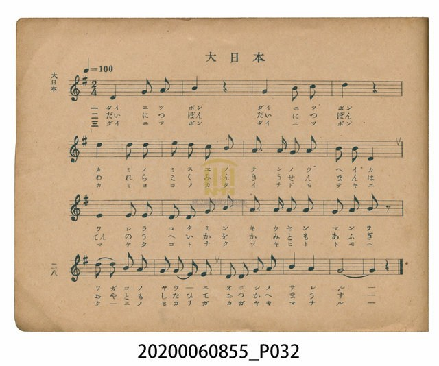
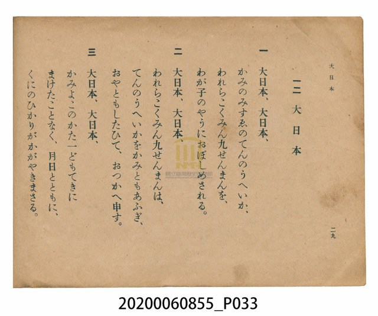

# 大日本

> Re:Shōka 使用 AI 協助辨識與重建樂譜，可能會有錯誤。歡迎回報。

- **鋼琴伴奏版**：<br><audio controls src="dainippon.mp3"></audio>
- **NEUTRINO 歌聲合成版**：<br><audio controls src="dainippon_neutrino.mp3"></audio>

- 日治時期公學校唱歌（第三學年・第十二課）
- 國立臺灣歷史博物館典藏

## 說明


- 出處：臺灣總督府編《公學校唱歌》第三學年用，第十二課〈大日本〉，原書第 28–29 頁。
- 調性與拍號：ト調（G 大調），2/4 拍，速度 != 100。
- 背景與曲風：日治時期公學校教材中之儀式／臣民教化歌曲，反映昭和時期（書載「九千萬國民」）
皇民化教育下之國家意識形態。音樂結構上採用莊重端正的 G 大調二拍子，第四樂句特意擴充為
6 小節（全曲共 18 小節），以寬廣的長音終止。
- 版本說明：本檔案為原書單聲部簡譜（數字譜）之忠實數位化版本，作為歷史教材史料保存。

### 編曲說明（鋼琴伴奏版）：

1. 前奏 (Intro, 4 小節)：取開頭「大日本」上行四度與大三和弦動機，以二分與四分音符和聲莊重起音。
2. 主歌伴奏 (Dainippon, 18 小節 × 3 段)：右手 (PianoRH) 演奏主旋律；
左手 (PianoLH) 在第一行與結尾長音處採用厚實的拍點和弦支撐，中段則以穩健的八分音符進行曲低音推展。


## 歌詞

```text
一　大日本、大日本、
かみのみすゑのてんのうへいか、
われらこくみん九せんまんを、
わが子のやうにおぼしめされる。

二　大日本、大日本、
われらこくみん九せんまんは、
てんのうへいかをかみともあふぎ、
おやともしたひて、おつかへ申す。

三　大日本、大日本、
かみよこのかた一どもてきに
まけたことなく、月日とともに、
くにのひかりがかがやきまさる。
```

## ABC

<div class="abc-score" data-abc-src="dainippon.abc" aria-label="五線譜載入中"></div>

[下載 ABC 原始檔](dainippon.abc)

## TMD 檔案連結

- [主旋律 TMD 檔案](dainippon.tmd) [[在 TMD Studio 編輯](https://tmdlang.github.io/Tmd-TS/#tmd=s7IKdvYPcrWy4qpTUCpJTLdSSM7PyUlNLsnMz7PKzk9PzM7Ojy_OyM9OVIKrKMvPKc1NtUovSkxJjTdGiBfnlxYlp1oVJ2fk5-fEl6RWlCTl52cj5AuK8stS8xLzgGoKijLzSlJTwIoQClLLMlNSQdKpKZkl-UWZiTlIlqYWFYPcBLEkvqQoMa84uSizAORQhKqSjFSgyzJzC1JRdQMNS8_Ms8rNz0sqBfoGQ6IkMRMoDPJoeWJ8bmJmXk5iXooSl5aWwtMly59NX_pszhoFLS0uRVsFQwMDLntbBXcuGyN9EzuQOSDpTbufzWx6Nmf-09Y1T9fueLZg4dMpG5-t7Xm_p-P5mjVPdnQCBZ_u3PK4eTeQ-7S38cmunherNr3f0wl2yNM53c9Xd79o3_W8cfGztduf9m962jvreefKl0tWPG3d8WJ6vxIXl76Wgi21AJeCgsLjhgnPZm96Pnvdi1Wrns3oe9wwESzavPtp-64XM6e-3zML4p7nO_Y-n7v46a45z7eveNzQhea_xw3dyP57PmXF-z09yF583NABD8DHDZ1A2ad985_N3gFUo2Bk8ahhspGlwssFjY8bmqDWv1i1_1nD8hcd7c-6e1_MnA90x-PmDqAgMCTdQXEBZoLMAYa-AlANkPWyYf7TXcsUIHGDZFJzz7OZ60Emzd70chHQYbOwRtSzqTOfzZ3wZMfaJzu7n7Y0PN3T_35P_4v2xc82TARKPe2ZBvQm0ASQy_t7n81Y8GzG2qeTgCaDDAE6CuiXF3s6Hzf0PNk592lv84sJa4CxCdT7uAHotE6QUxQUns9qB4qAjJo680XTpic7ukF2zel-um7bs5b-F2tnPN276FlrN9DpL-dvfrai6fnWCc-Wdz_Z0fWsbyEwSF_0db1s732-ev2ztYufz2pRgIUDMISBAfB07QRomM-eDdT7tH_p886dQGOfTd7ytLX1edMuiBvMFJ5u6H--vgHo5KetK4Aeetq6UcHQAi4KCtInu5c-Xb_m6W6QLS-nbgc65vnWpmdrFyHC9HlnBzAiIUkGFKBz1jxbNeXZwg6gNZB4fTpt3YvGTS-bVzzfsPDF2jmgAJq64-na6WB2J8jb-xc8Xb8MKPhkby8wRCAGguzeOwdoCCT1Q6IExJg288n-uU_XzgC5AJpqIfYAI-XFynkgn0xrB0YxMPpAjFXzXqxdD0zKIE9u6H3W3qmQmZuYnmqkl1WQmq6grxBgYGwMihWQUU92NDxuaEBKnI3IbLBljd2PG_c_blwHJmc-bpoIZi973DQZzGh73LjjcWMLSBlUQ1P_46aex02djxuBKvpB2pomA9PF48bZYD37QGTTJCTVjT3A6AMZ1gQ0Bmje6seNXY8b9zxunP64qfFx41SwcaCEAdIA9BXEh8CQh7sVlC6R2M-XzgMG8ovFU56uXQ2MxadLVgIT38uZs4FpDqRyQ_uzjolPGyaiJVag1Itl054ua3q6fSMo_3cAxTc8n7P95cLlz1pmv1i7HegCeLjtAuZ6_OFGTDA0AuMJGsrYAhQYStDQX_G4qelxIxBtfdwILKagerrAIQaRm_64cf7jxk0ggxqAgQYMwCVgzTueT9kMijfiQw9X4ADDDTkkgQEFDGdgFgAG1LOpa57s3gAKBaBgx7Zn63tBgjPXAwVBYbh67YtVC54u7Xyyrxc5DHcASwxi0l5TBzgMgWED5M4HJdnGlWA_L3vc2AtMLhCl-x43ApMmMAyASlc8blwFCvSGxmdzOoBGgkUg4bQabjYwToApDWgqMNCAYQ0MsR6wDcBIA4Yq0GCgicC0R0rCe9G-CpT2di8GFiJP9rU9m7Pq2ex9z6ZOf74VmNm3Ptm1C1RQz1rxYuL0Z2s3QZwGIvtWvGwAl63g0hBUPrR2PmvpeD5zz8tpzS8aGl7smfu8FZjgwEEHdArllR8UKGjpc3G5ACv6zIICYKsiIDMxL9-hxqCmGlxc2lho2YEZ2KpdBXCV1_BiYY-Chgm0ANWBlDRIBY2RJhadQEtBptYomMYr6CoYKhgBmcZAlgEQ1wD5ukCeCUgaJgZW7mNYAyx8Gx43LQEKPW7uBuIWoKLHzXMfN2-G6yaoAmKWEVC4cQEwm4FUNq4G4iUglY17gbkQYRYhFRCzjKnjLvwhDWxHUBTSQCtMgbAGWAWaAgPXGMjSMAIK6ioYaapq6OpqwuPBGBItSIHetBrs7vlA3Ad2N5DVtBNIb4SKaDxubgObBfSPJljscdMysMoZQNYSqAlIQd_UD1Lc1APEneBQnQzKj0C8HygyGWxiYy_ExMY2oImNs6HiwEwJZgFLTtQIQHLjCpC6ps1QdwBjrmk_2ERw8IMUNYLc2AnEi8BubAOqWAuOF8LRsKOT8gQPJIAIGBNg2jweGPIYkWEEjgxQlBgDkwdyBgD5-3HzGiBeCfNn03qozzdD_LkW4s-mZUB_Nu2Gij9ungdmPW7ehDARnA1ANQ84pNeBQhscyDuAuAVU_AINmASJDlDogBTtB0XHCqB4E1hlExBvBeI-hKHg_DAP7AJgAgEHPiQ6OoC4C-xccJIB5SyQorWg6JgElgfpBKlaBI4OkIl4owPY2ANHB6xZR3quMAWGLySkDUHxAUTgSAIiRLEEihlIsQSCNWASvVgCxkATME6gqQ4kAkr1y6D5HRQAq4CsOUB6O5BeCBbZCo1JSPEASr9YzQfHESjYQBGCCPjpQAyM88ZNoBgEiwDVAMsocKQBIxCSV8AZCFqYzcRlAzj_QNIVqGyCuB8YIaC80wx0N9BnkBwG9iPYZ2uhKQoUfyB_4PJBLReXrp0CvIYB2wcUUOYCAA)]
- [鋼琴伴奏 TMD 檔案](dainippon_piano.tmd) [[在 TMD Studio 編輯](https://tmdlang.github.io/Tmd-TS/#tmd=s7IKdvYPcrWy4tLSUni6ZPmz6UufzVnzfk_Hy-49zydsebJny9Ol_c87O97v6VTQ0uJStFUwNDDgsrdVcOeyMdI3seOqU1AC6dm0-9nMpmdz5j9tXfN07Y5nCxY-nbLx2doeoEHP16x5sqMTKPh055bHzbuB3Ke9jU929bxYtQloqBLIgKdzup-v7n7Rvut54-Jna7c_7d_0tHfW886VL5eseNq648X0fiUuLn0tBVtqAS4FBYXHDROezd70fPa6F6tWPZvR97hhIli0effT9l0vZk59v2cWxD3Pd-x9Pnfx011znm9f8bihC81_jxu6kf33fMqK93t6kL34uKEDHqqPGzqBsk_75j-bvQOoRsHI4lHDZCNLhZcLGh83NEGtf7Fq_7OG5S862p91976YOR_ojsfNHUBBYEi6gyIIzASZAwx9BaAaIOtlw_ynu5YpQOIGyaTmnmcz14NMmr3p5SKgw2ZhjahnU2c-mzvhyY61T3Z2P21peLqnH-gvoBagwc_6Fr7o63rZ3guUUoDZDvQX0NqnayeA_NK6UcHQQuHphv7n6xsgcf109uxnK5qe9i99NnnL09bW5027FMzgCjoRrgMGJ9ASSOBjTW5A94KUKigY6ik87ewFiitoeOaVFOXrKJhADdQEqnnaP-3ltO6XC9Y-buhBCuneJzu6XizsAboGGDTAMABKgWJpUs_TPcuedk99thIYsj1Pdi8F-uZpRxtIAVBlR9vL-Zufr1kGVPaicRPE6y-2bgcKQt2toGCkp_Bkx25gCEGcqqDhkpiZl1lQkJ-ngwgJhcPTFYwVnq3bCnHg5med3QoaAZmJeflBHpoKz_ZMAeoEmTK9--m-7vd7ZkOMBoKn25ch1PoA1T6dswKcvhqAfgE68vnWCU837Hs5FeQkYCIFxg8wxT3tm_V0_bLns1qA0fJy9zyIH59NWf9sEiiKgBELdMjTznagZ5-vXPm0cSlQ5dPW1XDPvmzYBDQcGBdP9vYBRZ71rXi6cSrIv9BcAkmvQB-_WDnvaeuKZ9PagQ4BmQpkrJr3Yu16YNYBRuDTDb3P2jsVMnMT01ON9LIKUtMV9BUCDIyNgVEJNgroiccNDUhR1IjMBlvW2P24cf_jxnVgcubjpolg9rLHTZPBjLbHjTseN7aAlEE1NPU_bup53NT5uBGooh-krWnyk51zHzfOBuvZByKbJiGpbuwBJlyQYU1AY4DmrX7c2PW4cc_jxumPmxofN04FGwc0HhzbQF9BfAiKRUTRiEhmoLy-dB4wc7xYPOXp2tWggF2y8vms9pczZz_ZAYzYnqcb2p91THzaMBHoqKe9zS8mrAEWdc82AMOr58WyaU-XNT3dvhFU3nQAxTc8n7P95cLlz1pmv1i7HegCeLjtApYy-MONmGBoBMYTNJSxBSgwlKChv-JxU9PjRiDa-rgRWCxC9XSBQwwiN_1x4_zHjZtABjUAAw0YgEvAmnc8n7IZFG_Ehx6uwAGGG3JIAgMKGM7AggIYUM-mrnmyewMoFICCHduere8FCc5cDxQEheHqtS9WLXi6tPPJvl7kMNwBLHmISXtNHeAwBIYNkDsflGQbV4L9vOxxYy8wuUCU7nvcCEyawDAAKl3xuHEVKNAbGp_N6QAaCRaBhNNquNnAOAGmNKCpwEADhjUwxHrANgAjDRiqQIOBJgLTHikJ70X7KlDa270YVIjta3s2Z9Wz2fueTZ3-fOuyZ1O3Ptm1C1QxzFrxYuL0Z2s3QZwGIvtWAPM7yKg53U_XbQMV-a2dz1o6ns_c83Ja84uGhhd75j5vBSY4cNABnUJ5ZQsFClr6FFbiIOegVASaVvCaQEEDWh1qgqN791JI4Q1sPbyc3QrKl-ASHVLUAYs3YI1BmefAvgE7wgparjvUGNRUgwtyGwstOzCjRsE0XkFXwVDBCMg0BrJMgRjCMgKzDIGkroKBQg1XLYppPthNMwSZFm0YC9GLzAHbE22KJgM1mOJAh1R4wFoEqbYDhj2iukMJfEh9B6z3IS0kpHquB1K9AaWer14PjCBgdQSMI2DsPF-27sW6WZAalQrxAncknrjBFigK8KpWQQOWsHQgNRpShWakiUUn0FqsMW4Aj2djYFoFSsPEwMp9DGuATaGGx01LgEKPm7uBuAWo6HHz3MfNm-G6CaqAmGUEFG5cACzOQSobVwPxEpDKxr3A0h5hFiEVELOMqeMu_CENbB9TFNLgDGUKZJkBSRNgANcAEyI4Rxlpqmro6mrC48EYEi1Igd60Guzu-UDcB3Y3kNW0E0hvhIpoPG5uA5sF9I8mWOxx0zKwyhlA1hKoCUhB39QPUtzUA8Sd4FCdDCr3gXg_UGQy2MTGXoiJjW1AExtnQ8WBhT-YBayhUSMAyY0rQOqaNkPdAYy5pv1gE8HBD1LUCHJjJxAvAruxDahiLTheCEfDjk7KEzyQACJgTIBp83hgyGNEhhE4MkBRYgwumRAZAOTvx81rgHglzJ9N66E-3wzx51qIP5uWAf3ZtBsq_rh5Hpj1uHkTwkRwNgC1cMAhvQ4U2uBA3gHELaBqHmjAJEh0gEIHpGg_KDpWAMWbwCqbgHgrEPchDAXnh3lgFwATCDjwIdHRAcRdYOeCkwwoZ4EUrQVFxySwPEgnSNUicHSATMQbHcBuCDg6YH0m0nOFKTB8ISFtCIoPIAJHEhAhiiXk6gfEglRDqMUSMAaagHECTXUgEVCqXwbN76AAWAVkzQHS24H0QrDIVmhMQooHUPrFaj44jkDBBooQRMBPB2JgnDduAsUgWASoBlhGgSMNGIGQvALOQNDCbCYuG8D5B5KuQGUTxP3ACAHlnWagu4E-g-QwsB_BPlsLTVGg-AP5A5cPgDUqWgWDtbomtoLBG5voNT6ICYxIYCrCqP9BtT9EirRil5D9UCtBVI2CCZBhEgsTRrYXRCGrJ7ncIVTIgCwwgtlDpDtgjSCSchxJAQLMXdFmubEwB8EVwPnYW2YgDoSGpyldOwVwCxBsEZADT2PRPoaxWASNsAkawwWVuQA)]

## 分析

```text
================================================================================
📊 TMD Song Profile: [ 大日本 ]
================================================================================
⏱  Duration:       0:21 (21.6s), 18 measures total
🎼 Key & Tempo:    首調基準 G, != 100.0 BPM, <2/4>
   - 分析範圍：      由實際發聲的音符與和弦推測調性；播放脈絡另行呈現
🎤 人聲音域:    D4 (MIDI 62) – E5 (MIDI 76) [跨度: 14 個半音 / 1.2 個八度, 難度: moderate]
   - 最低音:  D4 in [Dainippon #1 @ m.1, 0:00]
   - 最高音: E5 in [Dainippon #1 @ m.6, 0:06]
   - 適合: soprano, mezzo-soprano, contralto, tenor, baritone, bass
🏛  結構:      Dainippon (21.6s)
⚡ 編曲密度:        Peak 1 軌道同時演奏
🗝  調性診斷：       D 調性不明確（純淨自然大調，未偵測到可信轉調）
   - 風格氣質:    純淨自然大調（陽光明朗、易唱易記，無明顯調外色彩）
   - 轉調歷程:    全曲維持單一推測調性（未偵測到可信轉調）
   - 核心骨幹音:  D, G, A, B, E
   - 調性數值:    D 調性不明確 [相關度: 0.86, 穩定度: Ambiguous, 自然音純度: 96.9%]
   - 候選調性 (K-S): D 大調 (0.86), G 大調 (0.84), B 小調 (0.60)
   - 五度圈歷程:   +2
   - 各段落調性細節:
     • [Dainippon #1]: D 調性不明確 (r: 0.86, 自然音純度: 96.9%, 調外音: C)

  [ 五度圈游移軌跡 ]
               C  
         F            G  
      Bb              [D ]*
      Eb               A  
         Ab           E  
            Db       B  
               F# 
     (* = active key center)

  [ 十二半音累積音高分佈 ]
     C  : ██                         3.1%
     C# :                            0.0%
     D  : ████████████████████████  30.8%
     D# :                            0.0%
     E  : █████                      6.2%
     F  :                            0.0%
     F# : █                          1.5%
     G  : ██████████████████        23.1%
     G# :                            0.0%
     A  : ████████████████          20.0%
     A# :                            0.0%
     B  : ████████████              15.4%
--------------------------------------------------------------------------------
Assignment 軌道音域：
  - Piano         : D4 – E5 (14 個半音 / 1.2 個八度, 51 個音符)
================================================================================
```


## 原書掃描頁






