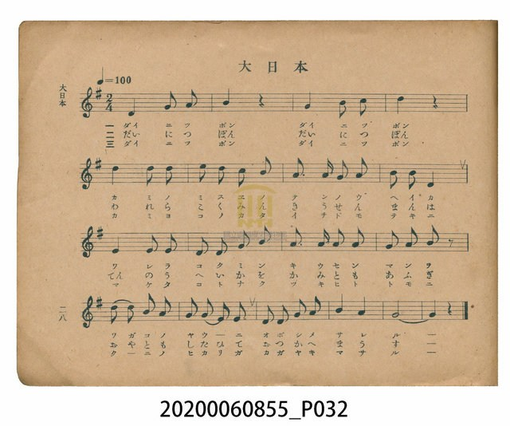
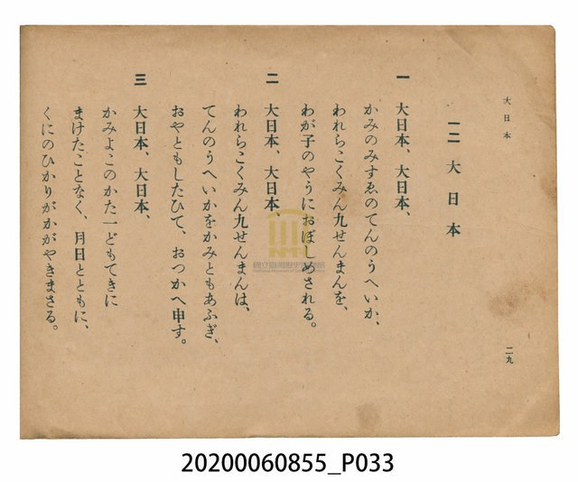

# 大日本

<audio controls src="dainippon.mp3"></audio>

- 日治時期公學校唱歌（第三學年・第十二課）
- 國立臺灣歷史博物館典藏

## 說明

【曲目說明】
・出處：臺灣總督府編《公學校唱歌》第三學年用，第十二課〈大日本〉，原書第 28–29 頁。
・調性與拍號：ト調（G 大調），2/4 拍，速度 != 100。
・背景與曲風：日治時期公學校教材中之儀式／臣民教化歌曲，反映昭和時期（書載「九千萬國民」）
皇民化教育下之國家意識形態。音樂結構上採用莊重端正的 G 大調二拍子，第四樂句特意擴充為
6 小節（全曲共 18 小節），以寬廣的長音終止。
・版本說明：本檔案為原書單聲部簡譜（數字譜）之忠實數位化版本，作為歷史教材史料保存。

・編曲說明（鋼琴伴奏版）：
1. 前奏 (Intro, 4 小節)：取開頭「大日本」上行四度與大三和弦動機，以二分與四分音符和聲莊重起音。
2. 主歌伴奏 (Dainippon, 18 小節 × 3 段)：右手 (PianoRH) 演奏主旋律；
左手 (PianoLH) 在第一行與結尾長音處採用厚實的拍點和弦支撐，中段則以穩健的八分音符進行曲低音推展。

## 跨冊／重複收錄參照

> 同曲（山本壽作曲；《公學校唱歌》第三學年、《新定兒童唱歌》第三學年與楊金土《唱歌帖》P008 皆收錄同曲）

- **[同曲]** 《新定兒童唱歌》尋常科第三學年用（2020.006.0847.0003）：[**〈大日本〉**](../../../shintei_jido_shoka/grade_3_2020.006.0847.0003/3_01_dainippon/index.md)（`G` / `2/4` — [原始 TMD](../../../shintei_jido_shoka/grade_3_2020.006.0847.0003/3_01_dainippon/dainippon.tmd)）
- **[同曲]** 楊金土手抄《唱歌帖》第 8 冊・VIII（2020.006.0843）：[**〈大日本〉**](../../../shokacho/vol_08/p008_dainippon/index.md)（`G` / `2/4` — [原始 TMD](../../../shokacho/vol_08/p008_dainippon/dainippon.tmd)）
- 總表：[跨冊重複與同名歌曲總索引](../../../duplicate_songs.md)

## 歌詞

```text
一　大日本、大日本、
かみのみすゑのてんのうへいか、
われらこくみん九せんまんを、
わが子のやうにおぼしめされる。

二　大日本、大日本、
われらこくみん九せんまんは、
てんのうへいかをかみともあふぎ、
おやともしたひて、おつかへ申す。

三　大日本、大日本、
かみよこのかた一どもてきに
まけたことなく、月日とともに、
くにのひかりがかがやきまさる。
```

## ABC

```abc
X:1
T:大日本
M:2/4
L:1/16
Q:1/4=100
K:G
V:V1 name="Piano" snm="Pia"
[V:V1]
D4 G2 A2 | B4 z4 | G4 B2 c2 | d4 z4 |
d4 d2 d2 | e2 d2 c2 B2 | A3 A G2 A2 | B2 B2 D4 |
D4 D2 D2 | E2 D2 F2 G2 | A3 A A2 A2 | G2 A2 B2 z2 |
d2 d2 B2 A2 | G2 E2 E2 E2 | D2 D2 G2 A2 | B4 A4 |
G8- | G4 z4 |
```

## TMD 檔案連結

- [主旋律 TMD 檔案](dainippon.tmd) [[在 TMD Studio 編輯](https://tmdlang.github.io/Tmd-TS/#tmd=s7IKdvYPcrWy4tLSUni6ZPmz6UufzVmjoKXFpWirYGhgwGVvq-DOZWOkb2LHVaegBJLetPvZzKZnc-Y_bV3zdO2OZwsWPp2y8dnanvd7Op6vWfNkRydQ8OnOLY-bdwO5T3sbn-zqebFq0_s9nUogA57O6X6-uvtF-67njYufrd3-tH_T095ZzztXvlyy4mnrjhfT-5W4uPS1FGypBbgUFBQeN0x4NnvT89nrXqxa9WxG3-OGiWDR5t1P23e9mDn1_Z5ZEPc837H3-dzFT3fNeb59xeOGLjT_PW7oRvbf8ykr3u_pQfbi44YOeAA-bugEyj7tm_9s9g6gGgUji0cNk40sFV4uaHzc0AS1_sWq_c8alr_oaH_W3fti5nygOx43dwAFgSHpDooLMBNkDjD0FYBqgKyXDfOf7lqmAIkbJJOae57NXA8yafaml4uADpuFNaKeTZ35bO6EJzvWPtnZ_bSl4eme_vd7-l-0L362YSJQ6mnPNKA3gSaAXN7f-2zGgmcz1j6dBDQZZAjQUUC_vNjT-bih58nOuU97m19MWAOMTaDexw1Ap3WCnKKg8HxWO1AEZNTUmS-aNj3Z0Q2ya07303XbnrX0v1g74-neRc9au4FOfzl_87MVTc-3Tni2vPvJjq5nfQuBQfqir-tle-_z1eufrV38fFaLAiwcgCEMDICnaydAw3z2bKDep_1Ln3fuBBr7bPKWp62tz5t2QdxgpvB0Q__z9Q1AJz9tXQH00NPWjQqGFnBRUJA-2b306fo1T3eDbHk5dTvQMc-3Nj1buwgRps87O4ARCUkyoACds-bZqinPFnYArYHE69Np6140bnrZvOL5hoUv1s4BBdDUHU_XTgezO0He3r_g6fplQMEne3uBIQIxEGT33jlAQyCpHxIlIMa0mU_2z326dgbIBdBUC7EHGCkvVs4D-WRaOzCKgdEHYqya92LtemBSBnlyQ--z9k6FzNzE9FQjvayC1HQFfYUAA2NjUKyAjHqyo-FxQwNS4mxEZoMta-x-3Lj_ceM6MDnzcdNEMHvZ46bJYEbb48YdjxtbQMqgGpr6Hzf1PG7qfNwIVNEP0tY0GZguHjfOBuvZByKbJiGpbuwBRh_IsCagMUDzVj9u7HrcuOdx4_THTY2PG6eCjQMlDJAGoK8gPgSGPNytoHSJxH6-dB4wkF8snvJ07WpgLD5dshKY-F7OnA1McyCVG9qfdUx82jARLbECpV4sm_Z0WdPT7RtB-b8DKL7h-ZztLxcuf9Yy-8Xa7UAXwMNtFzDX4w83YoKhERhP0FDGFqDAUIKG_orHTU2PG4Fo6-NGYDEF1dMFDjGI3PTHjfMfN24CGdQADDRgAC4Ba97xfMpmULwRH3q4AgcYbsghCQwoYDgDswAwoJ5NXfNk9wZQKAAFO7Y9W98LEpy5HigICsPVa1-sWvB0aeeTfb3IYbgDWGIQk_aaOsBhCAwbIHc-KMk2rgT7ednjxl5gcoEo3fe4EZg0gWEAVLriceMqUKA3ND6b0wE0EiwCCafVcLOBcQJMaUBTgYEGDGtgiPWAbQBGGjBUgQYDTQSmPVIS3ov2VaC0t3sxsBB5sq_t2ZxVz2bvezZ1-vOtwMy-9cmuXaCCetaKFxOnP1u7CeI0ENm34mUDuGwFl4ag8qG181lLx_OZe15Oa37R0PBiz9znrcAEBw46oFMor_ygQEFLn4vLJTEzL7OgID_PKiAzMS_focagRqEaXF7aWGjZgRnY6l0FcJ3X8GJhj4KGCbQE1YEUNUgljZEmFp1AW6GmAg2wAhapDY-bloDL1m4gblGoAZJzHzdvBpfZCmAufhVIBu7qARrYuACYg8CRvBqIl4CUN-4FZjCEgQRUILuwk4ourFEwjVfQVTBUMAIyjYEsAyCuAfJ1gTwTkDRMDJxFcAc8sF1BhYBvWg128Xwg7oN6A8hu2gmkN4LFQCJtYDWbwfzHTcvAYjOArCVQ_eiB39QP0tDUA8Sd0MCeDMpuQLwfKDYZLNILDvs2IJ4NF9sHZgELRSwRgOTSFRBDm2AuAkZg036wCCT8G4G4E4gXQV3_uGktOFaQIwEYwqZAWANsEZgCw90YyNIwUtDVVTDSVNXQ1dWEx5AxJMIIRceOTqrkA5DPHzevAeKVCE82rYd6fDNYZC04dJcB8W6YWPM8aARtwpYXQDULkFoHDm9IfOwA4hZQ8Qo0ZRJYBBQ84PhpXAEUawKLNQHxViAGJQ2MDDEP7AxgKgGGPSI-OoC4C-xkkLPAGQwc-pPAciAxkIpFGPEBCmMgAUTAKAHT5vHAOECPFSNwrIDixhiYSwhECrApCI4UWKOP_Eh53ASMEmh6A_kBlPKBEdC8B-wPkN9XAVlzgPR2IL0QLLIVGpWQXAVKvbCCYg9qkYCIKFDAtYBNRYqE6UAMjPzGTaCYBIsAlQELLHDkASMSknEgmQkSuTPx2wXJTqA0BXE-zFPAKAJlpWagV4DeBXkBlLFAaRHk3bXQdAaKUJDXCHgKlMVMgZEEiS5gjEIQOKaBCFH-AaMXWv6BYA2YhJR_tVxcunYK8MoJxFHm4gIA)]
- [鋼琴伴奏 TMD 檔案](dainippon_piano.tmd) [[在 TMD Studio 編輯](https://tmdlang.github.io/Tmd-TS/#tmd=s7IKdvYPcrWy4tLSUni6ZPmz6UufzVnzfk_Hy-49zydsebJny9Ol_c87O97v6VTQ0uJStFUwNDDgsrdVcOeyMdI3seOqU1AC6dm0-9nMpmdz5j9tXfN07Y5nCxY-nbLx2doeoEHP16x5sqMTKPh055bHzbuB3Ke9jU929bxYtQloqBLIgKdzup-v7n7Rvut54-Jna7c_7d_0tHfW886VL5eseNq648X0fiUuLn0tBVtqAS4FBYXHDROezd70fPa6F6tWPZvR97hhIli0effT9l0vZk59v2cWxD3Pd-x9Pnfx011znm9f8bihC81_jxu6kf33fMqK93t6kL34uKEDHqqPGzqBsk_75j-bvQOoRsHI4lHDZCNLhZcLGh83NEGtf7Fq_7OG5S862p91976YOR_ojsfNHUBBYEi6gyIIzASZAwx9BaAaIOtlw_ynu5YpQOIGyaTmnmcz14NMmr3p5SKgw2ZhjahnU2c-mzvhyY61T3Z2P21peLqnH-gvoBagwc_6Fr7o63rZ3guUUoDZDvQX0NqnayeA_NK6UcHQQuHphv7n6xsgcf109uxnK5qe9i99NnnL09bW5027FMzgCjoRrgMGJ9ASSOBjTW5A94KUKigY6ik87ewFiitoeOaVFOXrKJhADdQEqnnaP-3ltO6XC9Y-buhBCuneJzu6XizsAboGGDTAMABKgWJpUs_TPcuedk99thIYsj1Pdi8F-uZpRxtIAVBlR9vL-Zufr1kGVPaicRPE6y-2bgcKQt2toGCkp_Bkx25gCEGcqqDhkpiZl1lQkJ-ngwgJhcPTFYwVnq3bCnHg5med3QoaAZmJeflBHpoKz_ZMAeoEmTK9--m-7vd7ZkOMBoKn25ch1PoA1T6dswKcvhqAfgE68vnWCU837Hs5FeQkYCIFxg8wxT3tm_V0_bLns1qA0fJy9zyIH59NWf9sEiiKgBELdMjTznagZ5-vXPm0cSlQ5dPW1XDPvmzYBDQcGBdP9vYBRZ71rXi6cSrIv9BcAkmvQB-_WDnvaeuKZ9PagQ4BmQpkrJr3Yu16YNYBRuDTDb3P2jsVMnMT01ON9LIKUtMV9BUCDIyNgVEJNgroiccNDUhR1IjMBlvW2P24cf_jxnVgcubjpolg9rLHTZPBjLbHjTseN7aAlEE1NPU_bup53NT5uBGooh-krWnyk51zHzfOBuvZByKbJiGpbuwBJlyQYU1AY4DmrX7c2PW4cc_jxumPmxofN04FGwc0HhzbQF9BfAiKRUTRiEhmoLy-dB4wc7xYPOXp2tWggF2y8vms9pczZz_ZAYzYnqcb2p91THzaMBHoqKe9zS8mrAEWdc82AMOr58WyaU-XNT3dvhFU3nQAxTc8n7P95cLlz1pmv1i7HegCeLjtApYy-MONmGBoBMYTNJSxBSgwlKChv-JxU9PjRiDa-rgRWCxC9XSBQwwiN_1x4_zHjZtABjUAAw0YgEvAmnc8n7IZFG_Ehx6uwAGGG3JIAgMKGM7AggIYUM-mrnmyewMoFICCHduere8FCc5cDxQEheHqtS9WLXi6tPPJvl7kMNwBLHmISXtNHeAwBIYNkDsflGQbV4L9vOxxYy8wuUCU7nvcCEyawDAAKl3xuHEVKNAbGp_N6QAaCRaBhNNquNnAOAGmNKCpwEADhjUwxHrANgAjDRiqQIOBJgLTHikJ70X7KlDa270YVIjta3s2Z9Wz2fueTZ3-fOuyZ1O3Ptm1C1QxzFrxYuL0Z2s3QZwGIvtWAPM7yKg53U_XbQMV-a2dz1o6ns_c83Ja84uGhhd75j5vBSY4cNABnUJ5ZQsFClr6FFbiIOegVASaVvCaQEEDWh1qgqN791JI4Q1sPbyc3QrKl-ASHVLUAYs3YI1BmefAvgE7wgparjvUGNQoVINLchsLLTswo0bBNF5BV8FQwQjINAayTIEYwjICswyBpK6CgUINVy2KcT44jDMEGRdtGAvRjMwBWxRtiiYDNZniYIdUecB6BKm-A4Y-osJDCX5IjQes-SFtJKSargdSwQGlnq9eD4wiYIUEjCVg_Dxftu7FulmQOpUKMQN3JL7YwRYqCvDaVkEDlrZ0IJUaUp1mpIlFJ9BeqKlAA6yATZyGx01LwG2dbiBuAUbL4-a5j5s3Q6t6EBe_CiQDd_UADWxcACyrwcXJaiBeAlLeuBdYlCMMJKAC2YWdVHQhRjI3gCduY2AOBUrDxMCFMe6AB7aYqRDwTavBLp4PxH1QbwDZTTuB9EawGEikDaxmM5j_uGkZWGwGkLUEqh898Jv6QRqaeoC4ExrYk0EFOxDvB4pNBov0gsO-DYhnw8X2gVnA6hdLBCC5dAXE0CaYi4AR2LQfLAIJ_0Yg7gTiRVDXP25aC44V5EgAFzCmQJYZkDQBhn0NMF8q6AILG01VDV1dTXgMGUMijFB07OikSj4A-fxx8xogXonwZNN6qMc3g0XWgkN3GRDvhok1z4NG0CZseQHUhgFS68DhDYmPHUDcAqrIgaZMAouAggccP40rgGJNYLEmIN4KxKCkgZEh5oGdAUwlwLBHxEcHEHeBnQxyFjiDgUN_ElgOJAZSsQgjPkBhDCSACBglYNo8HhgH6LFiBI4VUNwYgwtsvJEC7KaAIwXWpyI_Uh43AaMEmt5AfgClfGAENO8B-wPk91VA1hwgvR1ILwSLbIVGJSRXgVIvrKDYg1okICIKFHAtYFORImE6EAMjv3ETKCbBIkBlwAILHHnAiIRkHEhmgkTuTPx2QbITKE1BnA_zFDCKQFmpGegVoHdBXgBlLFBaBHl3LTSdgSIU5DUCngJlMVNgJEGiCxijEASOaSBClH_IlTuIBankQRkOWBmj1U3Yq3pi6yY8cY3ZWgAxge4EpjGMtgOo5QCRIq2IJmQ_1EoQVaNgAmSYxMKEke0FUcjqSS6b8LoDaoERzB4i3QFrQJGUH0kKEGDiiTbLjYU5CK4AzsfeqgNxIDQ8UenaKYCbjwpABjyB4ecoc3EBAA)]

## 分析

```text
================================================================================
📊 TMD Song Profile: [ 大日本 ]
================================================================================
⏱  Duration:       0:21 (21.6s), 18 measures total
🎼 Key & Tempo:    首調基準 G, != 100.0 BPM, <2/4>
   - 分析範圍：      由實際發聲的音符與和弦推測調性；播放脈絡另行呈現
🎤 人聲音域:    D4 (MIDI 62) – E5 (MIDI 76) [跨度: 14 個半音 / 1.2 個八度, 難度: moderate]
   - 最低音:  D4 in [Dainippon #1 @ m.1, 0:00]
   - 最高音: E5 in [Dainippon #1 @ m.6, 0:06]
   - 適合: soprano, mezzo-soprano, contralto, tenor, baritone, bass
🏛  結構:      Dainippon (21.6s)
⚡ 編曲密度:        Peak 1 軌道同時演奏
🗝  調性診斷：       D 大調（純淨自然大調，未偵測到可信轉調）
   - 風格氣質:    純淨自然大調（陽光明朗、易唱易記，無明顯調外色彩）
   - 轉調歷程:    全曲維持單一推測調性（未偵測到可信轉調）
   - 核心骨幹音:  D, G, A, B, E
   - 調性數值:    D 大調 [相關度: 0.87, 穩定度: Moderate, 自然音純度: 96.9%]
   - 候選調性 (K-S): D 大調 (0.87), G 大調 (0.83), B 小調 (0.61)
   - 五度圈歷程:   +2
   - 各段落調性細節:
     • [Dainippon #1]: D 大調 (r: 0.87, 自然音純度: 96.9%, 調外音: C)

  [ 五度圈游移軌跡 ]
               C  
         F            G  
      Bb              [D ]*
      Eb               A  
         Ab           E  
            Db       B  
               F# 
     (* = active key center)

  [ 十二半音累積音高分佈 ]
     C  : ██                         3.1%
     C# :                            0.0%
     D  : ████████████████████████  30.8%
     D# :                            0.0%
     E  : ██████                     7.7%
     F  :                            0.0%
     F# : █                          1.5%
     G  : █████████████████         21.5%
     G# :                            0.0%
     A  : ████████████████          20.0%
     A# :                            0.0%
     B  : ████████████              15.4%
--------------------------------------------------------------------------------
Assignment 軌道音域：
  - Piano         : D4 – E5 (14 個半音 / 1.2 個八度, 51 個音符)
================================================================================
```


## 原書掃描頁






