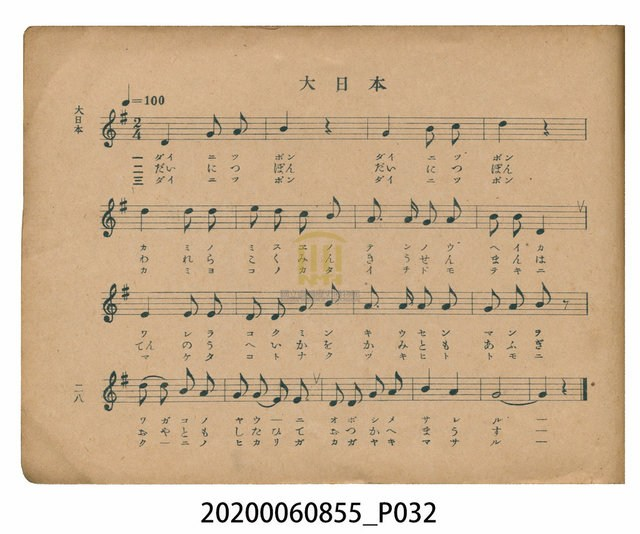
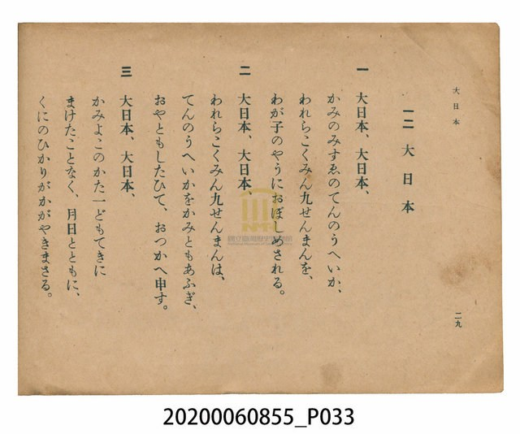

# 大日本

> Re:Shōka 使用 AI 協助辨識與重建樂譜，可能會有錯誤。歡迎回報。

- **鋼琴伴奏版**：<br><audio controls src="dainippon.mp3"></audio>
- **NEUTRINO 歌聲合成版**：<br><audio controls src="dainippon_neutrino.mp3"></audio>

- 日治時期公學校唱歌（第三學年・第十二課）
- 國立臺灣歷史博物館典藏

## 說明


- 出處：臺灣總督府編《公學校唱歌》第三學年用，第十二課〈大日本〉，原書第 28–29 頁。
- 調性與拍號：ト調（G 大調），2/4 拍，速度 != 100。
- 背景與曲風：日治時期公學校教材中之儀式／臣民教化歌曲，反映昭和時期（書載「九千萬國民」）
皇民化教育下之國家意識形態。音樂結構上採用莊重端正的 G 大調二拍子，第四樂句特意擴充為
6 小節（全曲共 18 小節），以寬廣的長音終止。
- 版本說明：本檔案為原書單聲部簡譜（數字譜）之忠實數位化版本，作為歷史教材史料保存。

### 編曲說明（鋼琴伴奏版）：

1. 前奏 (Intro, 4 小節)：取開頭「大日本」上行四度與大三和弦動機，以二分與四分音符和聲莊重起音。
2. 主歌伴奏 (Dainippon, 18 小節 × 3 段)：右手 (PianoRH) 演奏主旋律；
左手 (PianoLH) 在第一行與結尾長音處採用厚實的拍點和弦支撐，中段則以穩健的八分音符進行曲低音推展。


## 歌詞

```text
一　大日本、大日本、
かみのみすゑのてんのうへいか、
われらこくみん九せんまんを、
わが子のやうにおぼしめされる。

二　大日本、大日本、
われらこくみん九せんまんは、
てんのうへいかをかみともあふぎ、
おやともしたひて、おつかへ申す。

三　大日本、大日本、
かみよこのかた一どもてきに
まけたことなく、月日とともに、
くにのひかりがかがやきまさる。
```

## ABC

<div class="abc-score" data-abc-src="dainippon.abc" aria-label="五線譜載入中"></div>

[下載 ABC 原始檔](dainippon.abc)

## TMD 檔案連結

- [主旋律 TMD 檔案](dainippon.tmd) [[在 TMD Studio 編輯](https://tmdlang.github.io/Tmd-TS/#tmd=s7IKdvYPcrWy4qpTUCpJTLdSSM7PyUlNLsnMz7PKzk9PzM7Ojy_OyM9OVIKrKMvPKc1NtUovSkxJjTdGiBfnlxYlp1oVJ2fk5-fEl6RWlCTl52cj5AuK8stS8xLzgGoKijLzSlJTwIoQClLLMlNSQdKpKZkl-UWZiTlIlqYWFYPcBLEkvqQoMa84uSizAORQhKqSjFSgyzJzC1JRdQMNS8_Ms8rNz0sqBfoGQ6IkMRMoDPJoeWJ8bmJmXk5iXgqyqpKMfKB_CzIqrTIyi0FuS07Mic9OzEMKFqjLChLTU60CDIyNlLi0tBSeLln-bPrSZ3PWKGhpcSnaKhgaGHDZ2yq4c9kY6ZvYgfSCpDftfjaz6dmc-U9b1zxdu-PZgoVPp2x8trbn_Z6O52vWPNnRCRR8unPL4-bdQO7T3sYnu3perNr0fk8n2PKnc7qfr-5-0b7reePiZ2u3P-3f9LR31vPOlS-XrHjauuPF9H4lLi59LQVbagEuBQWFxw0Tns3e9Hz2uherVj2b0fe4YSJYtHn30_ZdL2ZOfb9nFsQ9z3fsfT538dNdc55vX_G4oQvNf48bupH993zKivd7epC9-LihAx6Ajxs6gbJP--Y_m70DqEbByOJRw2QjS4WXCxofNzRBrX-xav-zhuUvOtqfdfe-mDkf6I7HzR1AQWBIuoPiAswEmQMMfQWgGiDrZcP8p7uWKUDiBsmk5p5nM9eDTJq96eUioMNmYY2oZ1NnPps74cmOtU92dj9taXi6p__9nv4X7YufbZgIlHraMw3oTaAJIJf39z6bseDZjLVPJwFNBhkCdBTQLy_2dD5u6Hmyc-7T3uYXE9YAYxOo93ED0GmdIKcoKDyf1Q4UARk1deaLpk1PdnSD7JrT_XTdtmct_S_Wzni6d9Gz1m6g01_O3_xsRdPzrROeLe9-sqPrWd9CYJC-6Ot62d77fPX6Z2sXP5_VogALB2AIAwPg6doJ0DCfPRuo92n_0uedO4HGPpu85Wlr6_OmXRA3mCk83dD_fH0D0MlPW1cAPfS0daOCoQVcFBSkT3Yvfbp-zdPdIFteTt0OdMzzrU3P1i5ChOnzzg5gREKSDChA56x5tmrKs4UdQGsg8fp02roXjZteNq94vmHhi7VzQAE0dcfTtdPB7E6Qt_cveLp-GVDwyd5eYIhADATZvXcO0BBI6odECYgxbeaT_XOfrp0BcgE01ULsAUbKi5XzQD6Z1g6MYmD0gRir5r1Yux6YlEGe3ND7rL1TITMXmJmN9LIKUtMV9BWAmdoYFCsgo57saHjc0ICUOBuR2WDLGrsfN-5_3LgOTM583DQRzF72uGkymNH2uHHH48YWkDKohqb-x009j5s6HzcCVfSDtDVNBqaLx42zwXr2gcimSUiqG3uA0QcyrAloDNC81Y8bux437nncOP1xU-Pjxqlg40AJA6QB6CuID4EhD3crKF0isZ8vnQcM5BeLpzxduxoYi0-XrAQmvpczZwPTHEjlhvZnHROfNkxES6xAqRfLpj1d1vR0-0ZQ_u8Aim94Pmf7y4XLn7XMfrF2O9AF8HDbBcz1-MONmGBoBMYTNJSxBSgwlKChv-JxU9PjRiDa-rgRWExB9XSBQwwiN_1x4_zHjZtABjUAAw0YgEvAmnc8n7IZFG_Ehx6uwAGGG3JIAgMKGM7ALAAMqGdT1zzZvQEUCkDBjm3P1veCBGeuBwqCwnD12herFjxd2vlkXy9yGO4AlhjEpL2mDnAYAsMGyJ0PSrKNK8F-Xva4sReYXCBK9z1uBCZNYBgAla543LgKFOgNjc_mdACNBItAwmk13GxgnABTGtBUYKABwxoYYj1gG4CRBgxVoMFAE4Fpj5SE96J9FSjt7V4MLESe7Gt7NmfVs9n7nk2d_nwrMLNvfbJrF6ignrXixcTpz9ZugjgNRPateNkALlvBpSGofGjtfNbS8XzmnpfTml80NLzYM_d5KzDBgYMO6BTKKz8oUNDS5-JyAbYTMgsKgI2SgMzEvHyHGoOaanBxaWOhZQdmYKt2FcBVXsOLhT0KGibQAlQHUtIgFTRGmlh0Ai0FmVqjYBqvoKtgqGAEZBoDWQZAXAPk6wJ5JiBpmBhYuY9hDbDwbXjctAQo9Li5G4hbgIoeN8993LwZrpugCohZRkDhxgXAbAZS2bgaiJeAVDbuBeZChFmEVEDMMqaOu_CHNLAdQVFIA60wBcIaYBVoCgxcYyBLwwgoqKtgpKmqoaurCY8HY0i0IAV602qwu-cDcR_Y3UBW004gvREqovG4uQ1sFtA_mmCxx03LwCpnAFlLoCYgBX1TP0hxUw8Qd4JDdTIoPwLxfqDIZLCJjb0QExvbgCY2zoaKAzMlmAUsOVEjAMmNK0DqmjZD3QGMuab9YBPBwQ9S1AhyYycQLwK7sQ2oYi04XghHw45OyhM8kAAiYEyAafN4YMhjRIYRODJAUWIMTB7IGQDk78fNa4B4JcyfTeuhPt8M8edaiD-blgH92bQbKv64eR6Y9bh5E8JEcDYA1TzgkF4HCm1wIO8A4hZQ8Qs0YBIkOkChA1K0HxQdK4DiTWCVTUC8FYj7EIaC88M8sAuACQQc-JDo6ADiLrBzwUkGlLNAitaComMSWB6kE6RqETg6QCbijQ5gYw8cHbBmHem5whQYvpCQNgTFBxCBIwmIEMUSKGYgxRII1oBJ9GIJGANNwDiBpjqQCCjVL4Pmd1AArAKy5gDp7UB6IVhkKzQmIcUDKP1iNR8cR6BgA0UIIuCnAzEwzhs3gWIQLAJUAyyjwJEGjEBIXgFnIGhhNhOXDeD8A0lXoLIJ4n5ghIDyTjPQ3UCfQXIY2I9gn62FpihQ_IH8gcsHtVxcunYK8BoGbB9QQJkLAA)]
- [鋼琴伴奏 TMD 檔案](dainippon_piano.tmd) [[在 TMD Studio 編輯](https://tmdlang.github.io/Tmd-TS/#tmd=s7IKdvYPcrWy4qpTUCpJTLdSSM7PyUlNLsnMz7PKzk9PzM7Ojy_OyM9OVIKrKMvPKc1NtTJGiBTnlxYlp-JSX1CUX5aal5gHVFGSmFmemBefDhQoyssvik9PzUstSsxBqE0ty0xJBaksKMrMTSyqjE_JTwZalleCZH1qUTHIdQWZiXn58YlFRYl56amoSvKLSjLy04sSCzIqrTIyi0vyizKTE3PisxPzkJxVkgHUZZWaUpqcCPItum_iCxLTU60CDIyNlLi0tBSeLln-bPrSZ3PWvN_T8bJ7z_MJW57s2fJ0af_zzo73ezoVtLS4FG0VDA0MuOxtFdy5bIz0TexABoL0bNr9bGbTsznzn7auebp2x7MFC59O2fhsbQ_QoOdr1jzZ0QkUfLpzy-Pm3UDu097GJ7t6XqzaBDQU7KKnc7qfr-5-0b7reePiZ2u3P-3f9LR31vPOlS-XrHjauuPF9H4lLi59LQVbagEuBQWFxw0Tns3e9Hz2uherVj2b0fe4YSJYtHn30_ZdL2ZOfb9nFsQ9z3fsfT538dNdc55vX_G4oQvNf48bupH993zKivd7epC9-LihAx6qjxs6gbJP--Y_m70DqEbByOJRw2QjS4WXCxofNzRBrX-xav-zhuUvOtqfdfe-mDkf6I7HzR1AQWBIuoMiCMwEmQMMfQWgGiDrZcP8p7uWKUDiBsmk5p5nM9eDTJq96eUioMNmYY2oZ1NnPps74cmOtU92dj9taXi6px_oL6AWoMHP-ha-6Ot62d4LlFKA2Q70F9Dap2sngPzSulHB0ELh6Yb-5-sbIHH9dPbsZyuanvYvfTZ5y9PW1udNuxTM4Ao6Ea4DBifQEkjgY01uQPeClCooGOopPO3sBYoraHjmlRTl6yiYQA3UBKp52j_t5bTulwvWPm7oQQrp3ic7ul4s7AG6Bhg0wDAASoFiaVLP0z3LnnZPfbYSGLI9T3YvBfrmaUcbSAFQZUfby_mbn69ZBlT2onETxOsvtm4HCkLdraBgpKfwZMduYAhBnKqg4ZKYmZdZUJCfp4MICYXD0xWMFZ6t2wpx4OZnnd0KGgGgrBzkoanwbM8UoE6QKdO7n-7rfr9nNsRoIHi6fRlCrQ9Q7dM5K8DpqwHoF6Ajn2-d8HTDvpdTQU4CJlJg_ABT3NO-WU_XL3s-qwUYLS93z4P48dmU9c8mgaIIGLFAhzztbAd69vnKlU8blwJVPm1dDffsy4ZNQMOBcfFkbx9Q5Fnfiqcbp4L8C80lkPQK9PGLlfOetq54Nq0d6BCQqUDGqnkv1q4HZh1gBD7d0PusvVMBWKClpxrpZRWkpivoKwBLFmNgVIKNAnricUMDUhQ1IrPBljV2P27c_7hxHZic-bhpIpi97HHTZDCj7XHjjseNLSBlUA1N_Y-beh43dT5uBKroB2lrmvxk59zHjbPBevaByKZJSKobe4AJF2RYE9AYoHmrHzd2PW7c87hx-uOmxseNU8HGAY0HxzbQVxAfgmIRUTQikhkory-dB8wcLxZPebp2NShgl6x8Pqv95czZT3YAI7bn6Yb2Zx0TnzZMBDrqaW_ziwlrgEXdsw3A8Op5sWza02VNT7dvBJU3HUDxDc_nbH-5cPmzltkv1m4HugAebruApQz-cCMmGBqB8QQNZWwBCgwlaOiveNzU9LgRiLY-bgQWi1A9XeAQg8hNf9w4_3HjJpBBDcBAAwbgErDmHc-nbAbFG_GhhytwgOGGHJLAgAKGM7CgAAbUs6lrnuzeAAoFoGDHtmfre0GCM9cDBUFhuHrti1ULni7tfLKvFzkMdwBLHmLSXlMHOAyBYQPkzgcl2caVYD8ve9zYC0wuEKX7HjcCkyYwDIBKVzxuXAUK9IbGZ3M6gEaCRSDhtBpuNjBOgCkNaCow0IBhDQyxHrANwEgDhirQYKCJwLRHSsJ70b4KlPZ2LwYVYvvans1Z9Wz2vmdTpz_fuuzZ1K1Pdu0CVQyzVryYOP3Z2k0Qp4HIvhXA_A4yak7303XbQEV-a-ezlo7nM_e8nNb8oqHhxZ65z1uBCQ4cdECnUF7ZQoGClj6FlTjIOSgVgaYVvCZQ0IBWh5rg6N69FFJ4A1sPL2e3gvIluESHFHXA4g1YY1DmObBvwI6wgpbrDjUGNdXggtzGQssOzKhRMI1X0FUwVDACMo2BLFMghrCMwCxDIKmrYKBQw1WLYpoPdtMMQaZFG8ZC9CJzwPZEm6LJQA2mONAhFR6wFkGq7YBhj6juUAIfUt8B631ICwmpnuuBVG9Aqeer1wMjCFgdAeMIGDvPl617sW4WpEalQrzAHYknbrAFigK8qlXQgCUsHUiNhlShGWli0Qm0FmuMG8Dj2RiYVoHSMDGwch_DGmBTqOFx0xKg0OPmbiBuASp63Dz3cfNmuG6CKiBmGQGFGxcAi3OQysbVQLwEpLJxL7C0R5hFSAXELGPquAt_SAPbxxSFNDhDmQJZZkDSBBjANcCECM5RRpqqGrq6mvB4MIZEC1KgN60Gu3s-EPeB3Q1kNe0E4hVQEY3HzW1gs4D-0QSLPW5aBlY5A8haAjUBKeib-kGKm3qAuBMcqpNB5T4Q7weKTAab2NgLMbGxDWhi42yoOLDwB7OANTRqBCC5cQVIXdNmqDuAMde0H2wiOPhBihpBbuwE4kVgN7YBVawFxwvhaNjRSXmCBxJABIwJMG0eDwx5jMgwAkcGKEqMwSUTIgOA_P24eQ0Qr4T5s2k91OebIf5cC_Fn0zKgP5t2Q8UfN88Dsx43b0KYCM4GoBYOOKTXgUIbHMg7gLgFVM0DDZgEiQ5Q6IAU7QdFBzDim5rAKpuAeCsQ9yEMBeeHeWAXbIQGPiQ6OoC4C-xccJIB5SyQorWg6JgElgfpBKlaBI4OkIl4owPYDQFHB6zPRHquMAWGLySkDUHxAUTgSAIiRLGEXP2AWJBqCLVYAsZAEzBOoKkOJAJK9cug-R0UAKuArDlAejuQXggW2QqNSUjxAEq_WM0HxxEo2EARggj46UAMjPPGTaAYBIsA1QDLKHCkASMQklfAGQhamM3EZQM4_0DSFahsgrgfGCGgvNMMdDfQZ5AcBvYj2GdroSkKFH8gf-DyAbBGRatgsFbXxFYweGMTvcYHMYERCUxFGPU_qPaHSJFW7BKyH2oliKpRMAEyTGJhwsj2gihk9SSXO4QKGZAFRjB7iHQHrBFEUo4jKUCAuSvaLDcW5iC4Ajgfe8sMxIHQ8DSla6cAbgGCLQJy4Gks2scwFougETZBY7igMhcA)]

## 分析

```text
================================================================================
📊 TMD Song Profile: [ 大日本 ]
================================================================================
⏱  Duration:       0:21 (21.6s), 18 measures total
🎼 Key & Tempo:    首調基準 G, != 100.0 BPM, <2/4>
   - 分析範圍：      由實際發聲的音符與和弦推測調性；播放脈絡另行呈現
🎤 人聲音域:    D4 (MIDI 62) – E5 (MIDI 76) [跨度: 14 個半音 / 1.2 個八度, 難度: moderate]
   - 最低音:  D4 in [Dainippon #1 @ m.1, 0:00]
   - 最高音: E5 in [Dainippon #1 @ m.6, 0:06]
   - 適合: soprano, mezzo-soprano, contralto, tenor, baritone, bass
🏛  結構:      Dainippon (21.6s)
⚡ 編曲密度:        Peak 1 軌道同時演奏
🗝  調性診斷：       D 調性不明確（純淨自然大調，未偵測到可信轉調）
   - 風格氣質:    純淨自然大調（陽光明朗、易唱易記，無明顯調外色彩）
   - 轉調歷程:    全曲維持單一推測調性（未偵測到可信轉調）
   - 核心骨幹音:  D, G, A, B, E
   - 調性數值:    D 調性不明確 [相關度: 0.86, 穩定度: Ambiguous, 自然音純度: 96.9%]
   - 候選調性 (K-S): D 大調 (0.86), G 大調 (0.84), B 小調 (0.60)
   - 五度圈歷程:   +2
   - 各段落調性細節:
     • [Dainippon #1]: D 調性不明確 (r: 0.86, 自然音純度: 96.9%, 調外音: C)

  [ 五度圈游移軌跡 ]
               C  
         F            G  
      Bb              [D ]*
      Eb               A  
         Ab           E  
            Db       B  
               F# 
     (* = active key center)

  [ 十二半音累積音高分佈 ]
     C  : ██                         3.1%
     C# :                            0.0%
     D  : ████████████████████████  30.8%
     D# :                            0.0%
     E  : █████                      6.2%
     F  :                            0.0%
     F# : █                          1.5%
     G  : ██████████████████        23.1%
     G# :                            0.0%
     A  : ████████████████          20.0%
     A# :                            0.0%
     B  : ████████████              15.4%
--------------------------------------------------------------------------------
Assignment 軌道音域：
  - Piano         : D4 – E5 (14 個半音 / 1.2 個八度, 51 個音符)
================================================================================
```


## 原書掃描頁






