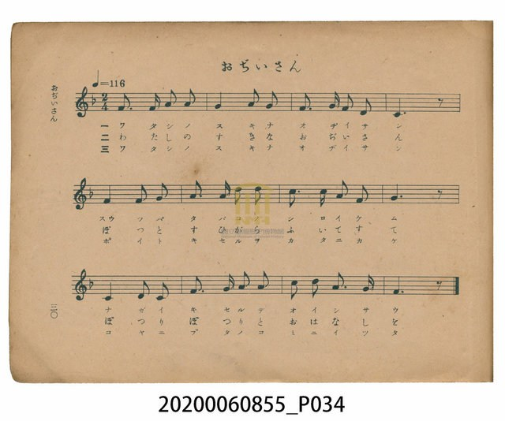
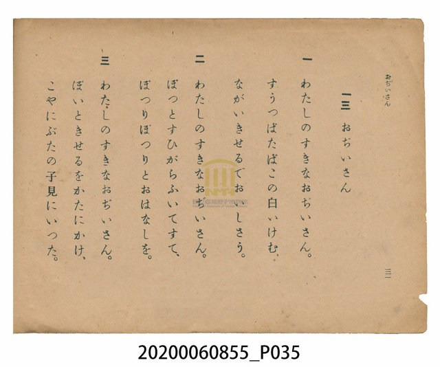

# おぢいさん（老爺爺）

> Re:Shōka 使用 AI 協助辨識與重建樂譜，可能會有錯誤。歡迎回報。

- **鋼琴伴奏版**：<br><audio controls src="ojiisan.mp3"></audio>
- **NEUTRINO 歌聲合成版**：<br><audio controls src="ojiisan_neutrino.mp3"></audio>

- 吉村守 作詞（懸賞募集入選）
- 日治時期公學校唱歌（第三學年・第十三課）
- 國立臺灣歷史博物館典藏

## 說明


- 出處：臺灣總督府編《公學校唱歌》第三學年用，第十三課〈おぢいさん〉（老爺爺），原書第 30–31 頁。
- 調性與拍號：ヘ調（F 大調），2/4 拍，速度 != 116。
- 背景與曲風：描寫臺灣農村家庭裡慈祥和藹的老爺爺（祖父）。歌詞透過生動的狀聲詞：
第一段抽著長煙管「すうつぱ（吸—啪）」吐出白煙，第二段「ぽつと（噗地）」吹掉煙灰、
「ぽつりぽつりと（娓娓地）」說故事，第三段「ぽいと（順手地）」把煙管扛在肩上，走到豬圈去看小豬
（こやにぶたの子見にいつた）。曲調輕快親切，充滿農家祖孫的溫馨日常感。
- 版本說明：本檔案為原書單聲部簡譜（數字譜）之忠實數位化版本。

### 編曲說明（鋼琴伴奏版）：

1. 前奏 (Intro, 4 小節)：引用第三樂句幽默親切的旋律線條，帶出祖孫相處的溫馨氣氛。
2. 主歌伴奏 (Ojiisan, 12 小節 × 3 段)：右手 (PianoRH) 演奏帶有附點彈跳感的主旋律；
左手 (PianoLH) 以輕巧富彈性的八分音符和聲伴奏，襯托老爺爺悠閒自在的日常步調。


## 歌詞

```text
一　わたしのすきなおぢいさん。
すうつぱたばこの白いけむ、
ながいきせるでおいしさう。

二　わたしのすきなおぢいさん。
ぽつとすひがらふいてすて、
ぽつりぽつりとおはなしを。

三　わたしのすきなおぢいさん。
ぽいときせるをかたにかけ、
こやにぶたの子見にいつた。
```

## ABC

<div class="abc-score" data-abc-src="ojiisan.abc" aria-label="五線譜載入中"></div>

[下載 ABC 原始檔](ojiisan.abc)

## TMD 檔案連結

- [主旋律 TMD 檔案](ojiisan.tmd) [[在 TMD Studio 編輯](https://tmdlang.github.io/Tmd-TS/#tmd=s7IKdvYPcrWy4qpTUCpJTLdSSM7PyUlNLsnMz7PKzk9PzM7Ojy_OyM9OVIKrKMvPKc1NtUovSkxJjTdGiBfnlxYlp1oVJ2fk5-fEl6RWlCTl52cj5AuK8stS8xLzgGoKijLzSlJTwIoQClLLMlNSQdKpKZkl-UWZiTlIlqYWFYPcBLEkvqQoMa84uSizAORQhKqSjFSgy9ISczNzKhGiQKPSM_OsShIzyxPz4vPT0jKTUcxGlU_OBzqtuCTe0NIYyXP5RSUZ-UAvF2RUWmVkFoOcl5yYE5-dmIcUMlDHFSSmp1oFGBibKHFpaSk8bux63LjocWPL48apj5smv9_T8aKh8XnHLiB6v6dTQUuLS9FWwdDQjMveVsGNy8ZI38QOZODTCZ3P5k58uq5D4cneOS9WzgPqe9a-48XmeU-757-c3fa0denLxh1AA8C2P5u-9Nmm3c9mNj2bM_9p65qna3c8W7Dw6ZSNz9b2APU9X7PmyY5OoODTnVseN-8Gcp_2NgJFXqzaBDPg6Zzu56u7X7Tvet64-Nna7U_7Nz3tnfW8c-XLJSuetu54Mb1fiYtLX0vBllqAS0FB4XHDhGezNz2fve7FqlXPZvQ9bpgIFm3e_bR914uZU9_vmQVxz_Mde5_PXfx015zn21c8buhC89_jhm5k_z2fsuL9nh5kLz5u6ECLgscNnWixANTytG_-s9k7gBoVjA0eNUw2NlR4uaDxcUMT1E0vVu1_1rD8RUf7s-7eFzPnAx33uHkGUBBokJvC0yXLwUyQOcD4UwCqAbJeNsx_umuZAiR2kUxq7nk2cz3IpNmbXi4CunbWs_7-p-tXQzz7Yt8mcLRve7pr7YvFC5-1djxfuvTppJ4X03c-n9WC5Gag-LTnHduAlgKNBoYDMIm8bOh_2dj3fMr8p91TgYqfdze8aNwETjqzQHYrKIADquHZuq3Puva-mDj95dTtz1tnPl-38HFDz-PGmY8b2x43LnncuBFo-NMJOx41THk6dRXY_N6nEyYAI-X5zL1A9ZDgfbKrB2gOWONesC6gRzqezpz-dM4GmJadz_o6QeY3bnjc0AhxAEJ9EzBG4Ayw3hWTQQimHZQmprY-2dUNtW5HJ5J1wHgEaXm5oO1ZZzdcy7OuLoh3nnXOfjpnxYumlU92dAG1v9i64WnHhhcb1zyd0_G0b_fzOd1PN_QDuRAnAc153Dj5cRPQzNWPG7c9bpz_uHHd07UTXizrBosAxYG-A0Y4OJxnbwJG9Is9U5_uX_1i2aqnHe2glNPa-mz3fmDEAWMNGClP164GBv6zXatfLlsBzJdPd-x41jIfEf3POzuezVkDSfKguJ-z5tmqKc8Wdjxv2gVJgk-nrQNG28vmFc83LHyxdg4o30_d8XTtdDC788nO7qf7Fzxdvwwo-GRv79OeaRADQRZAMxXEGEiSeNq64tm0dmBie7JjLYixat6LteuBOQ0U4Bt6n7V3KmTmAksrI72sgtR0BX0FYKllCrQFbBQwqTxuaHjc1A8Ok-nAYAEnkt7HjaswMhTEd0hpCKxnAyhkG9cB0w1Y6cTHTUATwUkBbAYwMoGiQPNmP24CBvZysKlAEaBVU0EGQUwFZVWws0Gh1THx2ZyGp9PmPFu7EDk7AJUC0wY80YKS35wNkET7ctnMF_07QNkBnnqnrACmfFDiBwpCEgwwO2zd_mRf29Ole5829z_d1_F8X9_TiZtB8bhiMTAxAM2Hh8ouYJFDWqhAMwhY3SaQt5s6HzduBatbBhZcBg8VLHkDbOp6sPHTHzdNIj1UZk6HhAcwPoEJC5pLGoHBA8qgwPAAij_tX_q0vwPKgGVEYBoFhgokFwLDBjkMdgAzA8lhAMq1iOgG-qQRGOlA_cBMBmRMhIcB4cxIWhhAigmgv-HlHbCAABYNwALiRVsDKAODS4cXHb3AAhe5gHiye8qTXTB_A-2jvNqDAgUtfS4u_6zMzOLEPKuAzMS8fIcag5pqcIFkY6FlB2Zgq26hJfiLhT0KGiYKQFc-X9-gA8nCSDnYRBOLTqCVIFNrFDQMFXSB0FBTVUNXV1PBGAhrFIyAIsZAEi5tBJU2VDCLB4qaxoNFDRRqwKb4GAIVPm5eDxZ83LRfE0hsB5ZufUClj5t2ggXXAvldIAMfN62CqGtuAqlbAsRbQeqaN6OaaQRW2w9R2zgfqLZxOhCvA6ltnAkW7AUVHGAzG7ug6haB1LUA8VSw3ZNRzTSmrjvxR8yuHooiBhTwhpA4MAbbaAyNAzMgBAqaggVN4fFmCI031GgBeutx0zKwN4Ch0jwR4rP9UJ9NAPlsMzQEgOLboeJrYT7eCPbxAoyYAeZgcHAD1TSugMQAKEpAQptAMdAD1NsJEd8KFW8BiS8Dxx1IP8hNqDHzuHkuOAaAZjZ3QNyzFhpTu4F6m1cD8SaI-GqkGGzuBjJWg2NwI5ExA2wIUhIz4NQPzAdAGiODQPKPKTCKoLEGk4BEKFrkAFMayBtrwL7G7uN2sM9WgVUgYqhpK8hESMzijJkmSDoGC4CFQLHaBY0xUJYBViQgeWg6b5wOMXMSZswA0wgoWYBiphtsZvM05BjoA6sA-Wc-WAXQnUugKQkY6yD9kAQHMrOWi0vXTgFa2oFtAHKVuQA)]
- [鋼琴伴奏 TMD 檔案](ojiisan_piano.tmd) [[在 TMD Studio 編輯](https://tmdlang.github.io/Tmd-TS/#tmd=s7IKdvYPcrWy4qpTUCpJTLdSSM7PyUlNLsnMz7PKzk9PzM7Ojy_OyM9OVIKrKMvPKc1NtTJGiBTnlxYlp-JSX1CUX5aal5gHVFGSmFmemBefDhQoyssvik9PzUstSsxBqE0ty0xJBaksKMrMTSyqjE_JTwZalleCZH1qUTHIdQWZiXn58YlFRYl56amoSvKLSjLy04sSCzIqrTIyi0vyizKTE3PisxPzkJxVkgHUZZWaUpqcCPItum_iCxLTU60CDIxNlLi0tBQeN3Y9blz0uLHlcePUx02T3-_peNHQ-LxjFxA9bt79snvP8wlbnuzZ8nRp__POjvd7OhW0tLgUbRUMDc247G0V3LhsjPRN7EBWPJu-9Nmm3c9mNj2bM_9p65qna3c8W7Dw6ZSNz9b2AA19vmbNkx2dQMGnO7cAzQVyn_Y2AkVerNoENBTsxqdzup-v7n7Rvut54-Jna7c_7d_0tHfW886VL5eseNq648X0fiUuLn0tBVtqAS4FBYXHDROezd70fPa6F6tWPZvR97hhIli0effT9l0vZk59v2cWxD3Pd-x9Pnfx011znm9f8bihC81_jxu6kf33fMqK93t6kL34uKEDLZwfN3QiBzUwDIBanvbNfzZ7B1CjgrHBo4bJxoYKLxc0Pm5ogrrpxar9zxqWv-hof9bd-2LmfKDjHjfPAAoCDXJTeLpkOZgJMgcYJQpANUDWy4b5T3ctU4BEGJJJzT3PZq4HmTR708tFQNfOetbf_3T9aohnX-zb9GzuxKfrtj3dtfbF4oXPuva-mDj95dTtz1tnPl-38HFD49MJO5_1dYK4jRtAATe19cmubpB4W-_Tvt0vNq55Oqfj-Zzupxv6gezns1qetXY8X7oUka7g7gCGJtAFkLAH-gIztQFdBlKqoGCop_C0sxcorqDhmVdSlK-jYKIANP_5-gZNoJqne6YCAx0SB89WND3tX_p0596Xu2e8WLbqaUc7yAXTu5_u636-fdazRXNBAb1jGzCCny-d9nTt6uezdwBjGqRm1-qXy1Y827D42YbZUCcqKBjpKTzZsRsYxxBXKWj4Z2VmFifm6SgYGkEdoHB4uoKxwrN1W8Eu6d_8rLNbQSMAlImDPDQVnu2ZAtQHtPDZnM6XM1te7p73dG_Hi-2bn7XMB9oJMhvstPd7ZkMsBIKn25chzPABmvFk99IXe6Y-3b786foeoG5gIgBqfdq6-mlH28v5m5-vWfZ0Us-Lxk0QJwK992Lp-medM-Dh_axpwctpk160r3o6ZwU4LJY-3bHj2dqlwPQC8ic0H0ASH9CnL1bOe9q64tm0dmD6eLJjLYixat6LteuBmQMYR0839D5r71QAFmLpqUZ6WQWp6Qr6CsDSxBQYW2CjnuxoeNzQ8Lip_3Hj_MeN0x83rnvcOPNxY-_jxlUYeQCSDkDSbY8blzxu3AjWs-Fx42Sgtucz94KVTnzcBDSxEaIUaEYPWBRo3uzHTd2PG5eDTQWKAK2aCjIIYiood4GdDUrcHROfzWl4Om3Os7ULgQGAnBAfN_Q8nbDjUcOUp1NXPW7ofTpnw9MJE4Bp4-WymS_6dwAVA10BTOig_DxlBTAPgLIBUBCcE0AZY-v2J_vani7d-7S5_-m-juf7-p5O3AwK4xWLn66dADQfHiq7gKUEaaEC9D0wSFaA1W0Cebup83HjVrC6ZWDBZfBQASttAhoDZwC1Acn1YOOnP26aRHqozJwOCQ9gfALT1rOuLkh-h-R9YHgAxUH5rL8DylgxGYTmgAoEYKhAygRg2CCHwY5OMsIAKAT0DCy6gT5pBEY6UP9qMGMiPAwmP24CKgWKbgNLrwOG_4tlQBVAEaA4MCTnkxYGLxe0AXMh0N_wku9Z5-wnO7peNK180dYAKkQ6NgCLtxcdvcAyEljswQu8J7unPNkF8zfQPsprKihQ0NKnsAYEOQelGNW0gpejChrQakMTHFfAIgdefnTtRS79oaU5rNwHlWL7-5_PWgcpbJ92T322cv7TjVNfTuumzPdg74JdaQUtTR1qDGqqwcWkjYWWHZhRo2Aar6CrYBYPomsUNAyBHF0FI01VDV1dTWCxbAxSoWCmoGGMIlGjAFFooFDDVYtiiw92WwzjFaINY0GWgChMvgmQYQLhmyLJgzDUDoojDlIPAesZeCUEjD1ELYQSfZBq6HnTLkgDBama6YHULkApUJWyfzWkogRFIrj2oEKUQR2HJ9KwBYUCuPZueLGwR0EDliR1INUMUi1joolFJ9BSSCRBY98QJfaNgCLGQBIjcRiCUg00_UBSAsgUH0OgwsfN68GCj5v2awKJ7cC2Sh9Q6eOmnWDBtUB-F8jAx02rIOqam0DqlgDxVpC65s2oZhqB1fZD1DbOB6ptnA7E60BqG2eCBXtBlRvYzMYuqLpFIHUtQDwVbPdkVDONqetO_BGzq4eiiAEFvCEkDiD50BgaB2ZACBQ0BQuawuPNEBpvqNEC9NbjpmVgbwBDpXkixGf7oT6bAPLZZmgIAMW3Q8XXwny8EezjBRgxA6xlwMENVNO4AhIDoCgBCW0CxUAPUG8nRHwrVLwFJL4MHHcg_SA3ocbM4-a54BgAmtncAXHPWmhM7QbqbV4NxJsg4quRYrC5G8hYDY7BjUTGDLB_QUnMUFx6wiMHmNJA3lgD9jV2H7eDfbYKrAIRQ01bQSZCYhZnzDRB0jFYACwEitUuaIyBsgywsQOSh6bzxukQMydhxgwwjYCSBShmusFmNk9DjoE-sAqQf-aDVQDduQSakoCxDtIPSXDQUh2lsMNadxBb2OHPQGjVDbSeQa9ugBEZbZaLqoDkzE2SQ2A2Qus_Cl2ClphJcgnpNbKunQK44gcbCORA4zLaxzAWQ8gIU8gYLqTMBQA)]

## 分析

```text
================================================================================
📊 TMD Song Profile: [ おぢいさん（老爺爺） ]
================================================================================
⏱  Duration:       0:12 (12.4s), 12 measures total
🎼 Key & Tempo:    首調基準 F, != 116.0 BPM, <2/4>
   - 分析範圍：      由實際發聲的音符與和弦推測調性；播放脈絡另行呈現
🎤 人聲音域:    C4 (MIDI 60) – D5 (MIDI 74) [跨度: 14 個半音 / 1.2 個八度, 難度: moderate]
   - 最低音:  C4 in [Ojiisan #1 @ m.4, 0:03]
   - 最高音: D5 in [Ojiisan #1 @ m.6, 0:05]
   - 適合: soprano, mezzo-soprano, contralto, tenor, baritone, bass
🏛  結構:      Ojiisan (12.4s)
⚡ 編曲密度:        Peak 1 軌道同時演奏
🗝  調性診斷：       F 大調（純淨自然大調，未偵測到可信轉調）
   - 風格氣質:    純淨自然大調（陽光明朗、易唱易記，無明顯調外色彩）
   - 轉調歷程:    全曲維持單一推測調性（未偵測到可信轉調）
   - 核心骨幹音:  F, A, C, G, D
   - 調性數值:    F 大調 [相關度: 0.86, 穩定度: High, 自然音純度: 100.0%]
   - 候選調性 (K-S): F 大調 (0.86), C 大調 (0.70), D 小調 (0.61)
   - 五度圈歷程:   -1
   - 各段落調性細節:
     • [Ojiisan #1]: F 大調 (r: 0.86, 自然音純度: 100.0%)

  [ 五度圈游移軌跡 ]
               C  
        [F ]*          G  
      Bb               D  
      Eb               A  
         Ab           E  
            Db       B  
               F# 
     (* = active key center)

  [ 十二半音累積音高分佈 ]
     C  : █████████████████         20.0%
     C# :                            0.0%
     D  : █████████                 11.1%
     D# :                            0.0%
     E  :                            0.0%
     F  : ████████████████████████  28.9%
     F# :                            0.0%
     G  : ████████████████          18.9%
     G# :                            0.0%
     A  : ██████████████████        21.1%
     A# :                            0.0%
     B  :                            0.0%
--------------------------------------------------------------------------------
Assignment 軌道音域：
  - Piano         : C4 – D5 (14 個半音 / 1.2 個八度, 36 個音符)
================================================================================
```


## 原書掃描頁






