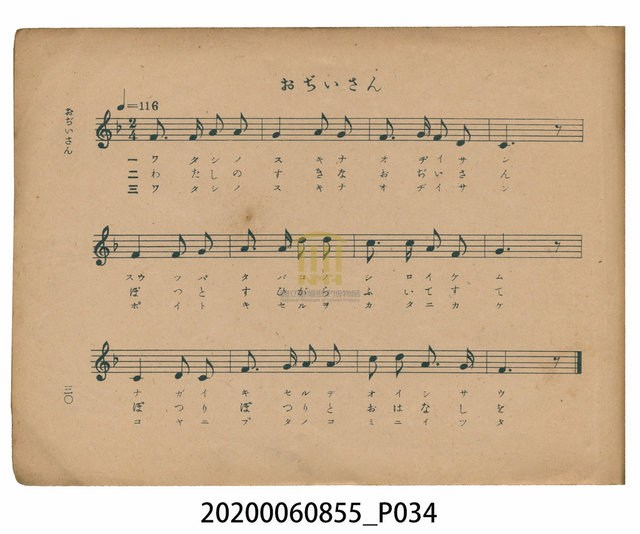
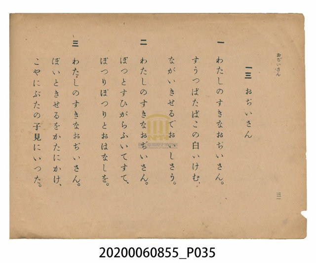

# おぢいさん（老爺爺）

<audio controls src="ojiisan.mp3"></audio>

- 日治時期公學校唱歌（第三學年・第十三課）
- 國立臺灣歷史博物館典藏

- note

【曲目說明】
・出處：臺灣總督府編《公學校唱歌》第三學年用，第十三課〈おぢいさん〉（老爺爺），原書第 30–31 頁。
・調性與拍號：ヘ調（F 大調），2/4 拍，速度 != 116。
・背景與曲風：描寫臺灣農村家庭裡慈祥和藹的老爺爺（祖父）。歌詞透過生動的狀聲詞：
第一段抽著長煙管「すうつぱ（吸—啪）」吐出白煙，第二段「ぽつと（噗地）」吹掉煙灰、
「ぽつりぽつりと（娓娓地）」說故事，第三段「ぽいと（順手地）」把煙管扛在肩上，走到豬圈去看小豬
（こやにぶたの子見にいつた）。曲調輕快親切，充滿農家祖孫的溫馨日常感。
・版本說明：本檔案為原書單聲部簡譜（數字譜）之忠實數位化版本。

・編曲說明（鋼琴伴奏版）：
1. 前奏 (Intro, 4 小節)：引用第三樂句幽默親切的旋律線條，帶出祖孫相處的溫馨氣氛。
2. 主歌伴奏 (Ojiisan, 12 小節 × 3 段)：右手 (PianoRH) 演奏帶有附點彈跳感的主旋律；
左手 (PianoLH) 以輕巧富彈性的八分音符和聲伴奏，襯托老爺爺悠閒自在的日常步調。

## 歌詞

```text
一　わたしのすきなおぢいさん。
すうつぱたばこの白いけむ、
ながいきせるでおいしさう。

二　わたしのすきなおぢいさん。
ぽつとすひがらふいてすて、
ぽつりぽつりとおはなしを。

三　わたしのすきなおぢいさん。
ぽいときせるをかたにかけ、
こやにぶたの子見にいつた。
```

## 原書掃描頁





## 調性分析

```text
================================================================================
📊 TMD Song Profile: [ おぢいさん（老爺爺） ]
================================================================================
⏱  Duration:       0:12 (12.4s), 12 measures total
🎼 Key & Tempo:    首調基準 F, != 116.0 BPM, <2/4>
   - 分析範圍：      由實際發聲的音符與和弦推測調性；播放脈絡另行呈現
🎤 人聲音域:    C4 (MIDI 60) – D5 (MIDI 74) [跨度: 14 個半音 / 1.2 個八度, 難度: moderate]
   - 最低音:  C4 in [Ojiisan #1 @ m.4, 0:03]
   - 最高音: D5 in [Ojiisan #1 @ m.6, 0:05]
   - 適合: soprano, mezzo-soprano, contralto, tenor, baritone, bass
🏛  結構:      Ojiisan (12.4s)
⚡ 編曲密度:        Peak 1 軌道同時演奏
🗝  調性診斷：       F 大調（純淨自然大調，未偵測到可信轉調）
   - 風格氣質:    純淨自然大調（陽光明朗、易唱易記，無明顯調外色彩）
   - 轉調歷程:    全曲維持單一推測調性（未偵測到可信轉調）
   - 核心骨幹音:  F, A, C, G, D
   - 調性數值:    F 大調 [相關度: 0.86, 穩定度: High, 自然音純度: 100.0%]
   - 候選調性 (K-S): F 大調 (0.86), C 大調 (0.70), D 小調 (0.61)
   - 五度圈歷程:   -1
   - 各段落調性細節:
     • [Ojiisan #1]: F 大調 (r: 0.86, 自然音純度: 100.0%)

  [ 五度圈游移軌跡 ]
               C  
        [F ]*          G  
      Bb               D  
      Eb               A  
         Ab           E  
            Db       B  
               F# 
     (* = active key center)

  [ 十二半音累積音高分佈 ]
     C  : █████████████████         20.0%
     C# :                            0.0%
     D  : █████████                 11.1%
     D# :                            0.0%
     E  :                            0.0%
     F  : ████████████████████████  28.9%
     F# :                            0.0%
     G  : ████████████████          18.9%
     G# :                            0.0%
     A  : ██████████████████        21.1%
     A# :                            0.0%
     B  :                            0.0%
--------------------------------------------------------------------------------
Assignment 軌道音域：
  - Piano         : C4 – D5 (14 個半音 / 1.2 個八度, 36 個音符)
================================================================================
```

## ABC

```abc
X:1
T:おぢいさん（老爺爺）
C:TMD (Chen, Chih-Han / aguai)
M:2/4
L:1/16
Q:1/4=116
K:F

V:V1 name="Piano" snm="Pia"

[V:V1]
f3 f a2 a2 | g4 a2 g2 | f3 g f2 d2 | c6 z2 |
f4 f2 g2 | a3 a d2 d2 | c3 c a2 f2 | g6 z2 |
c4 d2 c2 | f3 g a2 a2 | c2 d2 a3 g | f6 z2 |
```

- [主旋律 TMD 檔案](ojiisan.tmd)
- [鋼琴伴奏 TMD 檔案](ojiisan_piano.tmd)
