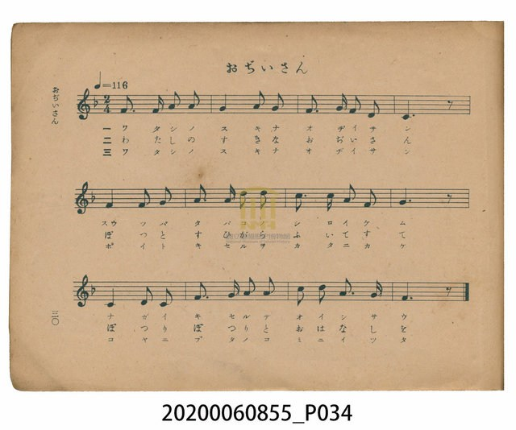
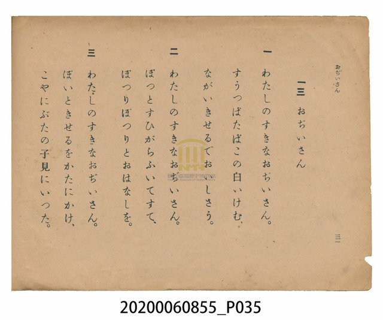

# おぢいさん（老爺爺）

> Re:Shōka 使用 AI 協助辨識與重建樂譜，可能會有錯誤。歡迎回報。

- **NEUTRINO 歌聲合成版**：<br><audio controls src="ojiisan_neutrino.mp3"></audio>
- **鋼琴伴奏版**：<br><audio controls src="ojiisan.mp3"></audio>


- 吉村守 作詞（懸賞募集入選）
- 日治時期公學校唱歌（第三學年・第十三課）
- 國立臺灣歷史博物館典藏

## 說明


- 出處：臺灣總督府編《公學校唱歌》第三學年用，第十三課〈おぢいさん〉（老爺爺），原書第 30–31 頁。
- 調性與拍號：ヘ調（F 大調），2/4 拍，速度 != 116。
- 背景與曲風：描寫臺灣農村家庭裡慈祥和藹的老爺爺（祖父）。歌詞透過生動的狀聲詞：
第一段抽著長煙管「すうつぱ（吸—啪）」吐出白煙，第二段「ぽつと（噗地）」吹掉煙灰、
「ぽつりぽつりと（娓娓地）」說故事，第三段「ぽいと（順手地）」把煙管扛在肩上，走到豬圈去看小豬
（こやにぶたの子見にいつた）。曲調輕快親切，充滿農家祖孫的溫馨日常感。
- 版本說明：本檔案為原書單聲部簡譜（數字譜）之忠實數位化版本。

### 編曲說明（鋼琴伴奏版）：

1. 前奏 (Intro, 4 小節)：引用第三樂句幽默親切的旋律線條，帶出祖孫相處的溫馨氣氛。
2. 主歌伴奏 (Ojiisan, 12 小節 × 3 段)：右手 (PianoRH) 演奏帶有附點彈跳感的主旋律；
左手 (PianoLH) 以輕巧富彈性的八分音符和聲伴奏，襯托老爺爺悠閒自在的日常步調。


## 歌詞

```text
一　わたしのすきなおぢいさん。
すうつぱたばこの白いけむ、
ながいきせるでおいしさう。

二　わたしのすきなおぢいさん。
ぽつとすひがらふいてすて、
ぽつりぽつりとおはなしを。

三　わたしのすきなおぢいさん。
ぽいときせるをかたにかけ、
こやにぶたの子見にいつた。
```

## ABC

```abc
X:1
T:おぢいさん（老爺爺）
M:2/4
L:1/16
Q:1/4=116
K:F
V:V1 name="Piano" snm="Pia"
[V:V1]
F3 F A2 A2 | G4 A2 G2 | F3 G F2 D2 | C6 z2 |
w: 1.~ワ タ シ ノ | ス キ ナ | オ ヂ イ サ | ン
w: 2.~わ た し の | す き な | お ぢ い さ | ん
w: 3.~ワ タ シ ノ | ス キ ナ | オ ヂ イ サ | ン
F4 F2 G2 | A3 A d2 d2 | c3 c A2 F2 | G6 z2 |
w: 1.~スウ ツ パ | タ バ コ ノ | シ ロ イ ケ | ム
w: 2.~ぽ つ と | す ひ が ら | ふ い て す | て
w: 3.~ポ イ ト | キ セ ル ヲ | カ タ ニ カ | ケ
C4 D2 C2 | F3 G A2 A2 | c2 d2 A3 G | F6 z2 |
w: 1.~ナ ガ イ | キ セ ル デ | オ イ シ サ | ウ
w: 2.~ぽ つ り | ぽ つ り と | お は な し | を
w: 3.~コ ヤ ニ | ブ タ ノ コ | ミ ニ イ ツ | タ
```

## TMD 檔案連結

- [主旋律 TMD 檔案](ojiisan.tmd) [[在 TMD Studio 編輯](https://tmdlang.github.io/Tmd-TS/#tmd=s7IKdvYPcrWy4qpTUCpJTLdSSM7PyUlNLsnMz7PKzk9PzM7Ojy_OyM9OVIKrKMvPKc1NtUovSkxJjTdGiBfnlxYlp1oVJ2fk5-fEl6RWlCTl52cj5AuK8stS8xLzgGoKijLzSlJTwIoQClLLMlNSQdKpKZkl-UWZiTlIlqYWFYPcBLEkvqQoMa84uSizAORQhKqSjFSgy9ISczNzKpW4tLQUHjd2PW5c9Lix5XHj1MdNk9_v6XjR0Pi8YxcQvd_TqaClxaVoq2BoaMZlb6vgxmVjpG9iBzLs6YTOZ3MnPl3XofBk75wXK-cB9T1r3_Fi87yn3fNfzm572rr0ZeMOoAFgm59NX_ps0-5nM5uezZn_tHXN07U7ni1Y-HTKxmdre4D6nq9Z82RHJ1Dw6c4tj5t3A7lPexuBIi9WbYIZ8HRO9_PV3S_adz1vXPxs7fan_Zue9s563rny5ZIVT1t3vJjer8TFpa-lYEstwKWgoPC4YcKz2Zuez173YtWqZzP6HjdMBIs2737avuvFzKnv98yCuOf5jr3P5y5-umvO8-0rHjd0ofnvcUM3sv-eT1nxfk8PshcfN3SgRcHjhk60WABqedo3_9nsHUCNCsYGjxomGxsqvFzQ-LihCeqmF6v2P2tY_qKj_Vl374uZ84GOe9w8AygINMhN4emS5WAmyBxg_CkA1QBZLxvmP921TAESu0gmNfc8m7keZNLsTS8XAV0761l__9P1qyGefbFvEzjatz3dtfbF4oXPWjueL136dFLPi-k7n89qQXIzUHza845tQEuBRgPDAZhEXjb0v2zsez5l_tPuqUDFz7sbXjRuAiedWSC7FRTAAdXwbN3WZ117X0yc_nLq9uetM5-vW_i4oedx48zHjW2PG5c8btwINPzphB2PGqY8nboKbH7v0wkTgJHyfOZeoHpI8D7Z1QM0B6xxL1gX0CMdT2dOfzpnA0zLzmd9nSDzGzc8bmiEOAChvgkYI3AGWO-KySAE0w5KE1Nbn-zqhlq3oxPJOmA8grS8XND2rLMbruVZVxfEO886Zz-ds-JF08onO7qA2l9s3fC0Y8OLjWuezul42rf7-Zzupxv6gVyIk4DmPG6c_LgJaObqx43bHjfOf9y47unaCS-WdYNFgOJA3wEjHBzOszcBI_rFnqlP969-sWzV0452UMppbX22ez8w4oCxBoyUp2tXAwP_2a7VL5etAObLpzt2PGuZj4j-550dz-asgSR5UNzPWfNs1ZRnCzueN-2CJMGn09YBo-1l84rnGxa-WDsHlO-n7ni6djqY3flkZ_fT_Querl8GFHyyt_dpzzSIgSALoJkKYgwkSTxtXfFsWjswsT3ZsRbEWDXvxdr1wJwGCvANvc_aOxUycxPTU430sgpS0xX0FQIMjE2BtoCNAiaVxw0Nj5v6wWEyHRgs4ETS-7hxFUaGgvgOKQ2B9WwAhWzjOmC6ASud-LgJaCI4KYDNAEYmUBRo3uzHTcDAXg42FSgCtGoqyCCIqaCsCnY2KLQ6Jj6b0_B02pxnaxciZwegUmDagCdaUPKbswGSaF8um_mifwcoO8BT75QVwJQPSvxAQUiCAWaHrduf7Gt7unTv0-b-p_s6nu_rezpxMygeVywGJgag-fBQ2QUsckgLFWgGAavbBPJ2U-fjxq1gdcvAgsvgoYIlb4BNXQ82fvrjpkmkh8rM6ZDwAMYnMGFBc0kjMHhAGRQYHkDxp_1Ln_Z3QBmwjAhMo8BQgeRCYNggh8EOYGYgOQxAuRYR3UCfNAIjHagfmMmAjInwMCCcGUkLA0gxAfQ3vLwDFhDAogFYQLxoawBlYHDp8KKjF1jgIhcQT3ZPebIL5m-gfZRXe1CgoKXPxeWflZlZnJhnFZCZmJfvUGNQUw0ukGwstOzADGzVLbQEf7GwR0HDRAHoyufrG3QgWRgpB5toYtEJtBJkao2ChqGCLhAaaqpq6OpqKhgDYY2CEVDEGEjCpY2g0oYKZvFAUdN4sKiBQg3YFB9DoMLHzevBgo-b9msCie3A0q0PqPRx006w4Fogvwtk4OOmVRB1zU0gdUuAeCtIXfNmVDONwGr7IWob5wPVNk4H4nUgtY0zwYK9oIIDbGZjF1TdIpC6FiCeCrZ7MqqZxtR1J_6I2dVDUcSAAt4QEgfGYBuNoXFgBoRAQVOwoCk83gyh8YYaLUBvPW5aBvYGMFSaJ0J8th_qswkgn22GhgBQfDtUfC3MxxvBPl6AETPAHAwObqCaxhWQGABFCUhoEygGeoB6OyHiW6HiLSDxZeC4A-kHuQk1Zh43zwXHANDM5g6Ie9ZCY2o3UG_zaiDeBBFfjRSDzd1AxmpwDG4kMmaADUFKYgac-oH5AEhjZBBI_jEFRhE01mASkAhFixxgSgN5Yw3Y19h93A722SqwCkQMNW0FmQiJWZwx0wRJx2ABsBAoVrugMQbKMsCKBCQPTeeN0yFmTsKMGWAaASULUMx0g81snoYcA31gFSD_zAerALpzCTQlAWMdpB-S4EBm1nJx6dopQEs7sA1ArjIXAA)]
- [鋼琴伴奏 TMD 檔案](ojiisan_piano.tmd) [[在 TMD Studio 編輯](https://tmdlang.github.io/Tmd-TS/#tmd=s7IKdvYPcrWy4tLSUnjc2PW4cdHjxpbHjVMfN01-v6fjRUPj845dQPS4effL7j3PJ2x5smfL06X9zzs73u_pVNDS4lK0VTA0NOOyt1Vw47Ix0jex46pTUHo2femzTbufzWx6Nmf-09Y1T9fueLZg4dMpG5-t7QEa-nzNmic7OoGCT3duAZoL5D7tbQSKvFi1CWioEsiAp3O6n6_uftG-63nj4mdrtz_t3_S0d9bzzpUvl6x42rrjxfR-JS4ufS0FW2oBLgUFhccNE57N3vR89roXq1Y9m9H3uGEiWLR599P2XS9mTn2_ZxbEPc937H0-d_HTXXOeb1_xuKELzX-PG7qR_fd8yor3e3qQvfi4oQMtnB83dCIHNTAMgFqe9s1_NnsHUKOCscGjhsnGhgovFzQ-bmiCuunFqv3PGpa_6Gh_1t37YuZ8oOMeN88ACgINclN4umQ5mAkyBxglCkA1QNbLhvlPdy1TgEQYkknNPc9mrgeZNHvTy0VA18561t__dP1qiGdf7Nv0bO7Ep-u2Pd219sXihc-69r6YOP3l1O3PW2c-X7fwcUPj0wk7n_V1griNG0ABN7X1ya5ukHhb79O-3S82rnk6p-P5nO6nG_qB7OezWp61djxfuhSRruDuAIYm0AWQsAf6AjO1AV0GUqqgYKin8LSzFyiuoOGZV1KUr6NgogA0__n6Bk2gmqd7pgIDHRIHz1Y0Pe1f-nTn3pe7Z7xYtuppRzvIBdO7n-7rfr591rNFc0EBvWMbMIKfL532dO3q57N3AGMapGbX6pfLVjzbsPjZhtlQJyooGOkpPNmxGxjHEFcpaPhnZWYWJ-bpKBgaQR2gcHi6grHCs3VbwS7p3_yss1tBIyAzMS8_yENT4dmeKUB9QAufzel8ObPl5e55T_d2vNi--VnLfKCdILPBTnu_ZzbEQiB4un0ZwgwfoBlPdi99sWfq0-3Ln67vAeoGJgKg1qetq592tL2cv_n5mmVPJ_W8aNwEcSLQey-Wrn_WOQMe3s-aFrycNulF-6qnc1aAw2Lp0x07nq1dCkwvIH9C8wEk8QF9-mLlvKetK55Nawemjyc71oIYq-a9WLsemDmAcfR0Q--z9k6FzNzE9FQjvayC1HQFfYUAA2NTYGyBjXqyo-FxQ8Pjpv7HjfMfN05_3LjucePMx429jxtXYeQBSDoASbc9blzyuHEjWM-Gx42Tgdqez9wLVjrxcRPQxEaIUqAZPWBRoHmzHzd1P25cDjYVKAK0airIIIipoNwFdjYocXdMfDan4em0Oc_WLgQGAHJCfNzQ83TCjkcNU55OXfW4offpnA1PJ0wApo2Xy2a-6N8BVAx0BTChg_LzlBXAPADKBkBBcE4AZYyt25_sa3u6dO_T5v6n-zqe7-t7OnEzKIxXLH66dgLQfHio7AKWEqSFCtD3wCBZAVa3CeTtps7HjVvB6paBBZfBQwWstAloDJwB1AYk14ONn_64aRLpoTJzOiQ8gPEJTFvPurog-R2S94HhARQH5bP-DihjxWQQmgMqEIChAikTgGGDHAY7OskIA6AQ0DOw6Ab6pBEY6UD9q8GMifAwmPy4CagUKLoNLL0OGP4vlgFVAEWA4sCQnE9aGLxc0AbMhUB_w0u-Z52zn-zoetG08kVbA6gQ6dgALN5edPQCy0hgsQcv8J7snvJkF8zfQPsor6mgQEFLn8IaEOQclGJU0wpejipoQKsNTXBcAYscePnRtRe59IeW5rByH1SK7e9_PmsdpLB92j312cr5TzdOfTmtmzLfg70LdqUVtDR1qDGoqQYXkzYWWnZgRo2CabyCroJZPIiuUdAwBHJ0FYw0VTV0dTWBxbIxSIWCmYKGMYpEjQJEoYFCDVctii0-2G0xjFeINowFWQKiMPkmQIYJhG-KJA_CUDsojjhIPQSsZ-CVEDD2ELUQSvRBqqHnTbsgDRSkaqYHUrsApUBVyv7VkIoSFIng2oMKUQZ1HJ5IwxYUCuDau-HFwh4FDViS1IFUM0i1jIkmFp1ASyGRBI19Q5TYNwKKGANJjMRhCEo10PQDSQkgU3wMgQofN68HCz5u2q8JJLYD2yp9QKWPm3aCBdcC-V0gAx83rYKoa24CqVsCxFtB6po3o5ppBFbbD1HbOB-otnE6EK8DqW2cCRbsBVVuYDMbu6DqFoHUtQDxVLDdk1HNNKauO_FHzK4eiiIGFPCGkDiA5ENjaByYASFQ0BQsaAqPN0NovKFGC9Bbj5uWgb0BDJXmiRCf7Yf6bALIZ5uhIQAU3w4VXwvz8UawjxdgxAywlgEHN1BN4wpIDICiBCS0CRQDPUC9nRDxrVDxFpD4MnDcgfSD3IQaM4-b54JjAGhmcwfEPWuhMbUbqLd5NRBvgoivRorB5m4gYzU4BjcSGTPA_gUlMUNx6QmPHGBKA3ljDdjX2H3cDvbZKrAKRAw1bQWZCIlZnDHTBEnHYAGwEChWu6AxBsoywMYOSB6azhunQ8ychBkzwDQCShagmOkGm9k8DTkG-sAqQP6ZD1YBdOcSaEoCxjpIPyTBQUt1lMIOa91BbGGHPwOhVTfQega9ugFGZLRZLqoCkjM3SQ6B2Qit_yh0CVpiJsklpNfIunYK4IofbCCQA43LaB_DWAwhI0whY7iQMhcA)]

## 分析

```text
================================================================================
📊 TMD Song Profile: [ おぢいさん（老爺爺） ]
================================================================================
⏱  Duration:       0:12 (12.4s), 12 measures total
🎼 Key & Tempo:    首調基準 F, != 116.0 BPM, <2/4>
   - 分析範圍：      由實際發聲的音符與和弦推測調性；播放脈絡另行呈現
🎤 人聲音域:    C4 (MIDI 60) – D5 (MIDI 74) [跨度: 14 個半音 / 1.2 個八度, 難度: moderate]
   - 最低音:  C4 in [Ojiisan #1 @ m.4, 0:03]
   - 最高音: D5 in [Ojiisan #1 @ m.6, 0:05]
   - 適合: soprano, mezzo-soprano, contralto, tenor, baritone, bass
🏛  結構:      Ojiisan (12.4s)
⚡ 編曲密度:        Peak 1 軌道同時演奏
🗝  調性診斷：       F 大調（純淨自然大調，未偵測到可信轉調）
   - 風格氣質:    純淨自然大調（陽光明朗、易唱易記，無明顯調外色彩）
   - 轉調歷程:    全曲維持單一推測調性（未偵測到可信轉調）
   - 核心骨幹音:  F, A, C, G, D
   - 調性數值:    F 大調 [相關度: 0.86, 穩定度: High, 自然音純度: 100.0%]
   - 候選調性 (K-S): F 大調 (0.86), C 大調 (0.70), D 小調 (0.61)
   - 五度圈歷程:   -1
   - 各段落調性細節:
     • [Ojiisan #1]: F 大調 (r: 0.86, 自然音純度: 100.0%)

  [ 五度圈游移軌跡 ]
               C  
        [F ]*          G  
      Bb               D  
      Eb               A  
         Ab           E  
            Db       B  
               F# 
     (* = active key center)

  [ 十二半音累積音高分佈 ]
     C  : █████████████████         20.0%
     C# :                            0.0%
     D  : █████████                 11.1%
     D# :                            0.0%
     E  :                            0.0%
     F  : ████████████████████████  28.9%
     F# :                            0.0%
     G  : ████████████████          18.9%
     G# :                            0.0%
     A  : ██████████████████        21.1%
     A# :                            0.0%
     B  :                            0.0%
--------------------------------------------------------------------------------
Assignment 軌道音域：
  - Piano         : C4 – D5 (14 個半音 / 1.2 個八度, 36 個音符)
================================================================================
```


## 原書掃描頁






