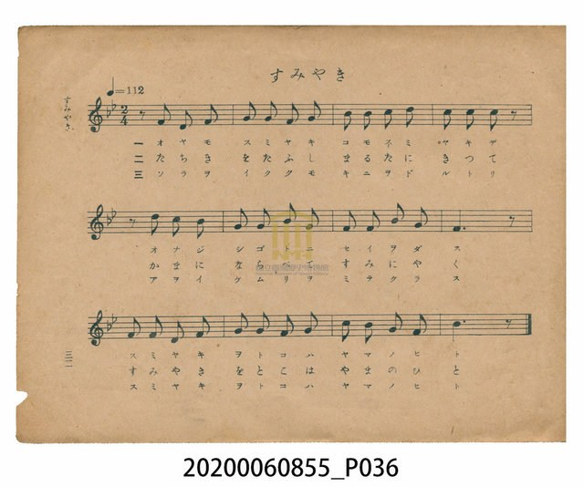
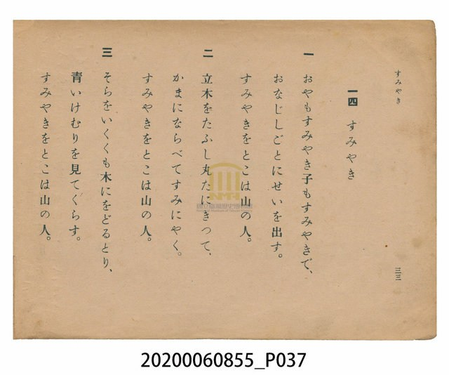

# すみやき（燒炭）

> Re:Shōka 使用 AI 協助辨識與重建樂譜，可能會有錯誤。歡迎[回報](https://github.com/TMDLang/reshoka/issues)。

- **鋼琴伴奏版**：<br><audio controls src="sumiyaki.mp3"></audio>
- **NEUTRINO 歌聲合成版**：<br><audio controls src="sumiyaki_neutrino.mp3"></audio>

- 日治時期公學校唱歌（第三學年・第十四課）
- 國立臺灣歷史博物館典藏

## 說明


- 出處：臺灣總督府編《公學校唱歌》第三學年用，第十四課〈すみやき〉（燒炭），原書第 32–33 頁。
- 調性與拍號：變ロ調（Bb 大調），2/4 拍，速度 != 112。
- 背景與曲風：描寫深山裡的燒炭職人（すみやきをとこ）父子世代相傳、伐木截成圓木、排入炭窯燒炭，
伴著天上流雲、林間飛鳥與裊裊青煙度日的山林生活。旋律極具特色：第一、二行皆以「前半拍八分休止符」
弱起進入（`| 0 5_ 3_ 5_ |`、`| 0 3 2 1 |`），宛如山谷回音與揮斧伐木的呼吸律動；第三行副歌
「すみやきをとこは山の人」則轉為正拍強起，質樸而堅定。
- 版本說明：本檔案為原書單聲部簡譜（數字譜）之忠實數位化版本。

### 編曲說明（鋼琴伴奏版）：

1. 前奏 (Intro, 4 小節)：引用第三樂句正拍強起的「すみやきをとこは山の人」五聲音階主題，確立山林民謠風格。
2. 主歌伴奏 (Sumiyaki, 12 小節 × 3 段)：當右手 (PianoRH) 在第一、二行第 1 小節以後半拍弱起進入時，
左手 (PianoLH) 先一步在正拍敲響低音 `1_`，給予歌者清晰的拍點引導與穩健支撐。


## 歌詞

```text
一　おやもすみやき子もすみやきで、
おなじしごとにせいを出す。
すみやきをとこは山の人。

二　立木をたふし丸たにきつて、
かまにならべてすみにやく。
すみやきをとこは山の人。

三　そらをいくくも木にをどるとり、
青いけむりを見てくらす。
すみやきをとこは山の人。
```

## ABC

<div class="abc-score" data-abc-src="sumiyaki.abc" aria-label="五線譜載入中"></div>

[下載 ABC 原始檔](sumiyaki.abc)

## TMD 檔案連結

- [主旋律 TMD 檔案](sumiyaki.tmd) [[在 TMD Studio 編輯](https://tmdlang.github.io/Tmd-TS/#tmd=s7IKdvYPcrWy4qpTUCpJTLdSSM7PyUlNLsnMz7PKzk9PzM7Ojy_OyM9OVIKrKMvPKc1NtUovSkxJjTdGiBfnlxYlp1oVJ2fk5-fEl6RWlCTl52cj5AuK8stS8xLzgGoKijLzSlJTwIoQClLLMlNSQdKpKZkl-UWZiTlIlqYWFYPcBLEkvqQoMa84uSizAORQhKqSjFSgy8rzi5CsBRqUnplnVZKYWZ6YF5-flpaZjGJyflFJRj7QMwUZlVYZmcUgi5MTc-KzE_OQ_Ay1tiAxPdUqwMDYTIlLS0vhcePMx437Hze1PG7sfb-n43n7pOdNa9_v6VTQ0uJStFUwNDTisrdVcErisjHSN7EDmfVs-tJnm3Y_m9n0bM78p61rnq7d8WzBwqdTNj5b2wMyYM2aJzs6gYJPd2553LwbyH3a2_h09uwXqzYBTQU75umc7ueru1-073reuPjZ2u1P-zc97Z31vHPlyyUrnrbueDG9X4mLS19LwZZagEtBQeFxw4Rnszc9n73uxapVz2b0PW6YCBZt3v20fdeLmVPf75kFcc_zHXufz138dNec59tXPG7oQvPf44ZuZP89n7Li_Z4eZC8-buhADtDHDZ3IYQpU_LRv_rPZO4BaFIyNHjVMNjZWeLmg8XFDE9Q1L1btf9aw_EVH-7Pu3hcz54Octa7rcfNaoDjQIKckhadLloPZILOAEaIAVAdkvWyY_3TXMgVIfCGZ1tzzbOZ6kGmzN71cBHTrrGf9_U_Xr362fePTjRtfLF74fFYLxHEvGrc_2bULaAWK65smPW5c8bhxMtC65x3bnq6d8GTHtCe7Fz-fveNp0-bHDY1P9kx4NmfFs45VzzomPJ0zGcgGCj7rm_S0dSnQzOer1sN83gNykILCkz1bXkyc_nTJyic7up5tbXw5Gxhejc_mTX85bfLLxbNfbl4KdOqLxV1A9HLupOetM4F-AiY2oCOBrgUqez5l_rMtu4Heeza9--m-7mdLtz5t3f68c-eLTmDSmgWOmAaQq3b1vFjY83xW25PdSx839Dzt7H3a2wUMp6etq592tD3ZM_HZ2kXP1yx73NALcdXTPRtfbN3-smET0NnAEEioUTBQMI1XMI4HkTUJQBPBQsYKRgqGQD40HtfNfrqsCRSKG7Y_nT3v5fzNoGDuX_ds2nJIqIBcPXHP0wk7gC592g1MYLMhKQfotKed64FpCWI50IFYg_xx43qg4Y8b1wGjBejSp53tL_Z2Pm_a9WztYpBX9mwHOhnojBebVz1bseMF0JcLWp-um4WI-uedHc_mrIEkdlC8z1nzbNWUZws7gEZAkuDTaeteNG562bzi-YaFL9bOAXr82dQdT9dOB7M7n-zsfrp_wdP1y4CCT_b2Pu2ZBjEQZAE0O0GMAXrkxcp5T1tXPJvWDgyBJzvWghir5r1Yux6Yx4CmPt3Q-6y9UyEzF1jqGOllFaSmK-grAEsfc6AtYKPAkdbwuLELFAJNTcihAUxxaCKPG5cD4wPsAqCGxlWPG2c8bpz-uHEKONRWP26c_bgRaMokYK4GaYMGB-EABqsDuhbiclBq6tj2Yhkw8KBJGJw5ep6uXQnKBDvno4m_bN4LDFdQ0p7Q82zFYlDUb1_6ZO-cF5sXP-2a_axz8rNuUNRAtDzbswhoCNAEeBaEuAAeHruAxUwDsIAEZSeQa-c_btwK9OSTHTvAbKAngcGw5HEjMAVDQ6L7ceM-sMSqx02djxt3guQgfgYKgrzdT0lILOh9sqMbmP2g2Ruc24GR9mzdViCCZHtgGDybuuXl3i5Q5u-Y_hSY_MH5H-S_9klA9aAM0bSW-DDY0QlOE3NB_gG5E-wHIGoCVjrgiAYJrnzcBPQ5MJC6oCEBLDXASic-bmoAiTZNerEMqAIYGECdwIChJEFAyq7nK3cBk_jLxS0vG_uAroYUYqCcDy7EXmzf_GJXL1AcUpqBQgVYVwLRnNlAvZCS7WlvOzDrgtQgFXFEBQzQQZTXhVCgoKXPxRVcmptZmZidaRWQmZiX71BjUFMNLpRsLLTswAxslbACpJwFFmMKGiYKTzf0P1_foAPJ3ki520wTi06gnSBTUctXBbN4EAIygWQNsIQ1BJazxkCWERgaKNSANfkYgrQ9bloFLNyWAPEioIrHTTuBrPkQkaa1YJHNYDmYDFAEKve4uR1hlhHYrEagzsaFQNwL1jkJKrIViKeDRBr3AUW7oaKrwSK9QAw0r3EZwixjiLv2Am1YCcSbwGaB7FwPwVCXglwANAso_7i5E-yu1UDcAcSrwGbhD29wjUZJeEMrL2hgG0LCGhjmQITg6AIhtvDuAtI7wL7YDsRboO7uBovshvgW7K8GaJygmAMNa1A4AsMTGo5AU5s6gTQwloBhCRKZCcT7wfLAbAkW6Uc1BxrOwLgF2QW0E2TXRiBvATgMoSEPTg1t0JBfieYeAmkaVDWTH8aQwMSeqEFhD-GCEjh6MGNJxuDgBAYyODn3w5Jx8zwg7gPiSWCRDoyAhgcjMAiRk_UKIJ4MxOvBIiA5UFSsA2JwoAHl0YOacjfVcnHp2inAihiwwUC-MhcA)]
- [鋼琴伴奏 TMD 檔案](sumiyaki_piano.tmd) [[在 TMD Studio 編輯](https://tmdlang.github.io/Tmd-TS/#tmd=s7IKdvYPcrWy4qpTUCpJTLdSSM7PyUlNLsnMz7PKzk9PzM7Ojy_OyM9OVIKrKMvPKc1NtTJGiBTnlxYlp-JSX1CUX5aal5gHVFGSmFmemBefDhQoyssvik9PzUstSsxBqE0ty0xJBaksKMrMTSyqjE_JTwZalleCZH1qUTHIdQWZiXn58YlFRYl56amoSvKLSjLy04sSCzIqrTIyi0vyizKTE3PisxPzkJxVkgHUZZWaUpqcCPItum_iCxLTU60CDIzNlLi0tBQeN8583Lj_cVPL48be93s6nrdPet609nHz7pfde55P2PJkz5anS_ufd3a839OpoKXFpWirYGhoxGVvq-CUxGVjpG9iBzL92fSlzzbtfjaz6dmc-U9b1zxdu-PZgoVPp2x8trYHZOSaNU92dAIFn-7cAjQYyH3a2_h09uwXqzYBTQU77-mc7ueru1-073reuPjZ2u1P-zc97Z31vHPlyyUrnrbueDG9X4mLS19LwZZagEtBQeFxw4Rnszc9n73uxapVz2b0PW6YCBZt3v20fdeLmVPf75kFcc_zHXufz138dNec59tXPG7oQvPf44ZuZP89n7Li_Z4eZC8-buhADuLHDZ3wUAb6Hqj4ad_8Z7N3ALUoGBs9aphsbKzwckHj44YmqGterNr_rGH5i472Z929L2bOBzlrXdfj5rVAcaBBTkkKT5csB7NBZgEjRAGoDsh62TD_6a5lCpD4QjKtuefZzPUg02ZverkI6NZZz_r7n65f_Wz7xqcbN0Kc9WTXrucd256unfBkz4Rnc4B-bnzauvT5qvVAxrM5s19MnP5y7qTnrTNBhmxtfAk0Z_Hsl5uXAm0DJoPns1qerdjxdP2yp93znnZPfT5l_rMtuxHWA4MQaDEkwIGux0xjQAeBlCooGOopPO3sBYoraHjmlRTl6yiYKDzd0P98fYMmUM3TPUCjV0AC_tmKpqf9S5-tXQz0-NM9219s3Q50xOOGHpRQb5r0uHHF48bJjxvXA_35uHEd0JOPG3qf7JryonHTy_mbX87qe7Jj98uFwPTa83zRLmBiBCp7Nm_6sw0TX6xZAAypZwv2QL2hoGCkpwBUDIx8iMsVNIJLczMrE7MzdRQMjaCuVDg8XcFY4dm6rSDnPp-67Wn_5med3QoaAaDMHeShqfB0DsT9DcBgfbKr58VCUKpRMIRqf7J76dN9PU97u8Ce2gj01MuGTcBoAOYxoAshzgCCp9uXIUz1AZna2gE08tnapUDjIUHybCrQf_uf7O0D-lIhwTA-AeTDrcue7OoAeuBFQ-uzHa3PZm4AxVt378vd84Ah-3RDHzBun69c-bRx6bMp659NmgDyOTTLQFIrSOvKeU9bVzyb1g5U-2THWhBj1bwXa4GpZCIwZp9u6H3W3qkALOrSU430sgpS0xX0FYBljjkwjsFGgT3e8LixCxRBTU3IkQVMeWgijxuXA0MJ7AKghsZVjxtnPG6c_rhxCjhSVz9unP24EWjKJGDOBWmDJjfC8Q9WB3QtxOWgiOrY9mIZMHGuh-cEUAZduxKUGXbORxN_2bz3edMuYH54OqHn2YrFwCB8un3pk71zXmxe_LRr9rPOyc-6ZwHtgGh5tmcR0BCgCUDrXyxeCFQMcQE8PHYBi5IGYLoD5TiQa-c_btwK9OSTHTvAbKAngcGw5HHjMnhIdD9u3AeWWPW4qfNx406QHMTPQEGQt_spCYkFvU92dINyALgEeNax6lnHBFDSWrcViJ7OmQwUB4bBs6lbXu7tetY36WnHdFCKbloLLChA_mufBFQPVAOqTIgOgx2d4DQxF-QfkDvBfgCiJmDFAo5okODKx01AnwMDqQsaEsDiCKx04uOmBpBo06QXy4AqgIEB1AkMGEoSBDCHAyP4-cpdwCT-cnHLy8Y-UE4BF3ug8m_e9JfTJr_YvvnFrl6gOKQgBIUKsD4EInBh-WJxFxA97W2HFEyQshNSWBIVMEAHUV7fQYGClj6F9SjIOSjlsqYVvGBW0IBWP5rgyASWYOAiFJ5lYBXDkmft7WAvIspeYFXxbOX8pxunvpzWTZmPwV4Eu8wKWtQ61BjUVINLTBsLLTswo0bBNB6EjMFkjYJZPAgBmUCyRsEIWApDuDVAli4QGijUcNWiGOuD3VjDeIVow1iQVhBVo2ACZJjEwoTB1kabQuSBFFw9CEPtoDh2IDUTMI8iqiVgHCHqJZRIgtRKwFIM0pgB6Z3e_XRfN6jUA1ctQKlnmzqBdcGLzauA8Qcq48AVO7zyo0JswZyJJ8KwhYoCpPoEVpwKGrAkqAOpcZAqHDNNLDqBtkLiywB3KjAEQiNgFQ5KDyAIih-QJh9DkLbHTauA7ZklQLwIqOJx004gaz5EpGktWGQzWA4mAxSByj1ubkeYZQQ2qxGos3EhEPeCdU6CimwF4ukgkcZ9QNFuqOhqsEgvEAPNa1yGMMsY4q69QBtWAvEmsFkgO9dDMNSlIBcAzQLKP27uBLtrNRB3APEqsFn4wxvcUKEkvI3B2QsW2OCMBsuNCA4sz6GHdxeQ3gH2xXYg3gJ1dzdYZDfEt2B_NUDjBMUcaFiDwhEYntBwBJra1AmkgbEEDEuQyEwg3g-WB9YUYJF-VHOg4QyMW5BdQDtBdm0E8haAwxAa8uDU0AYN-ZVo7iGQpjspCmPSizZYMGNJxuDgBAYyODn3w5Jx8zwg7gPiSWCRDoyAhgcjMAiRk_UKIJ4MxOvBIiA5UFSsA2JwoAHl0YOacjcBC1XUEgZr2U1sCYM36AkV_1AGMAaizXJR6wOSsx45DoFSFDoELX1SFCKEK0RdOwVwvQs2EMiBxWW0j2EsppgRFjFjuJgyFwA)]

## 分析

```text
================================================================================
📊 TMD Song Profile: [ すみやき（燒炭） ]
================================================================================
⏱  Duration:       0:12 (12.9s), 12 measures total
🎼 Key & Tempo:    首調基準 B,, != 112.0 BPM, <2/4>
   - 分析範圍：      由實際發聲的音符與和弦推測調性；播放脈絡另行呈現
🎤 人聲音域:    D4 (MIDI 62) – D5 (MIDI 74) [跨度: 12 個半音 / 1.0 個八度, 難度: easy]
   - 最低音:  D4 in [Sumiyaki #1 @ m.1, 0:00]
   - 最高音: D5 in [Sumiyaki #1 @ m.3, 0:02]
   - 適合: soprano, mezzo-soprano, contralto, tenor, baritone, bass
🏛  結構:      Sumiyaki (12.9s)
⚡ 編曲密度:        Peak 1 軌道同時演奏
🗝  調性診斷：       F 調性不明確（純淨自然大調，未偵測到可信轉調）
   - 風格氣質:    純淨自然大調（陽光明朗、易唱易記，無明顯調外色彩）
   - 轉調歷程:    全曲維持單一推測調性（未偵測到可信轉調）
   - 核心骨幹音:  F, G, A#, C, D
   - 調性數值:    F 調性不明確 [相關度: 0.75, 穩定度: Ambiguous, 自然音純度: 100.0%]
   - 候選調性 (K-S): F 大調 (0.75), A# 大調 (0.75), G 小調 (0.64)
   - 五度圈歷程:   -1
   - 各段落調性細節:
     • [Sumiyaki #1]: F 調性不明確 (r: 0.75, 自然音純度: 100.0%)

  [ 五度圈游移軌跡 ]
               C  
        [F ]*          G  
      Bb               D  
      Eb               A  
         Ab           E  
            Db       B  
               F# 
     (* = active key center)

  [ 十二半音累積音高分佈 ]
     C  : ███████████               14.0%
     C# :                            0.0%
     D  : ███████                    9.3%
     D# :                            0.0%
     E  :                            0.0%
     F  : ████████████████████████  30.2%
     F# :                            0.0%
     G  : ████████████████████      25.6%
     G# :                            0.0%
     A  :                            0.0%
     A# : █████████████████         20.9%
     B  :                            0.0%
--------------------------------------------------------------------------------
Assignment 軌道音域：
  - Piano         : D4 – D5 (12 個半音 / 1.0 個八度, 39 個音符)
================================================================================
```


## 原書掃描頁






